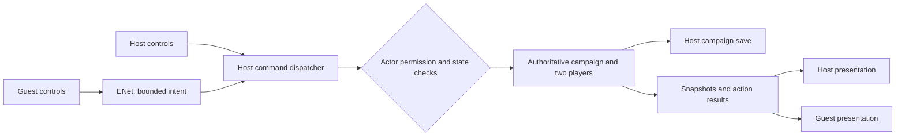

# Mouse Frontier: two-player local co-op implementation plan

Status: implementation in progress. See the latest entry in section 14 for current code and verification; earlier entries record historical milestones. The complete co-op release is not yet implemented.
Audit date: October 11, 2026.

Current focus: finish guest presentation/input parity and memory validation, then regenerate matching packages and complete P9/P10 platform acceptance. Two-player command authority, independent movement, host-owned story/save progression, ordinary assistance, tactical and roaming combat, Last Stand, train ambush, independent shooting ranges, discovery and reconnect are implemented with bounded automated/native evidence recorded below. Current development adds guest device settings, remapped controls, read-only maps/journal and checked shared poses on schema44/protocol29. Mobile build30 installed on the phone remains schema44/protocol28; its physical LAN checks passed to a limited scope, but Android LOW_MEMORY interrupted a longer transition. The complete release remains unfinished; current-source gates, memory stability, exact newer packages, remaining physical topology/controller/soak checks and clean release provenance are required.

Host authored conversations use `conversation.begin`, `conversation.choose` and `conversation.end` transactions. Guests receive approved read-along prompts and responses without story-choice controls; admitted participants receive the existing conversation XP once. Host quest offers, acceptance/decline and passenger recruitment use saved command transactions, while guests can help with accepted work using their own packs. Host adventure events persist their prompt, deterministic choice and explicit continuation through `event.begin`, `event.choose` and `event.continue`, with passive guest presentation and restore. Finale choices use `finale.choose`; ordinary/boss stop rolls use `encounter.roll` and stable saved encounter identities. Ordinary/boss tactical construction, actions, AI and settlement now run through `battle.*` commands and the saved host RNG. The companion uses their own character, health, level, equipment, ammunition, durability, proficiency, medicines, potions and ability; host-only entry, retreat and continuation remain enforced. Ordinary and expedition battles have native guest evidence; boss model/reload coverage does not yet prove every boss adventure. Passenger drop-off is already part of `travel.arrive`. See the latest October 12 combat checkpoint at the end of section 14 for verification and remaining boundaries.

## 1. Confirmed product contract

The host opens their Mouse Frontier save and a friend joins as a capable companion. Use the same networking technology and authority model as The Picture Shop's Local Play. The host owns the campaign, story decisions, scene progression, and save; the guest helps play the adventure the host has opened.

Confirmed by the user in this planning session:

- First release: **two players total**, one host and one guest.
- **Local network first.** Internet connections are a later project.
- The guest should have broad gameplay capabilities, not merely a visible avatar.
- **The host decides when the story and major scenes progress.** Leaving the train and traveling to the next stop are explicit examples. Important choices belong to the host because this is the host's playthrough.
- Mouse Frontier test saves may be wiped if testing requires it. No saves were read, modified, wiped, or backed up during this source audit. This does not authorize wiping The Picture Shop saves.

The rules below implement that distinction: **gameplay assistance is shared; campaign direction is host-controlled.** A server accepting guest input does not, by itself, satisfy this requirement. Progression commands must be forbidden to guest actors inside the authority layer, even if a guest bypasses the UI.

### Proposed defaults for details not explicitly specified

These are implementation assumptions, not additional user approvals:

- Each player has a separate character, backpack, equipment, ammunition, weapon condition, health, and character progression. The host saves both character records in the campaign.
- Train supplies, scrap, storage, decorations, map discovery, quests, goodwill, relationships, and story outcomes belong to the shared campaign.
- Both players occupy the same host-selected major scene. They move and use menus independently inside it. Train-car navigation is personal movement within the train; getting off the train is a host-controlled party transition.
- The host selects departures, returns, house/interior transitions, expedition/caravan area transitions, quest scenes, battle entry, event continuation, retreats/retries, and the ending. Guests may indicate interest or request a transition, but a request has no progression effect.
- The guest may carry out and turn in routine objectives of an already accepted quest when this only grants its established reward. A hand-in that also chooses a branch, starts a scene, or commits a major outcome waits for the host.
- Guests may spend shared resources on ordinary allowed gameplay, including supplies, repairs, crafting, and unlocked train upgrades. The host can see the result. Purchasing an upgrade must not implicitly depart, start an event, or advance a story milestone.
- Only one companion is enrolled in a campaign initially. Rejoining resumes that companion. Replacing it is an explicit host management operation; ordinary joins never silently replace it.
- No guest import/export of an existing solo inventory, no campaign copying to the guest, no PvP, no automatic host migration, and no background Android hosting promise in the first release.

## 2. What the source audit established

Both repositories were clean when inspected. The reference points are:

- Mouse Frontier: `bcd24af2317031c65382e08468b3aff26d11d341`.
- The Picture Shop: `33a1f4de9e5f6a7cc589d5dcefe69ae13749aea4`.
- Reference repository: `C:/Users/johnw/OneDrive/Documents/ChatGPT/The Picture Shop`.

Recheck these revisions before implementation. Existing documentation is useful background, but current code determines what can actually be reused.

### The Picture Shop's actual technology

| Evidence in The Picture Shop | Observed implementation | Application to Mouse Frontier |
| --- | --- | --- |
| `src/net/transport_enet.lua`, `src/net/address.lua` | LÖVE `require("enet")`; host/client ENet endpoints; nonblocking service; reliable and unreliable sends; default UDP port 22122 | Reuse/adapt the transport and address validation with Mouse Frontier configuration |
| `src/net/protocol/context.lua` | Current wire version **36**, four players, three channels, 1,200-byte ordinary packet ceiling, 512 KiB shop snapshot ceiling | Create a separate Mouse Frontier protocol, two-player limit, and measured snapshot limits; do not copy the shop message schema |
| `src/net/session/context.lua` | 20 Hz input; 12 Hz snapshots; .35-second stale-input timeout; correction/interpolation constants | Initial tuning reference for movement, not evidence that those rates suit every Mouse Frontier combat mode |
| `src/net/codec.lua` | Bounded, data-only codec; rejects unsupported values, mixed table shapes, invalid numbers, and excess depth/size | Adapt this codec; never send executable Lua save text |
| `src/net/session/*`, `src/runtime/multiplayer_update.lua` | Host simulation, peer-bound identities, guest intent, correlated results, revisions, authoritative snapshots | Adapt lifecycle patterns; replace shop-specific command execution |
| `src/workshop_authority.lua` | Exclusive expiring resource leases, request deduplication, revisions, cleanup callbacks | Extract a small generic authority model for NPC sessions, workbenches, and movable furniture; remove machine-specific dependencies |
| `src/multiplayer_capabilities.lua` | Explicit interaction capability registry; some features remain candidates awaiting physical acceptance | Build a Mouse Frontier registry covering interaction, menu, combat, and progression commands; track implemented versus device-verified separately |
| `src/net/lan_discovery.lua`, `interface_addresses.lua` | LuaSocket UDP discovery, bounded queries/results, interface detection, manual fallback; `TPSLAN1` identity on port 22123 | Adapt with a distinct game identity and ports; discovery is optional and never admits a player by itself |
| `src/net/lan_reconnect.lua` | Six bounded retry delays: 0, 1, 2, 4, 8, 8 seconds; fresh session per attempt | Reuse scheduling; add persistent companion identity without restoring old leases or replaying uncertain commands |
| `src/runtime/lan_startup.lua`, `lifecycle.lua`, `simulation.lua`, `src/net/focus_grace.lua` | Writable host-save preflight, display-awake handling, neutral input on focus loss, current 120-second focus-grace policy | Adapt deliberately and validate on Mouse Frontier devices |
| `src/tests/multiplayer_*`, `src/tests/support/network_impairment_harness.lua` | Fake transport, loss/reordering/duplication, contention, disconnect, and soak tests | Port testing patterns into Mouse Frontier's Lua/Python test arrangement |

The older `docs/lan_multiplayer_slice.md` describes protocol 16 and immediate Android focus-loss shutdown. Current code is protocol 36 with focus grace. Do not present the older document's physical tests as verification of current code or of Mouse Frontier. The Picture Shop's Direct internet stack is separate and is outside this implementation.

### Mouse Frontier's integration obstacles

| Current source | Finding | Required change |
| --- | --- | --- |
| [game_session.lua](../../game/game_session.lua), [runtime_state.lua](../../game/runtime_state.lua) | One player, one save record, one scene; scene changes write directly into the save | Introduce two actor records, explicit party scene state, and local presentation state |
| [session_bootstrap.lua](../../game/session_bootstrap.lua), [save_schema.lua](../../game/save_schema.lua) | Save version 37 mixes world, personal character, position, and preferences | Add a migration and explicit ownership of each field |
| [application_composition.lua](../../game/application_composition.lua), [gameplay_update.lua](../../game/gameplay_update.lua) | Simulation is tied to local input and screens; Last Stand/ambush and modal paths return early | Service networking and host simulation independently of local UI routing |
| [world_pause.lua](../../game/world_pause.lua) | Inventory, map, trade, dialogue, maintenance, and other local menus pause the world | Separate a player's input capture from an intentional host-owned party pause |
| [inventory_actions.lua](../../game/inventory_actions.lua), [gameplay_input.lua](../../game/gameplay_input.lua), [screen_ui.lua](../../game/screen_ui.lua) | Actions and UI handlers can mutate shared save state directly | Route mutations through actor-aware commands; audit all entry points, including touch/controller and wrapper tools |
| [world_scene.lua](../../game/world_scene.lua), [train_car_runtime.lua](../../game/train_car_runtime.lua), [expedition_runtime.lua](../../game/expedition_runtime.lua) | Scene operations relocate one actor and keep local transient activity state | Host-controlled transitions move both actors safely; authoritative scene systems operate on both |
| [battle_controller.lua](../../game/battle_controller.lua), [battle_runtime.lua](../../game/battle_runtime.lua) | Hard-coded `id="player"`; character costs and rewards target one save record | Add player/unit ownership and separate resource/progression accounting |
| [last_stand_shootout.lua](../../game/last_stand_shootout.lua), [train_ambush.lua](../../game/train_ambush.lua), [shooting_range.lua](../../game/shooting_range.lua) | Separate first-person simulations with local aim, timers, ammo, and damage | Separate shared encounter authority from each shooter's presentation and weapon state |
| [npc_conversations.lua](../../game/npc_conversations.lua) | Persistent one-time conversations; validation depends on global `currentNPC` | Use stable NPC/session IDs, preserve one-time results, and enforce host-only story answers |
| [save.lua](../../game/save.lua), [persistence_runtime.lua](../../game/persistence_runtime.lua) | Lua-file local saves; debounced writes; focus/quit scheduling | Host-only campaign writes; dedicated data-only network snapshots; distinguish accepted state from disk-confirmed state |
| [world_renderer.lua](../../game/world_renderer.lua), [asset_streamer.lua](../../game/asset_streamer.lua) | Player draw/asset retention centered on one character | Render both actors with existing art; retain the guest's visible animation assets |
| [mobile Android manifest](../../mobile/android/AndroidManifest.xml) | Explicitly removes `android.permission.INTERNET` | Add network permission and inspect the final merged APK manifest |

The project already has useful composition boundaries and real Lua behavioral tests. Preserve those boundaries rather than adding networking branches throughout `main.lua`.

## 3. Authority, ownership, and command design



### One execution path

Offline play and the local host invoke the same gameplay command handlers that remote intents invoke. A guest submits an intent; it never submits the resulting inventory, damage, reward, story state, or scene. The host supplies actor identity from the admitted network peer.

Suggested command context:

`{ campaign, actorId, actor, scene, encounter, authority, random, effects }`

Do not temporarily replace `runtime.player`, `runtime.saveData`, or `currentNPC` to execute the guest's action. That would let nested callbacks, saves, or delayed work charge the wrong player. Domain operations must accept explicit campaign and character contexts. Read-only presentation projections can ease migration, but writable aliases to two different authoritative records are forbidden.

### Explicit permission categories

Every command declares one of these policies:

- `personal`: the actor's own gear, movement, aiming, or menu-associated gameplay.
- `shared_assistance`: allowed guest help that mutates shared resources or already authorized objectives.
- `host_progression`: scene transitions, departures, branching choices, quest acceptance/rejection, event continuation, retreat/retry, finale.
- `host_admin`: save selection/reset, hosting, enrollment/replacement, disconnecting a guest, ending the session, development cheats.
- `local_presentation`: camera, zoom, UI selection, accessibility, input preferences; no gameplay mutation.

Progression authorization checks the executing actor's role, not whether code happens to run on the server. A guest calling a normal interaction that would indirectly advance a scene must be rejected or produce a non-mutating request for the host. Domain callbacks cannot bypass this check.

The capability registry must cover all command-producing surfaces, not just `interaction_router.lua`: inventory, merchant panels, train upgrades, dialogue, event UI, combat, shooting, maintenance, first aid, outfit crafting, player tools, and keyboard/touch/controller shortcuts.

### Validation and transactions

For each mutation, validate game/protocol identity, session epoch, admitted actor, command ID, payload shape, capability, current scene epoch, target existence, proximity, ownership, resource revision, cost, cooldown, and activity state as applicable. Clients send stable target IDs and bounded semantic choices, never file paths or arbitrary function names.

Command results include the request ID, accepted/rejected status, reason, committed campaign revision, and affected record revisions. A successful request changes all relevant records together. Reusing an ID with a different payload is rejected; replaying the same accepted request returns its recorded outcome without charging again.

Use atomic transfer transactions for chests/trade/loot; allow both people to inspect a container. Use exclusive leases only for activities that need them: an NPC conversation, a repair/workbench task, a first-aid patient, a furniture edit, or a firing position. The host obeys the same activity ownership rules. A host scene transition can close leases through their defined cleanup path.

Revision conflicts refresh the panel and explain the result in neutral UI text. Do not automatically retry a purchase or story action with a new request ID.

## 4. Guest capability and progression matrix

This is the release target. No category may disappear into a generic “guest unsupported” fallback.

| System | Guest can do | Host-controlled boundary / acceptance condition |
| --- | --- | --- |
| Movement and camera | Walk, sprint, face, pose, zoom, use own camera and controls | Independent movement in the active party scene; valid collision and matching remote animation |
| Train interior | Walk between owned cars, use storage/mailbox/radio, add coal | Leaving the train, returning the party, and next-stop travel require the host |
| Stops, houses, caravan camps, expeditions | Explore the open scene, inspect, loot, interact with available objects | Doors/area exits that change the party scene wait for host initiation/approval; guest never drags host into another scene |
| Personal inventory | Rearrange, equip, consume, drop, pick up, use backpack/wearables, change weapons | Cannot mutate host inventory; transfer through explicit shared storage/drop transactions |
| Shared containers and loot | Deposit/withdraw, collect mailbox rewards, open unlocked caches | Contested final item can be claimed once; gated story objects cannot bypass progression policy |
| Merchant trade | Buy/sell, inspect prices and stock, use shared scrap | Host validates current stock, budgets, funds, delivery capacity; no arbitrary client prices |
| Crafting and repairs | Craft outfits, repair own weapons, help at unlocked workbenches, perform maintenance | Host validates steps, timing, costs, and completion; no guest-supplied success score |
| Train upgrades/decorations | Buy already unlocked upgrades, place/move/rotate/scale/collect valid furniture | No story unlocks/departures from purchases; leases and placement validation prevent collisions/duplication |
| Ordinary NPC interaction | Approved regular chatter, gifts, eligible trade, first aid | Guest talk does not consume or choose an authored story conversation |
| Branching/authored conversations | Read along with the host's live conversation | Host chooses every story answer; assignments/completion/rewards occur once per campaign; verbatim approved text |
| Quests/passengers | View objectives, deliver accepted cargo, help patients, collect accepted quest items, give equipment | Accept/decline, passenger recruitment/dismissal, branch choices, and story hand-ins belong to host |
| Events and family story | View the event and help with already opened objectives | Host selects options and advances the event/family sequence |
| Roaming combat | Attack, defend, use own items and abilities inside a host-opened encounter area | Guest cannot independently force a new tactical scene; escalation requiring transition waits for host |
| Tactical battles | Control own unit, move, attack, heal, guard, use abilities/items; optionally control assigned NPC allies | Host starts/continues/retreats; turn ownership enforced for everyone; victory is resolved by host simulation |
| Last Stand | Help wounded defenders; occupy an available firing position; aim/fire/reload/cover with own weapon state | Host accepts quest, advances stages, starts/retries/withdraws defense, and confirms aftermath |
| Train ambush | Independently aim/fire/reload/cover and damage the shared convoy | Host authorizes event progression and withdraw/retry; one shared convoy and reward |
| Shooting range | Use an available lane/session, select legal gear, aim/fire/reload; buy ammo | Host opens/closes a party-level range scene; independent lane sessions cannot change campaign scene |
| Travel | Inspect route/cost and send a departure request | Only host commits cost, departure, arrival, random event roll, and next-stop unlock |
| Ending | View shared result | Only host chooses and commits the finale |
| Settings | Own accessibility, sound volume, input bindings, camera | Local preferences do not overwrite the host's preferences or affect simulation speed |
| Session and debug tools | View roster/connection, leave/reconnect | Host saves/resets/manages campaign and guest; cheats never become guest network commands |

Distinguish a story completion from its presentation: combat damage and eligible objective progress can settle automatically on the host, while “continue to the next scene” remains a separate host action. Do not make the guest wait for host approval for every shot, inventory click, or routine helpful action.

## 5. Campaign, character, and save model

### Ownership map

Proposed authoritative shape:

```text
campaign
  id, schemaVersion, revision, nextEntityId
  world: location, visitedStops, generated layouts, loot, train, shared resources
  story: choices, events, family/finale, quests, conversations, relationships
  partyScene: sceneId, sceneEpoch, phase, transition, encounterId
  players[hostId | companionId]: persistent character records
  enrollment: companion identity and reconnect binding
  receipts: bounded critical transaction/reward outcomes

session (transient, host-owned)
  sessionEpoch, peer-to-player mapping, input acknowledgements
  leases, pending requests, rate limits, simulation tick

local presentation (per device)
  localPlayerId, camera, panel state, selected slots, predicted movement
  animation/audio instances, touch state, preferences, connection UI
```

This is a conceptual ownership model, not a requirement to rename every existing world field immediately. Keep established campaign field names where useful. Add `players` and party-scene ownership explicitly; migrate personal accesses instead of maintaining two competing copies.

Personal fields include `character`, trait, `health`, `maxHealth`, `stats`, `inventory`, `inventoryCapacity`, backpack/wearables, equipment, ammo, weapon durability/proficiency, temporary combat effects, position/facing, and current train car. Shared fields include resources/scrap, owned cars/engine/maintenance, dropped items/containers, layouts, encounter results, quests/passengers, goodwill, relationships, family clues, authored-conversation state, and finale. Audit every field before finalizing migration.

### Migration and persistence rules

1. Use the next available save version (currently 38 would follow 37; recheck at implementation).
2. Migrate the original personal fields into the host record exactly once. Preserve the original journey, one-time completions, and world items. Migration is idempotent and validates both characters.
3. Add stable IDs to world objects, containers, NPC instances, quest sessions, encounter units, and transferable equipment records where instance state matters. Array positions and NPC artwork filenames are not durable identities. Define how weapon condition moves with a transferred weapon; do not accidentally repair it or use the other player's name-keyed condition.
4. Create the companion once on host enrollment, with an allowed character and bounded starter kit. Proposed catch-up: initialize its XP to the host's current XP once; retain independent XP thereafter. Do not copy the host's possessions or award a new kit on reconnect.
5. Persist companion inventory, health, progression, and equipment even when the host resumes solo. Park the absent companion safely; its backpack is not silently merged into host inventory or awarded to another friend.
6. Reconnect credentials bind to campaign and companion, not display name or IP. Store only the necessary local connection metadata on the guest; never a writable replica of the host campaign. Lost credentials require a host-confirmed rebind. Credential generation/storage must be validated on the packaged runtime; a display name is never sufficient proof of ownership.
7. Checkpoint both players with campaign changes. Host `focus`, `quit`, autosave, manual saves, and special activity saves share the same authority gate. Joining guests must never pass the campaign through a load path that schedules local migration writes.
8. Critical one-time actions persist their completion marker and reward/cost together. Character XP grants use a recipient ledger. Proposed XP rule: eligible participating characters receive the existing XP amount once; shared item/currency rewards are granted once total. Offline companion XP does not accrue automatically.
9. Keep session deduplication separate from durable completion receipts. After a host crash, recover the last validated checkpoint under a new session epoch. Reconnect does not replay commands from the lost session. Never claim cross-crash exactly-once durability solely because ENet is reliable.
10. For disk-critical commits (enrollment, story decisions, one-time rewards, travel checkpoints), use a checked persistence operation and publish a durable success only after the write is confirmed. On write failure, keep an explicit unsaved/error state and block further dependent progression; ordinary debounced movement saving can remain separate.

Preserve the existing save engine's recovery contract. This plan does not initiate an extra backup operation. The approved disposable-save choice is for task testing and is not a reason to delete unrelated saves/backups or skip migration correctness.

## 6. Connection, protocol, and replication

### Connection lifecycle

Offline -> host save validation/write preflight -> host listening -> guest hello -> compatible build/content check -> host enrollment approval when needed -> welcome -> bounded baseline transfer -> baseline acknowledged -> guest ready -> normal play -> disconnect/reconnect/host end.

No guest gameplay executes before baseline acknowledgement. The hello identifies `mouse-frontier`, protocol version, content/build compatibility, display name, allowed character selection, and optional reconnect identity. Start Mouse Frontier's wire protocol independently at version 1; Picture Shop version 36 has no compatibility meaning here.

Use new configurable defaults, proposed UDP **22124** for gameplay and **22125** for discovery, with a distinct discovery prefix such as `MFLAN1`. This avoids copying Picture Shop's game identity/ports. Verify binding on target devices and report occupied/unavailable ports rather than silently changing them. Manual IPv4/hostname entry remains available when discovery fails.

The two-player limit applies to ready players and bounded pending admission. A second guest gets a clear “session full” result without replacing the current companion. Loading an unrelated game, malformed packets, incompatible content, or an incomplete baseline must not alter the host save.

### Transport lanes and budgets

| Lane | Delivery | Contents |
| --- | --- | --- |
| 0: control | Reliable | Handshake, admitted roster, semantic commands/results, activity leases, scene prepare/commit, story/event state, disconnect notices |
| 1: realtime | Unreliable sequenced by application | Movement inputs, acknowledged player poses, live enemies/projectiles/encounter presentation, held-control state |
| 2: durable state | Reliable | Initial baseline chunks, inventory/quest/world record updates, checkpoint revisions, resynchronization |

Initial tuning: 20 Hz movement input, 12 Hz ordinary snapshots, and a fixed 30 Hz host simulation with bounded catch-up. Profile real-time shooting before selecting its snapshot rate; allow 20–30 Hz small encounter updates if measurement requires them. These are proposed starting values, not measured performance promises.

Retain the 1,200-byte ceiling for realtime and ordinary commands. Chunk large baseline/state transfers separately; begin with at most 16 KiB per chunk, a measured total cap (initial ceiling 8 MiB), 32 nesting levels, and explicit record/count limits. Validate these against early-, late-, and maximum-fixture saves; never truncate a campaign silently. Throttle durable transfer so input/control remains responsive; bound queues, pending commands, retries, partial assembly memory, and transfer duration.

Define wire records rather than encoding the raw Lua save. Inventories have nil holes, some maps use numeric keys, and battle grids use zero-based columns; the reference codec rejects mixed/sparse array shapes. Send explicit slot records, keyed IDs, coordinates, and bounded strings. Images, Lua functions, userdata, caches, generated executable text, and local settings do not cross the connection.

Baseline assembly is all-or-nothing: snapshot ID, revision, part count, length, checksum, timeout, and acknowledgement. Buffer a bounded set of subsequent changes or restart from a fresh baseline if that buffer overflows. Never apply a new partial world while retaining old player records. Reject stale epochs and stale revisions. Because ENet channels are separate, explicitly reconcile command results, scene commits, and state deltas that arrive in different orders.

Replicate dirty domain records instead of serializing the entire 50-stop campaign every frame. Include a bounded periodic revision/digest check and targeted resync. A dropped realtime packet must be repaired by later full actor/entity state. Reliable spawn/despawn and scene commits prevent stale ghosts.

### Movement and rendering

- Host owns collision, speed, sprint allowance, scene membership, and final coordinates. Guest sends normalized controls and sequence numbers.
- Predict the guest's own movement locally using the same movement rules; reconcile from host input acknowledgements. Do not predict pickups, costs, rewards, story decisions, or teleports.
- Interpolate the other actor. Carry facing, movement/action state, and distance-based gait data needed by the existing `character_motion.lua` / `character_animation.lua` pipeline.
- Do not redesign art or generate replacement animation. Draw the guest with existing character assets, correct depth/shadows, a name marker, and personal held-item state. Include both players in asset-retention and package checks.
- On focus loss/input timeout, neutralize controls and release held firing so a lost key-up cannot keep walking or shooting. Scene epochs invalidate queued movement from before a transition.

## 7. Host progression and shared scenes

Use a `party_scene` coordinator as the only authority for major scene changes. Replace direct scene-changing callbacks with host-progression commands. Personal train-car viewing and camera changes remain actor-local.

Transition sequence:

1. Host requests a legal transition; server verifies scene, prerequisites, resources, encounter state, and host role.
2. Publish `scene_prepare` with target and new scene epoch. Stop accepting new conflicting mutations; resolve or safely cancel ongoing activities through their cleanup handlers.
3. Compute both spawn positions using the target's real walkmask/floor bounds. The guest does not inherit the host's exact occupied position or an old house/caravan return point.
4. Commit costs, world generation, quest effects, party location, and checkpoint once. Publish the authoritative transition and scene baseline.
5. Close stale panels, clear held input/prediction, load presentation, acknowledge readiness, and resume. A stalled guest times out into reconnect; it cannot veto host progression indefinitely.

The host can wait for a friend voluntarily, but guest consent is not required to make the host's story choice. Busy state is visible before a transition. Costs are never charged twice if a transition is retried or its reply is lost. The host's own UI has no privileged bypass around valid game prerequisites.

Once the host leaves the train, both players appear at the stop. Once the host enters a house, expedition, caravan area, or quest scene, both join that scene. Host return brings both back safely. This avoids accidentally implementing two independent campaigns or allowing the guest to open the next adventure alone.

Shared scene decisions do not imply shared menus. Either actor can manage their own inventory, trade, or use an unlocked station. Opening an ordinary menu only captures that actor's input; the other actor and the host simulation continue. Do not give menu invulnerability. A host-owned story/event modal or explicit party pause can pause gameplay for both while network servicing continues. Pause status must be visible to the guest.

## 8. Combat and activity conversion

### Tactical combat

Replace special cases for `id="player"` with stable unit IDs and `ownerPlayerId`. Build two player units from their individual stats/equipment and choose distinct legal spawn cells. Add NPC ally assignment explicitly (default host control; optional host assignment to guest). NPC ammo/gear needs a stated policy so adding the companion does not accidentally make every allied shot consume the host's ammunition.

Keep the existing turn-based model. Only the active unit's controller may move, attack, use an item/ability, or end its turn. Host simulation owns RNG, movement/line of sight, damage, conditions, ammo consumption, durability, turn advancement, AI, victory/loss, and rewards. Local target highlights and inspection remain local.

A guest victory-causing attack is normal allowed play. It settles battle results once on the host and opens the result view; the host decides when to continue out of that scene. Retreat, retry, and voluntary encounter entry are host progression commands. Reject stale encounter/turn IDs and commands for somebody else's unit.

If a guest disconnects during its turn, clear its input and leases, then apply a documented fallback after a short reconnect grace: host temporarily controls the companion unit until the encounter ends or reconnection is acknowledged at a turn boundary. Do not skip the battle, grant a reward, or create a second unit. A defeated companion remains defeated for that encounter under existing health/item rules; host decides retreat if needed. Reconnection cannot refill health/ammo.

### Roaming expedition combat

Refactor roaming-mob context from one `player` to eligible actors in the active party scene. Host owns aggro, pathing, windup/hit resolution, hazard/flood timers, gate state, chest claims, and reward flags. Validate a guest melee attack using host position and current weapon.

An action that would switch to a tactical encounter must go through the host progression coordinator. A guest challenge becomes a host-visible request. If an attack would implicitly cause that transition, stage the transition before applying the initiating attack; do not let the guest force it through a nested callback. Existing autonomous world threats remain host-simulated game rules, with encounter presentation coordinated by the host scene controller.

### First-person combat and ranges

Separate `first_person_shooting.lua` into authoritative weapon timing/ammo state and local authored-frame presentation without changing the approved weapon art. Each actor owns its aim, ADS, cover, reload, fire mode, weapon choice, and gun state. Shared encounter state owns enemies, convoy vehicles, timer/morale/integrity, objective progress, and reward flags.

Send bounded aim coordinates in a canonical gameplay viewport plus fire/reload/control intent and sequence/tick. Host computes hit testing using canonical target geometry; a phone's resolution or zoom must not change hit authority. Clients never submit damage, score, kill count, or successful reload completion. Document any bounded latency tolerance; do not accept arbitrary historical hits.

Last Stand's two front-window positions are a natural two-player arrangement, subject to verifying the actual window/target mappings. Give each position an occupancy lease and independent weapon state while one shared defense progresses. Both can perform authorized aid tasks. Train ambush gives both actors independent guns/cover against one convoy. Range targets/scores are scoped per lane or exclusive lane session; the guest must have a playable shooting role, not just a spectator screen.

Audit late join, disconnect, loss, retry, and persistence in each mode. First release may defer entry into a live encounter until its next safe boundary, with visible waiting state; it may not mark that feature fully accepted until joining/rejoining has a tested policy. Authored weapon frames, correct mechanisms, and the no-body-parts art rule continue to apply.

### Dialogue, quest activities, and timed work

Keep `authored_dialogue.lua` and approved regular `Catalog.dialogueLines` verbatim. Guests can trigger regular chatter but cannot consume a one-time story assignment. Host story sessions replicate the current authored text and selected result for read-along; only the host sends a branch-choice command. Completion and reward receipts persist per campaign, regardless of which player reconnects.

Player reply choices show only the supplied dialogue. Do not add reward, XP, cost, or outcome previews. Neutral status outside the choices may state that the host is choosing. If multiplayer requires new character speech, record the speaker/trigger/context/branches in `docs/DIALOGUE_REVIEW.md` and request the user's wording; do not ship invented speech.

First aid, maintenance, crafting, and repair accept semantic step/tool/target commands. The host owns sequence, elapsed time, material use, and result quality. Transfer existing UI rendering/hit targets onto a replicated activity view rather than building a reduced guest interface. Cancellation/disconnect returns to a valid existing checkpoint and cannot consume materials twice.

## 9. Reconnect, pause, failure, and platforms

- Guest disconnect: neutralize movement/fire, remove network presence, release leases, preserve the companion record and all committed actions. Cancel incomplete transient work according to the activity's policy.
- Rejoin: fresh transport and session admission, same authorized companion, fresh baseline, no old lease IDs. Clear uncertain pending UI actions. Recent durable receipts may explain a completed action, but the client does not automatically issue it again.
- Host ends session: flush a checked checkpoint, send an end reason, close transport/discovery, restore display sleep settings. Guest returns to the join screen. Host may continue solo without losing companion progress.
- Host crash/unreachable: guest stops submitting actions and offers bounded reconnect/cancel. Guest cannot continue mutating an unsavable replica. Host resumes the recovered campaign under a new epoch.
- Windows: test minimized/focus-lost behavior, firewall failure, occupied port, and clean restart. Opening a local menu must not stop network servicing.
- Android: add `INTERNET`; adopt `ACCESS_NETWORK_STATE` only with an actual connectivity use. Check ENet/LuaSocket availability in the final runtime and the merged manifest. Keep the screen awake while hosting and restore it on every exit/failure path.
- Proposed Android v1 policy: checkpoint and end hosting on background/suspend rather than promising unattended hosting. The Picture Shop's current focus-grace implementation is a reference to evaluate, not a requirement to copy blindly; a suspended process cannot be assumed to simulate. Guests backgrounding reconnect to the same character. Never fast-forward a long suspended frame into combat.
- iOS: the repository ships a `.love` archive for a third-party player, not a native app. Probe its ENet/LuaSocket and host-app local-network behavior before exposing co-op. Windows/Android are the initial acceptance targets; iOS co-op remains conditional on an actual device/runtime pass. Preserve offline iOS behavior.

LAN v1 adds no router mapping, relay, matchmaking, or Direct internet modules. It does not claim encrypted transport. Keep networking behind an adapter so a future internet project can add authentication/privacy/connectivity without rewriting gameplay authority.

## 10. Proposed file layout and integration boundaries

New paths below are planned, not present implementations.

| Planned module/group | Responsibility |
| --- | --- |
| `game/net/{address,codec,transport_enet,lan_discovery,lan_reconnect,protocol,session}.lua` | Adapted generic networking, Mouse Frontier schemas and session lifecycle |
| `game/coop_composition.lua` | Build validated co-op services through the existing composition/service registry |
| `game/coop_session.lua`, `game/coop_players.lua` | Mode, roles, peer/player binding, persistent companion enrollment, actor contexts |
| `game/coop_capabilities.lua`, `game/coop_commands.lua` | Complete permission registry, command routing/validation, result correlation |
| `game/coop_transactions.lua`, `game/coop_activity_authority.lua` | Multi-record commits, receipts, resource revisions, leases and cleanup |
| `game/coop_snapshot.lua`, `game/coop_replication.lua` | Explicit wire/save projections, baseline/delta application, bounded synchronization |
| `game/coop_movement.lua`, `game/coop_renderer.lua` | Shared movement integration, prediction/correction, second actor rendering |
| `game/coop_party_scene.lua` | Host-only scene/story transitions and synchronized arrival/departure |
| `game/coop_combat.lua` and focused domain adapters | Turn ownership, per-shooter state, encounter replication |
| `game/coop_ui.lua` | Host/join, discovery, roster, waiting/reconnect, host progression cues |
| `tools/tests/test_coop_*_behavior.py`, `tools/tests/lua/coop_*` | Real Lua behavior tests and deterministic transport harness |
| `tools/coop-smoke/`, `tools/run_coop_smoke.ps1` | Two-instance socket/UI smoke with isolated save identities |

Update existing domain modules at their service boundaries. Keep `main.lua` and `game/app.lua` as lifecycle adapters. Update `systems.lua`, `application_composition.lua`, and the registry validation for the new graph. In particular, network service must run before early returns for ordinary UI, Last Stand, train ambush, outfit workbench, or player tools. Those wrapper names contain “host” today but do not imply network host authority.

## 11. Dependency-ordered implementation backlog

Each phase ends with a reviewable implementation and behavioral gate. Do not declare co-op ready after the movement slice. Advance only when its dependencies and focused tests pass; leave unfinished capabilities explicit.

### P0 — Capture contracts and executable fixtures

- Recheck reference commits and current working changes; inventory direct gameplay writes and every command/scene-changing callback.
- Turn the matrix above into `coop_capabilities.lua`, with role, domain, targets, persistence policy, and acceptance status. Include nested progression side effects.
- Create isolated deterministic fixtures for a new campaign, an advanced campaign, pending conversation, full container, expedition, tactical battle, Last Stand, and ambush.
- Adapt Picture Shop fake transport/clock and impairment patterns to Lupa/LÖVE tests; no app installation is needed.
- **Gate:** tests enumerate every existing command surface; guest progression/admin actions are declared forbidden before networking is added.

### P1 — Split character ownership and migrate saves

- Implement actor records/context and next-version migration in `game_session`, `runtime_state`, `session_bootstrap`, `save_schema`, and persistence.
- Separate preferences and presentation; establish stable object/character IDs and equipment-transfer state.
- Convert personal reads/writes to explicit actor access, retaining offline behavior.
- **Gate:** legacy host loads unchanged, two inventories/health/ammo records remain independent, reload preserves companion and conversation completion, migration is idempotent.

### P2 — Establish the command authority in offline mode

- Route inventory, trade, costs, repair/crafting, train interactions, quests, events, and debug writes through semantic commands.
- Implement actor-role guards, revisions, transactions, and leases; host/offline uses the same dispatcher.
- Introduce `host_progression` at source operations as well as UI entry points.
- **Gate:** forged guest commands cannot leave the train, enter another scene, accept quests, choose story answers, travel, retreat/retry, or finish the campaign; allowed help still succeeds.

### P3 — Add LAN session and read-only baseline

- Adapt transport/codec/address modules; implement two-player admission, compatibility checks, bounded baseline, and client save-write prohibition.
- Add simple Host/Join/Leave UI with manual address entry and explicit unavailable-network errors.
- **Gate:** two isolated instances connect to the same campaign; wrong version/game, oversized data, extra guest, unfinished baseline, and host write failure fail cleanly.

### P4 — Independent movement and host-controlled scenes

- Refactor update order into input capture, network intake, host simulation, replication, and local presentation.
- Add second actor, collision/prediction/correction, renderer/asset retention, personal menus, and party scene coordinator.
- Wire all train/stop/house/caravan/expedition transitions through host commands.
- **Gate:** guest moves independently; opening guest inventory does not stop host; guest train exit does not progress anything; host exit/travel brings both to correct valid spawns exactly once.

### P5 — Complete ordinary guest assistance

- Connect inventory/storage/loot/mailbox, trade, resource use, gifts, equipment, first aid, maintenance, outfit crafting, weapon repair, unlocked upgrades, and decoration commands.
- Connect survey markers and nearby unlocked expedition caches through authored targets, host-known actor positions, read-only guest affordances and durable opening/survey receipts. Keep cache contents on the existing owned storage-transfer path, and area/boss entry under host progression.
- Reuse the full existing panels with replicated views/results, pending state, and busy/conflict explanations.
- **Gate:** race for last item, simultaneous purchases, same-patient/workbench contention, furniture editing, disconnect mid-task, and inventory overflow produce no duplication or loss.

### P6 — Preserve host story ownership end to end

- Convert authored conversations, quest offers, passengers, family/events/finale, travel costs, random generation, and arrival processing.
- Replicate host story views/read-along; distinguish routine accepted objective completion from branch commits.
- Test host progress while guest is in a panel/activity; safe cancellation must preserve completed work.
- **Gate:** guest can help complete host-accepted objectives, but only host choices progress the playthrough; one-time dialogue/rewards remain completed after reconnect and reload; all supplied text remains exact.

### P7 — Tactical and roaming combat

- Add two owned player units, optional NPC assignments, actor-specific resources, host RNG/AI, encounter/turn revisions, and result receipts.
- Refactor roaming aggro/hits/hazards for two players and gate scene escalation.
- Add disconnect turn fallback, safe rejoin, party loss, and host-only continue/retreat.
- **Gate:** both players complete a representative ordinary battle, boss battle, and expedition encounter; no wrong-player ammo/health charges, duplicate loot, or guest-triggered progression.

### P8 — First-person and special-scene parity

- Separate shared simulation from local guns/views in Last Stand, train ambush, and range.
- Add two positions/actor sessions, canonical aim/hit tests, reliable action outcomes, transient effects, and save-safe checkpoints.
- Verify all wrapper/early-return paths continue servicing the session.
- **Gate:** host and guest both fight, reload, use cover, change weapons, and perform allowed aid; host alone advances/retries/withdraws; simultaneous hits and reconnect do not duplicate kills/rewards or refill resources.

### P9 — Reconnect, discovery, lifecycle, packaging

- Add discovery/interface presentation/manual fallback, bounded retries, credential rebind flow, and persistent companion resume.
- Implement final focus/suspend policy, neutral inputs, lease cleanup, timeout UX, host exit, save-error reporting, and display-sleep restoration.
- Update Android manifest/build inspection and shared package contents; probe optional iOS support.
- **Gate:** same companion survives address changes/rejoin and host save reload; guest cannot impersonate host or replace companion; actual packages contain required networking and all gameplay modules.

### P10 — Full acceptance and release

- Run focused co-op suites, existing regression/validation gates, real sockets, and the physical matrix below.
- Update the capability registry with automated, socket, and physical evidence separately. Record exact source revision, package checksum, topology, and unresolved failures.
- Document host/join use, host progression ownership, save ownership, and tested disconnect behavior in project docs.
- **Gate:** every advertised assistance capability works on both host and guest, every progression restriction is enforced, and both characters/campaign reload correctly after an end-to-end adventure.

Highest-risk work is P1/P2's removal of implicit single-player state and P7/P8's combat conversion. ENet transport is the reusable portion, not the majority of the integration. Keep internet work out of this dependency chain.

## 12. Verification and definition of co-op ready

### Automated behavioral coverage

- Codec bounds, sparse-table DTO round trips, invalid numbers/strings/IDs, wrong channels/version/game, unauthorized peers, packet budgets, timeouts, bounded queues, and repeated open/close.
- Same command replay versus same ID/different payload; stale revisions; scene/turn/session epoch mismatch; result arriving before/after the matching state delta.
- Guest host-role spoof and every indirect progression path (door shortcut, dialogue callback, auto-hand-in, battle challenge, event button, controller/touch action).
- Client save-write tripwire across join/update/focus/quit/options and every special screen. Disk-failure tests distinguish in-memory acceptance from confirmed checkpoint.
- Simultaneous pickup/trade/crafting/repair, partial activity cleanup, shared-container overflow, companion equipment transfer, per-player ammo/health/XP, and reward ledgers.
- Host scene transition during guest inventory/trade/aid/fire/repair; stale actions cannot land in the new scene. Scene baseline loss never leaves one player acting in the old stop.
- Loss, duplicate, delay, jitter, reordering, abrupt disconnect, and full host restart at command boundaries. A pending purchase is not blindly retried after reconnect.
- Authored text exactness, one-time conversation persistence, no advance outcome hints, existing weapon-frame behavior, and offline single-player behavior.

Use the existing `tools/tests` real-Lua pattern rather than tests that only search source strings. Add fixture-level invariants: item conservation, nonnegative resources, unique IDs, one authoritative scene, no repeated completion, and bounded transport/state growth.

### Real socket and device acceptance

1. Two desktop instances with distinct test identities: join, move, permitted actions, denied progression, host travel, disconnect, and rejoin.
2. Windows host + Android guest; Android host + Windows guest; Android host + Android guest. Test the exact same protocol/content build.
3. Normal Wi-Fi and hotspot; discovery disabled/blocked with manual join fallback; unreachable/occupied address; canceled joins; guest attempts while full.
4. Visit train, stop, house, caravan, expedition; perform shared storage, trade, repair/crafting, and an accepted quest with the guest doing the work and host making story choices.
5. Complete tactical combat, roaming combat, Last Stand, train ambush, and range actions as both roles. Compare live state and then reload the host campaign offline.
6. Interrupt the guest during a transfer, a repair, a story view, its combat turn, and held fire; rejoin without duplicate avatar/items/actions. Background each device under the documented policy.
7. At least 30 minutes of two-device play plus repeated join/leave cycles, including the slowest available supported Android device. Observe latency, frame time, memory, packet sizes, save duration, and correction frequency.
8. Long-route fixture at stop 50 and a full-route smoke: host alone chooses finale, guest receives the same result, completed conversations and rewards never repeat.

Suggested performance gates to calibrate on devices: at least 30 FPS on the slowest supported phone; no blocking network poll; no network-service stalls caused by ordinary panels; bounded catch-up after a hitch; stable memory across repeated joins; ordinary realtime packets at or below 1,200 bytes. Establish bandwidth/latency baselines on each encounter before setting final thresholds.

After focused changes pass, use `tools/run_tests.py` and `tools/run_validation.ps1`, plus the existing expedition, weapon, conversation, save, platform, and mobile package checks relevant to that phase. Add co-op checks to validation without weakening existing gates. Keep automated smoke saves isolated via dedicated LÖVE identities, as current `conf.lua` already does for single-player smoke.

**Release criterion:** a friend can join the host's saved journey, independently perform every advertised assistance activity, fight meaningfully in every supported combat mode, disconnect/rejoin as the same character, and leave durable progress in the host's save—while the host alone controls story decisions and major scene progression. Walking synchronization alone does not meet this criterion.

## 13. Original planning handoff

Completed: source audit of both projects, technology/reuse mapping, ownership and host-progression contract, domain capability matrix, implementation sequence, and acceptance plan.

At the end of the original source audit, gameplay edits, network listeners, test execution, package builds, installs, save access/reset, and physical multiplayer verification had not been performed. Implementation progress is recorded below.

First implementation step: P0 fixtures/capability inventory followed by P1 character ownership. Do not begin by copying Picture Shop's entire session/runtime graph into Mouse Frontier; its shop-specific dependencies and guest progression rules do not implement this campaign's requirements.

## 14. Implementation progress and evidence

### October 11, 2026 — character/save and permission foundations

Implemented:

- `game/coop_capabilities.lua`: explicit personal, assistance, host-progression, host-admin, and local-presentation command policies. Unknown commands/actors fail closed. Server-derived scene/story effects also deny otherwise routine guest commands. Every currently selectable world interaction has an explicit declaration; `interaction_router.lua` rejects undeclared interaction kinds before selection.
- `game/coop_players.lua`: canonical `players.host` and optional `players.companion` records; character ownership, validation, host-only enrollment against a loaded-character allowlist, separate starter possessions, and independent character statistics. Repeated enrollment does not refill health/ammo or grant another starter kit.
- Save schema **38** migrates personal fields out of the campaign root into the host character. A fixed host-field bridge lets existing offline code access that single canonical record without duplicate serialized fields. Explicit `forActor(campaign, id)` views let data-oriented domain services operate on another character without swapping runtime globals. Views are not campaign save payloads and are rejected by save migration/copy. The bridge is transitional integration support; it does not authorize guest actions or complete the service refactor.
- `game_session.lua` now records offline/host/client mode and local player identity, exposes explicit character views, and prevents client save scheduling or host-world position/scene persistence. `persistence_runtime.lua` blocks client campaign read/migrate, remove, schedule, update, flush, focus-save, and shutdown-save paths.
- Deterministic new/advanced campaign fixture, in-memory filesystem, and behavioral checks in `tools/tests/lua/coop_fixtures.lua` and `test_coop_foundation_behavior.py`.
- Picture Shop's standalone transport-impairment harness adapted as `tools/tests/lua/coop_network_harness.lua`, with a two-player default and source provenance. Its own three behavioral tests verify capacity/rejoin generations, unreliable loss/reordering/duplication, and per-channel reliable ordering/application replay. This is a test transport, not an implemented LAN session.

Verified on the current working tree:

| Check | Result | Evidence |
| --- | --- | --- |
| Full existing regression runner plus the initial 10 co-op tests | **500 passed**, no skipped tests; exit 0 | `.stabilization/coop-foundation-regression.log`; `tools/run_tests.py` |
| Co-op foundation + subsequently added network-harness suite | **13 passed**; exit 0 (10 already included above, 3 additional harness tests) | `python -m unittest tools.tests.test_coop_foundation_behavior tools.tests.test_coop_network_harness_behavior -v` |
| Actual desktop LÖVE autonomous smoke | **102 checkpoints passed**, no warnings/errors; exit 0 | `.stabilization/coop-foundation-desktop.rpt`; `tools/run_smoke.ps1` |
| Patch whitespace | Passed | `git diff --check` |

The behavior suite covers migrated sparse inventories, one canonical record, companion enrollment, actor-specific XP/ammo/health, real save serialization/reload, malformed records, host-only policy, and a tripwire on all client persistence entry points. Existing authored-dialogue, repair, inventory, migration, architecture, and other regression checks remain green. The engine smoke used its isolated `.stabilization/smoke-run-*/appdata/LOVE/mouse-frontier-smoke` directory; no normal player saves were touched.

Test runtime: bundled Python 3.12 with Lupa installed in `.stabilization/coop-python-deps`; set `LUA_RUNTIME_PYTHONPATH` to that absolute directory. The existing `.stabilization/python-deps` and the newly installed native package are unreadable in the restricted shell; the successful Python runs used approved expanded filesystem access. The desktop smoke ran in the normal workspace environment.

Phase status and next work:

| Phase | Status / remaining gate |
| --- | --- |
| P0 | In progress: initial registry, fixtures, impairment lab exist. Still inventory all non-world UI mutation paths and add encounter/activity fixtures. |
| P1 | In progress: canonical character persistence and host bridge implemented. Still add stable world/container/equipment instance identities, local preferences, companion connection identity, and complete explicit actor-context integration. |
| P2 | Policy implemented only. Still build transactional command dispatch and route existing gameplay mutations through it. No claim that all current gameplay paths enforce network authority yet. |
| P3–P10 | Not implemented. No Host/Join UI, actual network transport/session integration, second live avatar, guest gameplay, co-op combat, multiplayer package, socket/device acceptance, or release claim. |

Next concrete step: finish stable identity/ownership foundations, then connect the authority dispatcher to real inventory/shared-resource operations and host progression services. Keep guest mode inaccessible in the shipped UI until command authority and baseline synchronization are in place. Full objective remains active.

### October 11, 2026 — world identities and first inventory transactions

Implemented in the next working increment:

- `game/coop_entities.lua` allocates campaign-local, monotonic `entityId` values for dropped objects/containers, passengers, stop layouts, supply/mail quest records, expedition areas/chests/mobs, and caravan camps. IDs survive array compaction and save/reload; deleted IDs are not reused. Duplicate IDs/references, regressed allocation sequences, and malformed revision metadata fail validation. Newly generated objects receive IDs before local commands and save scheduling. Schema 38 remains the same unreleased migration, now also carrying co-op revision/scene metadata.
- `House.storeLoot` registers generated and overflow containers on the live campaign. This fixes the full regression suite's first failure, where a detached save received identity metadata that its still-live counterpart lacked; existing container contents, home scoping, overflow limits, and no-regeneration checks remain intact.
- `game/net/codec.lua` reuses Picture Shop's bounded, canonical, data-only codec with source provenance. The current command envelope limit is 1,200 bytes. This is not yet a complete network protocol; sparse inventories need explicit slot DTOs for snapshots.
- `game/coop_authority.lua` accepts trusted actor/connection bindings separately from payloads, checks session/scene epochs and exact record revisions, enforces the capability policy plus handler-derived progression effects, and denies unimplemented commands. Handlers work on detached campaign drafts. Rejected actions, handler exceptions, and invalid results do not commit partial changes. Successful commits retain live player/container references, including containers whose array offset changed.
- Bounded per-player request receipts distinguish exact retries from conflicting reuse. Rejoin retains receipts; stale connection generations and evicted request IDs cannot execute. Results explicitly report `durable=false`: this is in-memory acceptance, with ordinary save scheduling, not a confirmed disk checkpoint or a crash-persistent receipt ledger.
- `game/coop_inventory.lua` implements real actor-scoped inventory swaps/equipping, quick storage transfers, ammunition collection, world pickup, and dropping. The host validates slot bounds, ownership, scene/car/house/area/camp context, proximity, expedition cache gates, mailbox direction, backpack capacity, and container emptiness. Item names, quantities, pickup rewards, and drop positions come from authoritative state rather than payload claims.
- `inventory.lua` also closes an existing one-way mailbox loophole: collecting into an occupied slot cannot swap the displaced item back into the mailbox. The race/constraint tests check that rejection preserves both items.
- `game/coop_inventory_runtime.lua` connects those operations to the actual offline application's `inventory_actions.lua` through application/adventure composition. The same dispatcher executes the real UI actions. A client cannot use this offline adapter to mutate the campaign. Network submission will replace this adapter's local submission path once admission and replication exist.
- Canonical character validation now checks health bounds, capacity/car indices, and nonnegative statistics before accepting a staged result. Legacy migration still normalizes older data before validation.

New behavior coverage in `tools/tests/test_coop_authority_behavior.py` exercises competing host/guest transfers, independent inventories, exact replay/conflict/eviction, reconnect generations, forged identity, stale scene/session/revisions, direct and indirect guest progression denial, rollback, stable object references, save round trips, proximity/capacity/mailbox constraints, the actual offline inventory adapter, and bounded data-only encoding.

The desktop smoke initially exposed a fixture that opened a house container through a synthetic selection while the actor remained elsewhere. The fixture now positions the actor at that container before exercising the existing mouse drag, save/reload, and no-regeneration assertions. The production proximity check remains enforced, and the behavioral suite separately verifies out-of-range rejection.

Validation evidence for this increment:

| Check | Result / evidence |
| --- | --- |
| Focused authority, previous co-op, save reliability, inventory input, and architecture tests | **35 passed**; `.stabilization/coop-authority-tests.log` |
| Final identity-alias rejection and complete authority suite | **11 passed**; targeted `test_coop_authority_behavior` run |
| Home-loot fix plus both character/authority suites | **30 passed**; `.stabilization/coop-authority-home-tests.log` |
| Final mailbox constraint fix and inventory input regression | **16 passed**; `.stabilization/coop-authority-mailbox-tests.log` |
| Desktop LÖVE smoke with actual application composition | **102 checkpoints passed**, zero warnings/errors, exit 0; `.stabilization/coop-authority-desktop.rpt` |
| Full regression suite after the home-container fix | **514 passed**, no skipped tests, exit 0, 219.555 seconds; `.stabilization/coop-authority-regression.log` |
| Patch whitespace | Passed; `git diff --check` |

The last mailbox assertion was added while the full suite was already running, and was separately verified with the 16-test focused run above. The desktop smoke preceded that final mailbox edge-case fix. All engine runs used isolated test identities; no normal player saves were reset. This increment did not build/install an Android package or test two physical peers.

Remaining boundaries are explicit: this is partial P1/P2 implementation. Equipment is still represented by legacy item-name slots and weapon-name durability; it needs persistent equipment instance identity and transfer semantics. Some existing local writers still bypass the dispatcher (consumption, gifts, trade, crafting, repair, rewards, and progression). They must be routed through authority before admitting a network guest, otherwise those writes would bypass record revisions. The current transaction path copies the campaign for discrete inventory actions; it is not suitable for per-frame movement/fire, and larger campaign/device performance must be measured before release. Scene epochs exist but the major-scene coordinator is still pending. Durable transaction receipts, leases, admission/reconnect credentials, rate limits, transport, snapshot/delta projection, client submission/UI, and all multiplayer combat/platform acceptance remain unfinished.

Next implementation step: route the remaining inventory/resource mutations and host progression entry points through authority, complete equipment identity handling, then add the real ENet session and explicit replication DTOs. Keep the host-plus-one-guest LAN release objective active; this increment does not make the game co-op ready yet.

Concrete remaining mutation routing checklist (source audit, not completed work):

| Existing entry point | Required command/domain boundary |
| --- | --- |
| `inventory_actions.consumeSelected`, `addCoalToFire`, `repairWeapon` | Personal health/potions and shared supply/fuel commands; repair leases and host-scored completion. Keep current UI result wording and obtain costs/results from the handler. |
| `gameplay_input.offerGift`, trade buy/sell/gift buttons, decoration collection | NPC/passenger targets by stable identity; resolve price/stock/relationship/mailbox from the staged campaign. A current UI index or live callback must never select an unrelated merchant or mutate the original campaign. |
| `merchant_trade.stopSource`, caravan trade sources | Rebuild stock and budget sources against the draft. Existing `spendBudget`, `onPurchase`, and `onSale` closures must not retain live campaign tables inside a staged transaction. Include player, merchant, relationship, shared scrap, and overflow mailbox revisions. |
| `outfit_crafting`, `loot_progression` repair completion, `first_aid`, maintenance | Register/release shared activity ownership; verify recipe inputs, timing/work state, revision conflicts, and rewards on the host. No client-supplied completion quality or reward quantities. |
| `journey_rules.talkToNPC`, `acceptQuest`, `chooseHelpDialogue`, `itemHelp`, `resolveFirstAid` | Separate ordinary chatter and assistance on accepted tasks from new offers, authored choices, automatic hand-ins that open story branches, and required combat. Guest effects must be classified before commit. |
| `journey_rules.attemptLeaveTrain` / `enterStop`, `gameplay_input` departure | Host-only travel and scene coordination; reserve costs and update both player spawns under one scene epoch. |
| `train_car_runtime.enterTrain`, house buttons/keys, expedition transitions, caravan entry/return, range start/exit | Same host-only coordinator for every input route. Train-car movement stays personal within the shared train scene. |
| `event_runtime.choose`, conversation/family/finale choices, battle begin/continue/retreat/retry | Central host policy with authoritative encounter/story IDs and durable progress barriers, including keyboard/controller/touch and indirect callbacks. |
| Roaming kills/rewards, tactical battle consumption/rewards, Last Stand/ambush/range callbacks | Host simulation, individual player records, shared reward ledgers, and encounter epochs; implement during the combat phases after actor identity is complete. |

The capability registry now marks the four implemented inventory domains and the ammunition-only mailbox handler separately from planned commands. These statuses describe domain code, not network feature availability.

### October 11, 2026 — consumables, train economy, merchant transactions, and controller guards

This increment extends the existing authority rather than opening a second mutation path:

- `game/consumables.lua` contains the shared rules used by ordinary inventory input and the authoritative handler. `inventory.consume` applies health, special-heart and next-battle potion effects only to the acting character; food/water/oil refill shared storage with the actual catalog capacity. Full storage leaves the item untouched. Consumption from a shared container participates in that container's revision, so a competing pickup cannot also succeed.
- `train.fuel` validates the actor's position at the fire in the first train car and consumes only that actor's coal. `train.upgrade` and `train.engineUpgrade` resolve valid catalog entries, unlocks, costs, and capacity effects on the host. Costs and effects cannot be supplied by a request. Competing purchases and exact retries cannot buy/charge twice.
- The single application command adapter is shared by inventory and gameplay input. The normal consume/fuel and train-purchase UI now reaches those handlers. Existing result text is preserved; wire rejection codes are not displayed as character dialogue.
- `game/coop_trade.lua` implements stop and caravan buy/sell commands. It validates the current merchant/camp, actor distance, item slot or persistent caravan listing ID, shared scrap, merchant budget, relationship revisions, and mailbox overflow. It applies prices and items to the selected actor. `MerchantTrade.caravanSource` builds its stock/budget/history callbacks against the supplied campaign, so callbacks executed during a rejected transaction cannot mutate the live campaign. The world UI and transaction handler use the same source builder. The existing disabled-buy-button path now explains its quote without calling the purchase function.
- Confirmed purchases carry the displayed item/price as expectations. The host still computes the real price and rejects a changed quote; the UI cannot silently purchase a different item or charge a changed amount after another transaction.
- `session_bootstrap.newSave` returns canonical schema-38 player records immediately. The desktop caravan smoke exposed that the prior constructor still returned legacy root personal fields before `enterGame`; this is now fixed at creation. The command adapter validates a changed campaign before binding a new authority and never retains a stale authority after an initialization failure.
- `game/coop_progression.lua` applies the capability policy at real local controller entry points. Added guards cover leaving/returning to the train, departure/arrival progression, entering/exiting houses, expedition transitions/challenges, caravan entry/return, range entry/exit, event generation/choices, new quest acceptance/decline, authored conversation initiation/choices, battle initiation/finish, finale selection, Last Stand acceptance/phase/start/return/retry, and ambush continuation/withdrawal. Ordinary chatter is not classified as story permission. Last Stand and ambush authoritative update loops do not advance a client mirror. These guards are additional defenses; remote assistance still requires the planned client command/replication paths.
- `GameSession` tracks the campaign scene scope (stop, house, expedition/camp, and screen). Host changes advance the scene epoch, including a different stop within the same train scene; client presentation changes cannot advance it. The local command adapter refreshes the scope before submitting. This invalidates commands prepared for an earlier scene. Party spawn/transition coordination and client baseline acknowledgement are still pending.

Added behavioral evidence:

- Consumable ownership, full-capacity retention, chest consume/transfer races, verified fire position, personal coal, train catalog costs, competing purchases, and forged quantities/prices.
- Actual journey, event, train, expedition, and Last Stand controllers reject guest progression before calling their side effects. A host can still enter the stop normally. Scene-scope changes invalidate outstanding requests without changing the guest's saved campaign on local presentation updates.
- Stop purchase races/replay, actor-specific selling and merchant budgets, caravan mailbox delivery/history persistence, and a forced failure after a caravan callback proving rollback of stock, wallet, delivery, and history together.

Validation for this increment:

| Check | Result / evidence |
| --- | --- |
| Progression, authority, character foundations, inventory input, architecture | **39 passed**; `.stabilization/coop-progression-tests.log` |
| Trade plus progression and authority behavior | **25 passed**; targeted `test_coop_trade_behavior`, `test_coop_progression_behavior`, `test_coop_authority_behavior` |
| Final quote/scene-scope changes plus trade, progression, authority and inventory input | **30 passed**; `.stabilization/coop-resources-focused.log` |
| Desktop engine smoke after all final changes | **102 checkpoints passed**, zero warnings/errors, exit 0; `.stabilization/coop-resources-desktop.rpt` |
| Full regression suite | **528 passed**, no skipped tests, exit 0, 220.213 seconds; `.stabilization/coop-resources-regression.log` |

The final quote expectations and scene-scope refresh were added during the broader regression run and verified separately in the focused suite; the desktop smoke was repeated successfully after those final changes. Engine runs use isolated test-save identities. No normal player saves were reset, and no Android package was built/installed in this increment.

P1/P2 remain incomplete. The remaining mutation routing work includes NPC/passenger gifts and equipment ownership, repair and sewing activity leases, accepted quest deliveries/rewards, decoration placement, radio state, and combat-owned mutations. Current guest talk/assistance UI still needs explicit actor-context command routing; the local controller guards alone do not provide that parity. Host story controllers are guarded but are not yet staged as durable scene transactions. Equipment instances, private preferences, connection identity, durable receipts/checkpoints, and the coordinated scene barrier remain unfinished. No Host/Join UI or real ENet multiplayer session has been exposed, and no physical-peer acceptance has been performed.

Next concrete work: equipment instance ownership plus the remaining gifts/activity commands and durable save barriers, followed by the real ENet admission/replication integration. Preserve the full P0–P10 release criteria.

### October 11, 2026 — authoritative gifts and staged equipment instances

`npc.gift` and `passenger.equip` now run through `game/coop_gifts.lua`. Both use the existing staged authority, actor-specific source inventory, stable recipient/container identities, recipient proximity, scene/car checks, backpack capacity rules, and player/recipient/relationship revisions. The host derives the gift category and effects. Rejected or replayed requests cannot remove an additional item or increase the gift count twice. Gifts do not authorize story choices or scene progression. Existing rules retire an ally's replaced weapon; gifting is not a free exchange for that old weapon.

The actual gift dialog, merchant weapon-gift button, and inventory weapon-give action now call the shared local command adapter. A successful weapon gift updates the resident's saved presentation weapon inside the transaction. The result preserves existing gift feedback. Inventory weapon-giving now records the relationship through the same gift rules as the other gift entry points. Neutral UI feedback reports unavailable recipients/items without creating character speech.

`game/item_instances.lua` supplies the next equipment ownership layer:

- A campaign-local monotonic `itemIdentity.nextId` creates persistent `iN` records. Each record contains the catalog name and, for weapons, its own condition. Duplicate weapons are separate records; proficiency and ammunition remain character data.
- The record lives at exactly one owner: a personal inventory/equipment/wearable slot, container slot, world drop, passenger/stop weapon, or caravan resale queue. Catalog names remain in the existing string slots so Lua 5.1 iteration and existing drawing code continue to work. There is no duplicate central copy of the record.
- Migration inherits the old character/name condition once. Creating a replacement item later starts a new identity and does not reuse that name's obsolete condition. Validation rejects duplicate/regressed IDs, invalid condition, mismatched names, hidden slot kinds, and sparse resale instance queues. Exhaustion is checked before migration writes.
- Inventory swaps and transfers carry both item names and records, including two identical weapon names and wearable displacement. Authoritative ground drop/pickup, gifts, and merchant delivery carry the same record. Caravan listing merging/normalization preserves a queue of sold instances, and repurchasing removes the actual record from that queue. Selling uses the selected inventory slot's condition.
- Schema validation and command construction understand campaigns with this ledger. **Automatic enablement for ordinary saves is deliberately still off.** These ownership paths are exercised with explicitly migrated fixtures. Legacy combat, repair and several creation/destruction paths still read/write weapon-name data; enabling the ledger before converting them would produce inconsistent condition or invalid saves. This increment does not claim complete live equipment ownership.

Behavioral checks cover separate duplicate-weapon conditions, host-to-guest chest transfer, same-name swaps, save/reload, missing/duplicate/invalid identity rejection, ground pickup replay, two worn resale items merged into a caravan listing and bought back with their original identities/conditions, competing gifts, stale recipients/cars/range, inaccessible source containers, backpack shrink protection, guest gifts that leave story state unchanged, and rollback after a forced relationship-update exception. A test also exercises the actual offline inventory action through the production command adapter.

The desktop smoke initially failed its old gift fixture, which gave an item to an arbitrary roster entry without a present recipient. The fixture now sets up a resident and moves the actor into range before using the same gift UI callback. Production range checks stay enforced. The final desktop run passed all 102 checkpoints with zero warnings/errors (`.stabilization/coop-gifts-desktop.rpt`). The final focused suite passed 38 tests (`.stabilization/coop-gifts-focused.log`). The full regression suite passed **542 tests**, no skipped tests, exit 0, in 221.182 seconds (`.stabilization/coop-gifts-regression.log`). The resident-state change was made during the broader run and separately verified by the final focused and desktop runs. `git diff --check` passed. No normal player saves were modified or reset.

Required equipment follow-through before enabling ordinary-save migration:

1. Convert every weapon-condition consumer and writer: `loot_progression` repair/wear, tactical combat/UI, roaming combat, first-person selection/shooting, range sessions, inventory inspection, and caravan repair-part targeting. Bind actions to an exact item ID or slot; a same-name replacement must not inherit an active weapon/repair session. Present duplicate weapons separately where selection matters.
2. Convert remaining creation/removal paths in events, quest rewards/hand-ins, house loot, outfit crafting, debugging grants, decoration collection, and legacy fallback actions. Preserve a carried record during transfers; allocate fresh records for new gear; clear records for consumed/destroyed gear. Explicitly move a resident's weapon identity when recruiting a passenger and resolve the legacy layout/NPC-state ownership aliases.
3. Enable the ledger in the unreleased schema migration, new campaigns, companion enrollment, and live generation paths only when those conversions pass. Validate old saves with duplicate weapons, all owners, and sparse slots; reject corrupt ledgers without silently restoring or deleting equipment. Add engine coverage for actual wear, repair, gift, resale, pickup and save/reload after enablement.
4. Complete activity leases and host-validated actions, accepted quest assistance, decorations/radio, durable receipt/checkpoint barriers and scene coordination. Then expose ENet admission, explicit replication DTOs, independent player control and the full combat/connection/platform acceptance phases.

The full P0–P10 goal remains active. This work does not expose a Host/Join menu or a playable remote guest, and no physical two-device LAN acceptance has been performed.

### October 11, 2026 — item-specific repair/combat and remaining slot writers

Equipment integration now reaches the real domain and UI consumers for explicitly migrated campaigns:

- `ItemInstances.weapons` exposes a stable selector, catalog name, slot and condition per weapon. Repair choices use individual IDs, including duplicate copies. Repair validates current ownership, uses that copy's condition/cost, consumes the acting player's component, and changes only that copy. A stale ID cannot repair a same-name replacement. The workbench displays the equipment/backpack slot, retains identity in mouse/keyboard/controller selection, and cancels timing when the selected item disappears.
- Tactical weapon resolution is in `game/battle_weapon_ownership.lua`. Player choices resolve only their equipped item, passenger choices resolve the passenger's persistent weapon and entity, and temporary defenders hold separate encounter-only condition. Attack targeting retains a catalog name for reach/rendering and an item selector for resolution. Player and passenger attacks no longer wear another owner's same-name weapon when the ledger is enabled. The tactical controller still needs full two-player unit/turn/health/ammo authority in P6; this ownership work is not that completed phase.
- Roaming attacks inspect/wear the actual equipped slot. First-person options distinguish duplicate guns, persist loaded sessions under individual IDs, and reject removed/replaced/broken weapons or unavailable live ammunition before firing. Last Stand and ambush cycling compare item identity. Range selections use individual IDs; starting/firing/reloading rechecks the owned item. Inventory condition inspection uses the hovered/selected slot, including shared container contents. Caravan ammo/repair-part targeting inspects the actual owned copies. Existing firearm/range wear balance is preserved; this change does not introduce new wear charges in modes that previously had none.
- `ItemInstances.write` is used by event loss/rewards, quest cargo/rewards, stop-help consumption, house loot, crafting, consumables, tactical item consumption and debug grants. Creation allocates fresh gear; destruction clears its record. Inventory fallback drop/pickup/gift paths and decoration collection preserve the carried instance. Recruiting a passenger transfers the resident's record and removes it from the old owner. NPC presentation derives its weapon name from the stop's canonical equipment.
- For already-enabled campaigns, save scheduling and the local command adapter ensure newly generated live gear has IDs before copying/submitting. This prevents the saved copy from acquiring identities that the live world does not have. Invalid existing ownership fails preparation instead of silently repairing the ledger.

Added behavioral evidence uses real repair, tactical, first-person, range, reward, crafting, recruitment and save-preparation functions with canonical host/companion records. It covers repairing one duplicate without touching the other or the guest, transfer/replacement during a repair or loaded session, a broken equipped gun alongside a usable duplicate, separate passenger condition, event retirement/new rewards, fresh crafted gear, replaying completed crafting, live/save ID agreement and corrupted-ledger rejection. The workbench UI test checks duplicate row selectors, text bounds, and cancellation after replacement.

The desktop smoke's existing repair render/restore checkpoints explicitly enabled item identities on their temporary campaign and completed a real repair through mouse/keyboard input. The screenshot was inspected: slot identity and condition were readable and the existing workbench/art remained intact. All 102 checkpoints passed after the writer changes with zero warnings/errors (`.stabilization/coop-weapons-desktop.rpt`). The earlier focused integration run passed 105 checks (`.stabilization/coop-weapon-integration-tests.log`); the subsequent expanded equipment-session suite passed 10 checks. The following full run passed 552 of 553 tests; its architecture check still expected the old name-based wear call in the battle controller. That assertion was updated to check the new ownership module and wear-before-miss ordering. The next milestone below records the passing full suite, including those corrected checks.

**Next required step is ordinary-save enablement**, not another alternative ownership layer. Enable item migration in schema/new campaigns and companion enrollment; update fixture construction to use the real item writers; audit resumed expedition battles and saved weapon sessions so legacy name-only selections are either rebound from proven ownership or safely cancelled. Keep migration corruption rejection and sparse-slot behavior. Extend engine coverage to wear/gift/resale/transfer/reload with identity enabled by default. Normal saves still use the legacy mode at this checkpoint; only explicit fixtures opt in. No normal player saves were wiped.

After that, finish the activity/quest/decorations/radio commands, durable transaction barriers and scene coordinator, then implement actual ENet admission/replication and all remaining P3–P10 release criteria. No network guest UI, peer simulation, Android package, physical LAN test, or co-op release completion is claimed here.

### October 11, 2026 — equipment identities enabled for ordinary campaigns

This milestone supersedes the earlier opt-in-only equipment status. Save schema 38 now initializes the item ledger for every migrated or new campaign. Companion enrollment assigns distinct starter-item identities and rolls enrollment back if identity allocation fails. Once a persisted ledger exists, loading rejects missing, mismatched or duplicated records instead of manufacturing replacement equipment or restoring condition. Legacy name-based condition is inherited only during the original migration. Plain pre-migration domain fixtures retain their compatibility path; they are not the runtime campaign format.

Expedition generation now registers entity and item identities when its chest contents are created. Game entry prepares generated equipment before restoring a battle. The legacy loose-loot-to-house migration carries the existing record into its new container. Existing production save scheduling and command preparation continue to register live generated gear before snapshots, while rejecting corrupted ownership.

Restored tactical battles retain turn, HP, movement usage and outcomes. A legacy passenger unit is rebound only when its saved character and weapon match one present passenger; ambiguous matches do not guess ownership. A legacy name-only attack selection, or an exact selection whose item has since been replaced, is cancelled back to the appropriate selection/action phase without spending the turn. A valid canonical selection retains its exact item ID. First-person restore tests verify that a legacy or replaced-item checkpoint cannot take over another copy's loaded session or increase ammunition.

Canonical test fixtures now construct gear through migration or production item writers, including sparse slots and explicit removals. Repair and battle UI expectations select IDs; assertions still check actual item names, ownership, condition, costs, inventory and reward effects. The real combat smoke now checks per-item wear and equipped IDs. The caravan UI smoke sells and buys back a weapon at 24% condition and verifies the same ID/condition through persistence copies. The gift UI smoke additionally gives a weapon at 17% condition and verifies the recipient's ID/condition after schema roundtrip.

Validation for this milestone:

- Full regression: **558 tests passed**, no skipped tests, exit 0, 222.696 seconds (`.stabilization/coop-default-items-regression.log`).
- Focused migration/checkpoint/architecture verification: **30 tests passed** (`.stabilization/coop-default-items-checkpoints.log`), including corrupt missing records, exhausted companion enrollment, legacy/valid/replaced attack selections, ambiguous passenger matching and first-person restoration.
- Desktop LÖVE smoke: **102 checkpoints passed**, zero warnings/errors (`.stabilization/coop-default-items-desktop.rpt`).
- Desktop mobile/touch simulation: **109 checkpoints passed**, zero warnings/errors (`.stabilization/coop-default-items-mobile.rpt`). This is not physical Android verification. The mobile workbench screenshot was inspected; the item slot and condition remain readable.
- The worn-gift and worn-buyback smoke extensions were added while the full suite was running and then exercised by both final engine runs. No gameplay source changed after the full suite started. `git diff --check` passed.

All engine runs used isolated test-save directories. Normal player saves were neither reset nor opened. No Android package was built/installed and no physical two-device LAN test was performed.

P1/P2 remain in progress: actor records and equipment ownership are live, while personal preferences/connection identity, remaining commands, durable receipts and coordinated scene changes remain incomplete. No Host/Join UI or remote guest is exposed yet. Next implement host-owned activity leases and repair/sewing/maintenance/first-aid actions against actor records, then accepted-quest assistance, decorations/radio, durable transaction barriers and the scene coordinator. Continue into ENet admission/replication, independent player control, full two-player combat and the remaining P3–P10 gates. Do not mark the overall goal complete at this equipment milestone.

### October 11, 2026 — transactional activity leases and real repair commands

`game/coop_leases.lua` implements the host-owned exclusive-resource pattern audited in The Picture Shop's `src/workshop_authority.lua`, without its shop machine dependencies. Leases bind a resource, actor, peer generation, scene epoch, unique session-local lease ID, start time and expiry. One actor cannot hold multiple activities. Timeout, scene changes, disconnect and rebind invalidate old ownership; a stale release cannot release a newer occupant. Active leases are ephemeral and are not part of the campaign save.

`game/coop_authority.lua` now stages activity state alongside each detached campaign transaction. A failed domain operation, bad result or revision conflict commits neither its item/resource changes nor its activity-state changes. Request preparation does not acquire a lock. Successful request replay returns the same receipt without allocating another lease or charging a second cost. Explicit expiry/disconnect cleanup is independent of a rejected gameplay request. This is still in-memory request history, not the unfinished durable receipt/checkpoint layer.

`game/coop_activities.lua` implements `weaponRepair.acquire`, `weaponRepair.complete` and `activity.release`. Both host and guest obey the same exclusive train repair bench. Acquisition verifies an owned exact item ID, condition, repair component and scrap; completion rechecks actor ownership, player revision, item condition, train car and live costs. A repair can run only in the stopped train, outside combat, car/travel transitions, ambushes and conflicting activities. It cannot progress the story or change scenes. The acting character supplies the component and receives the condition change; scrap remains shared.

The command accepts no client quality, duration, start time or actor override. The host derives the timing quality from its clock. Misses and resource shortages finish the attempt and release its lock without partial cost. The offline adapter currently supplies the existing simulation animation clock to retain solo pause/timing behavior. P3/P4 must supply and service the network host's independent clock and synchronize client gauge presentation; a paused host menu must not freeze networking or remote simulation. `weaponRepair.step` remains a reserved, unimplemented capability; this repair implementation needs only acquisition and completion, with its gauge derived from host time. Resolve that reservation when finalizing the wire capability contract rather than accepting client-computed quality.

The production inventory actions and mouse/keyboard/controller/touch repair UI now use these commands. Closing/cancelling, selecting another weapon, replacing the selected item, switching to sewing, losing focus and shutting down release the local repair attempt. Conflict/expiry feedback uses neutral UI text. Existing direct pure-domain repair remains only for callers without the production command adapter, including pre-migration domain tests; it is not a remote command surface.

Behavioral evidence covers host/guest contention, guest-owned costs and condition, exact replay, forged timing/quality fields, other-actor items and leases, disconnect/rebind, expiry, scene epoch changes, save/reload without leases, changed car/scene/ambush/activity, inventory revision changes, same-name replacement, shared-resource conflicts, no partial cost, forced exception rollback, one-activity-per-actor, lease-ID exhaustion, and the actual offline adapter ignoring a supplied quality in favor of its clock. A lifecycle test invokes the real persistence focus-loss path and verifies that no repair cost or condition change occurs.

Validation:

- Full regression: **571 tests passed**, no skipped tests, exit 0, 221.067 seconds (`.stabilization/coop-activities-regression.log`).
- Combined authority/repair/UI/architecture suite: **61 tests passed** (`.stabilization/coop-activities-focused.log`).
- The final activity guard/exhaustion additions were checked separately: **14 activity tests passed** (`.stabilization/coop-activities-final-focused.log`). This adds one test beyond the full run's discovered set; a future full run should discover 572 tests unless more are added.
- Desktop LÖVE smoke after the final activity guards: **102 checkpoints passed**, zero warnings/errors (`.stabilization/coop-activities-final-desktop.rpt`). It completes real repair through the command adapter.
- Desktop touch simulation: **109 checkpoints passed**, zero warnings/errors (`.stabilization/coop-activities-mobile.rpt`), before the final car/ambush guards; those guards were verified by the final focused and desktop runs. This is not physical Android verification.
- `git diff --check` passed. Engine saves were isolated; normal saves were neither opened nor reset.

Next: integrate sewing, maintenance and first-aid models with the same host activity ownership and staged command mechanism, including their persisted work and reward ownership. Repair does not make those other activities authoritative. Then finish accepted-quest assistance, decorations/radio, durable transaction barriers and scene coordination before ENet admission, replication and independent guest controls. Personal preferences/connection identity and all remaining combat/platform acceptance remain required. The full P0–P10 goal stays active, with no playable network guest or co-op release completion claimed.

### October 11, 2026 — sewing, maintenance and accepted-patient treatment

The shared activity authority now includes sewing, train maintenance and first aid. Production offline input uses the same staged commands exercised for the guest actor in behavioral tests. These commands do not accept client-calculated costs, quality, duration, progress, rewards or player ownership. Their leases retain the existing actor, peer-generation and scene-epoch checks. Campaign and lease changes commit together or roll back together.

**Sewing:** `game/coop_sewing.lua` implements acquisition, renewal, project start, point placement, thread-pull start/release, accessible tension adjustments, suspension and collection under `outfit.craft`. The stopped train's shared sewing bench admits one actor at a time. Starting a project charges that actor's materials once and persists `ownerPlayerId`. Either actor can resume/finish construction, but collection delivers the uniquely identified upgrade to the paying character's backpack. A full owner's backpack preserves the completed project. Legacy projects belong to the host. Valid construction progress survives loss of focus, disconnect and reload; held input and live leases do not. The host measures pull timing; requests carry no elapsed time or resulting quality. The real workbench UI now submits these commands, closes/releases on focus loss and shutdown, and renews its lease while open.

**Maintenance:** `game/maintenance_rules.lua` separates doses and payment from presentation, and `game/coop_maintenance.lua` applies them under the exclusive train maintenance lease. Point requests reserve unpaid work; completion atomically charges five shared oil, restores condition and records the serviced stop. Replayed completion, a second actor, a second legacy session and reload cannot charge or restore the same service again. Cancellation, expiry or disconnect discard unpaid doses without spending oil. The real oiling UI uses the authority for point placement, renewal and completion, with cleanup on focus loss/shutdown.

**First aid:** `game/coop_first_aid.lua` accepts only an existing, host-accepted first-aid quest for a present nearby patient in the party's current stop/house scene. The guest cannot use this assistance command to accept an offer or select a story branch. Exclusive patient ownership protects progress and reward claims. The host applies the existing pointer gestures and accessible keyboard steps; disinfectant timing comes from the host clock. Treatment progress is copied into the campaign quest checkpoint, while pointer state and leases remain ephemeral. At completion the treating actor supplies one medical item; goodwill and relationship gains belong to the host's campaign and are claimed once. Missing supplies or an exception while awarding rewards roll back the entire completion. A different helper can resume the checkpoint and finish using their own supply. A fully treated, unclaimed checkpoint can be reloaded and collected without repeating its treatment.

The first-aid UI holds a presentation copy bound to commands rather than directly changing campaign progress. Its normal input, pause/resume and persistence focus/shutdown paths now use the authority. The existing smoke fixture previously opened aid through a manually supplied offer without actually placing a patient nearby; it now creates the real resident, positions the player in range and constructs inventory through production item writers. Proximity and item-ledger validation remain enforced. No character speech was added or rewritten.

Behavioral coverage includes all nine sewing recipes and masterwork outputs, helper/owner separation, owner backpack overflow, shared workbench/patient contention, replay, forged results/timing/progress, wrong phases, real pointer gestures, actor-specific medical costs, moved/replaced supplies, forced post-payment/reward failures, pause/resume, peer rebind, expired leases, changed scenes and persisted checkpoints without persisted locks. A new required engine checkpoint starts sewing through normal input, loses focus, reloads its paid checkpoint and finishes/collects it through normal input. First-aid engine checks assert the live command binding, keyboard and pointer treatment, free pause/resume and focus-loss release.

Validation for this increment:

- Full regression on the final gameplay/test source: **597 tests passed**, no skipped tests, exit 0, 221.764 seconds (`.stabilization/coop-shared-activities-regression.log`).
- Focused sewing/maintenance/activity/model/content/architecture integration: **49 tests passed** (`.stabilization/coop-sewing-maintenance-focused.log`). The subsequent first-aid/activity/architecture run passed **41 tests** (`.stabilization/coop-first-aid-focused.log`); the additional completed-treatment reload test is included in the final full run.
- Final desktop LÖVE playthrough: **103 checkpoints passed**, zero warnings/errors (`.stabilization/coop-shared-activities-desktop.rpt`).
- Final desktop mobile/touch simulation: **110 checkpoints passed**, zero warnings/errors (`.stabilization/coop-shared-activities-mobile.rpt`). This is not physical Android verification.
- `git diff --check` passed. Engine runs used isolated save directories. Normal player saves were neither opened nor reset. No physical two-device LAN acceptance was performed.

P1/P2 remain in progress. Next finish accepted delivery/item-help and expedition assistance, decoration/radio commands, personal preferences/connection identity, durable transaction receipts/checkpoint barriers and coordinated host progression. Then continue P3–P10: real ENet admission and bounded replication, independent actor/UI simulation, full guest assistance, host-owned story progression, every combat mode, reconnect/persistence, packaging and release acceptance. Network service and an independent host clock must run outside every paused-menu/wrapper early return. The current activity UI timing adapter uses the solo simulation clock; first-aid presentation responses still need bounded replication DTOs and pointer traffic needs rate/coalescing policy before remote exposure. The full goal stays active; no Host/Join session, playable remote guest or completed co-op release is claimed.

### October 11, 2026 — accepted deliveries, train objects and radio

`game/coop_quests.lua` implements `quest.help` for an already accepted item request and `quest.deliver` for existing mail/supply quest entities. The authority verifies the current stop/house, nearby recipient, exact quest identity, destination, acceptance/completion state and explicit story-hand-in markers. These assistance commands cannot accept a new offer, recruit a passenger, change a scene or choose a story branch. The production `journey_rules` talk/hand-in flow now uses them; acceptance remains behind the host progression guard.

All six supply delivery kinds use the existing domain rules: the acting character supplies inventory items/ammunition, while food/water/coal may also come from shared train stores. Shortage leaves the whole delivery unchanged. Existing reward balance is retained, using the acting character's reward trait. Shared coal/scrap/item rewards occur once total. The item goes to the acting character's backpack/ammunition, then the existing shared mailbox/local supply-crate overflow route. Connected characters present in the same gameplay scene receive the existing XP amount once, recorded in the quest's `rewardRecipients`; absent companions do not accrue XP. Completion also records the acting character and reward item. Goodwill/relationships remain campaign-owned. Replay, competing hand-ins, changed admission, missing cargo and forced reward failures cannot duplicate or partially pay these rewards.

`game/coop_random.lua` supplies a persisted gameplay random sequence for staged delivery rewards. The production authority receives its initial seed from the host runtime, never a request. Preparing, rejecting or rolling back a command does not advance the live sequence. A successful transaction checkpoints the resulting state; reload continues it. Validation rejects invalid persisted states. This is a gameplay generator, not a source of reconnect credentials. Existing unrelated world/combat randomness still needs its respective host simulation/progression integration. `House.lootDestination` exposes the existing overflow selection without modifying live data, allowing the command to include the chosen container's revision before storing its reward.

`game/coop_train_objects.lua` implements object acquisition, placement, collection and radio station commands. Editing pins an exact entity under an actor/peer/scene lease. It validates finite bounded position, scale, rotation, layer, hue and saturation values; rejects arbitrary property changes; and verifies the current train car. It preserves the existing free 960×720 canvas editor, including deliberate overlap and layering. These props are visual decorations, so this does not introduce furniture collision or restrict previously legal arrangements. The plan's placement-collision concern is addressed as competing edits/collection of the same entity, rather than changing the authored editor's geometry policy. Permanent objects and nonempty containers cannot be collected; full backpacks preserve the object. Collection carries the existing equipment instance, if any, and removes the exact entity once. Ordinary nearby pickup also refuses an object currently leased for editing.

`game/coop_decoration_runtime.lua` connects the real editor's select, drag/nudge, scale, rotate, layer, tint and collect controls. Selection follows stable identity through array compaction. Leases renew while editing and release on Done, deselection, car changes, focus loss, shutdown and relevant panel changes. Busy/invalid feedback uses neutral UI text. Radio station/rain controls now require a nearby accessible radio and use the shared radio revision; the command cannot change volume or other personal preferences. Previous/next playback, mute/volume and preference isolation still need the local-preferences work below.

Focused behavior tests cover accepted/unaccepted tasks, each cargo type, actor-owned payment, XP eligibility, replay and competing completion, reward overflow with unique gear, deterministic random rollback/reload, forged reward/actor fields, patient/recipient distance and story boundaries, object contention versus ordinary pickup, malformed transforms, wrong cars/scenes/leases, permanent/full containers, exact collection, expiry/disconnect and the actual editor adapter after array compaction. Two required engine checkpoints exercise accepted supply/mail/item hand-ins and save/reload through normal keyboard interaction, plus real desktop/touch object handles, movement/scale/rotation/tint/collection, focus cleanup and radio selection. The initial desktop object-selection smoke missed the train presentation transform; the fixture now projects the handle through both train and camera transforms before clicking. Production selection checks were retained.

Validation on the final gameplay/test source:

- Full regression: **614 tests passed**, no skipped tests, exit 0, 221.773 seconds (`.stabilization/coop-assistance-regression.log`).
- Desktop LÖVE playthrough: **105 checkpoints passed**, zero warnings/errors (`.stabilization/coop-assistance-desktop.rpt`).
- Desktop mobile/touch simulation: **112 checkpoints passed**, zero warnings/errors (`.stabilization/coop-assistance-mobile.rpt`). The decoration/radio checkpoint uses real touch callbacks; the accepted-quest checkpoint uses normal keyboard interaction in both display configurations. This is not physical Android verification.
- Initial quest/authority/house/migration suite: **47 tests passed** (`.stabilization/coop-quests-focused.log`). Expanded quest/train-object/architecture suite: **20 tests passed** (`.stabilization/coop-assistance-focused.log`).
- `git diff --check` passed. All engine saves were isolated. Normal player saves were neither opened nor reset.

The overall P0–P10 goal is still active. Pending foundation work includes expedition assistance/chatter, private preferences and connection identity, durable receipt/checkpoint barriers, host progression transactions and party scene coordination. Gameplay RNG outside these delivery commands remains part of that work. ENet admission/replication, independent guest controls/UI, all multiplayer combat, reconnect/platform packaging and release acceptance remain unfinished. These local and actor-fixture checks are not a playable network session or physical LAN/Android acceptance; normal player saves have not been opened or reset.

### October 11, 2026 — device preferences and checked save writes

`game/local_preferences.lua` provides a bounded, data-only local settings file (`local-preferences.txt`). Application composition installs one store per device. Accessibility, music/SFX/rain volume, mute, pause and personal station/rain overrides bind to presentation through weak campaign references, including explicit actor views. They are not copied into player records or authority drafts. Existing keyboard/controller bindings and touch layouts retain their separate local stores; camera remains local presentation.

The first own campaign imports legacy personal settings only when the device has not already been configured. Menu changes mark the device configured. Attaching a guest campaign neither imports its settings nor changes its serialized data. Once local settings have been written and read back successfully, the host marks `coop.preferencesDetached=true`, removes campaign accessibility and leaves only the shared radio station/rain fields in campaign audio. Schema 38 validates this boundary and rejects personal fields reintroduced into detached campaigns. A failed settings import retains the legacy fields for another attempt. Loading another own campaign does not replace configured device preferences.

Options uses local audio/accessibility views. Its station/rain buttons are personal overrides; **Follow Radio** clears them. Physical train-radio station/rain controls remain proximity-checked authority commands, and a successful radio selection clears the acting device's override. Playback previous/next, pause, mute and volume persist locally. Audio rendering, first-person SFX, scene accessibility effects and touch controls read the bound settings. Reduced motion retains the established offline acceleration, but `Accessibility.motionSpeed` returns 1 in host/client modes so a device preference cannot accelerate shared simulation. Unbound authoritative drafts use defaults without recreating serialized accessibility fields. Guest focus loss/shutdown may write its device preferences while every campaign-storage entry point stays blocked.

`game/save.lua` now verifies exact temporary and final read-back contents as well as schema validity. A valid but stale/altered file cannot count as a successful write. Filesystem exceptions return failure and retain pending saves for retry. The existing recovery-copy mechanism is verified before replacing a good primary, and corrupt primary contents do not replace a known-good recovery copy. No new backup feature or manual save backup was added. `GameSession:scheduleSave` propagates scheduling failure. `persistence_runtime.checkpoint` requires a successfully queued current campaign followed by a successful flush; focus/shutdown can no longer hide a scheduling failure behind an empty successful flush.

These are prerequisites for durable command acknowledgements. **Authority receipts still report `durable=false`.** Critical-command receipt persistence, an unsaved/error barrier, user-visible retry handling and coordinated scene commits are not yet implemented. Do not claim crash-safe command replay from the existing in-memory request cache or from these checked writes alone.

Behavioral checks cover first-own-save import, configured preferences across campaigns, guest isolation, actor views, host/client simulation-speed invariance, personal/shared radio separation, settings-file corruption and size bounds, failed/false-success/throwing writes, pending save retries and client lifecycle restrictions. A new required engine checkpoint operates actual Options mouse/touch controls, follows the shared radio and confirms campaign/device files are separate. The existing audio fixture now uses device settings. The accepted-item-help fixture now explicitly assigns an item offer so random NPC generation cannot replace it with first aid during layout normalization; production checks remain intact.

A Lua 5.1 garbage-collection probe also reproduced a settings-reference cycle that retained unloaded campaigns. Campaign references captured by audio views are now weak, and view lookup records do not point back to their own keys or strongly retain a closed store. A behavioral test keeps an audio view alive while collecting its old campaign, verifies that local playback/follow controls still work, then closes the store and confirms both remaining objects can be collected.

Concrete next integration sequence:

1. Add bounded critical-receipt metadata to the campaign schema, with actor/session/request identity, request fingerprint, accepted revision and outcome. Validate its limits and ownership. Keep ephemeral leases and ordinary per-frame input out of it.
2. Mark checkpoint requirements in prepared operations. Cover one-time quest rewards, paid construction/collection, enrollment, story choices and travel; do not infer durability merely from a command's guest permission category. Preserve staged rollback before in-memory acceptance.
3. Inject the checked persistence operation into `coop_authority.lua` through composition. Commit the receipt, relevant actor records and world cost/reward in one checkpoint. An accepted in-memory result remains `durable=false` until checked persistence succeeds. An exact retry queries that same operation rather than paying again.
4. Add an explicit pending-save/error state and retry path. Block dependent mutations/progression while a critical checkpoint is unresolved. Keep local settings, rendering and session servicing available; host or guest menus must not suspend connection upkeep. Cover save failure after temporary write and after primary replacement, not only failure before any bytes are written.
5. On host restart, use a fresh session epoch and reconcile from the recovered campaign/completion receipts. Reject replay of commands from the lost session. No completion claim may depend on the current in-memory request cache surviving a process restart.
6. Finish remaining assistance and the shared scene coordinator, then connect ENet admission and explicit replication DTOs. Guest startup needs its own validated baseline path; do not run a received campaign through the host bootstrap or migration-write path. Connection credentials still need a validated packaged-runtime entropy source and host-approved rebind semantics.

Validation on the final gameplay/test source:

- Full regression: **630 tests passed**, no skipped tests, exit 0, 223.578 seconds (`.stabilization/coop-preferences-final-regression.log`).
- Focused preference/save/authority lifecycle/architecture checks: **58 tests passed** (`.stabilization/coop-save-preferences-focused.log`).
- Desktop LÖVE playthrough: **106 checkpoints passed**, zero warnings/errors (`.stabilization/coop-preferences-desktop.rpt`).
- Desktop mobile/touch simulation: **113 checkpoints passed**, zero warnings/errors (`.stabilization/coop-preferences-mobile.rpt`). The new preferences checkpoint uses the production mouse/touch callbacks and confirms separate file contents after focus-save/reload.
- `git diff --check` passed. No gameplay or test source changed after the final runs started; only these implementation notes were updated.

Desktop and desktop touch simulation used isolated save identities. Normal player saves were neither opened nor reset. No Android package was built/installed and no physical two-peer LAN test was performed. The full P0–P10 goal remains active. Next: durable receipt/checkpoint barriers, remaining assistance/progression commands and party scene coordination, then ENet admission/replication, independent guest control and the combat/platform acceptance phases.

### October 11, 2026 — durable receipts and critical-save retry barrier

`game/coop_receipts.lua` adds an optional schema-38 checkpoint journal. Each entry records actor, session, request, bounded request fingerprint, result and accepted revisions. The journal retains at most 64 receipts and 256 KiB of encoded entries, with a 16 KiB limit per receipt. Validation rejects malformed identities, conflicting scopes, inconsistent request/results, duplicate records and excessive sizes; migration does not silently repair corrupted receipts. Old schema-38 campaigns without the journal remain supported. These receipts are separate from the transient request cache and activity leases.

`coop_authority.lua` accepts a checked persistence callback. A new authority increments a persisted session counter and checkpoints it before accepting commands. Critical converted actions stage their costs, both actor records, world changes and receipt together, validate the draft, commit in memory, and then checkpoint that exact campaign. An unsuccessful write returns an accepted result with `durable=false` and `savePending=true`. New mutations wait; an identical retry retrieves the same result. Retrying persistence never reruns the action or charges again. A confirmed write changes the cached acknowledgement to durable. A noncritical action does not claim durability or force a write on every pointer update.

Checkpoint classification covers converted inventory consumption/transfers/pickups/drops, purchases/sales, gifts/equipment transfers, fuel/upgrades, completed treatments/repairs/maintenance, accepted quest rewards, decoration collection and sewing payment/collection. Host progression/admin policies and server-derived story/scene effects require checkpoints when their operations are converted; handlers can explicitly require one. This classification does not convert the remaining direct story controllers by itself.

Receipt queries require the current admitted actor and peer generation. Restart/reload creates a fresh session; old envelopes cannot execute even after eviction from either cache. A currently admitted actor may query its retained outcome using the exact fingerprint. An older authority instance cannot mutate, checkpoint or query a campaign after a newer session claims it. If a new instance inherits an in-memory campaign with an unconfirmed receipt, failed preflight cannot certify that receipt; confirmation waits for a successful checkpoint. Previously confirmed receipts remain queryable while a later action waits on its own failed save. Connection enrollment/rebind credentials are still future work, so this is an authority contract, not completed network authentication.

`persistence_runtime.checkpointCampaign` writes the accepted campaign without resynchronizing stale presentation state over it. The offline command adapter installs that callback, synchronizes live host state before staging, and exposes pending status/retry. `coop_checkpoint_host.lua` wraps all gameplay, workbench and player-tool callbacks. During a critical save failure it releases ephemeral activity leases, neutralizes input and stops world updates and legacy world drawing. Its neutral UI offers Retry Save, Settings and an explicit unsaved-quit confirmation. Audio, accessibility and button bindings remain available; the combined touch-layout/player-tools editor waits until saving succeeds. Focus return can retry. A session-service hook runs before the barrier, but no live network service is wired yet.

Behavioral coverage includes successful cost/reward checkpoints, failed and throwing writes, read-back mismatch, temporary-file recovery, exact and conflicting retries, actor/peer isolation, restart sessions, stale authority instances, failed preflight, bounded receipt retention, oversized-result rollback, input blocking, local settings and explicit quit confirmation. The new required engine checkpoint `critical_checkpoint_blocks_and_retries` performs actual accepted quest deliveries, injects a primary-write failure, checks that world time and progression/debug input stop, operates Settings through production mouse/touch callbacks, retries the save and verifies two rewards and two receipts persisted exactly once. Save-bearing smoke fixtures now select isolated slots instead of attempting commands without a save destination; production preflight is not bypassed.

Scope limits remain explicit: the barrier currently covers the authority's critical checkpoints, not every legacy debounced save failure. Many story/scene callbacks still have host-role guards around direct mutations; those must become coordinated transactions. No Host/Join UI, ENet session, guest baseline, independent movement or multiplayer combat is implemented by this milestone. No physical Android or two-device LAN acceptance is claimed.

Validation for this milestone:

- Full regression: **651 tests passed**, no skipped tests, exit 0, 225.729 seconds (`.stabilization/coop-durability-final-regression.log`). This run collected its test list before the final failed-preflight receipt test was added.
- Final focused durability, barrier, player-tools, quest/activity, save and architecture checks: **64 tests passed**, exit 0, 3.349 seconds (`.stabilization/coop-durability-final-focused.log`). These include the final receipt-query correction and its additional test.
- Desktop LÖVE playthrough: **107 checkpoints passed**, zero warnings/errors, exit 0 (`.stabilization/coop-durability-final-desktop.rpt`).
- Desktop mobile/touch simulation: **114 checkpoints passed**, zero warnings/errors, exit 0 (`.stabilization/coop-durability-final-mobile.rpt`). The final receipt-query correction does not change engine/UI routing and is exercised by the focused checks above.
- `git diff --check` passed. Engine runs used isolated save identities and temporary test slots. Normal player saves were not opened or reset, and no manual backups were created. All launched full-regression and engine processes finished; no final result is inferred from an intermediate log.

Next integration sequence:

1. Convert the remaining host progression writes to staged commands. Start with train exit/return, house entry/exit, departure and arrival. Use the same checked checkpoint and request-replay rules for costs, generated content and resulting scene state. Preserve approved dialogue exactly.
2. Replace `GameSession:syncSceneEpoch`'s after-the-fact scene detection with an explicit major-scene commit boundary. Keep train-car changes personal. Resolve/release activities, stop stale input, record party location and valid actor spawns, then apply presentation. Inspect `journey_rules.lua`, `train_car_runtime.lua`, `gameplay_input.lua`, `world_scene.lua`, `expedition_runtime.lua`, `event_runtime.lua`, battle and first-person transitions together so nested callbacks cannot advance a guest's story.
3. Establish companion enrollment/rebind and packaged-runtime entropy before network admission. Persist host-approved companion identity, and retire replaced-companion receipts; do not let a replacement inherit the previous player's authenticated history.
4. Add the Picture Shop ENet transport and address handling, bounded explicit baseline/replication DTOs, Host/Join/Leave controls and independent guest presentation. Keep session servicing outside local menus, the save barrier and encounter early returns. Complete the remaining P3–P10 gates, including every combat mode and physical platform acceptance.

### October 11, 2026 — party destination commits and persistent travel

`game/party_scene.lua` and `game/coop_scenes.lua` add authority transactions for resolved train exit, return to train, house entry/exit and the three travel stages. The existing production controls use the command adapter. All seven commands reject guest actors in the authority layer. House entry validates the host's position against the real door; a selected UI target cannot authorize entering from across the map. Return/exit controls retain their existing host menu behavior. Unopened encounters/events cannot be skipped by sending the resolved-destination command.

Each successful destination transaction commits the campaign scene, both saved actor positions, generated content and durable receipt together. Spawn resolution uses the destination's actual settlement clamp, existing house bounds, or the appropriate actor's train-car floor. A companion without an initial position receives a legal spawn. Actors in the same space must be at least 24 pixels apart; separate personal train cars remain supported. Transitions clear both actors' activity leases and increment `coop.sceneEpoch` once. `GameSession:acceptPartyState` installs the committed scene/positions and updates its legacy change detector without adding a second epoch or copying old presentation coordinates over the save.

`coop_scene_runtime.lua` closes obsolete panels/activities, clears pointer input and transient interactions, and binds the local presentation after the commit. Existing host controllers still decide whether an event or battle must happen before entering a stop. Consequently `scene.leaveTrain` is labeled `resolved_destination_commit` in the capability registry; this is not a claim that event generation and all battle/story controllers have become transactions. The new party result is an integration boundary for later network scene preparation/readiness, not a current peer handshake.

Travel now persists `coop.journey` with origin, destination, phase, departure epoch and maintenance condition. `travel.depart` computes and charges the real supply cost once and checkpoints the paid leg before its animation runs. `travel.arrive` requires the host simulation's arrival time, advances location, wear, train benefits, generated stop content and passenger contributions/rewards in one checkpoint. `travel.finish` requires the remaining animation time and commits completion/ending. Guests cannot choose or forge any stage or timing. Duplicate requests return their existing receipt; another departure while a leg exists is rejected.

Loading a departed leg resumes its animation without another payment. Loading an arrived leg resumes after the arrival boundary without repeating its generation or rewards. Loading stop 50 with an unfinished leg stays in gameplay until the finishing checkpoint, so the ending screen cannot strand a pending journey. Failed critical writes use the existing pause/retry barrier. Arrival notifications retain the existing wording; their full text stays in the campaign rather than expanding command receipts. Passenger XP and health contributions use admitted party participants; shared resources and reward items retain the established host-campaign destination.

Stop layouts, house loot, household choices, conversation assignments and persistent NPC family generation accept an injected random stream. Authority calls advance the campaign RNG on the draft; failed spawn/validation cannot consume live RNG or partially create a house. Legacy calls keep LÖVE's ordinary RNG. `scene_npcs.lua` prepares persistent NPC state before checkpointing. Generated equipment receives item-instance identities before final schema validation. Approved dialogue source and weapon artwork were not changed.

Behavioral tests exercise every guest-forbidden scene/stage, real door proximity, distinct party spawns, one-time house loot, stale scene requests, activity cleanup, RNG rollback, paid departure/reload, arrival timing, passenger rewards, failed saves, corrupt journey metadata, epoch synchronization and the final-stop reload. The required engine checkpoint `party_scene_travel_save_resume` enrolls a second saved actor in an isolated fixture, uses production mouse/touch travel confirmation, injects a departure-write failure, retries through the UI, reloads the paid leg, completes the journey and verifies both saved positions and one payment. This tests two character records in the host engine; it does not simulate a connected second device. Existing house-entry fixtures now approach a real door before pressing the interaction key.

Remaining integration work: convert encounter/event selection, authored story answers, quest acceptance, expedition/caravan/range transitions and combat/first-person continuation to staged host commands; complete connection identity/admission, transport and baseline DTOs; then connect independent guest controls, network scene readiness, ordinary UI assistance and all combat modes. Network servicing, public Host/Join controls and a playable LAN guest are still absent. The full goal remains active.

Validation for this milestone:

- Full regression: **663 tests passed**, no skipped tests, exit 0 (`.stabilization/coop-scenes-regression.log`, 229.256 seconds). The required source-validation runner repeated the regression successfully: **663 tests**, 225.622 seconds (`.stabilization/coop-scenes-validation/regression.process.log`).
- Final focused scene, receipt, actor/schema, house-loot and architecture checks: **48 tests passed**, exit 0 (`.stabilization/coop-scenes-final-focused.log`). These include reloading the arrived final leg before ending. Additional scene/HUD/architecture checks passed after the specialist-fixture corrections (`.stabilization/coop-scenes-harness-focused.log`).
- Source-validation engine gates: desktop **108 checkpoints**, desktop touch simulation **115 checkpoints**, and full-route **111 checkpoints** passed with zero warnings/errors. Last Stand also passed. Reports are in `.stabilization/coop-scenes-validation/`.
- `tools/run_validation.ps1` initially finished **5/7** gates because two specialist fixtures predated canonical equipment and required save destinations. The zoom fixture now equips its pistol through `item_instances`; both fixtures select an isolated test slot, and mobile pickup clears inventory through the canonical item API. Production validation was retained. Focused reruns then passed: zoom **331 checks** (`.stabilization/coop-scenes-zoom.rpt`) and mobile pickup **51 checks** (`.stabilization/coop-scenes-pickup.rpt`). The original aggregate summary still records its initial failures; these repaired reruns are separate evidence, not an overwritten green summary.
- `git diff --check` passed. All regression/validation/engine processes finished. Saves were confined to isolated smoke identities; normal player saves were not opened or reset. No Android package or physical two-device LAN test was performed.

### October 11, 2026 — ENet admission, connection identity and bounded initial transfers

This milestone implements and tests the P3 connection core. It does not complete P3's game-facing integration or bypass the remaining authority conversions. The new modules are exercised through behavioral fixtures and a native two-process harness; the production application does not yet create these sessions.

`game/net/address.lua` and `game/net/transport_enet.lua` adapt The Picture Shop's audited ENet implementation at commit `33a1f4de9e5f6a7cc589d5dcefe69ae13749aea4`. Mouse Frontier uses default gameplay port 22124, one admitted guest, up to two native peers so an extra connection can be rejected, three channels, nonblocking service calls and a 64-event update budget. Only manual IPv4/hostname handling is imported here; interface discovery and broadcasts remain future work. Picture Shop's files were not modified.

`game/net/protocol.lua`, `baseline.lua` and `session.lua` implement the initial exchange:

1. A host greeting advertises protocol/build/schema compatibility and campaign identity. The guest chooses a locally saved credential for that campaign before sending its hello. A display name does not authenticate anyone.
2. Valid reconnect credentials restore the existing companion binding. A new or unrecognized credential waits for explicit local host approval, represented by a connection generation. A second peer cannot displace the pending or connected guest.
3. Approval calls the durable authority adapter. A new credential reaches the guest only after its host checkpoint succeeds. The guest verifies its own credential-file write before acknowledging the welcome.
4. The host sends a frozen, bounded initial transfer on the state channel. The receiver assembles and validates all parts before acknowledging it. The host compares the current revision and scene epoch with that acknowledgement; changed state gets a fresh baseline, with at most three attempts.
5. A matching final ready acknowledgement publishes the guest snapshot. Ready sessions exchange heartbeats; timeouts, malformed messages, disconnects and transport failures discard incomplete state and invoke cleanup. Gameplay and movement packets are still rejected by this session core.

Control messages are limited to 1,200 bytes. Baselines are limited to 8 MiB of encoded data, with explicit codec depth/entry/string limits and at most 1,200 parts. Each part carries at most 7,168 raw bytes as hex, keeping the encoded state packet below 16 KiB. The sender emits at most two parts per update. Exact part lengths, transfer identity, duplicate consistency, SHA-256, revision/epoch and a supplied DTO validator must all pass. Missing transfers expire after 30 seconds; ordinary greeting stages expire after eight seconds and approval after 60. The data-only codec never evaluates received Lua. The production snapshot whitelist/projection is still required: passing a raw campaign to this generic transfer API is not a supported integration.

`game/net/crypto.lua` obtains credentials from the operating system, independently of gameplay randomness. The Windows runtime uses `BCryptGenRandom`; SHA-256 uses LÖVE's data API. There is no time/name/game-RNG fallback. The native test verifies a known SHA-256 vector and multiple OS-generated tokens on the installed Windows LÖVE runtime. The Unix/Android entropy-device path exists but is not yet device-validated. ENet remains an unencrypted LAN transport; these credentials bind a companion and do not turn this into an Internet-secure transport.

`game/net/identity.lua`, `coop_connections.lua` and `coop_admission.lua` add optional validated `coop.network` metadata: campaign ID, companion ID, credential digest and binding version. Raw credentials are excluded from host command arguments, receipts and saved metadata. Host-only `session.host`, `session.enroll` and `session.rebind` operations use the existing checkpoint barrier. Enrollment creates one character/kit and resolves its spawn on the transaction draft. Rebind rotates the credential while retaining that character, equipment, health and identity; it also supports companions created before network identity existed. A failed enrollment checkpoint keeps the credential private until retry succeeds. Connected or stale authorities cannot rebind/authenticate through this adapter. Callers must clear an adapter's pending credential when its connection ends.

`game/net/credential_store.lua` stores only campaign ID, companion ID and reconnect token in a separate guest-local data file, with a 16-campaign bound. Temporary and final writes require exact readback. A valid temporary record can recover a failed primary write. Corrupt or unreadable existing data is reported instead of silently overwritten; a full store does not silently evict another campaign. The guest never writes the host's campaign save.

The new native harness, `tools/run_lan_smoke.ps1` with `tools/lan-smoke/`, starts two hidden LÖVE processes on a loopback ENet socket, gives them independent APPDATA directories and waits for actual host readiness before joining. Its host uses the real authority, admission adapter and checked `Save.write`; its guest uses the real credential store. It transfers a 50,000-character test payload plus explicit sample state, waits through a heartbeat, disconnects, rejoins from the saved credential and verifies one enrollment, two successful ready exchanges, unchanged companion/item identities and cleanup of the admitted actor. Only this test harness automatically approves enrollment. It does not drive the real game UI, move two avatars, project a full campaign or simulate a physical LAN device.

Validation for this milestone:

- **32 focused behavioral tests passed**, exit 0, covering transfer corruption/bounds/timeouts, approval sequencing, compatibility, duplicate peers, delayed traffic, stale/forged acknowledgements, save barriers, credential failures, reconnect, rebind, legacy companions and cleanup (`.stabilization/coop-lan-focused.log`).
- **Native two-process ENet test passed**, exit 0: `.stabilization/coop-lan-native/summary.rpt`, run `a2df23ede49f42d286b899da70e817ca`. Host reported `ready=2 issues=1 disconnects=2`; guest reported `ready=2`. Earlier failed harness runs remain in separate run directories. One fixture originally compared saved item tables by reference; it now compares persistent item IDs. The gate requires both process exit codes and explicit success markers.
- Full source validation passed **7/7 gates**, exit 0 (`.stabilization/coop-lan-validation/validation-summary.rpt`): **695 regression tests** passed in 225.670 seconds, followed by desktop, touch simulation, full-route, Last Stand, zoom and mobile-pickup engine checks. The native ENet test above is separate additional evidence; the seven-gate source runner is unchanged.
- `git diff --check` passed. All validation and native test processes finished. Normal player saves were not opened or reset; native host and guest used separate isolated save roots. No Android package, production Host/Join UI playthrough or physical two-device acceptance has been performed.

Next implementation boundary: define the explicit production replica and validation manifest for actors, shared campaign state and the current scene; add build/content compatibility fingerprinting and continuous revision updates; then connect Host/Join/Leave/rebind controls and session servicing outside menus/save-barrier/encounter early returns. Wire admission cleanup and authority generation consistently across host stop/restart. Keep guest actions disabled until independent presentation, input ownership, command submission and scene readiness are implemented. Finish remaining host story/encounter transactions, all combat modes, discovery, lifecycle/package work and the complete acceptance matrix before marking the goal complete.

### October 11, 2026 — production state projection and live reliable updates

`game/net/state_manifest.lua` explicitly classifies persistent campaign fields into ten wire domains: journey, train/economy, world, people, quests, story, shared radio, public authority revisions, host character and companion character. All current personal fields are covered. Save allocation counters, migration flags, campaign credentials, checkpoint receipts, gameplay RNG and device settings are excluded. Shared radio station and rain state remain visible. An unclassified campaign/actor field stops projection so a newly added feature cannot silently disappear from co-op. This manifest describes persistent state; live combat actors/projectiles, camera/UI state and movement simulation are separate remaining work.

`game/net/state_records.lua` supplies a flat table-record format with explicit keys and forward references. It preserves sparse inventory holes, numeric/string key distinctions, zero-based coordinates and false values. Each reconstructed table has one owner; cycles, backward references, duplicate keys, shared references and unreachable nodes are rejected. Bounds apply across the complete projected state: 12,000 table nodes, 50,000 entries, 32 levels of source nesting, 8 KiB values and 128-byte keys, in addition to the existing wire-byte/codec limits. The flat layout avoids multiplying wire nesting depth for every nested Lua map. Nested connection/credential/device-preference fields are also rejected.

`game/net/game_state.lua` projects a validated host campaign without modifying it. Its receiver checks the manifest, actor/resource/train bounds and the existing save-schema actor/entity/item consistency rules before publishing a view. That view contains both actor records and exposes fixed actor adapters; choosing the companion never rewrites host identity. `game/replica_ownership.lua` marks received views, and the save schema explicitly rejects them. The receiver neither migrates a remote campaign into a new local save nor imports host device preferences.

The producer compares canonical domain records and sends only changed domains. Removing an item or field replaces its complete containing domain, preserving holes and deletions. No change produces no packet. Replication sequence numbers are distinct from host command revisions: every delta names its exact base sequence; world/scene epochs, source authority revisions and command-scope revisions cannot regress at the receiver. A scene-epoch change produces a full baseline. Missing deltas require a full resync, and the entire update is validated before it replaces the visible model. Cached canonical records are separate from the UI view, so incidental presentation mutations cannot become the source of the next replica.

The session core now sends reliable updates after admission, using the same bounded transfer/acknowledgement machinery. It retains the last complete visible snapshot until a new one commits and invokes actor admission only once per connection. A heartbeat that arrives after a state header on another ENet channel remains valid. Pending host checkpoint saves defer new state captures while networking/heartbeats continue. Host restarts can supply the existing authority's generation base, preserving its monotonically increasing peer binding. The snapshot/update callbacks still need to be attached to the real application loop and its command/scene dirty notifications; the new producer must not serialize an entire campaign each rendered frame.

`game/net/compatibility.lua` computes a bounded SHA-256 identity from sorted gameplay Lua paths and their actual bytes, including catalogs and authored dialogue. Directory order and unrelated non-Lua notes do not affect it; changed code, renamed/added/removed modules, missing reads, size races or unavailable hashes cannot fall back to a shared development tag. Both native test processes compute this identity from their loaded game source. This currently covers the `game/` Lua tree; entrypoint/package capabilities, art completeness and cross-platform package acceptance remain P9 work. Approved dialogue and artwork are unchanged.

The native harness now transfers the real projected state instead of a sample payload. It generates all 50 stops through the real stop generator, enrolls the companion through durable authority, transfers a multipart baseline, applies a real host inventory command and sends just the host-actor and authority domains. The guest applies the update, retains its own credential file, leaves and reconnects to the same saved companion/item identities. The harness uses fixed gameplay randomness for repeatable world sizes; credential generation continues to use OS entropy. A slot rearrangement follows the ordinary checked host-save path; it is not mislabeled as a critical receipt.

The new required engine checkpoint `coop_replica_campaign_projection` projects an actual campaign created and initialized by the production application, checks both actors/item identities and sparse numeric records, verifies that guest-save rejection leaves the host's existing save unchanged, and applies a one-domain train-resource update. It runs through the desktop/touch/full-route smoke plans. This verifies initialized game data, not a second controllable avatar or multiplayer UI.

Validation for this milestone:

- **52 focused tests passed**, exit 0 (`.stabilization/coop-replica-focused.log`): projection/record graphs, 50-stop state, sparse slots, actor ownership, dirty-domain updates, corrupted/incomplete/stale state, revision gaps/regressions, compatibility fingerprints, existing admission/reconnect behavior, live-transfer heartbeat ordering, save barriers and peer generation continuation.
- Native production-state ENet run `e0885061ccf1430bb7f00f403caf4b2e` passed, exit 0 (`.stabilization/coop-replica-native-final/summary.rpt`). Both processes fingerprinted 208 gameplay Lua files. The fixed 50-stop baseline was **128,038 bytes in 18 parts**, and the rejoin baseline after the inventory move was **128,109 bytes in 18 parts**. The host and guest each observed one live update; the host reported two ready connections, one credential issue and two disconnects. Snapshot projection/encoding/hash took about 13–18 ms in this headless Windows fixture, not a device/frame-rate guarantee.
- Full source validation passed **7/7 gates**, exit 0 (`.stabilization/coop-replica-validation/validation-summary.rpt`). **715 regression tests** passed in 226.512 seconds. Desktop **109 checkpoints**, touch simulation **116 checkpoints**, full-route **112 checkpoints**, Last Stand, zoom and mobile-pickup checks all passed. An earlier desktop probe correctly rejected a replica save; its fixture mistakenly expected a second error return from the boolean `Save.write` API. The corrected fixture verifies false plus unchanged file contents. The failed report remains separate evidence.
- `git diff --check` passed. All engine/regression processes finished. Normal player saves were untouched. Production Host/Join UI, independent guest gameplay, Android package verification and physical two-device LAN acceptance remain unverified and unfinished.

Next: attach this session/producer/replica to application lifecycle and neutral Host/Join/Leave/approval/rebind controls; service it before all modal/save/encounter early returns; add independent guest presentation/input and host-simulated movement with scene readiness. Finish host story-controller transactions and every assistance/combat mode. Asset/package compatibility, discovery, mobile lifecycle, realistic loss/latency and physical-device acceptance remain required. The goal stays active.

### October 11, 2026 — application Local Play entry, ownership and connection preview

`game/coop_local_play.lua` now owns production session creation and cleanup. Hosting requires a loaded journey and a successful checked checkpoint of its current ordinary edits before opening an ENet socket. It uses the application's existing command authority, durable admission adapter, gameplay fingerprint and production state producer. A new guest or unrecognized reconnect credential waits for explicit host approval. A recognized credential resumes the existing companion without another kit or binding rotation. Companion enrollment uses the current scene's real geometry and refuses a placement that would move the host outside the transaction's allowed scope.

`game/local_play_panel.lua` provides neutral Host/Join/Leave/Approve/Decline controls, address/name/port fields, traveler selection, connection status and errors. The entry button appears on the save-selection screen and pause menu; F8 opens it directly. The panel handles mouse, touch, keyboard navigation/text and gamepad button navigation. Join begins from the title/save-selection screen; host begins from a loaded journey. It currently shows a **connection preview** with both characters and explicitly says gameplay controls are not available yet. This is a development milestone, not a playable co-op release. Text-size accessibility integration, interface/address discovery and physical mobile keyboard/controller behavior still need P9 acceptance.

`game/local_play_host.lua` wraps the complete application outside the existing workbench, player-tools and checkpoint wrappers. It services networking before their update early returns. A failed host checkpoint retains priority over the connection panel, and cancelling quit at that barrier keeps the connection alive. Modal/client preview input cannot reach the underlying game; consumed touch/mouse releases stay owned even when a press closes the panel. Returning the host to the title, changing campaign, explicit leave, failed connection or application quit cleans up the appropriate peer binding. Opening the connection panel neutralizes local motion.

The guest's local save, selected slot and player remain separate from the received model. Remote state lives in the marked replica and `session.replicaData`; the guest session cannot write campaign saves. Leaving restores the local title state and removes the remote view. The host owns both saved character records. Reconnecting from the guest's checked credential file restores the same companion and item IDs.

Command revision/scene changes trigger persistent-state capture; a one-second audit also catches ordinary legacy host writers that do not yet emit a command revision. The producer still sends only changed domains, and no change sends nothing. This audit is a correctness bridge, not the final movement/encounter transport: per-frame actor input and transient simulation must use bounded realtime packets and host ticks in P4. Networking now continues through panels, but the existing host world simulation still follows its solo modal pauses until that refactor.

`tools/run_lan_smoke.ps1 -Application` runs two full production applications with separate isolated APPDATA roots and a loopback-only test host. `-Mobile` selects desktop touch simulation. The harness drives actual controls to host, approve, receive a live resource change, leave and rejoin. It keeps an injected primary-write failure active until the checkpoint barrier has rendered, then retries through the keyboard or real touch button before opening the socket. This prevents automatic focus recovery from making the failure check pass without displaying the barrier. Host and guest exit codes, explicit success markers, credential persistence, unchanged companion equipment and binding cleanup are checked. Captures show the join form, host approval, checkpoint retry screen and connected preview. No test automation approves production players outside this isolated fixture.

Validation for this milestone:

- **11 focused Local Play behavioral tests passed**, exit 0: ownership separation, approval/decline, host checkpoint failure, failed enrollment retry, revisionless host updates, return-to-title cleanup, authority generations across rehost, reconnect identity, modal servicing, input-release ownership and quit cancellation.
- Desktop application ENet run `e7c84c3a60504fe5a71fdc4b616c073c` passed, exit 0 (`.stabilization/coop-local-play-desktop-final/summary.rpt`). Touch-simulation application run `e3582cad5a3b425b9bcd53da8da2359d` passed, exit 0 (`.stabilization/coop-local-play-touch-retry/summary.rpt`). Both use two separate game processes and verify two ready connections to one saved companion. Join/approval/connected layouts and the actual save-retry barrier were visually inspected. These are local Windows process tests, not physical two-device or Android acceptance.
- Full source validation passed **7/7 gates**, exit 0 (`.stabilization/coop-local-play-validation/validation-summary.rpt`). **726 regression tests** passed in 227.973 seconds. Desktop **109 checkpoints**, touch simulation **116 checkpoints**, full-route **112 checkpoints**, Last Stand, zoom (**331 checks**) and mobile pickup (**51 checks**) all passed. The native application ENet runs above are additional evidence beyond those seven gates.
- `git diff --check` passed. All validation and native test processes finished. Normal player saves and The Picture Shop's files remain untouched; all native fixtures use disposable isolated directories. No Android package or physical two-device LAN acceptance was performed.

Next implementation work is P4's explicit local/remote actor runtime, host fixed-step simulation, bounded sequenced input with stale-input neutralization, scene-epoch readiness, prediction/reconciliation and a separate guest presentation path. Reuse the existing motion/collision rules and art; do not run a guest action by temporarily swapping the host's `runtime.player`, `runtime.saveData` or NPC context. Move local menu capture apart from host world simulation, render/retain both actors, and keep all major scene decisions host-only. Then connect the existing assistance authority to guest panels and complete the remaining story/combat/lifecycle/platform phases. The full goal remains active.

### October 11, 2026 — companion motion channel and host world rendering

`game/coop_movement.lua` implements a separate companion runtime owned by the host. It receives only direction, sprint and a monotonically increasing input sequence from the admitted peer. It uses the host clock at 30 fixed steps per second, with at most four catch-up steps. A stalled frame cannot grant the guest unlimited movement, and newly received input cannot be applied to earlier elapsed time. Existing `character_motion.lua` profiles and distance-based gait are reused; characters on the legacy motion path keep their established normalized response. Host-side collision adapters cover train floors, settlements, houses, expeditions and the caravan area. Only the companion's canonical position/facing are updated; the host's player object and save bridge are never swapped.

The companion requires explicit readiness for the current scene epoch. A scene change resets motion to the saved party spawn and clears input/readiness. Old peer generations, old scenes and out-of-order input cannot move it. Lack of fresh input for 0.35 host-clock seconds stops movement and velocity. Disconnect also stops and unbinds the actor while preserving its saved character and position. Pending critical checkpoints, incapacitation and existing travel/encounter restrictions prevent movement. Host-local menus are not a movement pause for the guest. This is the companion movement scheduler; the host's own input and broader world/encounter simulation still need the rest of P4's update-order refactor.

`game/net/movement.lua` defines bounded data-only realtime messages. The guest cannot supply coordinates, speed, elapsed time, inventory, actor identity or story commands. Motion output includes both actors' positions, velocity, facing, intent, gait distance/phase, car and movement state, plus host tick, snapshot serial and input acknowledgement. Integer millipixels keep numerical representation compact within the ordinary 1,200-byte packet ceiling. Readiness uses a reliable control message. Direction input and 12 Hz host motion frames use the unreliable ENet channel, independent of the reliable campaign-state transfer. The input API is intended for the existing 20 Hz input cadence; the native fixture sends at that rate, while the real guest control sampler is still pending.

The session validates message shape, session identity and peer admission before invoking motion callbacks. An eight-packet burst bucket refilling at 30 per second bounds input callback work; packet frequency never advances the simulation clock. Realtime motion can cross a live campaign transfer. A motion frame that overtakes the initial ready receipt is discarded until the baseline commits. Application-side frame publication rejects old serials or mismatched scene epochs and never replaces the persistent campaign replica. No discrete gameplay-command wire adapter is enabled by this change.

The application now prepares the companion's lazy character assets before sending its final ready receipt. `world_renderer.lua` draws an explicitly supplied actor/character/presentation through the same existing animation and weapon-attachment path used for the local character. The host draws the admitted companion in its actual train car and in ordinary world scenes, and the asset streamer retains both connected characters' animation art. Disconnect removes the companion's presence without deleting its saved record. No character artwork, approved dialogue or weapon frames were changed. The native host screenshot verifies two distinct actors in the train; the other scene render paths still require the complete two-player scene acceptance work.

The full-application native fixture now sends movement after scene readiness, observes host-authoritative acknowledgements, waits for stale-input stopping, checks that host coordinates did not change, saves the companion position, and rejoins at that position with the same equipment. It keeps the host Local Play panel open during movement, briefly draws the real world to capture both actors, then restores the panel. This fixture intentionally supplies network input directly: the production guest remains on its connection preview until the separate guest world view and input routing are implemented. The test does not prove a player can yet control the guest from the released UI.

Validation for this milestone:

- **211 focused co-op tests passed**, exit 0 (`.stabilization/coop-motion-focused.log`, 5.780 seconds), including the new host-clock/collision/bounds tests, unreliable loss and callback limits, movement crossing live baselines, initial-ready ordering, scene/peer cleanup, saved-position reconnect and failure to prepare companion art. Asset-retention and architecture checks also passed separately (three tests each).
- Desktop full-application ENet run `073282d7fd72437c9af6f7d1e90ba64c` passed, exit 0 (`.stabilization/coop-motion-world-final/summary.rpt`): the guest observed input acknowledgement 13 and 244.190 pixels of movement, then a stopped actor. Its `host-two-actors.png` was visually inspected: the connected Conductor Cat and host Botanist Frog appear separately inside the train using their original art. Touch-simulation run `79fa24814c2349b986892a0f053199ef` also passed (`.stabilization/coop-motion-render-final/summary.rpt`), observing acknowledgement 13 and 195.133 pixels before stopping. Different wall-clock delivery/render timing can change the distance traveled after the final sampled intent; both runs check collision-owned state, stopping, host independence and saved reconnect.
- Earlier failed native fixture runs remain separate evidence: one had a Lua logging-expression syntax error; another expected a stopped frame too soon after the first world draw. The corrected fixture uses a bounded allowance for that first draw, while the unit tests enforce the exact host-clock stale-input cutoff. Character art is now loaded before readiness rather than at first appearance.
- Full source validation passed **7/7 gates**, exit 0 (`.stabilization/coop-motion-validation/validation-summary.rpt`). Its collected regression suite passed **742 tests** in 225.813 seconds. Desktop **109 checkpoints**, touch simulation **116 checkpoints**, full-route **112 checkpoints**, Last Stand, zoom (**331 checks**) and mobile pickup (**51 checks**) passed. The final 211-test focused run above additionally includes the art-preparation failure case added after the full suite had been collected.
- `git diff --check` passed, and all native/validation processes finished. Native tests use loopback and separate disposable save roots; normal saves remain untouched. Physical LAN devices and packaged Android builds remain unverified.

Next: build the guest's explicit world/presentation runtime from the validated replica and motion frames, connect keyboard/controller/touch sampling and focus neutralization, then implement prediction/correction and remote interpolation. Complete personal train-car navigation, all party scene readiness/transitions and the host/world simulation update refactor. Wire the existing assistance commands and panels to the network without letting the guest progress the host's story. Every combat, remaining story transaction, lifecycle/platform and acceptance phase remains part of the active full goal.

### October 11, 2026 — independent guest world view and normal movement controls

`game/coop_guest_view.lua` now owns the guest's presentation runtime, camera, touch controls, drawing caches and two visible actors. It makes a detached, explicitly unsavable copy of each validated persistent replica and uses a fixed companion adapter. Motion frames update presentation positions; the original application runtime, selected slot, solo player and canonical network replica are never substituted. Device accessibility preferences bind to the guest's existing local preference store. The guest renderer reuses the existing character, item and scene artwork through `worldRenderer.createView`, with explicitly replaced scene callbacks. It retains both visible character assets and releases its own scene/shader/font resources when leaving.

`game/coop_scene_view.lua` supplies read-only presentation callbacks for all five ordinary scene types. Drawing a stop cannot generate wildlife, sludges, mail or a caravan schedule. House drawing reads the host-selected door's interior. Caravan presentation creates only its authored visual actors and attaches already replicated camp state; it does not create stock or mark a visit. Expedition drawing reads existing gates, mobs, chests and environment state without running generation, simulation, rewards or completion checks. Persistently defeated mobs are omitted until live encounter/death presentation is implemented, so their missing transient death timers cannot make them appear alive on join. Guest expedition atlas tables and loaded images are owned separately from the solo-world tables. Missing required scene data prevents readiness instead of generating replacements locally.

The guest sends reliable readiness after its scene and character assets are prepared, then samples existing keyboard bindings, controller movement/sprint and the touch joystick at 20 Hz. Direction is normalized and quantized; no local position is submitted or authoritatively simulated. Slow frames send one current sample rather than a catch-up burst. Opening the guest menu, losing focus or changing scene clears touch/pan state and sends neutral input, with host stale-input stopping still providing the fallback. A new scene waits for a matching host-ready motion frame before permitting movement. Persistent updates in the same scene do not rewind an already received motion position. Host menus remain independent.

Local Play now offers **Back to journey** after a guest's view is prepared. The outer application wrapper routes all connected guest drawing and input through that separate view, consuming unsupported inputs instead of falling through into solo story or inventory code. Guest construction/update failure closes the connection, releases the view and restores local ownership. The current guest HUD explicitly identifies movement as available and shared actions/combat as unfinished. Mouse wheel/pan and mobile camera gestures affect only the guest camera. The mobile health display was moved clear of the default touch menu after screenshot review.

Validation for this milestone:

- **226 focused co-op tests passed**, exit 0 (`.stabilization/coop-guest-final-focused.log`, 6.025 seconds). Added coverage includes detached ownership/preferences, input bounds/cadence, keyboard/controller/touch sampling, menu/focus/host-pause neutralization, scene readiness and failure, same-scene motion retention, read-only scene drawing, defeated enemy presentation, view disposal and prevention of guest input falling through to solo simulation. Focus lost while connecting is retained when the guest view is later created; this final case was added after the full suite below had been collected.
- Desktop full-application ENet run `f18a4a01b0f247ebba660004ed24692b` passed (`.stabilization/coop-guest-native/summary.rpt`): the guest used the ordinary keyboard sampler, observed acknowledgement 41 and 176.474 pixels of host-simulated movement, stopped on opening its menu, then rejoined at the saved position with unchanged equipment. The host remained in its own menu during guest movement. The guest-world screenshot was visually inspected and shows both travelers in the original train.
- Final touch-simulation run `ff620c46bdcb4bca9dd35566a1e839ec` passed (`.stabilization/coop-guest-touch-reviewed/summary.rpt`): production touch joystick/menu events produced acknowledgement 32 and 204.680 pixels of movement, stopping and reconnect. The guest-world and corrected moved-world capture were inspected; health and the touch menu are visibly separate, and the companion has moved apart from the stationary host. Earlier successful touch runs remain in `.stabilization/coop-guest-touch` and `.stabilization/coop-guest-touch-final`. The moved-world fixture now captures the rendered world before the next menu redraw; the earlier moved-world file had captured the subsequent panel instead. These tests simulate two local processes, not physical LAN devices or Android packaging.
- The first native attempt exposed registration of a factory function as a service. Moving the factory onto the existing world-renderer service fixed startup; the failed run remains in its own run directory. Full regression also exposed an architecture assertion tied to the old inline renderer-constructor syntax; it now checks the explicit shared options and guest runtime/UI replacement.
- Final full source validation passed **7/7 gates**, exit 0 (`.stabilization/coop-guest-validation-final/validation-summary.rpt`). **757 collected regression tests** passed in 227.140 seconds. Desktop **109 checkpoints**, touch simulation **116 checkpoints**, full-route **112 checkpoints**, Last Stand, zoom (**331 checks**) and mobile pickup passed. The earlier run remains separately recorded with six passing engine gates and the obsolete architecture assertion as its one regression failure.
- `git diff --check` passed. All native and validation processes finished. Only isolated disposable test save roots were used; normal player saves, approved dialogue, character/weapon artwork and The Picture Shop's files remain unchanged. No physical LAN-device or packaged Android acceptance is claimed.

Next: implement local prediction/reconciliation and remote interpolation using the host motion acknowledgements and existing collision/motion rules. Complete personal train-car navigation and verify host-driven party changes through all scenes. Refactor host/world simulation so local menus do not pause shared NPCs/encounters. Then connect assistance command submission/results and guest gameplay panels, complete every combat mode and remaining story transaction, and finish reconnect/discovery, lifecycle, package and physical-device acceptance. The complete goal remains active. Guest combat, live NPC/encounter animation, shared audio presentation and broad gameplay parity are not claimed by this movement milestone.

Concrete next P4 implementation boundaries:

1. Extract the single-actor fixed-step integration from `coop_movement.lua` so host motion and guest prediction share acceleration, legacy movement, collision and gait rules. Keep actor, record and collision state explicit. In particular, expedition prediction must read the host's gates/environment without calling generation or completion helpers through the existing collision functions.
2. Separate the guest's authoritative motion target, predicted local actor and displayed remote actor. Bound prediction history and correction distance; reset all three on scene epoch, character/car change, reconnect, host pause or lost readiness. Prediction never changes inventory, costs, rewards, teleports or the canonical replica.
3. Treat `ack` as the last input sequence actually used by the host, not a count of elapsed movement ticks. The host holds direction samples across fixed steps, may drop samples, limits catch-up and never simulates client-supplied time. Reconciliation must account for that distinction rather than replaying one arbitrary timestep per unacknowledged packet. If the protocol needs additional timing anchors, make them bounded host outputs and version the contract.
4. Reuse The Picture Shop's distinction between local correction and remote smoothing (`src/net/session/client_update.lua`). Its current correction rate 12, remote rate 14 and teleport distance 140 are reference tuning only. Mouse Frontier must test its own train/house/expedition geometry, authored gait and different render rates before choosing final values. Remote interpolation must not invent a party transition or continue extrapolating indefinitely during packet loss.
5. Add loss/reordering/latency fixtures proving bounded correction, no movement advantage, eventual convergence, collision/closed-gate behavior, no old-scene replay and neutralization on menu/focus loss. Update the native guest screenshot/control fixture to distinguish displayed prediction from the acknowledged host position and verify eventual convergence after input stops. Retain the existing exact host stale-input tests.

### October 11, 2026 — shared movement integration and guest prediction

`game/coop_motion_step.lua` now supplies the same single-actor integration to host authority and guest prediction: existing directional acceleration/gait, legacy normalized movement, sprint scaling and collision resolution. `game/coop_collision.lua` provides the shared scene adapters. Settlement movement and visible corrections sweep in short segments, preventing a correction with legal endpoints from jumping over a thin blocked path. Expedition movement has a read-only path that reads the replicated gate and flood state. It never calls expedition generation, normalization, gate completion or rewards; missing area state permits no movement. Offline expedition callers retain their ordinary state-maintenance path.

The Mouse Frontier wire protocol is now **version 2**. Host motion frames include a bounded `ackAge` in milliseconds and `inputActive`. The age is measured from receipt of the acknowledged direction sample to the last actual simulation step, not to packet creation. A held sample can span many ticks. After stale input or a pause, the active sample is cleared. Guests still send only sequence, direction and sprint; client time, elapsed duration, position and speed remain forbidden. Both peers must use the matching build/protocol. Tests verify that even a frame containing the largest permitted field values fits the existing 1,200-byte realtime packet budget.

`game/coop_prediction.lua` keeps authoritative targets, a disposable local simulated actor, the displayed actor and the remote actor separate from campaign records. The host's acknowledged sample age anchors a bounded replay on the guest's local input timeline without synchronizing wall clocks. Replay uses elapsed fixed steps and actual input changes, rather than one timestep per unacknowledged packet. The implementation retains at most 64 sent samples and 120 recent input changes, limits replay to 250 ms and limits frame catch-up to four simulation steps. Missing/expired history reanchors to authoritative state. Future input acknowledgements and regressing host ticks/acknowledgements are rejected; old scenes and snapshot serials cannot be applied.

Local prediction responds between host replies and corrects visible error through the same collision adapter. Large corrections and identity/scene changes snap and clear obsolete prediction. The remote host interpolates toward received positions without extrapolating past them. Menus, focus loss, host pause and lost scene readiness stop local prediction; missing motion frames for 0.35 seconds also neutralize guest input and restore the last authoritative position rather than predicting indefinitely. The 20 Hz input sampler now retains fractional frame time at 30/60/120 FPS while still sending at most one scheduled sample per rendered frame. `player.move` is recorded as `realtime_implemented` in the capability registry; discrete assistance capabilities remain separately unconnected.

Validation for this milestone:

- **240 focused co-op tests passed**, exit 0 (`.stabilization/coop-prediction-final-focused.log`, 6.216 seconds). The new predictor tests cover host-clock offsets, held-sample timing, local direction changes, loss/reordering and 60 ms delay in each direction, legacy motion at 120 FPS, authored gait at 30/60 FPS, stopped convergence, bounded history, stale frames, invalid acknowledgements, pause/scene/car resets and remote interpolation. Collision tests cover closed expedition gates, flood state, missing scene state and a thin settlement obstacle. A gate assertion was corrected to match the authored corridor's actual boundary; no production collision rule was relaxed to satisfy it.
- Desktop full-application run `f79d8979e86d440d8f92e3e6372ee573` passed (`.stabilization/coop-prediction-native/summary.rpt`): keyboard input produced visible prediction, then converged to host position after the guest menu opened. The guest observed acknowledgement 40 and 180.138 pixels of authoritative movement; saved-position/equipment reconnect and host-menu independence passed.
- Touch-simulation run `1790e6189efd449a9ea9402b252ec6b5` passed (`.stabilization/coop-prediction-touch/summary.rpt`): the production joystick/menu path produced visible prediction, acknowledgement 33 and 168.028 pixels of authoritative movement, followed by convergence and reconnect. Its moved-world screenshot was inspected and shows the guest separated from the stationary host with the original artwork. These remain two-process loopback fixtures, not physical LAN-device acceptance or latency tuning on Android.
- Full source validation passed **all 7 gates**, exit 0 (`.stabilization/coop-prediction-validation/validation-summary.rpt`): **772 regression tests** in 226.432 seconds, desktop, mobile simulation, full route, Last Stand, zoom and mobile pickup. Both native application runs and the source runner have exited successfully. Test saves were isolated from the normal application saves; no extra save backups were created. `git diff --check` passed. Physical LAN devices, Android packaging and the remaining co-op capabilities are still outside this milestone's evidence.

Next implementation boundary: connect bounded discrete command submission/results to the existing peer-bound authority, then implement `player.car` and personal train-car UI using that path. Car changes need an actor motion/readiness generation so delayed input/readiness from the previous car cannot resume movement in a new car merely because the party scene epoch is unchanged. Move only the requesting actor, preserve party/story state and use explicit arrival positions plus host-controlled timing. Route local-host car changes through the same domain service. Verify both actors choosing different cars, interrupted transitions, stale input, reconnect and host departures. Continue the shared-world scheduling refactor and all guest assistance/combat/scene/platform work in the full goal; prediction does not complete P4 or the co-op release.

### October 11, 2026 — reliable guest commands and independent train cars

`game/net/commands.lua` now defines bounded reliable command requests, command-sequence admission and result metadata. The session binds each request to its admitted peer generation and passes the actor separately into authority. Client-supplied actor/role fields are forbidden; command arguments and expected revisions remain subject to each domain's validation. The control packet limit remains 1,200 bytes. Domain result tables and private authority records are not serialized into control packets. The client retains one exact encoded pending request, retries that same request through save-pending/busy outcomes and resumes above the host's request high-water mark after reconnect. The host limits command dispatch work per peer. Durable receipts prevent a retry from applying a transaction or restarting a transition twice.

`game/coop_cars.lua` implements the personal `player.car` transaction. Both host and guest select an existing car through the same service. The host chooses arrival coordinates from the destination car's actual floor geometry, changes only the requesting actor, releases that actor's activity leases, and checkpoints the actor's destination before confirming durability. Party scene/epoch, route, story and supplies remain unchanged. A host-controlled 0.78-second transition blocks that actor's movement and further car selections. Scene progression by the host invalidates the obsolete personal transition. The host presenter retains the source position during its existing slide animation; animation completion no longer performs a second campaign write.

The production guest command adapter currently exposes **only `player.car`**. Existing assistance domain handlers are not implicitly enabled by this channel. Guest story and administrative requests are rejected by the authority policy; unsupported guest assistance requests return an explicit unavailable outcome. The runtime now supplies a host-owned companion actor state to the command adapter. Its inactive activity/encounter flags correctly treat both `false` and `nil` as inactive.

The wire protocol is now **version 3**. Movement intent, readiness and snapshots carry a host-issued `motionId`, incremented whenever companion motion is recreated for an admission, scene, character or car change. A delayed ready acknowledgement or direction sample cannot authorize movement in a different car, including returning to the same car within one party scene epoch. The guest prepares the new car, clears obsolete prediction and acknowledges that generation before input resumes. Projection and motion channels may arrive in either order without briefly reverting the displayed car.

Guest navigation supports numbered car tabs, `[` / `]` on the keyboard, controller shoulder buttons and touch tabs. Selection sends a command and holds local movement until the authoritative car and readiness arrive. Both scenes use the existing authored car artwork. A generic neutral UI notice handles rejected or waiting actions; no character dialogue was added. `player.car` has capability status `network_implemented`, which does not claim packaged or physical-device release acceptance.

Validation for this milestone:

- **252 focused co-op tests passed**, exit 0 (`.stabilization/coop-cars-final-focused.log`, 6.443 seconds). Coverage includes independent host/guest cars, destination persistence, unchanged party/story/resources, duplicates, failed checkpoint/retry, rejoin sequence continuation, stale scopes/scenes, forged arguments, old movement generations, command bounds, projection ordering and host progression while the companion changes cars. Replaying an earlier successful selection after a later selection cannot restart the personal transition; presentation effects use a request high-water mark as well as authority receipt deduplication.
- Desktop full-application run `ca361ccd68d54f69abcb63552c83b0e4` passed (`.stabilization/coop-cars-native-final/summary.rpt`), with acknowledgement 39 and 180.138 pixels of authoritative movement before personal car selection. Touch run `397d415db005498aacb9fa59ff185388` passed (`.stabilization/coop-cars-touch-final/summary.rpt`), with acknowledgement 31 and 195.087 pixels. Both used ordinary production controls, kept the host in car 1, moved the companion to car 2, preserved party epoch 2, advanced motion generation to 3, checkpointed and rejoined twice. Both final car screenshots were inspected and show the authored medical car and independent guest controls. The earlier fixture used incorrect car asset IDs; those fixtures were corrected and both native runs repeated against the real car assets.
- The first full source run passed 780 regression tests and the specialist gates but exposed the old smoke assertion that `activeCar` changes only after its animation. The smoke check now requires the destination to be durably saved while the source-to-destination animation is still running. Accelerated autoplay also waits for the real host transition duration before opening maintenance; its visual timestep alone no longer certifies that the authority's delay has elapsed. The targeted desktop recheck passed all 109 checkpoints (`.stabilization/coop-cars-timing-recheck.rpt`).
- Final source validation passed **all 7 gates**, exit 0 (`.stabilization/coop-cars-validation-final/validation-summary.rpt`): **784 regression tests** in 227.667 seconds; desktop 109 checkpoints; mobile simulation 116; full journey 112; Last Stand; zoom; mobile pickup. The two final native runs and the source runner are terminal with exit 0. `git diff --check` passed. Automated saves were isolated; no normal saves or extra backups were needed. These are source and two-process loopback checks, not physical LAN devices or Android package acceptance. The complete co-op goal remains active.

Next implementation boundary: connect personal inventory/equipment and consumable UI to the bounded command path, with command-specific public result DTOs for actual post-action feedback, replica-derived expected scopes and explicit pending/rejected states. Audit existing panel rendering and input for save normalization or local mutations before reuse. Follow with shared storage, pickup/drop, trade and activities, checking races against host actions and scene progression for every new capability. Continue the host shared-world scheduling refactor so local menus cannot freeze common simulation, then runtime encounter replication and all combat modes. Reconnect, remaining host-only story transactions, compatibility packaging, Android networking and physical two-device acceptance remain part of the full goal.

Initial inventory audit for that next step: `inventory_presenter.lua` already accepts explicit runtime, UI, read-value and action callbacks, and exposes click/release handlers plus keyboard callbacks. Instantiate it against the guest's disposable actor view, with its own selection/drag state and command callbacks. Do not reuse `inventory_actions.lua` wholesale: it assumes synchronous command outcomes, writes saves and clears selections immediately. `inventory.swap` covers personal backpack, weapon and wearable slots with the `player:companion` revision; a storage source/target adds its `entity:<id>` revision. `inventory.consume` additionally requires `resources` and `train` revisions when the catalog effect replenishes shared food/water/oil rather than a potion. Derive those scopes from the replicated item/catalog and let the host independently revalidate them. Public consumable results can contain only the approved item identifier, potion/heart flags and bounded actual resource/health gains; never publish the unrestricted domain return table. Battle inventory remains a separate combat integration, not an automatic extension of the ordinary-scene panel.

### October 11, 2026 — guest backpack, equipment, consumables and ground items

`game/coop_guest_inventory.lua` now supplies the companion's ordinary-scene backpack through the existing inventory presenter and authored item art. Its separate selection, drag, focus and pending-action state belongs to the guest view. Desktop mouse, keyboard/controller navigation and touch controls submit personal slot swaps, wearable equip/removal, consumable use and ground drop/pickup. Opening the backpack neutralizes only the guest's movement; the host continues owning both saved characters. Neither the panel nor its read-only item helpers invoke campaign save writers or predict item consumption. Pending feedback resolves only after the command outcome and its matching or newer campaign projection arrive. Focus loss, the connection menu and party-scene changes cancel stale dragging; a party-scene change closes the backpack.

`game/coop_item_contract.lua` derives revision scopes from the displayed actor and catalog, and carries selected item names plus persistent gear IDs. An empty destination is explicit. The host validates both slot contents and expected revisions again; another item cannot silently replace a selected piece of gear. Consumable health and potion changes remain personal. Food/water/oil effects additionally validate and update the shared supply/train scopes. Ordinary pickup/drop validates host-owned position, scene and car, respects permanent objects and occupied containers, and retains the gear instance through the ground entity and back into inventory. The live adapter rejects these guest actions during travel, car changes, encounters or unavailable actor activity. Story and administrative requests retain their host-only policy.

The wire protocol is now **version 4**. `game/net/item_results.lua` defines strict public post-action DTOs: item identifier, successful move, dropped entity ID, ammunition amount, heart/potion flags and actual health/resource gains as applicable. Unknown fields, invalid amounts and private domain state never enter these control results. Command results correlate the command name as well as its request ID. They retain the 1,200-byte packet limit and the existing exact-request retries, peer binding and durable receipt deduplication. Inventory rearrangements now checkpoint with durable receipts as well as consumption and drop/pickup.

The production guest adapter now exposes `player.car`, `inventory.swap`, `inventory.consume`, `loot.drop` and `loot.pickup`. The four item capabilities are marked `network_implemented` for ordinary scenes; this is not physical-device or packaged-release acceptance. Storage/container arguments remain explicitly unavailable until the shared-storage UI and authority audit are connected. Equipment changes use `inventory.swap`; there is no separate enabled `inventory.equip` wire handler. No character dialogue or weapon artwork changed.

Validation for this milestone:

- **267 focused co-op behavioral tests passed**, exit 0 (`.stabilization/coop-items-focused.log`, 6.856 seconds). New coverage verifies detached UI intents, selected gear identity, expected supply versus personal scopes, actual-result feedback, stale selection rejection, delayed projections, save-pending behavior, scene/focus cleanup, keyboard input, authority-owned reach/car checks, duplicate consumption, checkpoint retry, durable reconnect, forged slots and continued host-only progression.
- Desktop full-application ENet run `610cf404d7c8445e9c04290cc9135b29` passed, exit 0 (`.stabilization/coop-items-native/summary.rpt`). Touch-simulation run `24ab45d662ca4972bc015b6aeed7c451` also passed (`.stabilization/coop-items-touch/summary.rpt`). Both retain the earlier independent movement/car checks and then drive real controls to move and re-equip a weapon, equip a backpack, heal, add shared food, drop a second weapon and collect the same instance. The host checkpoints the results; reconnect restores the companion's capacity, health, item IDs and supplies. The desktop sequence exercises mouse, keyboard and controller callback paths; the touch sequence uses touch controls throughout the item actions. Guest backpack/equipped screenshots and the touch collection screen were visually inspected.
- Full source validation passed **all 7 gates**, exit 0 (`.stabilization/coop-items-validation/validation-summary.rpt`): **799 regression tests** in 227.248 seconds, desktop 109 checkpoints, mobile simulation 116, full journey 112, Last Stand, zoom and mobile pickup. The source runner and both native runs are terminal with exit 0. Automated saves use separate disposable APPDATA roots; normal game saves and The Picture Shop files were untouched. `git diff --check` passed. Physical two-device LAN and packaged Android acceptance remain unverified.

Next implementation boundary: shared storage and mailbox panels. Resolve the active container by stable entity ID again after every replica update; never retain a replaced replica table or use the host's global chest context. Add the entity revision and source/destination identities to every transfer, and resolve consumable scopes from the actual container slot. Keep mailbox deposits forbidden, handle occupied-container pickup explicitly, and test contention for the same item or last backpack slot, unreachable/removed containers, failed saves and host scene progression while a panel is open. Then connect trade, train assistance, activities and eligible quest help with command-specific feedback. Shared-world scheduling, remaining host story transactions, encounter replication, all combat modes, reconnect/lifecycle/packaging and physical two-device acceptance remain required. The complete co-op goal stays active.

### October 11, 2026 — shared containers and mailbox collection

The companion can now open nearby shared storage and reward mailboxes from the world interaction control, drag items between storage and personal slots, transfer a selected item with a button/keyboard/controller action, collect ammunition directly, consume a stored supply, and pick up an empty movable container. The guest panel reuses the existing chest layout, including all 20 mailbox slots, alongside its personal backpack. Mailboxes remain take-only: the host rejects direct deposits and swaps that would return an occupied personal slot to the mailbox. Ammunition can be collected even when the backpack is full. Equipment quick-transfer now supports weapon slots as well as backpack/wearable slots.

`game/coop_container_view.lua` derives affordances from the same reach rules used by host transactions. It performs no lazy world initialization, gate update or save. `Areas.canReach` now supports an explicit read-only path for these checks. Train cars, stop locations, house doors, caravan camps and expedition areas retain their access boundaries; expedition locks and collision remain relevant to chest reach. A guest panel resolves its container ID against each current replica, discards obsolete table references, cancels a replaced item selection and closes storage when the object is removed, moves out of reach or belongs to an obsolete party scene. Opening a panel itself sends no mutation command.

The host now admits `storage.transfer`, ammunition `mailbox.collect`, and validated container arguments for inventory swaps, consumption and drop. Every remote source carries its selected name and gear ID; explicit destination slots also carry their selected contents. The container entity revision accompanies the actor revision, with resource/train revisions added for stored supply consumption. The host independently resolves the container and validates its type, actor scene, reach, slots, capacity and mailbox restrictions. Requests from obsolete scenes, changes by the other player, missing selectors and forged container IDs are rejected. Existing checked receipts cover transfers and retries. A successful mailbox collection clears its shared unread marker in the same transaction; successful expedition-container use records its opened presentation state. Failed actions leave these flags unchanged.

Wire **version 5** adds bounded public storage-transfer and ammunition-collection results. Storage actions use the existing one-request retry channel and wait for authoritative outcome/projection agreement before confirming success. `storage.transfer` is marked `network_implemented`; `mailbox.collect` is `network_ammunition_only`, with ordinary item rewards collected through storage transfers. Story, travel, quest acceptance and major scene choices remain host-only. No authored character speech or weapon art was changed.

Validation for this milestone:

- **276 focused co-op tests passed**, exit 0 (`.stabilization/coop-storage-final-focused.log`, 7.331 seconds). New coverage includes container re-resolution, stale gear selection, resource scopes for stored supplies, unchanged client replicas, inaccessible/removed containers, gated expedition chests without normalization, mailbox flags, host/guest contention, full backpacks, forged selectors/IDs, failed checkpoint/retry, gear identity through storage, and reconnect.
- Final desktop native run `54a1f7d77a3c40da9296ebdeb98686d7` passed, exit 0 (`.stabilization/coop-storage-native-verified/summary.rpt`); final touch run `c9c7232b064847999489f0863f4be0bf` passed, exit 0 (`.stabilization/coop-storage-touch-verified/summary.rpt`). The expanded production-application fixture exercises a chest round trip, stored food, ammunition, empty-container pickup, the last of 20 mailbox slots, reward gear, water, rejected deposits, shared unread-marker clearing and persisted item identities after reconnect. An initial run exposed a fixture-local Lua helper declaration-order error; that fixture was corrected before successful native reruns. Storage and mailbox layouts were visually inspected, including the final touch mailbox's Take Reward label and rejected-deposit feedback.
- Full source validation passed **all 7 gates**, exit 0 (`.stabilization/coop-storage-validation/validation-summary.rpt`): **808 regression tests** in 235.158 seconds, desktop, mobile simulation, full journey, Last Stand, zoom and mobile pickup. The source runner and both final native runs are terminal with exit 0. Native saves were isolated in disposable APPDATA directories. Normal saves and The Picture Shop's files were untouched; no additional backups were created. `git diff --check` passed. This verifies source behavior and local Windows host/guest processes, not packaged Android or physical two-device LAN acceptance.

Next implementation boundary: guest merchant buying/selling for both stop residents and caravans. Supply host-owned NPC identity/position to the remote actor context; never borrow the host's selected trade panel or temporarily replace its runtime. Build a read-only guest trade view: `MerchantTrade.stopSource`/`caravanSource`, relationship terms and delivery helpers currently include normalization or mutation callbacks and cannot simply be handed to the guest UI. Require the displayed item/price expectations for purchases and the selected personal gear identity for sales. Include the shared merchant, resources, relationships and overflow-mailbox revisions as applicable. Verify the last stock item, shared scrap contention, changed quotes, full-backpack delivery, item condition/identity, removed merchants, failed saves and host scene changes. Then continue train assistance, activities, eligible quests, shared-world scheduling, remaining host progression transactions, all combat modes, lifecycle/packaging and physical LAN acceptance. The complete goal remains active.

### October 11, 2026 — guest merchant purchases and sales

Stop/house resident merchants and caravan merchants now have an independent guest trade panel, reached with ordinary interaction controls. The host and guest share `merchant_trade_panel.lua` presentation, while their input handlers and saves remain separate. Guest controls support keyboard, controller and touch. Where a merchant overlaps loot/storage, ordinary interaction keeps the item reachable and a separate Trade action remains available (keyboard T, controller X, or a touch control). Gift actions remain deferred until their command/UI integration is ready.

`coop_merchant_access.lua` resolves persistent merchant entities, host-selected NPC identity/position, caravan merchant definitions, current party scene and physical reach. The authority uses the host's simulated companion position, never a coordinate or actor identity sent by the guest. It rejects unavailable actors, transitions, encounters, obsolete scenes, missing merchants/listings, and changed item selections. The application supplies the host-owned NPC identity and position independently of either player's selected trade panel.

Guest sources remain read-only: merchant stock, resale listings, purchase history, relationships and overflow-mailbox space are inspected without normalization or campaign mutation callbacks. Buying/selling with those sources is forbidden. The panel owns only local selection, pages, confirmation, focus and pending status. A buy confirmation retains the displayed item/price and caravan listing ID; a sale retains the selected personal item name/gear ID. The host computes actual price/delivery, checks expectations and revisions, charges shared scrap or merchant budget, updates stock/relationships/history, and commits ownership effects atomically through the existing checkpoint/receipt service. Gear condition and identity survive caravan resale/buyback and reconnect.

Wire **version 6** adds bounded public trade outcomes (item, actual price, delivery and direct-ammo amount as applicable). The guest waits for a matching durable result and current campaign projection; it does not predict inventory, stock or money. Repeated requests after failed saves/reconnect cannot charge twice. Merchant, resources, relationships and actor revisions accompany each trade. Overflow purchases add only the mailbox receiving the item, avoiding packet-scope limits on journeys with many mailboxes; a changed destination still invalidates an obsolete request. Ammo and personal-inventory purchases do not require unrelated mailbox revisions. `merchant.buy` and `merchant.sell` are now `network_implemented`, without claiming platform acceptance. Host-only campaign/story authority is unchanged. No authored speech or weapon art was changed.

Validation for this milestone:

- **290 focused co-op tests passed**, exit 0 (`.stabilization/coop-trade-complete-focused.log`, 7.909 seconds). Coverage includes unchanged replicas, read-only readers, immutable quotes, selected gear identity, wrong actor arguments, reach/availability, stock/resource contention, command-specific revisions/results, full backpacks, direct ammo, delivery with 20 mailboxes, resale identity, failed checkpoint/retry, duplicates and reconnect.
- Desktop stop run `4077d0bbbed14420b9167f62d0be6051` passed (`.stabilization/coop-trade-native-stop-focus/summary.rpt`); desktop caravan run `18e863150ae243c9aec1b82fe8421f18` passed (`.stabilization/coop-trade-native-caravan-verified/summary.rpt`). Touch stop run `508b11e6c82a4f53a564c477df24c0c4` passed (`.stabilization/coop-trade-touch-stop-focus/summary.rpt`); touch caravan run `6e605fd3466f42319b661a7243c7e826` passed (`.stabilization/coop-trade-touch-caravan-focus/summary.rpt`). All four use two full applications, real loopback ENet, isolated saves, normal guest input, an injected purchase checkpoint failure/retry, exact scrap accounting, original host gear and durable reconnect. Caravan tests also verify full-backpack ammo/mailbox delivery and original resale gear identity. Panels, confirmation and purchase/buyback screenshots were visually inspected.
- Earlier fixture attempts exposed a missing Lua terminator, cold-art readiness, stock-offset assumptions and concurrent hidden-window focus loss. The fixture now waits for input readiness, selects stable caravan listings, and retains logical focus for injected controls. Physical focus transitions have separate session/guest-view tests. These fixes affect the fixture, not production focus policy. The architecture check was updated to inspect the extracted shared renderer.
- Final full source validation passed **all 7 gates**, exit 0 (`.stabilization/coop-trade-validation-verified/validation-summary.rpt`): **822 regression tests** in 232.331 seconds; desktop, mobile simulation, full journey, Last Stand, zoom and mobile pickup. The source runner and all four final native runs are terminal with exit 0. `git diff --check` passed. Normal saves and The Picture Shop files were untouched; no extra backups were created. Native evidence is local Windows processes and touch simulation, not physical LAN devices or packaged Android acceptance. The full co-op goal remains active.

Next implementation boundary: guest train fueling and unlocked train/engine purchases. Audit the existing train domain for actor availability/scene/reach, require displayed cost expectations, project actual post-action outcomes, and build read-only guest controls using pure `TrainUpgradeBalance.carStatus`/`engineStatus`. Test shared resource/train revisions, simultaneous purchases, failed saves and reconnect. Do not run purchase methods or device debug tools on the guest. Continue radio/decorations and passenger interactions, leased maintenance/first aid/repair/sewing, eligible quests, shared-world scheduling, remaining host progression, every combat mode, lifecycle/packaging and physical LAN acceptance. Trading does not complete P5 or the release.

### October 11, 2026 — guest train fueling and upgrades

Guests can now add their own carried coal at the first car's firebox and open an independent Train Workshop to buy unlocked cars and engine tiers with shared scrap. The controls support keyboard, controller and touch. `coop_guest_train.lua` owns detached selection, confirmation, focus, pending status and feedback; `coop_train_access.lua` supplies read-only coal/reach facts and command revisions. The panel uses the existing pure upgrade status readers and artwork. It never calls purchase rules or a save writer on the guest. A confirmation retains the displayed cost, engine tier and revisions even when a newer projection arrives.

The peer-bound command adapter accepts `train.fuel`, `train.upgrade` and `train.engineUpgrade`. Remote fueling requires the exact personal inventory slot and item selector. The host checks current car, firebox reach, actor availability, scene/transition/encounter state, coal capacity and selection before consuming that slot. Upgrade requests require the displayed price and, for engines, the target tier; the host recomputes unlocks, ownership, price, capacity and affordability. Actor/resource/train revisions protect applicable effects. Full coal storage, obsolete selections/quotes and concurrent purchases cannot consume another player's coal or charge scrap twice. Existing offline host calls may continue to omit the remote-only selectors/quotes.

Wire **version 7** adds strict public outcomes: consumed coal and actual units gained, installed car and scrap cost, or engine tier and cost. Domain objects and private rule metadata are excluded. The panel waits for the matching durable receipt and current projection. Save failure/retry, lost replies and reconnect reuse the established command identity rather than applying the purchase again. The three capabilities are `network_implemented`; this does not claim physical platform acceptance. Fueling or purchasing neither changes the party scene epoch nor authorizes travel/story decisions. Approved dialogue and weapon art remain unchanged.

Validation for this milestone:

- **300 focused co-op tests passed**, exit 0 (`.stabilization/coop-train-live-focused.log`, 8.005 seconds). Ten added tests cover detached quotes and exact coal selection, read-only UI, invalid/public result filtering, shared revision contention, duplicate purchases, actor/car/reach/scene restrictions, dead/unavailable actors, changed engine tiers, failed checkpoint/retry, projection lag and reconnect.
- Desktop native run `549ddd7b4d6e4b71a7f5808c65f0ff91` passed, exit 0 (`.stabilization/coop-train-native-floor/summary.rpt`). Touch run `eb8efe0f280f419281e0d0ebaafd684c` passed, exit 0 (`.stabilization/coop-train-touch-floor/summary.rpt`). Both run two full applications over real loopback ENet with isolated saves. Normal guest controls reject fueling at full capacity, buy the coal hauler, consume two buckets and one chunk from the guest backpack, buy two engine tiers and the storage car, retry an injected purchase checkpoint failure, and rejoin with the exact coal/scrap/upgrade totals and original equipment identities. The host position, host gear, campaign location and story epoch remain unchanged. Workshop, confirmation and touch-world screenshots were visually inspected.
- Initial native attempts stalled before train commands: fixture coordinates placed the host above the authored walkable floor, so admission could not place the companion. The fixture now retains the game's normal host spawn and clamps the guest using the real train floor geometry; it reports admission errors immediately. No production admission/collision rule was loosened. Both corrected native runners have exited successfully.
- Full source validation passed **all 7 gates**, exit 0 (`.stabilization/coop-train-validation/validation-summary.rpt`): **832 regression tests** in 231.259 seconds, desktop, mobile simulation, full journey, Last Stand, zoom and mobile pickup. `git diff --check` passed. Normal saves and The Picture Shop files were untouched; no extra backups were created. These runs verify local Windows processes and simulated touch, not physical LAN devices or packaged Android.

Next implementation boundary: guest radio and decoration editing. Audit object availability against the host-simulated actor and current train car, including health/encounter/transition state. Use persistent entity IDs and exact resource/entity revisions. Radio readers must remain read-only; station/rain changes are shared campaign state while device volume/preferences stay local. Decoration editing must acquire, renew and release a peer-bound lease without temporary host-runtime substitution. Keep an unfinished drag local; commit only bounded authored editor values through authority, stop on expired leases/scene changes, and prevent collection of permanent or occupied containers. Extend bounded public receipts and retry behavior for lease acquisition/release before exposing controls. Test host/guest contention, forged or expired leases, save failures, menu/focus/scene cleanup, collection identity and reconnect. Then continue passenger/gift/chatter controls, leased maintenance/first aid/repair/sewing, eligible quests, shared-world scheduling, remaining host progression, every combat mode, lifecycle/packaging and physical LAN acceptance. P5 and the full co-op goal remain unfinished and active.

### October 11, 2026 — guest radio and leased train decoration editor

Guests now have independent radio and train decoration controls. `coop_object_access.lua` provides read-only object identity, current-car/scene, health, availability and radio-reach facts shared with the authority. `coop_guest_objects.lua` owns the guest's modal, selection, preview, drag, keyboard/controller focus, pending command and lease cleanup state. Radio opens with P, controller X when nearby, or the Radio touch control. Decorations open with O, the left-stick button or Decorate. Other guest panels cannot take input through an open editor/radio panel.

The editor acquires a peer-bound exclusive lease before changing an object. Movement, size, rotation, layer, hue and saturation remain a local preview; Apply sends bounded values to the host. Revert/closing discards unfinished work. `world_renderer.lua` can render the detached preview without changing either canonical replica or campaign objects. Leases renew every ten seconds through an empty placement command. Menu/focus loss queues release, including when acquisition is still in flight; scene/car changes discard obsolete state. A rate-limited or obsolete release retries with current scopes after a short delay rather than forgetting its lease. Disconnection/generation changes clear leases on the host. Collection rejects permanent props, occupied containers and full backpacks, and commits personal gear ownership/condition through the existing save barrier.

Radio station/rain commands update shared campaign state only. Previous/next track, pause, mute, volume and accessibility remain device preferences. `audio_runtime.lua` now accepts an explicit presentation runtime; the client idle path plays audio for the guest's projected scene/radio without assigning that view to the host runtime or selected save. Local radio playback controls use the same explicit guest context. Shared radio changes and nonempty placement commits are checkpointed; acquisition, empty renewal and release remain ephemeral. Wire **version 8** carries bounded radio, lease, placement, collection and release outcomes without arbitrary domain objects or lease payloads. These five commands are `network_implemented`, without a device-acceptance claim.

The new durable placement tests found and fixed a broader commit aliasing bug in `coop_authority.lua`: tables in a checkpoint receipt that merely mentioned an existing `entityId` could reuse the live entity table and clear its fields. Commit now identifies the actual source campaign entities through `Entities.records(source)`; only those tables may reuse live world objects. Receipt metadata remains a separate table. A dedicated regression proves an existing object's name/scene/placement and identity survive a receipt containing its ID, including saved reload. No dialogue or weapon art was changed.

Validation for this milestone:

- **314 focused co-op tests passed**, exit 0 (`.stabilization/coop-objects-complete-focused.log`, 8.535 seconds). New coverage includes detached editor values/default layering, precise slot/gear identity, transformed drag/color controls, pending acquisition cleanup, renewal without committing drafts, lease switching, scene/car/menu/focus cleanup, release rate-limit/revision retries, strict public results, read-only radio, actor/encounter guards, host/guest contention, forged/expired leases, durable placement/collection/radio save retries and reconnect. The separate device-preferences suite passed, including explicit guest audio context and unchanged host runtime.
- Desktop native run `32c1bc2fd3db4403ac8763f656ae6235` passed, exit 0 (`.stabilization/coop-objects-native-rejoin/summary.rpt`). Touch run `31368b79d2ef41699612bb2c241806ba` passed, exit 0 (`.stabilization/coop-objects-touch/summary.rpt`). Both use two full applications, real loopback ENet and isolated saves. Production controls select shared stations/rain, invoke device-local mute without a campaign command, preview a moved/scaled/rotated/layered/tinted object, Apply through injected checkpoint failure/retry, reject collecting the permanent radio and an occupied chest, collect the gear with its original ID/durability, and reconnect with the saved radio/gear and unchanged party epoch/host position/host equipment. Desktop and touch radio/preview/saved screenshots were inspected.
- Initial native fixtures assumed the new-save rain setting and gated reconnect on an already released guest view. They now seed the shared rain setting explicitly and handle reconnect outside that view. These were fixture fixes; both final runners are terminal with exit 0.
- Full source validation passed **all 7 gates**, exit 0 (`.stabilization/coop-objects-validation/validation-summary.rpt`): **846 regression tests** in 232.347 seconds, desktop, mobile simulation, full journey, Last Stand, zoom and mobile pickup. The runner was started before the last added release-retry regression; that additional case passed in the final 314-test focused suite. The source runner and both final native runs are terminal. `git diff --check` passed. Normal saves and The Picture Shop files were untouched; no extra backups were created. Native evidence remains two local Windows processes and touch simulation, not physical LAN-device or packaged Android acceptance.

Next implementation boundary: guest gifts, passenger equipment and approved regular chatter. Audit `coop_gifts.lua` for actor availability, exact selected personal/container item identity, recipient identity/reach and unchanged host-selected NPC context. Add read-only recipient/item presentation rather than borrowing the host's gift selection or running `Gifting` on a guest view. Persist gear identity and shared relationship/reward effects atomically; handle full inventories, rejection, simultaneous gifts, changed recipients/items, save retry and reconnect. Only the user-approved regular catalog chatter may supply spoken text. Branching conversations, recruit/dismiss decisions and other story choices remain host progression. Then integrate leased maintenance/first aid/repair/sewing, eligible quests, shared-world scheduling, remaining host progression, every combat mode, lifecycle/packaging and physical LAN acceptance. P5 and the complete goal remain unfinished and active.


### Guest gifts, passenger weapons and approved regular chatter

Added `coop_recipient_access.lua` and `coop_guest_people.lua`. Guests independently open nearby train passengers or the host-selected stop/house resident and choose gifts from their backpack, weapons, wearables or reachable storage. A drawn offer retains its exact item instance selector and revisions through confirmation; stale recipients, positions, cars, items and actor availability are checked again by the host. Successful weapon gifts transfer the original instance and durability, retire the previous ally weapon according to existing rules, and consume only the guest's selected source. Mailbox markers change only on a committed withdrawal. The guest view executes no gifting, relationship normalization or save writers.

Wire **version 9** adds bounded public gift/equipment outcomes and approved chatter indexes/tier. It excludes private item IDs, owned instances, arbitrary metadata and serialized spoken text. `npc.gift`, `passenger.equip`, `npc.chatter` and `passenger.chatter` are connected through the peer-bound remote allowlist and marked `network_implemented`. Both players' regular chatter uses the same authority, saved shuffle history and durable receipt path. Only the explicitly approved `Catalog.dialogueLines` supplies speech, verbatim; branching conversations, quests, recruitment and campaign choices remain host-controlled. No dialogue or weapon art was authored or edited.

Validation for this milestone:

- **326 focused co-op tests passed**, exit 0 (`.stabilization/coop-people-complete-focused.log`, 8.877 seconds). New cases cover detached offers, exact personal/container item selectors, mailbox markers, actor/recipient/car/reach restrictions, obsolete projections, shared approved chatter history, unchanged host equipment/story state, bounded results, checkpoint failure/retry, exact request replay and reconnect.
- All four two-process native ENet fixtures passed, exit 0: desktop train `1a87378692644ee7899b3b8756fced23`, desktop stop `dc277b812bfe40229e6a90061a73bc0d`, touch train `cc1e4510ad6f4f36b699a5c6979e5c13`, touch stop `d834f19bb61e4ef0b656f65a6905076c`. Reports are respectively `.stabilization/coop-people-native-train/summary.rpt`, `coop-people-native-stop/summary.rpt`, `coop-people-touch-train/summary.rpt` and `coop-people-touch-stop/summary.rpt`. Production controls talk twice without repeating, equip/gift exact personal gear, give food and withdraw a mailbox sword, handle an injected host save failure, and reconnect with three gifts, two talks, original weapon durability and unchanged host gear/party progression. Recipient, confirmation, approved speech and touch world/panel screenshots were inspected. All native processes are terminal.
- Full source validation passed **all 7 gates**, exit 0 (`.stabilization/coop-people-validation/validation-summary.rpt`): **859 regression tests** in 231.824 seconds, desktop, mobile simulation, full journey, Last Stand, zoom and mobile pickup. The source runner is terminal. Normal saves and The Picture Shop were untouched; no extra backups were created. This verifies two local Windows processes and simulated touch, not physical LAN devices or packaged Android acceptance.

Next implementation boundary: leased maintenance and weapon repair guest panels, then sewing/first aid and eligible quests. Use detached presentation and host-issued progress/results; do not run activity rule writers against a guest projection or transfer the host's local modal state. Audit health/encounter/location/car availability, contention, host time, cleanup, bounded activity results, save retries and reconnect. Shared-world scheduling, remaining host progression, every combat mode, lifecycle/packaging and physical LAN acceptance remain required. P5 and the complete goal remain active and unfinished.


### Guest leased train maintenance and weapon repair

Added `coop_activity_access.lua` and `coop_guest_activities.lua`. Guests open maintenance with M / controller D-pad Left or the touch control, and their weapon bench with R / D-pad Right or touch. Both use existing authored maintenance/workbench art and independent modal, selection, gauge and focus state. Maintenance displays only host-issued oil doses; completing service atomically spends shared oil and restores the train. Weapon repair selects the guest's exact owned instance, uses shared scrap and the guest's matching critical part, and retains that instance and condition across saving/rejoin. Neither panel calls service, repair, inventory or campaign-save writers on a replica. The maintenance renderer receives a separate display record because legacy reading helpers normalize their arguments.

Wire **version 10** adds six bounded activity outcomes: acquisition, progress/renewal and completion for maintenance and repair. Public results contain only validated lease IDs, doses, timing intervals and actual success/cost/condition/quality facts; they exclude raw session/lease payloads, private item records and host clock timestamps. Those six capabilities are now `network_implemented`. Host actor-state checks derive ongoing activity restrictions from host-owned leases for both players. Health, encounter, stopped-train, location/car and epoch restrictions apply at the authority boundary. Contention, scene/car invalidation, focus/menu suspension, late acquisition cleanup and rate/revision cleanup retries cannot transfer an activity or material cost to another actor.

Two production integration defects were found and corrected. The replica intentionally omits the host's item allocation counter, but owned gear records remain available. `Items.identified` now lets read-only weapon choices/repair facts distinguish those exact instances, including duplicates, without giving the guest an allocation ledger. Activity authority now uses the existing monotonic session clock; the host's Local Play menu had stopped the animation clock previously used by leases and repair timing. The host's original repair input/renderer uses the same clock through `repairElapsed`. Guest timing interpolates host-issued elapsed values using measured request latency; delayed replies require synchronization, and neither quality nor elapsed time is accepted from a client completion request.

Validation for this milestone:

- **340 focused co-op tests passed**, exit 0 (`.stabilization/coop-train-activity-clock-focused.log`, 9.558 seconds). Coverage adds detached renderer inputs, exact replica gear/duplicates without an allocation counter, host-only progress/timing, unchanged host gear, scoped supplies, late acquisition release, cleanup retry, focus/car/health guards, stalled animation clocks, renewed elapsed time, bounded outcomes, host contention, durable save retry/exact replay and reconnect.
- Desktop native run `d0bb498626524f16bb4786d27da282e1` passed, exit 0 (`.stabilization/coop-train-activities-native-clock/summary.rpt`). Touch run `584e5e3e9d7642f795d02ec85a51d0b5` passed, exit 0 (`.stabilization/coop-train-activities-touch/summary.rpt`). Both use two full applications, real loopback ENet and isolated saves. Production controls oil five doses across three hubs, complete through injected save failure/retry, restore 40 to 80 condition for exactly five oil, acquire/time the guest's critical weapon repair, consume its matching part and shared scrap once, reject competing host use of both stations, and reconnect with original weapon ID, saved condition/supplies and unchanged host equipment/position/party progression. Desktop and touch maintenance, workbench, timing and completed screenshots were inspected. Both final native processes are terminal.
- Final validation evidence covers all seven required gates. The source runner in `.stabilization/coop-train-activities-validation` passed **873 regression tests** (231.401 seconds) and the Last Stand, zoom and mobile-pickup gates. Its desktop/mobile/full-journey steps exposed obsolete synthetic-animation-clock assumptions in the repair, first-aid and sewing smoke fixtures. Only those fixtures were then updated to wait on actual host time, without a production timing bypass. All three corrected native gates passed, exit 0, in `.stabilization/coop-train-activities-smoke-clock`: desktop `desktop.rpt` (109 checkpoints), mobile `mobile.rpt` (116) and full journey `full-route.rpt` (112), with no errors or warnings. The final three-test Lua source architecture suite passed (`.stabilization/coop-train-activity-final-source.log`), and `git diff --check` passed. The original runner's failed summary is retained as diagnostic history; the corrected gate reports supply the terminal passing evidence. All runners are terminal. Ordinary saves and The Picture Shop remain untouched, with no extra backups. Native evidence is two local Windows processes and simulated touch; physical LAN-device and packaged Android acceptance remain required.

Next implementation boundary: sewing, then first aid and eligible quest controls. Sewing needs read-only recipe/project/status/stage presentation: `outfit_crafting.lua` accessors currently normalize their argument, and the existing UI assumes synchronous command results. Preserve project owner identity and deliver finished gear to that owner's backpack, even when the other player assists. Bind measured host timing to tension/pull actions, capture immutable selected recipes, and handle full owner inventory, checkpoint failure and rejoin. First aid must require an already accepted host quest, recheck patient/actor health/encounter/reach, publish a bounded treatment view, and consume the assisting actor's selected supply only on a saved completion; pointer actions cannot claim time or progress. Story choices/quest acceptance remain host-only. Shared-world scheduling, remaining host progression, every combat mode, lifecycle/packaging and physical LAN acceptance remain required; P5 and the complete goal remain active and unfinished.


### October 11, 2026 — guest sewing and project-owner delivery

Guests can now use the shared sewing bench through C, controller D-pad Down or its touch shortcut. The existing authored workbench art, recipe browser, point tools, thread-tension controls and completion display are reused. `outfit_crafting.lua` exposes read-only presentation accessors, and `outfit_crafting_ui.lua` accepts that model and a control-availability callback. `coop_guest_sewing.lua` supplies asynchronous commands and local input/pending state; it never calls crafting, inventory allocation or save writers on a replica. Keyboard, controller, pointer and single-owner touch releases reach the panel, including a release before the host has acknowledged beginning a pull. Modal, focus, menu, car and epoch boundaries clear input and release leases, including a late acquisition. The world shortcuts leave space for nearby fuel/trade controls.

One peer-bound `train:sewing` lease protects the shared project. Starting a pattern consumes the initiating player's required bundles and records that player as its owner. Either player can later assist, and collecting places the finished upgrade into the owner's backpack. An occupied/full owner backpack leaves the finished project available. Recipe/work commands capture the displayed activity/outfit and relevant personal revisions. Point coordinates and adjustment direction are intents; elapsed pull time, workmanship, project progress and item output are decided by the host. The guest interpolates host-issued tension only for presentation. The original host bench now uses the same monotonic clock for its pull display and lease renewal, even when local animation updates pause.

Wire **version 11** publishes action-specific sewing outcomes through `net/sewing_results.lua`: bounded lease IDs, owner identity, tension/pulling, lease duration, actual workmanship and completion facts. Raw project/session records, absolute clock values and arbitrary messages are excluded. `outfit.craft` is now `network_implemented`. Sewing tool motions have their own bounded allowance (six per second, burst four); starting/collecting and all other ordinary commands retain two per second, burst four. Every accepted request still passes the same actor, lease, scene, argument and revision authority checks. Material consumption and collection retain checkpointed receipts and duplicate-request protection.

The native save-failure fixture exposed a lifecycle condition absent from direct authority-only tests: the application's retry screen cancels ephemeral leases. After confirming a failed-save outcome, the guest now checks its lease and reacquires the station when it has expired. It never replays the payment, work input or collection to recover that lease. Completed owner labels/messages remain visible during recovery. Closing prevents reacquisition; obsolete scene/car results are discarded. No train departure, story answer, quest acceptance or other progression control is exposed by the bench.

Validation for this milestone:

- **354 focused co-op tests passed**, exit 0 (`.stabilization/coop-sewing-terminal-focused.log`, 10.730 seconds). New cases cover read-only access, immutable revisions, early release, host tension/renewal, late-acquisition cleanup, save/projection barriers, full owner inventory, failed-save lease recovery without payment replay, closed/focused/obsolete panels, public result filtering and bounded command rates. Two-peer tests additionally verify guest-paid projects, guest completion of host-paid projects, contention, duplicate critical requests, save retry and reconnect with exact saved upgrade identity.
- Desktop native run `b034228fa786468699720cd1dbb00797` passed, exit 0 (`.stabilization/coop-sewing-native-ready/summary.rpt`). Final touch run `8b56fdee51a147fa892fdd8ea0fea22f` passed, exit 0 (`.stabilization/coop-sewing-touch-checkpoint/summary.rpt`). Both use two full applications, real loopback ENet and isolated slot-99 saves. The host begins its project through its ordinary bench UI; the guest completes/collects it, then starts/completes/collects its own project using production controls and actual timed thread pulls. The host is denied competing bench use. A real checkpoint failure reaches the application's retry screen, and the guest recovers its lease, collects each upgrade once and rejoins with both original item IDs. Host gear/condition/position and party scene/location/epoch remain unchanged. World, project, tension, owner-completion and actual failed-save screenshots were inspected. The final touch shortcut layout is clear of the nearby interaction column. Both final runners are terminal.
- **887 full regression tests passed**, exit 0 (`.stabilization/coop-sewing-final-regression.log`, 233.288 seconds). The initial source runner in `.stabilization/coop-sewing-validation` passed all six native gates: desktop, mobile simulation, full journey, Last Stand, zoom and mobile pickup. Its earlier regression run used the previous collection test while lease recovery was being added and failed that one test. The original failed summary is retained; the separate final regression report supplies the passing seventh gate. The final three-test Lua architecture suite passed (`.stabilization/coop-sewing-final-source.log`), as did the subsequent final focused co-op suite and native touch run after the small owner-message/shortcut adjustments. `git diff --check` passed. All runners are terminal. Ordinary saves and The Picture Shop remain untouched, and no extra backups were created. This is Windows process and simulated-touch evidence; physical-device LAN and packaged Android acceptance remain outstanding.

Next implementation boundary: first aid, then eligible quest controls. The initial audit of `coop_first_aid.lua` confirms an already accepted, unresolved host aid quest and a leased patient interaction, but its patient guard still needs explicit actor health/encounter checks and a shared read-only reach/patient view. Bind the assisting player's exact selected medical supply and personal revision; do not trust a slot name after ownership or supplies change. Expose a bounded treatment projection rather than the current raw session reply. Keep authored treatment art in a detached guest renderer, coalesce pointer movement under a bounded rate, and advance treatment timing on the host. Capture releases/pause even while replies are pending, persist existing treatment checkpoints, recover leases after save barriers, and consume supply/reward only once on confirmed completion. Test accepted-quest gating, two-player patient contention, supply conservation, focus/reach/scene cancellation, save retry, reconnect and production touch. Story choices and quest acceptance remain host-only. Shared-world scheduling, remaining host progression, every combat mode, lifecycle/packaging and physical LAN acceptance remain required. P5 and the complete co-op goal remain active and unfinished.


### Guest first aid with selected supplies and saved treatment progress

Added `coop_aid_access.lua`, `coop_aid_presentation.lua`, `coop_aid_art.lua` and `coop_guest_first_aid.lua`. The guest can open an already accepted, unresolved aid quest near the host-selected patient in a stop or house. The same read-only access rules enforce current location, patient identity, reach, actor health, encounter/travel/car state and activity availability in presentation and authority. The guest cannot accept or decline an aid offer. The supply panel lists every medical supply in the guest's backpack, including later pages, and captures its exact slot/selector and displayed personal/quest/activity revisions.

Acquiring treatment binds that supply and the assisting player's revision. Later gestures and completion reject changed ownership, supplies or personal state; a matching supply in another slot is not silently substituted. Completion consumes the bound supply and claims the existing shared goodwill reward once. Cleanup can pause a valid accepted patient session after health/reach changes without consuming supplies. Pausing now checkpoints partial treatment through the same save-confirmation barrier; scene changes and disconnect clear ephemeral leases while the quest's existing progress remains in the campaign.

Pointer press/move/release and accessible keyboard steps are bounded queued intents. Straight strokes coalesce to their newest endpoint while preserving direction changes and enough ointment coverage samples; fast swipes do not fill the queue with tiny movements. The host measures disinfectant time and applies all cleaning, ointment, gauze and wrapping rules. The guest never calls model normalizers, rule updates, gesture writers or save writers on its projected data. Its detached display reads only known treatment progress fields and uses independently retained references to existing authored treatment art. Touch ownership rejects movement from an unrelated finger. Focus/menu loss queues pause even if acquisition is still pending; phase changes discard obsolete queued gestures while retaining release. Save/projection barriers keep completion receipts pending until the host's checkpoint is durable and the matching revision arrives.

Wire **version 12** publishes bounded treatment facts through `net/first_aid_results.lua`: lease/quest identifiers, supply name, phase, ready/dragging flags, pointer, outcome and remaining lease duration. Persisted treatment progress travels on the state channel; a long ointment trail cannot overflow the 1,200-byte control packet. Raw sessions, clocks, progress records and arbitrary messages are excluded. `firstAid.acquire`, `firstAid.step` and `firstAid.complete` are `network_implemented`. Treatment steps have a separate six-per-second, burst-four allowance; acquisition, completion and unrelated ordinary commands retain their existing allowance.

A failed save during active treatment cancels the lease in the production retry screen. The guest now reacquires only that interaction with the original selected supply and fresh revisions. It does not replay a gesture or completion to recover, and asks for a fresh press after restoring treatment. Closing or losing eligibility stops recovery. A completed receipt survives the resolved quest projection that arrives before its final save acknowledgement. No dialogue or weapon art was changed, and the host's original treatment UI retains its synchronous authority adapter.

Validation for this milestone:

- **374 focused co-op tests passed**, exit 0 (`.stabilization/coop-aid-terminal-focused.log`, 11.039 seconds). New cases cover accepted-patient gating, health/encounter/reach guards, exact selected supply/revision, rollback and no fallback consumption, detached art/progress, all backpack pages, early release and bounded queues, fast swipe endpoint/turn/coverage sampling, host-only timing, phase cleanup, late acquisition, pause/save/projection barriers, completion receipts, lease recovery/retry, closed or changed-supply recovery and strict public results. Two-peer tests verify patient contention, partial checkpoint failure/retry/rejoin, completion failure/retry, exact request replay and one supply/reward with unchanged host ownership and story state.
- Final desktop native run `ded140a1a44b437e9c6e26758c1c0c50` passed, exit 0 (`.stabilization/coop-aid-native-fast/summary.rpt`). Final touch native run `a12fb50f8afb4b97af25d2db500fdd7f` passed, exit 0 (`.stabilization/coop-aid-touch-fast/summary.rpt`). Both use two complete applications, real loopback ENet and isolated slot-99 saves. Production controls select the guest's own supply, locate the injury, perform timed disinfectant and actual cleaning/ointment/gauze/wrapping gestures, including bursts of 70 pointer events per stroke, save partial treatment, disconnect/rejoin, recover a cancelled active lease after injected checkpoint failure, then confirm completion after a second failed checkpoint. Host contention is denied. The final save contains one consumed guest supply, one claimed reward and unchanged host supply, gear, position and party progression. World, supply, treatment, partial progress, completion and actual failed-save screenshots were inspected. Both runners are terminal. This is Windows process and simulated-touch evidence; physical-device LAN and packaged Android acceptance remain outstanding.
- The source validation runner passed **all seven gates**, exit 0 (`.stabilization/coop-aid-validation/validation-summary.rpt`): **906 regression tests** in 233.420 seconds, desktop, mobile simulation, full journey, Last Stand, zoom and mobile pickup. The subsequent fast-swipe sampling change and new regression were verified by **907 full regression tests**, exit 0 (`.stabilization/coop-aid-final-regression.log`, 232.437 seconds), the final 374-test focused suite and both final native ENet fixtures above. The earlier seven-gate report is retained with its original counts; the separate final regression and LAN reports record the later input adjustment. All runners are terminal. `git diff --check` passed. Ordinary saves and The Picture Shop were untouched, and no extra backups were created.

Next implementation boundary: eligible quest assistance. The audit of `coop_quests.lua` finds accepted item requests and routine mail/supply delivery domains, but neither is connected to guest command outcomes or controls yet. Share a read-only recipient/quest view with explicit health/encounter/current-NPC/reach checks, bind the exact selected personal item and relevant revisions for item requests, and expose only accepted unresolved routine deliveries. Quest acceptance, branching dialogue, story hand-ins and scene changes remain host-only. Preserve deterministic host reward rolls, present-player XP sharing, existing item/mailbox delivery identity and full-inventory behavior; publish bounded actual completion outcomes and keep all rewards inside the checkpoint/receipt path. Test obsolete quests/items/locations, contention, no premature consumption, rollback, packet limits, save failures, exact replay, reconnect and desktop/touch controls. Shared-world scheduling, remaining host progression, every combat mode, lifecycle/packaging and physical LAN acceptance remain required. P5 and the complete co-op goal remain active and unfinished.


### Guest assistance with accepted item requests and routine deliveries

Added `coop_quest_access.lua`, `coop_guest_quests.lua` and `net/quest_results.lua`. The nearby resident panel now exposes QUEST HELP alongside gifts and approved chatter. Guests can hand in a selected requested backpack item, deliver accepted mail to its named recipient, and complete the six existing routine supply categories: food, water, medicine, repair, ammunition and recovery. Missing supplies remain visible with disabled submission. Task pages, keyboard/controller navigation, confirmation and touch use the recipient panel's existing modal ownership and pending-command guard. Guests neither accept offers nor run branching conversations, story hand-ins, encounter resolution or scene progression.

Presentation and authority share read-only recipient/task checks for the current host-selected resident, location, reach, actor health, encounter/travel/car state and activity availability. Explicit unaccepted/offered deliveries and story/branch/transition markers are rejected. Item requests retain the exact displayed source slot, item instance selector and personal/entity/quest/relationship revisions. `StopHelp.completeItem` supports that explicit slot without substituting another matching item. Existing host callers retain their normal selection flow. Shared `QuestProgression.cargoPlan` is a pure view of the existing cargo rules; host consumption applies that same plan inside its transaction. Confirmation captures the displayed backpack item names, ammunition and shared-resource usage with immutable revisions. The guest calls no quest normalizers, hand-in writers, cargo consumption or reward rolls.

Delivery reward scopes are now independent of the hidden roll. The possible overflow container is a revision dependency even when the actual result is ammunition or cargo consumption frees a backpack slot. The guest can calculate that dependency without guessing the reward. `lootContainerCursor` is explicitly included in the projected world group so house overflow selection agrees with the host. The server still derives present XP recipients from admitted actors and their live scene state, validates the exact scope set, rolls rewards with host RNG, and commits cargo, shared resources, XP, reward items/identity, quest completion and receipts together. Offline companions receive no XP; admission changes invalidate prepared recipient scopes. Full backpacks retain the existing mailbox and local-supply-crate overflow behavior.

Wire **version 13** publishes only actual completed/missing item facts or delivery item/destination, amounts, shared coal/scrap/goodwill, XP recipients and the assisting player's gained levels. Raw quests, random seeds/state, reward rarity, owned instances, sessions and spoken text are excluded. `quest.help` and `quest.deliver` are connected through the peer-bound remote allowlist and marked `network_implemented`. Confirmation shows requirements without advance reward hints. A pending save or lagging projection keeps submission pending; exact retries return the same receipt. Closing, lost focus/reach or a changed party epoch clears presentation while the accepted command is resolved, without replaying payment or inventing a completion. No dialogue or weapon art was changed.

Validation for this milestone:

- **389 focused co-op tests passed**, exit 0 (`.stabilization/coop-quests-final-focused.log`, 11.324 seconds). New coverage verifies read-only offers/plans, every task page, exact captured item/instance/revisions, unchanged confirmation names after inventory changes, shortage and health/encounter/current-recipient restrictions, explicit offer/story boundaries, possible overflow scopes independent of ammunition rewards, bounded public packets and recipient metadata, save/projection barriers and focus/scene cleanup. Two-peer tests verify selected item payment, critical checkpoint failure/retry/reconnect, unchanged host supplies/gear/position/story, one-time RNG/rewards/party XP, and mailbox/crate gear identity after reconnect. Existing domain tests cover all six cargo rules, offline companion XP, invalidated admission scopes, rollback, saved RNG continuation and overflow conservation.
- Final desktop native run `532ce22cd69248c09101194cf9ac807b` passed, exit 0 (`.stabilization/coop-quests-native-final/summary.rpt`). Touch run `fbb546c1a3714f218d49939b770850a8` passed, exit 0 (`.stabilization/coop-quests-touch/summary.rpt`). Both use two full applications, real loopback ENet and isolated slot-99 saves. Through production controls the guest selects backpack slot 3 rather than an identical item in slot 1, completes mail and all six supply categories, confirms the displayed requirements, waits for an injected mail checkpoint failure/retry, and rejoins with all eight tasks and their rewards saved once. The host cannot re-complete that mail delivery. Both players receive the recorded XP, host supply/gear/position remain unchanged, and scene/location/epoch never progress. Final rendered task, confirmation, receipt and actual failed-save screens were inspected. Both runners are terminal. Evidence remains Windows processes and simulated touch, rather than physical LAN devices or packaged Android acceptance.
- Full source validation passed **all seven gates**, exit 0 (`.stabilization/coop-quests-validation/validation-summary.rpt`): **922 regression tests** in 232.184 seconds, desktop, mobile simulation, full journey, Last Stand, zoom and mobile pickup. All runners are terminal. The preceding diff whitespace check passed. Ordinary saves and The Picture Shop remain untouched; no extra backups were created.

Next implementation boundary: finish the host/world update-order refactor and party scene/progression integration before combat. `gameplay_update.lua` and the `world_scene.lua`/`expedition_runtime.lua` update path still include single-player menu/interaction pauses that can stop shared NPCs or world timers while the host is in a local panel. Separate host local-input/modal updates from the authoritative shared simulation, service network intents first, apply validated commands, simulate actors/world once, then publish bounded state/motion/presentation. Preserve intentional shared encounter/save/scene barriers and avoid running normal writers on the guest. Audit passive train effects, NPC movement/positions, encounter triggers, host travel/arrival and stop/house/caravan/expedition transitions for both owned actors; guest inspection and allowed expedition assistance must remain available inside host-opened scenes. Then finish host-only conversations/offers/passenger/event/family/finale transactions and read-along presentation, every combat mode, lifecycle/packaging and physical LAN acceptance. P4/P6 and the complete co-op goal remain active and unfinished; these routine task controls do not establish the full release.


### Shared host simulation and frame publication

Separated local input pauses from host simulation in `world_pause.lua`. Offline play retains its modal pause rules. In a co-op host's ordinary game scene, backpacks, map, radio, workshop, dialogue panels, travel confirmation, maintenance, first aid, escape/options, Local Play, controls/editor and loss of local focus stop that player's inputs while shared world updates continue. Campaign checkpoints, major travel transitions and the existing battle/range/Last Stand/ambush modes retain shared barriers until their multiplayer adapters are implemented. The escape menu says MENU and explains that the friend can keep playing while the ordinary co-op world is running.

`gameplay_update.lua` now separates resident/passenger updates from host movement. Shared actors tick once during local panels and personal car transitions; an encounter or checkpoint started by world updates stops subsequent ordinary simulation. `expedition_runtime.lua` uses the shared simulation boundary for its existing world update. This does not implement two-player roaming enemies, combat, environmental displacement or expedition interactions. The outer escape/options handler in `application_composition.lua`, sewing workbench and player tools wrapper also call through to the shared update. Sewing no longer advances the host animation clock twice, and tool-close cleanup clears its local input marker immediately.

Active first-aid leases hold only the current patient, without pausing other shared actors. The runtime reads lease kind, patient, epoch, expiry and actor binding without changing authority state. The patient stops position and gait updates; its retained wander target resumes when the valid interaction ends. A changed NPC discards the old held target. Existing command, expiry, disconnect and checkpoint cleanup still own lease mutation. A new host focus guard initially affected offline pickup after simulated focus loss; it was restricted to host mode and covered by a regression and the actual mobile pickup fixture.

`net/session.lua` exposes service and publish phases while retaining its complete standalone update for callers and fixtures. The application lifecycle receives bounded network events and applies commands, advances companion motion, updates the host/world once, then captures scheduled reliable state and current actor motion. Join/command receipts keep their reliable order; publication does not service transport a second time. Local Play and save screens continue servicing sessions. A guest uses its detached view and never falls through to the normal world/save update.

Validation for this milestone:

- **409 focused co-op tests passed**, exit 0 (`.stabilization/coop-world-terminal-focused.log`, 11.494 seconds). Coverage includes once-per-frame shared actors, local held inputs and all modal categories, offline pauses/focus cleanup, current-frame publication after simulation, timeouts during separate intake, guest isolation, patient lease lifetime and gait/target restoration, host/offline sewing clocks, lease loss and checkpoints or encounters begun during a frame. Controls/editor wrapper tests also verify immediate close cleanup and retained offline pause behavior.
- Final desktop run `1064df9d18434963a55b30f989a091bb` passed, exit 0 (`.stabilization/coop-world-desktop-terminal/summary.rpt`). Final touch run `55557e6d7e594d0ebba4bcd4ad484269` passed, exit 0 (`.stabilization/coop-world-touch-final/summary.rpt`). The new `-World` fixture runs two complete applications with real loopback ENet and isolated slot-99 saves. It verifies eight outer host modal paths (Local Play, escape, options, backpack, map, maintenance, sewing and the actual controls tab): shared passengers continue, guest movement and own supplies remain usable, host held movement does not leak, and eight durable guest consumptions persist exactly once through reconnect without scene/story progress. Earlier native attempts exposed fixture receipt-observation and test supply-capacity errors; the final fixture uses the production command result and adequate train storage. Both final runners are terminal.
- Final touch first-aid run `7d515bbcdf27453eb7fce2d7abc5b0b2` passed, exit 0 (`.stabilization/coop-world-aid-touch-final/summary.rpt`), including actual treatment gestures, host timing, partial reconnect, checkpoint retry, active lease recovery and one owned supply/reward with unchanged host ownership/story. The final source runner passed **all seven gates**, exit 0 (`.stabilization/coop-world-final-validation/validation-summary.rpt`): **944 regression tests** in 233.596 seconds, desktop, mobile simulation, full journey, Last Stand, zoom and mobile pickup. All runners are terminal. The earlier source run passed 943 regression tests and six native gates but exposed the offline-focus pickup regression; that report remains unchanged as failure evidence. The repaired standalone mobile pickup fixture passed all 51 checks (`.stabilization/coop-world-mobile-pickup-final.rpt`). Final desktop/touch menu, controls, world and treatment screens were inspected; `git diff --check` passed. Evidence is Windows processes and simulated touch; physical-device LAN and packaged platform acceptance remain outstanding. No ordinary game saves or The Picture Shop data were changed, and no extra backups were created.

Next implementation boundary: finish durable party transitions and passive arrival parity before combat. `world_scene.lua` caravan entry/return and `expedition_runtime.lua` area entry/return still mutate only the host runtime position before a normal write. `GameSession:syncSceneEpoch` detects the changed scene but does not stage both actor spawns with its checkpoint. Add host-only caravan and expedition command handlers to `coop_scenes.lua`, derive and validate the live gate/area/spawn rather than trusting a guest, and stage camp/discovery/environment state, host RNG, both clamped nonoverlapping spawns, lease cancellation and epoch together through `Party.place`/`Party.commit`. Apply runtime-only art/audio/roaming reset from the accepted party result without replaying entry costs or discoveries after save retry; retain the existing offline adapters. Test wrong gate/area, guest rejection, save rollback/retry, exact receipt replay and two-app transitions/reconnect for each scene. Audit medical-car arrival healing: `TrainUpgradeBalance.applyArrival` still heals only the legacy host alias, whereas `Arrivals.apply` already receives admitted participant IDs for passenger contributions and XP. Bring that passive effect to the admitted guest without doubling shared resource contributions or crediting an offline companion. Host story/conversation/event/family/finale transactions and read-along, remaining guest expedition capabilities, all combat modes, lifecycle/packaging and physical LAN acceptance remain required. P4/P6 and the complete co-op goal stay active and unfinished.

### Caravan and expedition party transactions, arrival healing and live save barriers

The production caravan and expedition controllers now submit host-only `scene.caravan` and `scene.expedition` commands. Entry derives the current authored stop/area gate from the host's live position, validates the destination and named spawn, and rejects forged coordinates or unrelated areas. Caravan scheduling shares `journey_scene_routes.lua` with the local entrance presentation. Transactions stage first-visit meetings, generated camp stock, return anchors, expedition discovery/tutorial flags, environment reset, host random stream, both clamped distinct player positions, scene epoch and lease cancellation on the detached draft. A rejected spawn rolls all of these back. The existing host Return to Stop HUD remains usable throughout a caravan, including while trading; it validates the saved camp and return anchor without requiring the host to walk to the exit first. Guest requests cannot progress either route.

Accepted results apply runtime-only camp/expedition art preparation, door audio, roaming cache reset and the existing greeting/tutorial presentation. All existing wording is preserved. The command adapter applies each party receipt to local presentation once, so delayed exact receipt replays cannot teleport the host back or repeat entry presentation. A failed critical checkpoint keeps the accepted party transition behind the save barrier; retry writes the same scene and receipt without a second stock roll, meeting, discovery or reward. Existing standalone offline controller fallbacks remain available, and the complete application's offline routes use the same authority commands.

`TrainUpgradeBalance.applyArrival` accepts the admitted participant IDs already used for passenger contributions and XP. The medical car heals each admitted character by up to three health, once per arrival, while the greenhouse still contributes its two shared food once. A disconnected saved companion receives no passive healing. The original one-argument offline API and its host health result remain compatible.

Two-app touch testing exposed a real live-update acknowledgement race: a guest acknowledging the last durable state during the host's next pending checkpoint could be disconnected with `save_not_ready`. The network adapter now explicitly reports a pending checkpoint. For an already admitted peer, matching live-state acknowledgements wait behind that barrier, transfer deadlines exclude the held time, and heartbeats continue through the live update. When saving succeeds, the acknowledgement either completes its matching durable state or sends the newly saved scene. Initial admission still requires a durable campaign, and normal peer silence still times out. The client retains its old committed snapshot during the hold. A production session test verifies a 48-second held acknowledgement and subsequent scene resnapshot, without reissuing a kit or admitting the actor twice.

Validation for this milestone:

- **424 focused co-op tests passed**, exit 0 (`.stabilization/coop-party-terminal-focused-final.log`). New tests cover both routes, wrong gates/areas/spawns, nonfinite host runtime positions, guest rejection, camp stock/meeting conservation, one-time tutorials, both saved actor spawns, environment reset, rollback, checkpoint retry/exact replay, presentation deduplication, admitted/offline/disconnected medical-car healing, and live acknowledgement holds with retained admission and disconnect rules.
- Six final two-app ENet route fixtures passed, exit 0, with isolated slot-99 saves: caravan desktop `1ffb4aea979d4b819fc27ed6712a1654` (`.stabilization/coop-party-caravan-desktop-terminal/summary.rpt`), caravan touch `1d5723238ddf4815ba4468378850c347` (`.stabilization/coop-party-caravan-touch-terminal/summary.rpt`), badlands desktop `b66afe7814e54f1ca8a80a703c8af805` (`.stabilization/coop-party-badlands-desktop-terminal/summary.rpt`), badlands touch `bf8e0fe6fa1e435e98f9fbc23413df8e` (`.stabilization/coop-party-badlands-touch/summary.rpt`), waystation desktop `2cdcdcea093b4e44939fabbb85358e27` (`.stabilization/coop-party-waystation-desktop/summary.rpt`) and waystation touch `193987dcbcc74ed5a023f7b0233a5097` (`.stabilization/coop-party-waystation-touch/summary.rpt`). Each uses the complete host/guest applications and production keyboard/touch controls, follows every route transition with guest movement and owned supply consumption, retries an actual injected disk-write failure through the save UI, verifies one-time first visit/rewards and reconnects from the durable campaign. Guest backpacks close on the scene barrier. These fixtures do not claim expedition combat or hazard parity. Earlier failed attempts remain recorded: fixture readiness/receipt/motion-unit timing, the caravan HUD reach regression, and the live acknowledgement save-barrier race were addressed before the final passes.
- Final source validation passed **all seven gates**, exit 0 (`.stabilization/coop-party-terminal-validation/validation-summary.rpt`): **959 regression tests** in 413.685 seconds, desktop (109 checkpoints), mobile simulation (116 checkpoints), full journey (112 checkpoints), Last Stand, zoom and mobile pickup (51 checks). The final focused run passed 424 tests in 18.570 seconds. All final runners are terminal. The preceding run passed 957 regression tests and all seven source gates (`.stabilization/coop-party-final-validation/validation-summary.rpt`); the final run includes the two additional networking regressions. Desktop/touch expedition and caravan screenshots were inspected, and `git diff --check` passed. Evidence remains Windows processes with simulated touch; physical LAN/device and packaged platform acceptance are outstanding. Normal game saves, The Picture Shop data and backups were untouched.

Next implementation boundary: finish host story authority and read-along presentation plus guest expedition assistance before completing combat. Replace the remaining direct conversation/quest acceptance/passenger/event/family/finale mutations with explicit host progression transactions and persistent one-time outcomes, preserving every approved line and exposing no guest story choice. Connect expedition survey/cache assistance to the peer-bound command path, using authored targets and actor reach, owned item selections, stable IDs, rollback and durable receipts. Audit roaming mobs and environmental displacement against both admitted actors: existing expedition simulation and flood handling still use the single host player, so entering together is not enemy/hazard parity. Add bounded host-owned presentation for shared scenes/encounters and a consistent guest waiting view. Then integrate all required combat modes, reconnect/quit/focus/save lifecycle, packaging and physical LAN/platform acceptance. The P0–P10 goal remains active; this milestone does not establish a complete co-op release.

### October 12, 2026 — host authored conversations and guest read-along

Progress checkpoint; the P0–P10 goal remains active. This implements authored conversation ownership, not all of P6.

`game/coop_conversations.lua` installs host-only begin, choose and end commands in the production shared command adapter. Each request validates the assigned authored content ID, current resident's stable entity ID, host screen/scene and live reach. Choices derive costs and rewards from `authored_dialogue.lua`, stage all changes on the detached authority draft, and use the host campaign random stream for mixed ammunition. Shared food/water costs and item/ammunition rewards apply once. Items and ammunition belong to the host chooser; the existing 5 XP goes once to each admitted actor present in the scene. Completion records save the answer and actual XP recipients. Critical receipts and the existing save barrier hold failed writes without repeating a choice, cost or reward. All approved speech is preserved verbatim.

Conversation prompts own an ephemeral NPC activity lease. Both host and guest treatment commands obey that lease; the host cannot start a conversation while a friend treats that resident. Ordinary gift/chatter/accepted-task access also respects an active prompt. The existing shared actor update holds the current resident while a valid conversation lease exists, while other shared actors and guest movement continue. Trusted host frames renew the lease without saving heartbeat transactions. Expiry cannot award a choice; UI abandonment, continue-later, completion/dismissal and major scene commits release it. Loading a saved prompt restores the authored read-along state but does not restore a lease or admit an offline companion for XP. The host must resume or close it through the normal command path.

The saved `conversations.active` record carries only the authored ID, resident/target, scene/location/epoch, prompt/response phase and actual post-choice notice. Schema validation rejects malformed, unknown or forged presentation fields. The existing story projection carries this optional state; no new wire choice input is admitted. Guest presentation derives the question, chosen host answer and resident response from approved content. It exposes no reply controls, advance reward hints or invented speech. Reconnect restores a current response and its completed outcome. The passive touch panel fits above the movement controls and scales long authored text to its available body space. Personal panels remain usable. Host choices refresh against the current shared supply balance, including when the friend consumes resources during the prompt.

Verification checkpoint:

- 438 focused co-op tests passed, exit 0, in 12.875 seconds (`.stabilization/coop-story-conversations-focused-final.log`). Fourteen conversation tests cover all 13 definitions and all 39 branches, guest denial, forged/stale/out-of-reach targets, nonfinite positions, shortage refresh, NPC treatment ownership, long host-frame renewal, expired leases, scene cancellation, saved prompt reload, admitted/offline XP, exact replay, failed checkpoint retry, saved read-along validation and the actual journey/shared-command adapter.
- Initial two-full-application ENet desktop run passed, exit 0: `b8c89499ffad4163a40d90467bcfe0f7` (`.stabilization/coop-story-conversations-desktop-second/summary.rpt`). Initial touch run passed, exit 0: `84e48dddd9a4426e842afc487bec8489` (`.stabilization/coop-story-conversations-touch-layout/summary.rpt`). Each uses actual host choice controls, verifies a forged guest story packet returns `host_only`, checks guest keyboard input cannot choose the branch, exercises independent guest movement, retries an injected disk failure through the save UI, reconnects during the response, and verifies host dismissal is saved. Earlier fixture failures are retained: the first desktop helper referenced an incorrect menu table; the first touch movement began before the first gameplay draw had laid out the joystick. The corrected fixture initializes the actual layout and requires joystick capture. Screenshot review prompted the touch panel spacing correction.
- Both initial full source runs passed 973 regression tests and six of seven gates, but the combined mobile gate timed out in the existing `audio_priority_and_menu_ambience` assertion. Those failures remain in `.stabilization/coop-story-conversations-validation` and `.stabilization/coop-story-conversations-final-validation`. Standalone mobile runs then passed all 116 checkpoints at seeds 810 and 1337 (`.stabilization/coop-story-conversations-mobile-diagnostic.rpt` and `.stabilization/coop-story-conversations-mobile-seed1337-diagnostic.rpt`). A third complete run (`.stabilization/coop-story-conversations-terminal-validation`) passed 973 regressions and six gates, with the desktop audio check failing instead. Its added diagnostics show `suspendedBefore=true`, all categories nil and playback stopped. Hidden native windows can lose focus between steps. The priority smoke action now establishes an active-focus precondition, checks it, runs all the existing category/rain/playback assertions and restores its prior suspension. The separate focus suspend/resume check remains intact; production audio behavior is unchanged.
- Final two-app checks passed, exit 0, after the shared-supply button refresh and panel spacing changes: desktop `c0380ba4d57640b5841d0e333ce19cf8` (`.stabilization/coop-story-conversations-desktop-diagnostic/summary.rpt`) and touch `22e5150f08b64e72ba323cc1682f6219` (`.stabilization/coop-story-conversations-touch-diagnostic/summary.rpt`). Final touch prompt and response layout was inspected. Two preceding attempts (`3252d102ceb44a2c82d9a1e3b2ca6481` desktop, `add4abba8f1444b5ae3df238ee8ff272` touch) stalled before a prompt, with guest motion reporting ready but paused. Their logs are retained under the corresponding `*-terminal` directories. The later diagnostics capture host state, battle/range/travel/Last Stand/ambush, pending-save, focus and motion facts if this occurs again; these diagnostic runs passed without changing those gameplay guards. The cause of the earlier initial pause was not captured, so lifecycle acceptance must investigate it if it recurs.
- Final source validation passed all seven gates, exit 0 (`.stabilization/coop-story-conversations-checked-validation/validation-summary.rpt`): 973 regression tests in 232.998 seconds, desktop (109 checkpoints), mobile (116 checkpoints), full journey (112 checkpoints), Last Stand, zoom and mobile pickup (51 checks). The runner is terminal, as are both final ENet fixture runners. `git diff --check` passed. Normal game saves, Picture Shop data and backups remain untouched. Windows simulated touch/loopback checks do not establish physical LAN, Android or packaged release acceptance. These checks validate this conversation checkpoint; the complete co-op goal remains active and unfinished.

Next implementation boundary: host quest-offer/accept/decline and passenger decisions. `journey_rules.lua` still directly writes `questAsked`, mail/supply arrays, help acceptance/investigation and passenger recruitment/weapon ownership. The supplies offer also rolls and stores its delivery kind/cycle before acceptance. Move these through validated host commands using persistent current offers and actual resident reach, derive destination/layout/passenger rolls on the detached host RNG, and stage item-instance transfers, relationships and help-session state with critical receipts. Keep ordinary guest delivery/help commands limited to already accepted work. Then cover events, family/finale and encounter presentation, guest expedition survey/cache and hazards, every combat mode, lifecycle/packaging and physical platform acceptance. Authored conversation completion alone does not establish complete host story authority or a co-op-ready release.

### October 12 checkpoint — host quest decisions and accepted guest assistance (partial P6)

`coop_quest_decisions.lua` implements `quest.offer`, `quest.accept`, `quest.decline` and `passenger.recruit`. The production journey/input composition uses these commands in offline and host play. All four commands are host-only at the local controller and authority boundaries. They validate the current stop/resident's stable entity ID, current scene, live 95-pixel reach and NPC activity ownership. Guests still use the existing bounded assistance commands for accepted work; accepting an offer is never hidden inside a delivery or treatment command.

Offers are stored once in the current layout's optional `coopOffers` map. They contain the kind/status, location, existing request-line index, saved supply delivery kind or help-session ID. Reopening or replaying a supplies offer cannot reroll its cargo kind or advance the delivery cycle again. No character speech is stored or generated. Offer preparation is read-only; first creation and decisions stage changes on the authority draft. Conflict scopes include the resident, story offers, quest world and campaign RNG. Acceptance derives mail/supply destinations, destination layout/recipient rolls and passenger job/ride length from the host random stream. Acceptance and decline save `questAsked` and the offer status together. They create no immediate quest reward. The existing post-decision TASK instructions remain unchanged.

Recruitment transfers the resident's existing weapon instance, preserving its ID and durability, clears its former ownership and records the ride once. Stop reopening no longer regenerates the weapon for a resident whose ride offer was accepted. Newly created quests/passengers receive stable entity IDs before the command result is copied. Failed critical writes leave one accepted transaction behind the save barrier; retry and exact replay cannot create another quest/passenger or repeat random rolls and costs. Item/aid acceptance clears its choice UI while saving is pending, then guests can acquire/complete the accepted task after retry. A host without the requested medical supply can accept treatment for a friend to perform with their own supply.

Ordinary delivery/help no longer performs an extra legacy save after its command. Stop-help normalization retains an existing session's objective, paused state, progress and claimed reward; it imports legacy accepted/completed requests only when their session has not reached that state. Saved offer validation rejects unknown fields/text, out-of-range request indexes, inconsistent decision/asked states, invalid supply maps, missing or mismatched help-session identity/source, and accepted/offered or completion/resolution contradictions. These are optional nested layout fields: save schema remains 38 and wire protocol 13; build/content fingerprinting still requires compatible game code on both peers.

Verification checkpoint:

- 458 focused co-op tests passed, exit 0, in 14.399 seconds (`.stabilization/coop-quest-decisions-focused-checked.log`). Twenty new decision tests cover all six offer kinds, all six supply cargo kinds, host RNG, guest denial, malformed/stale/out-of-range targets, NPC contention, paused help normalization, weapon transfer/reopening, invalid spawn rollback, checked-save retry/replay, saved offer consistency and the actual journey/shared command adapter. Guest assistance waits for acceptance to become durable and consumes the guest's selected pack item.
- Two full applications passed the final ENet touch fixture, exit 0: `cae9ffdfa33b4048879e40d441af2dc8` (`.stabilization/coop-quest-decisions-touch-checked/summary.rpt`). The final desktop fixture passed, exit 0: `a10a9612d9a94eebb170ea73b80910e1` (`.stabilization/coop-quest-decisions-desktop-checked/summary.rpt`). Each exercises actual host controls for eight decisions covering all six offer kinds plus item/aid declines, independent guest movement, all four forbidden guest decision packets, accepted guest treatment and selected-item help, an injected item-acceptance write failure with UI retry, recruitment weapon ownership and reconnect. Both runners are terminal. Touch host prompt and guest confirmation screenshots were inspected. The guest confirmation is readable; the host touch prompt shows a character image overlapping part of the left ACCEPT label, so host dialogue legibility remains a P4/P10 visual acceptance item even though the actual control succeeds. Preserve approved assets while diagnosing its draw state/composition.
- Earlier fixture failures are retained. `b0a1f19a446d4a85ada2a97bc7019e78` used the pending-admission method as a boolean. `c2a7a1c64ff8458fa7ce257060423052` and `18eeb6fd3078477aa6ae54699eb7d487` could not open the first host offer; added diagnostics then showed `focusBefore=false`, `pausedBefore=true`. The hidden host loses focus when the second application opens, so the fixture establishes and checks active focus before scripted host input and refreshes its placed resident's interaction state. `coop-quest-decisions-desktop-focus` then reached the last guest task but used stale confirmation controls; the fixture now draws and asserts each panel closes. Desktop `8f3065fdba144cee8c271ff5b5036d39` passed after that correction. Touch `4a9a561b3086476ab814a10c34ed5bea` completed guest work/reconnect but missed the final position handshake because the guest prediction can lead the host position. That handshake now uses the durable item completion. Touch `d0fc12cab8f64d4dbf524a1cd5c3a0e4` overlapped other native gates and stalled with guest `focus=false`; final native fixtures run sequentially. Production focus, motion and story guards were preserved. This identifies these fixture failures, not the cause of the preceding conversation checkpoint's unexplained guest pause.
- Initial source validation (`.stabilization/coop-quest-decisions-validation`) passed 993 regression tests in 237.193 seconds and the Last Stand, zoom and mobile pickup gates, with desktop/mobile/full-route failing the old first-aid pause/resume fixture. It fabricated a fresh acceptance on every resume. The smoke helper now opens a real saved offer for new treatment and uses the ordinary Talk path to resume accepted treatment after dismissing its pause notice. Existing progress, supplies, goodwill, focus-release and actual control assertions remain intact.
- Final source validation passed all seven gates, exit 0, after both final ENet checks and the smoke fixture repair (`.stabilization/coop-quest-decisions-checked-validation/validation-summary.rpt`): 993 regression tests in 235.719 seconds, desktop (109 checkpoints), mobile (116 checkpoints), full journey (112 checkpoints), Last Stand, zoom and mobile pickup (51 checks). The source runner is terminal. `git diff --check` passed. These are Windows source, loopback and simulated touch checks; physical LAN, Android and packaged-release acceptance remain outstanding. The complete co-op goal remains unfinished. The final app goal read returned `blocked`, after its initial read was `active`; this implementation turn did not issue a goal-status mutation and the read supplied no blocking reason. Resuming automatic goal work is controlled by the user/app; this checkpoint's successful tests do not establish completion of P0–P10.

Next implementation boundary: remaining P6 host story operations. `event_runtime.lua` still selects/resolves event content, writes campaign outcomes and starts the next scene/encounter directly; persist a current event identity/presentation, derive choice costs/results on a detached host transaction and separate its host continuation from guest read-along. Convert passenger dismissal and family/finale decisions while preserving supplied text and host-only branches. Continue auditing stop/event generation and arrival writers rather than assuming a guard is a complete command integration. Guest expedition survey/cache and hazards, all tactical/roaming/first-person/Last Stand/ambush/range combat, lifecycle/discovery/packaging and physical LAN/platform acceptance remain required. This quest checkpoint does not complete P6 or the co-op release goal. Normal game saves, Picture Shop data and backups remain untouched; the fixtures use isolated APPDATA and slot 99.

### October 12 checkpoint — saved host adventure events and passive guest presentation (partial P6)

The goal was active at this continuation's first and final app reads. This checkpoint advances event ownership; the complete P0–P10 goal remains unfinished.

- `game/coop_events.lua` installs host-only `event.begin`, `event.choose` and `event.continue`. A prompt saves the event ID, stop, scene and epoch. A choice validates that saved prompt and actual host availability, then applies its costs, item/ammo rewards, event/history receipt, story/mystery progress, train-ambush preparation or tactical encounter selection on the authority draft. The current event keeps the chosen result until the host explicitly continues. Guest packets cannot invoke any of these operations.
- `game/events.lua` accepts the host RNG stream for mystery-stop assignment, required/random selection, reward rolls, mobs and temporary allies. Legacy callers retain the existing optional-argument behavior. All 40 existing definitions and 120 choices were exercised with the campaign stream and global randomness disabled. Dialogue, narration, choice wording and approved weapon art were preserved. This conversion does not include post-battle loot or combat resolution; those are still P7/P8 work.
- Party transactions advance the epoch and cancel leases at event opening/continuation. Save failures hold further actions behind the existing critical-save barrier. Choice replay cannot repeat costs, rewards or random rolls. A failed continuation stages its saved encounter and game screen without starting unsaved combat or entering another scene; after retry/reload, the host can use Leave Train to finish that handoff. Tactical encounter startup itself remains the existing guarded runtime path and still needs its combat authority conversion.
- The production event runtime/composition, keyboard/controller focus and touch controls use these commands. The host sees a saved outcome and Continue control after choosing. Guests see the same event art, title, narration and chosen response with a neutral waiting instruction and no story controls. Their private backpack remains available. `GameSession` and bootstrap restore a prompt/chosen outcome without a new roll or extra epoch. Title/focus/quit saves retain the event's campaign epoch until explicit continuation.
- New `tools/tests/test_coop_events_behavior.py` contains 15 behavioral cases: all existing choices, guest denial, saved identity, deterministic selection, unavailable choices/contexts, replay, opening/choice/continuation save failures, reload/title recovery, staged battle handoff, full-pack mailbox reward identity and unchanged companion ownership, and malformed saved outcomes. Final focused validation passed 473 tests in 16.140 seconds (`.stabilization/coop-events-focused-final.log`). Both architecture signature assertions were updated for the optional RNG argument; all three architecture cases pass (`.stabilization/coop-events-architecture-checked.log`), and the behavioral boundary is covered by the event tests.
- Final two-application ENet checks passed with terminal exit 0: desktop `e8f01f34702a465a969107472d8e3793` (`.stabilization/coop-events-desktop-final-checked/summary.rpt`) and touch `b00a001297b6405a9aeb9610c9ad47b7` (`.stabilization/coop-events-touch-final/summary.rpt`). The fixture uses actual host event/confirmation/Continue controls, denies all three guest event packet types and guest keyboard progression, injects a choice write failure with real save retry, and reconnects the guest to the same chosen outcome before the host enters the stop. Host and guest event screenshots were inspected for desktop and touch; text and controls are readable. These checks use isolated APPDATA and slot 99.
- Earlier event fixture failures were test issues: an incorrect confirmation-control name, a guessed cost instead of Dry Camp's existing three-water cost, and a motion-frame read before the new scene handshake completed. These were corrected without weakening production permission/readiness guards. Initial broad validation completed all seven gates: all six native gates passed, while regression failed on an old API-signature assertion and an ownership fixture using a non-ledger hat. The next broad run exposed the second old event signature assertion; both have been corrected and their targeted architecture suite passed before the final broad run. The ownership fixture now uses an actual owned weapon, and the title/focus epoch issue found in the lifecycle audit has its own regression case.
- Final source validation passed all seven gates, terminal exit 0 (`.stabilization/coop-events-final-validation/validation-summary.rpt`): 1,008 regression tests in 230.205 seconds, desktop, mobile, full journey, Last Stand, zoom and mobile pickup. The final desktop and touch ENet runners are also terminal. `git diff --check` passed. These are Windows source, loopback and simulated touch checks; physical LAN, Android and packaged-release acceptance remain outstanding. This event checkpoint does not complete P6 or the co-op release goal.

Remaining P6 audit: `FinaleProgression.choose` is a real direct writer in `input_composition.lua` and needs a saved host transaction plus passive guest ending presentation. `JourneyRules.attemptLeaveTrain` still rolls ordinary/boss encounters directly with global randomness. Stage that generation, save/retry and encounter identity under host authority before converting combat. `passenger.dismiss` and `family.choose` appear only in the reserved capability declarations; no corresponding production player controls or mutation functions were found. Existing passenger destination removal/rewards are already inside `travel.arrive`/`journey_arrivals.lua`, and the family-clue event choices use the event domain above. Audit those actual paths rather than inventing a new dismissal feature or character conversation to satisfy a reserved command name. Guest expedition survey/cache and hazards, all combat modes, lifecycle/discovery/packaging and physical LAN/platform acceptance still remain required. The earlier host touch quest-prompt image overlap remains a separate P4/P10 visual acceptance item; this event view does not resolve it. Normal game saves, Picture Shop data and backups remain untouched.

### October 12 checkpoint — saved finale and encounter rolls

- New `game/coop_finale.lua` registers the host-only `finale.choose` command against the actual ending screen, final train location and completed arrival. Strict arguments permit only an existing ending ID. A chosen finale is immutable; exact request replay returns its receipt, while new choices cannot replace it. Critical checkpoint failure holds the existing save barrier until retry. `SaveSchema` checks the saved finale shape and known choices.
- `game/finale_ui.lua` shares the existing ending text, metrics, outcome and family portraits. The host keeps all three choices and the return control. Guests receive passive waiting/outcome presentation and can open their private backpack; they have no choice or campaign-return controls. Ending evaluation uses private scratch normalization and the host's level even through a companion actor view. Drawing or inspecting the summary cannot normalize the live campaign. Original ending wording and assets are preserved. Ending streaming retains both family NPC portraits.
- New `game/coop_encounters.lua` registers host-only `encounter.roll`. The actual Leave Train flow uses it before ordinary/boss entry, with required event precedence, the existing encounter chance/tier/count/pools and forced-test-event behavior. Generation consumes the saved host RNG on the draft. Rejections discard random changes; checkpoint retry and existing encounters never reroll. No encounter, combat handoff or scene entry proceeds through a failed critical save. The legacy fallback remains for isolated contexts without command composition.
- Encounters now belong to the explicit stable entity registry. Migration assigns missing IDs without changing existing IDs; rolled encounters and event-generated battle continuations include the same identity in saved state and command receipts. This prepares combat addressing. `BattleController.begin`, battle actions/AI/rewards and runtime combat replication are still the existing single-player paths; staging an encounter is not guest combat support.
- Eight finale and nine encounter regression cases cover all three endings, ordinary tiers and all three boss stops, guest/forged arguments, required event precedence and RNG rollback, immutable outcomes, replay, checkpoint failure/retry/reload, pure guest evaluation, legacy IDs and the production journey save barrier. Event continuation also verifies saved/receipt/reloaded identity. All 490 focused co-op tests passed, terminal exit 0, in 16.372 seconds (`.stabilization/coop-finale-encounters-focused.log`); all three architecture cases passed (`.stabilization/coop-finale-architecture.log`).
- Both full-application ENet fixtures passed, terminal exit 0: desktop `70d0cbbd5c4744f7b686abd39e0e324e` (`.stabilization/coop-finale-desktop/summary.rpt`) and touch `8b46cc379e9d4cb38bba056c57d6ac74` (`.stabilization/coop-finale-touch/summary.rpt`). They deny guest encounter/finale packets and guest ending keys, inject encounter and finale write failures, retry through the actual save-error controls, verify saved boss entry without reroll, select the host's ending through its real keyboard/touch control and reconnect to the same passive guest outcome. The jump from boss entry to stop 50 is explicit fixture setup, not a completed adventure or guest combat test. Desktop/touch host and guest ending screenshots were inspected and readable. Test saves remain isolated under fixture APPDATA and slot 99.
- Full source validation passed all seven gates, terminal exit 0 (`.stabilization/coop-finale-encounters-validation/validation-summary.rpt`): 1,025 regression tests in 230.780 seconds, desktop, mobile, full journey, Last Stand, zoom and mobile pickup. Both ENet fixture runners are also terminal. `git diff --check` passed. The first and final app goal reads were active; this checkpoint does not complete P0–P10. These are Windows source, loopback and simulated touch checks; physical LAN, Android and packaged-release acceptance remain outstanding. Normal saves, Picture Shop data and backups remain untouched.

Next implementation boundary: durable tactical combat and actor ownership. Ordinary battles currently have no complete active save model; expedition battles use `expeditionBattle` and a single `player` unit. Introduce a bounded persisted model with stable encounter identity, actor-owned units, turn revision, host RNG and one-time settlement. Avoid circular save references between a model and its encounter. Refactor `battle_controller.lua`, `battle_weapon_ownership.lua` and `battle_ui.lua` consistently: every hard-coded `unit.id == "player"` health, level, wearable, proficiency, potion and weapon check must address its owner. Preserve passenger weapon identities and authored animations. Route actual host controls and peer-bound guest actions through this same model; reject stale turns/foreign units/items, keep host-only entry/continue/retreat/retry and provide safe disconnected-turn fallback. Verify ordinary, boss and expedition combat plus reload/reconnect and rewards before claiming tactical parity. Roaming/expedition assistance and hazards, every first-person/special combat mode, lifecycle/discovery/packaging and physical LAN/platform acceptance remain required. The earlier host touch quest-prompt image overlap also remains unresolved; readable ending screens do not resolve that separate panel defect.

### October 12 checkpoint — owned ordinary tactical battles

`game/tactical_battle_state.lua` persists the ordinary/boss board, terrain, obstacles, roster, active turn, bounded feed, animation timers, selected weapon instance and outcome with a stable encounter ID and turn revision. Shape validation rejects dangling encounters, duplicate/foreign actors, invalid coordinates/terrain, overlapping live units and malformed turns. Restore rebinds the model's encounter to the campaign encounter record, retaining one canonical resolved flag without circular serialization. The production save bootstrap restores unfinished or finished battles; finished battles wait for the host's continuation. Combat state has its own explicit replication domain.

`game/coop_battles.lua` installs host-only begin, enemy turn, continue and retreat transactions plus owned movement, attack, guard, heal, items, weapon/backpack swaps, character ability and end turn. The actual host controls and admitted guest controls use this same command path. Every action quotes encounter, turn revision and unit; foreign units/items, stale turns, busy animation, unsupported abilities and unavailable medicine are rejected before charging costs. Equipment swaps quote both slot contents and permit backpack/equipment slots only, preserving the existing outside-battle rule for outfit upgrades and shared containers. Each accepted action is checkpointed; exact replay and save retry preserve the same RNG, cost and outcome. A disconnected saved companion's turn can be controlled by the host; a connected companion's turn cannot.

`battle_actors.lua`, the controller, weapon ownership and battle UI now address each player's own character, health, level, wearables, ammunition, identified equipped weapon, durability, proficiency, potion state and ability. NPC passenger weapon identities remain bound to their saved owners. Enemy actions and ordinary settlement use the saved host random stream. Victory grants each participating player the existing XP once and shared coal/scrap/loot once. A companion's rare-loot potion contributes to the one shared loot roll using the highest active party chance; both flags clear on settlement. Temporary combat health remains clamped when written to permanent player health. Loss recovery updates both records and still waits for the host. The battle feed retains its newest 512 messages so repeated defensive turns remain saveable.

`game/coop_guest_battles.lua` presents the shared board through the existing battle art/UI, with private selection, move preview, feed scroll, camera and focus. Keyboard, controller and touch controls submit owned actions and wait for both a durable command reply and its matching projection. Guest panels expose no battle progression controls, including stale result rectangles. Touch canvas routing keeps the Local Play menu reachable and uses the guest's camera for zoomed hit tests. The battle backpack can use medicine/potions and swap weapons while ordinary world movement is paused. Existing dialogue, combat narration and weapon assets are preserved; new waiting/help text is neutral UI.

Nineteen tactical command/persistence cases and seven guest panel cases pass (`.stabilization/coop-tactical-new-tests-terminal.log`, 26 tests, 0.650 seconds). Additional guest backpack render/command, view touch/controller and stale result UI cases pass. Coverage includes all three boss checkpoint rosters, passenger weapon identity, own ammunition/wear/proficiency/health, deterministic reload, two-player rewards, foreign/stale requests, save failures at entry/action/continuation, disconnected-turn fallback, rare-loot assistance and long battle feeds. The final focused run passed all 520 co-op cases (`.stabilization/coop-tactical-focused-terminal.log`, 17.766 seconds, terminal exit 0), including strict rejection of an unknown explicit actor ID even on a legacy `player`-named unit. The eight personal battle actions are marked `network_ordinary_tactical` in the capability ledger; this status explicitly excludes expedition/special combat acceptance.

Final desktop fixture `478d85e89410485ab50fce57b7bcf23c` passed (`.stabilization/coop-tactical-desktop-terminal/summary.rpt`), and final touch fixture `0b782d44628c4743a42613d224915546` passed (`.stabilization/coop-tactical-touch-terminal/summary.rpt`), both terminal exit 0. These run two complete applications over real loopback ENet with isolated slot-99 saves. Actual controls move each player, swap the guest rifle into/out of their backpack, fire with guest-owned ammunition and zoomed guest targeting, retry a real injected disk-write failure through save-error UI, disconnect/rejoin the same active battle, reject foreign-unit and progression packets, win through host combat and continue through the host's result control. The fixture shortens enemy HP and guarantees its final hit to finish promptly; this is explicit fixture setup, not a full adventure difficulty test. Earlier failures remain as evidence: the fixture stopped after a missed final shot, and the final help-text render exposed a bad runtime reference that is now covered by a drawing test. Final touch battle controls/result and save-error screens and desktop result/backpack screens were inspected and readable. The duplicate mobile backpack overlay was removed from the battle controls.

Full source validation passed all seven gates, terminal exit 0 (`.stabilization/coop-tactical-validation/validation-summary.rpt`): 1,056 regression tests in 232.397 seconds, desktop, mobile simulation, full journey, Last Stand, zoom (331 checks) and mobile pickup (51 checks). The final focused and desktop fixture runs follow the last strict actor-ID guard/capability ledger update; the earlier full source run is retained without rewriting its evidence. All runners are terminal. `git diff --check` passed. The app goal remains active; this checkpoint completes neither P7 nor the P0–P10 release. Verification uses Windows source applications, loopback ENet and simulated touch; physical LAN/device, Android and packaged-release acceptance remain outstanding.

Next implementation boundary: expedition tactical authority and lifecycle parity. The expedition path still uses its legacy `expeditionBattle` controller and one player; adapt its saved encounter ID, enemy health/objective state, persistent reward receipt and return destination to the owned model without applying settlement twice or advancing before a durable host continuation. Extend ordinary checkpoint validation/native evidence to boss and expedition victories/loss/retreat, resume from disk and host disconnect. Admission during an already-started ordinary battle currently leaves a newly joined companion outside that battle's roster until the next battle; add a deliberate saved enrollment/roster transaction at a safe turn boundary or explicitly hold admission until that boundary, then test first join, reconnect, replacement and slot changes. Audit host fallback backpack presentation for a disconnected companion, host keyboard move/target previews during another player's turn, and host retreat visibility on guest turns. Domain commands already reject foreign actions; local presentation must be equally clear. P7 remains incomplete. Two-player roaming aggro/live enemy cues, expedition assistance, all first-person/special combat modes, discovery/lifecycle/packaging, the earlier host touch quest-prompt image overlap and physical LAN/platform acceptance still remain required. Normal game saves, Picture Shop data and backups are untouched.

### October 12 checkpoint — expedition tactical combat and first admission

`game/coop_expedition_battles.lua` adapts expedition encounters to the shared tactical model. Entry derives the roster, stable enemy identities, current HP, authored enemy profiles and host return point from the host campaign and actor state. It rejects dead, inactive, distant, unreachable, duplicate and foreign-area enemies, malformed lists and invalid return points. The client cannot supply enemy stats or initiate the battle. The saved model validates its area, ordered enemy identities and return point; expedition actions use the area's revision scope within the existing twelve-scope wire limit. Personal controls, owned supplies, host RNG, checkpoints and guest presentation use the same `battle.*` path as ordinary battles.

Every accepted tactical action synchronizes damage/deaths to the saved expedition enemies and updates existing gates. Enemy reward receipts still prevent a second claim across victory, retreat, reload and reconnect. Each participating actor receives the existing XP once; coal/scrap remain one shared reward. Victory retains the expedition result until host continuation, which returns both players to valid separated area positions. Loss and retreat return both to the train only through the host command, retaining surviving enemy damage and claimed casualties. A guest cannot start, continue or retreat. The eight personal actions now have `network_tactical` capability status; this excludes first-person/special combat and release/platform acceptance.

Production bootstrap adopts valid legacy `expeditionBattle` saves before their old result recovery can leave the scene. It retains the saved board, turn, statuses, owned equipment and reward receipts, including finished results waiting for the host. Conversion uses a detached copy, binds saved enemy identities and writes the shared model. A checkpoint that cannot satisfy the current shared-board contract recovers to the train while retaining the campaign and items. Legacy controllers used by isolated compatibility tests retain their existing recovery path. New production expedition battles always use the shared command model.

First admission or credential rebinding during an unfinished tactical battle saves a pending companion entry in the same checked enrollment transaction. At the next turn boundary the controller places that actor in a free space, preserves enemy identities/HP and board/turn state, and consumes only the companion's pending potions once. Reconnect keeps an existing unit and never adds a duplicate. An admitted guest sees a neutral waiting instruction until entry. Host retreat can discard the pending battle board while retaining the enrolled character for the next battle. Queued entries are validated and use the combat revision scope.

Host keyboard input now respects the active unit's ownership before changing move previews or opening its backpack. The host's Retreat control remains visible and usable during a connected guest's turn. A disconnected companion's fallback backpack displays and selects the same personal inventory, ammo and equipment that its commands address. Domain/presentation tests verify these cases. No dialogue or weapon art was changed.

The final focused suite passed 538 co-op cases in 18.734 seconds, terminal exit 0 (`.stabilization/coop-expedition-focused-terminal.log`). New coverage includes eight expedition authority/persistence cases, five production legacy-adoption cases, four session/admission cases, one fallback inventory presentation case and two host battle input/UI cases. Existing legacy expedition persistence cases also pass. The native loss fixture exposed an enemy turn returning without recording defeat when no allies survived; that branch now invokes the existing defeat settlement. Its regression uses an awake enemy with no targets, and the repeated native loss fixture passes. The earlier failed run is retained as evidence.

Native evidence uses two full Windows source applications, real loopback ENet, isolated slot-99 saves and actual desktop or simulated touch controls. Expedition victory passed on desktop (`f61c5085ad274d118c3dd01774c9579a`, `.stabilization/coop-expedition-desktop/summary.rpt`) and touch (`d27f3feaffa74b4bbb7fadb9554d1acb`, `.stabilization/coop-expedition-touch/summary.rpt`). First joining an active battle passed for desktop expedition (`8ae7018055844f68b5f24ce8a36bb3b1`, `.stabilization/coop-expedition-late-desktop/summary.rpt`) and touch ordinary combat (`749eac4af9724054aac371e468c4f6db`, `.stabilization/coop-tactical-late-touch/summary.rpt`). Defeat passed after the no-target fix (`bc5c37c9f57244a098965c42647a5ca8`, `.stabilization/coop-expedition-loss-desktop-terminal/summary.rpt`), and host touch retreat during a connected companion turn passed (`cd4f2c5fdc0941ab843de5e22b771d31`, `.stabilization/coop-expedition-retreat-touch/summary.rpt`). All six runners are terminal, exit 0. They exercise personal movement, backpack rifle swaps, guest ammunition, a real injected save failure and UI retry, active-battle disconnect/rejoin and forged progression/foreign-unit rejection. Final win/loss/retreat setups shorten private fixture state; these are lifecycle/controls tests, not complete difficulty playthroughs. Guest touch controls, host result/save-error screens and host retreat during the guest turn were inspected and readable.

The first full source validation passed all seven gates with 1,076 regression cases in 235.245 seconds (`.stabilization/coop-expedition-validation/validation-summary.rpt`), before the later no-target defeat fix. Final-code source validation also passed all seven gates, terminal exit 0 (`.stabilization/coop-expedition-validation-terminal/validation-summary.rpt`): 1,076 regression cases in 237.910 seconds, desktop, mobile simulation, full journey, Last Stand, zoom (331 checks) and mobile pickup (51 checks). All validation/native processes are terminal. `git diff --check` passed.

Remaining scope: P7 still needs two-player roaming aggro, field attacks and hazards, broader boss/disk-resume/host-disconnect/replacement/slot-change acceptance and action-failure presentation. P5 expedition assistance/cache/survey presentation, all P8 first-person/Last Stand/ambush/range assistance, P9 discovery/reconnect/lifecycle/packaging and P10 physical LAN/device/package acceptance remain required. The earlier host touch quest-offer image overlap remains unresolved. The goal remains active; this milestone completes neither P7 nor the P0–P10 release. Normal game saves, Picture Shop data and existing backups are untouched.
### October 12 checkpoint — owned expedition field attacks

`roaming.attack` now serves local host and admitted guest input. Its domain in `game/coop_roaming.lua` derives the actor position, facing and movement intent from host simulation; checks the active expedition/stop, walkable position, health, scene readiness, encounter/journey/activity barriers and exact equipped melee item ID; and rejects client-owned pose, damage, reward and story claims. The existing roaming attack rules supply reach, clicked-sprite/arc selection, line of sight, weapon condition/wear, proficiency, blunt stagger and guardian protection. Damage uses the saved host RNG with the integer-range adapter. A guardian remains alive at one HP until the host starts and settles its boss encounter.

Separate per-actor cooldowns live in the authority transaction state, use the host's monotonic clock and survive same-session disconnect/rejoin. Rejected transactions do not spend cooldown, RNG, durability or resources. Each accepted swing, including a miss, checkpoints its existing weapon cost and outcome. Per-enemy reward receipts grant participating players XP once and shared coal/scrap once; disk failure, exact request replay and retry do not repeat these changes. Host continuation and guardian/battle entry remain separately protected commands.

`roamingCombat` is an optional validated combat projection containing at most one recent accepted swing for each actor, with bounded serials, scene epochs, known area/mob identities, visual facts and notification text. The guest displays new cues once and skips old baseline/reload cues; visual timers never update enemy AI or repeat damage/rewards. Public command replies expose bounded post-action facts and exclude personal item IDs, coordinates and transient AI tables. Protocol is now 14; save schema remains 38. The field rate bucket permits the existing quick-weapon timing while the authoritative cooldown remains decisive.

The production expedition host routes melee input through the same dispatcher. Guest Space/controller X and a dedicated touch/pointer button send the owned weapon ID, wait through critical disk saves and require the matching host projection before completing the action. Both peers render the other player's existing melee animation/weapon art; local pose presentation remains separate from host simulation. Visual review caught overlapping expedition/footer notifications and a stale saving notice; guest feedback now uses a readable panel and changes to the actual outcome after persistence succeeds. No character dialogue or weapon art was edited.

Seventeen new domain and guest presentation cases cover exact duplicate-name equipment ownership, separate cooldowns, miss costs, host position/range/line of sight, malformed/forged inputs, broken/ranged weapons, guardian shell protection, once-only rewards, disk failure/replay/reconnect, transaction rollback, strict saved cue validation, public result filtering, projection acknowledgement, stale baseline suppression and input/scene barriers. The focused suite passed 554 co-op cases in 19.020 seconds (`.stabilization/coop-roaming-focused-terminal.log`, terminal exit 0), before the final presentation-only adjustments. Final source validation and final-code native evidence are recorded below.

The first native setup replaced an already equipped companion starter sword before the guest had its new item ID. Authority rejected the stale ID with `ownership`; this was a fixture race. The fixture now retains the existing sword instance. Its first touch host replay attempted the desktop HUD control, which is absent on mobile; it now presses the actual mobile primary attack control. Those failed runs remain in `.stabilization/coop-roaming-desktop/summary.rpt`, `.stabilization/coop-roaming-desktop-diagnostic/summary.rpt` and `.stabilization/coop-roaming-touch-terminal/summary.rpt`. Desktop field input/save retry/reconnect passed (`dc48532fea364ffba3d3cb9d70212a1c`, `.stabilization/coop-roaming-desktop-terminal/summary.rpt`), and touch passed after its control correction (`274445ca6cff47c99a8eab493dd78d33`, `.stabilization/coop-roaming-touch-final/summary.rpt`). These are two full Windows source apps over real loopback ENet, isolated slot-99 saves, injected actual disk-write failure and normal save-error UI retry, guest leave/rejoin, host field input, and rejected guest battle-entry/foreign-weapon packets. The private fixture shortens enemy HP and places it at the host-known guest position to test controls and lifecycle promptly; it does not prove full field difficulty, two-player aggro, physical LAN or packaged devices.

Final verification: `.stabilization/coop-roaming-validation/validation-summary.rpt` passed all seven source gates, terminal exit 0: 1,092 regression cases in 235.329 seconds, desktop, simulated mobile, full journey, Last Stand, zoom (331 checks) and mobile pickup (51 checks). This full regression run preceded the last guest pointer-routing addition. Subsequent final-code verification passed all 555 focused co-op cases in 19.098 seconds (`.stabilization/coop-roaming-focused-last.log`, terminal exit 0), including private camera/zoom conversion and keyboard/controller/touch field routing. Guest world clicks now support explicit aimed melee while touch keeps its dedicated attack button and camera gestures.

Final-code two-app fixtures passed on desktop (`7aac257ceef74c15b377bc2c30324b04`, `.stabilization/coop-roaming-desktop-final/summary.rpt`) and simulated touch (`724c065f0e5845c9bcb393ba552a49f4`, `.stabilization/coop-roaming-touch-last/summary.rpt`), both terminal exit 0. In addition to the initial hit/save retry/rejoin, each guest performs a new swing after reconnect; desktop uses an actual world-pointer click with its private camera at 1.3 zoom. Each guest sword has exactly two uses, the host sword exactly one, and the once-resolved reward receipt remains unchanged in the durable save. Final desktop feedback/character actions and touch save-error/retry controls were inspected and readable. All source/native/focused runner handles have been consumed to terminal completion. `git diff --check` passed. These results do not establish physical two-device LAN, Android/package, full enemy AI or complete co-op release acceptance.
Remaining P7 work: enemies must consider both host-simulated actors, and their positions/telegraphs/attack state need a bounded realtime projection so guest dodging uses current information. Escalation involving the helper must retain host ownership of encounter decisions; do not let a guest swing invoke a scene change. Flood/hazard relocation must handle both actors and correct guest movement without accepting client teleports. Broader boss/save-resume/host-disconnect/replacement/slot-change acceptance and combat action-failure/SFX presentation remain. P5 cache/survey assistance, all P8 first-person/Last Stand/ambush/range assistance, P9 discovery/lifecycle/packaging, P10 physical platform/package acceptance and the earlier host touch quest-offer overlap are still required. `roaming.attack` is marked `network_field_melee`, with these exclusions explicit. The full P0–P10 goal remains active. Normal saves, The Picture Shop data and existing backups were untouched.
### October 12 checkpoint — two-player flood correction

Flood transitions now plan safe destinations for every living authoritative actor in the expedition. `game/coop_expedition_hazards.lua` reserves positions of actors already on safe ground, chooses the nearest authored walkable bank, and tries safe offsets or another bank to keep host/companion landing points at least 24 pixels apart. It plans all destinations before applying them, rejects invalid/duplicate actors, and returns no partial correction when no safe bank exists. The single-host destination preserves the existing nearest-bank behavior. No health, item, reward, scene epoch or story choice is spent by relocation.

The production expedition runtime obtains the companion's position from admitted host movement simulation, includes actors regardless of their local menus, and applies only host-selected flood corrections. `Movement.Host:relocate` updates the companion's saved position, stops the old movement, clears queued intent and increments its motion generation. Old movement packets/ready acknowledgements are rejected. The existing client handshake resets disposable prediction at the corrected position and acknowledges the new generation before movement resumes. The scene epoch stays unchanged. Invalid positions, unbound peers and exhausted motion generations cannot write a new saved position. Guest expedition feedback now displays the existing warning/flood/recession instructions without invoking world writers.

Six flood planning cases and two movement correction cases cover distinct safe banks, an already safe actor reserving a bank, legacy single-host behavior, dry/no-hazard areas, unavailable banks, invalid actor IDs/coordinates, old input rejection, paused corrected frames, new acknowledgement/input, unchanged host data/scene and invalid/unbound/exhausted corrections. A preliminary focused run exposed a fixture assertion that assumed the test host started at full health; it now checks that its existing health is preserved. A first native run used the mutating collision helper against a guest replica; the fixture now requests the read-only check.

Final desktop native evidence passed (`cbd7ca4beca8439abacb9f323acca16b`, `.stabilization/coop-hazards-desktop-held/summary.rpt`) and simulated touch passed (`43f1bb92750649d8b7a45c9794c8bb42`, `.stabilization/coop-hazards-touch/summary.rpt`), both terminal exit 0. Two complete Windows source apps join through real loopback ENet and actual admission/menu controls. The host confirms a held guest movement intent before crossing the flood boundary; touch uses a held real joystick control and verifies its axes clear on correction. Both actors move to walkable separated banks; the guest observes exactly one new motion generation, acknowledges it and resets prediction, and the host save retains safe positions, health and the original expedition scene/epoch. Guest attempts to return the party to the train are rejected as host-only. The private fixture freezes the flooded phase and suppresses enemies to make timing and visual inspection repeatable. It does not establish complete enemy combat, physical LAN, Android or package acceptance. Guest touch flood feedback and bank placement were inspected and readable. Final source validation passed all seven gates, terminal exit 0 (`.stabilization/coop-hazards-validation/validation-summary.rpt`): 1,101 regression cases in 236.473 seconds, desktop, simulated mobile, full journey, Last Stand, zoom (331 checks) and mobile pickup (51 checks). All native/source processes are terminal. `git diff --check` passed. This also includes the final guest pointer-routing case from the preceding melee checkpoint.

Remaining P7 work includes two-player roaming targets and bounded live enemy/telegraph projection, host-owned escalation for pressure involving the helper, broader boss/disk-resume/host-disconnect/replacement/slot-change acceptance and combat failure/SFX presentation. Remaining P5/P8/P9/P10 requirements and the earlier host touch quest-offer overlap are unchanged. The P0–P10 goal stays active. No normal campaign, Picture Shop data or existing backups were touched.

### October 12 checkpoint — live enemy presentation

The host now sends dedicated unreliable `roaming_motion` packets over the existing ENet realtime channel at 12 Hz. Protocol 15 distinguishes this stream from actor movement. Each batch contains at most two authored enemy IDs and matching saved entity identities, integer positions/gait distance, facing, alert/chase/windup/recovery/stagger state, bounded visual timers, activity and an optional target actor code. Health, rewards, inventory, scene changes and attack outcomes remain in the reliable command/campaign model. Tests measure worst-case permitted packet contents against the unchanged 1,200-byte/80-entry codec limits. The host suppresses this stream while a save checkpoint is pending, and rejects guest-originated enemy packets.

`coop_roaming_presentation` holds disposable guest visuals independently of the campaign replica. Complete batches validate before installing any entry. Per-enemy sequence checks permit disjoint batches arriving in either order while ignoring duplicates/older packets. Scene, area, exact campaign source revision and known saved entity identity must match. Future command revisions wait for a subsequent packet after the reliable projection commits; older projections cannot overwrite current effects. Short interpolation provides movement/gait between packets, large corrections and stale gaps snap, and visuals expire after 350 ms without data. Paused/grace presentation freezes timers. No renderer runs enemy AI or writes campaign health/positions. Reliable baseline deaths remain hidden; only a newly observed living-to-dead projection can permit a bounded death animation.

The guest scene now draws a separate position/transient overlay while retaining reliable health/dead flags. This work exposed a prior ordinary-enemy art issue: the scene was copying image tables before the asset streamer loaded them. Private atlas tables now resolve ordinary images through the current streamer tables, including later loads and removals, while expedition atlas assignments remain private. The fix makes the enemy sprite, health bar and red windup circle visible on the guest's independent camera.

Final focused co-op validation passed 576 cases in 19.781 seconds (`.stabilization/coop-roaming-presentation-focused-final.log`), including late streamed art and the final stale-warning fallback. When realtime data expires, a historical attack cue can still supply its bounded hit flash but cannot leave an eternal windup/stagger pose. Final desktop native evidence passed (`acdc05e0dcfc417f8a0962ca0f38c3f5`, `.stabilization/coop-roaming-cues-desktop-rendered/summary.rpt`) and simulated touch passed (`f464bd5276424de9959083b0bcddeab0`, `.stabilization/coop-roaming-cues-touch-rendered/summary.rpt`), both terminal exit 0. The two full Windows source apps use real loopback ENet, actual admission/menu desktop or touch controls, and the existing host-targeted patrol/chase/windup AI. The fixture observes live enemy movement/gait and windup, asserts the red warning circle is actually drawn, checks baseline deaths do not replay, and preserves campaign health and scene/epoch. Desktop and guest touch screenshots were inspected: enemy art, health bar and warning circle are visible. The private fixture freezes the first authored windup using expedition grace solely for repeatable capture. It does not prove companion targeting, dodging difficulty, shared roaming encounter escalation, physical LAN, Android or packaged acceptance. Earlier runs retained evidence of a fixture readiness guard error and the missing-art finding; their state-only passes are superseded by the final rendered checks.

Seven-gate source validation passed, terminal exit 0 (`.stabilization/coop-roaming-cues-validation/validation-summary.rpt`): 1,113 regression cases in 234.331 seconds, desktop, simulated mobile, full journey, Last Stand, zoom (331 checks) and mobile pickup (51 checks). The final focused run additionally covers the stale-warning case added after the full regression discovery. All native/source processes are terminal. `git diff --check` passed.

Remaining P7 work starts with host-simulated selection of either living player, committed attack targets, and host-owned escalation when the companion draws enemy pressure. The planned bridge is a checked saved encounter prompt: a landed companion-targeted strike pauses shared field simulation while retaining the expedition scene, and only the host chooses engagement or withdrawal. This preserves existing tactical damage rules without granting the helper permanent immunity or allowing their contact to silently progress a major scene. The enemy roster must derive from authoritative companion/enemy positions; the encounter return point must remain the host's actual position. The prompt, disconnect/resume behavior, guest waiting view and host decisions need the same authority/checkpoint/revision barriers as other story choices. This bridge is planned and not implemented in this checkpoint. P5/P8/P9/P10, broader combat lifecycle and the earlier host touch quest-offer overlap remain open. The P0–P10 goal stays active. No normal campaign, Picture Shop data or existing backups were touched.

### October 12 checkpoint — shared roaming targets and host encounter decisions

The host's roaming AI now obtains both travelers from authoritative runtime/movement simulation. Only living players are supplied; a companion awaiting movement readiness cannot draw aggro. Acquisition chooses the nearest reachable player with a deterministic host tie-break, and pack alerts use that target's position. A tracked player can still be followed around cover using the existing authored chase/path behavior. Each windup commits its actor identity: dodging, losing line of sight, disconnecting or becoming unavailable causes recovery instead of redirecting that same strike at the other player. Patrol, alert, chase, stagger, recovery and boss timings retain their existing rules. The live enemy stream supplies the chosen actor code to guest presentation.

A landed companion-targeted strike calls the host-only `roaming.pressure` authority command. The handler checks the admitted simulation, movement readiness, active area, current living striker, committed target, expired windup, reach and line of sight, then derives up to six active enemies from host state around the companion. Client-supplied positions, damage or rosters are not accepted. The saved `roamingEncounter` contains the identity, scene epoch, area, companion anchor and derived enemy identities. Its schema rejects stale/wrong scenes, invalid actors/geometry, unknown/dead enemies, duplicate/non-dense rosters and conflicting tactical/event/journey state. This optional schema-38 combat projection is carried by protocol 16. A critical checked save is required before normal play can resume. Resource leases are released at this shared boundary.

The expedition remains the current scene while this prompt is pending. Host and companion movement and shared simulation pause; ordinary commands cannot alter the held world. Permission checks still reject guest attempts to create the pressure prompt, begin battle or return the party. The host's keyboard/controller/mouse/touch prompt offers engagement or return to the train; Escape/Back does not silently choose a story outcome. The guest receives a neutral waiting instruction without decision controls. The checkpoint error overlay retains priority and networking continues through it. Local host workbench/movement controls are neutralized when the prompt opens.

`battle.begin` accepts the exact stored enemy roster around the authoritative companion anchor only when that saved prompt is valid. It retains the host's actual position as the expedition battle return point, including when the host is farther than ordinary encounter reach. It clears the prompt, constructs the existing owned tactical units and checkpoints the party transition. The host prompt explicitly restores the saved board into the host renderer, as the ordinary battle adapter does. A saved prompt survives helper disconnect and process/authority reload; the host can engage it offline with their own unit or choose `scene.returnTrain`. Withdrawal clears the prompt and checkpoints one party scene transition without granting battle rewards or inventing field HP damage. Guests cannot make either choice.

Final focused co-op validation before the malformed-enemy additions passed 593 cases in 19.811 seconds (`.stabilization/coop-roaming-pressure-focused-final.log`). Dedicated cases cover nearest/tied/unreachable/unready targets, pack alerts, committed-target dodge/disconnect, authored chase around cover, authoritative contact validation, unchanged HP/rewards/scene, projection/save restore, guest permission denial, action barriers, save retry/idempotency, exact roster validation, distant host return points, offline engagement, withdrawal and keyboard/controller/touch decisions. Two early fixture runs exposed a reconnect panel sequencing error and a missing host renderer attachment; both were corrected. The earlier failed artifacts are retained and superseded by final runs.

Desktop engagement passed (`c804073f9d8b4751bb19400b2133705f`, `.stabilization/coop-roaming-pressure-desktop-final/summary.rpt`) and simulated touch withdrawal passed (`53b8c45dede342c28c4f757c57f84198`, `.stabilization/coop-roaming-pressure-touch-withdraw/summary.rpt`), both terminal exit 0. Two full Windows source apps use real loopback ENet and actual admission/menu/decision controls. Real host-simulated AI catches the guest positioned near an authored enemy while the host starts at a distant valid point. A real injected disk-write failure shows the checkpoint overlay; retry commits one prompt. The guest's forged create/engage/withdraw commands are rejected, leaving and reconnecting retains the wait, and only the host's button commits the battle or train return. The desktop battle has the guest's owned unit and the host's original saved return point; touch withdrawal preserves both actors' health. Host decision and guest wait screenshots were inspected and readable. This fixture shortens travel by selecting initial positions and suppresses an unrelated enemy; it does not prove complete adventures, physical LAN, Android or packaged acceptance. The existing native field-melee flow also passed on the new AI (`df7a9a173e1d4a4989d52301d58b92ae`, `.stabilization/coop-roaming-pressure-melee-regression/summary.rpt`).

Required seven-gate source verification passed across the recorded runs (`.stabilization/coop-roaming-pressure-validation-final.rpt`). The first full run passed all six native gates but failed one obsolete source assertion that required the old host-only local distance-variable name. Reach/LOS and handoff behavior already have executable coverage in the ordinary/companion behavioral suites; that identifier-only check was removed. The original failed report is retained (`.stabilization/coop-roaming-pressure-validation/validation-summary.rpt`). After its process reached terminal state, the full regression gate reran successfully: 1,131 cases in 236.826 seconds (`.stabilization/coop-roaming-pressure-regression-final.log`). Native desktop, simulated mobile, full journey, Last Stand, zoom (331 checks) and mobile pickup (51 checks) all passed. The final 38-case roaming run additionally covers malformed saved enemy fields and pathing around cover even inside attack reach (`.stabilization/coop-roaming-pressure-final-cases.log`). All native/source processes are terminal. `git diff --check` passed.

Remaining P7 work includes broader boss/disk-resume/host-disconnect/replacement/slot-change acceptance and combat failure/SFX presentation; complete field adventures and difficult network timing still require acceptance. Next P5 audit: cache transfers already use the ordinary owned `storage.transfer` domain and guest container UI, so verify empty/open/gated cache persistence and affordances before introducing another command. Survey markers still use a direct host writer and need a shared authority path and guest controls. P8 first-person/Last Stand/ambush/range assistance, P9 lifecycle/discovery/packaging, P10 physical devices/packages and the earlier host touch quest-offer overlap remain open. The P0–P10 goal stays active. No normal campaign, Picture Shop data or existing backups were touched.

### October 12 checkpoint — shared expedition survey and cache assistance

`expedition.survey` and `expedition.cache` now run through `game/coop_expedition_assistance.lua` and the production shared authority, for both host and admitted guest. The payload selects the current authored area and marker key or stable cache entity ID; it never supplies position, gates, completion or contents. Authority checks the real actor's scene, health, movement readiness, activity/encounter/travel barriers, walkable position, authored radius, reach and cache requirements. Area/player/cache revisions reject stale concurrent requests. Surveying sets the original marker and derives the original route-completion flags, without inventing XP, costs, rewards or scene transitions. Cache opening checkpoints even empty caches; item transfers reuse `storage.transfer`, exact item selections and ownership. Host-only area changes, train return, boss entry and story actions remain separate.

Production host expedition controls now submit these commands instead of directly marking/opening state. Survey feedback/SFX and the host cache panel wait for a confirmed save; a failed write and visible retry present the accepted result once. A pending host presentation is discarded when the campaign changes. Existing isolated offline domain harnesses retain their legacy fallback. The guest has a private assistance panel connected to keyboard E, controller A, desktop interaction clicks and the touch primary action. It never normalizes expedition state or writes campaign markers/gates/opening flags. Closed caches cannot bypass the saved opening through the inventory panel. Accepted opening waits for both the durable receipt and matching projection, including a delayed unpaused movement frame. Pending field or assistance receipts prevent another interaction from replacing the result before its UI finishes. Host touch survey now uses the existing secondary interaction control, labeled MARK; its primary control remains melee.

The new command, private-panel and shared-input tests cover all three cairns, shared completion, unchanged scene/epoch/XP, stale simultaneous surveys, malformed/foreign targets, authoritative range/cover/health/activity/readiness, sealed/empty caches, exact gear transfer, saved receipts/replay/reconnect/restore, read-only affordances, delayed projection/unpause, host durable retry and action capture. Focused verification passed 605 co-op cases in 21.032 seconds (`.stabilization/coop-expedition-assistance-focused-final2.log`, terminal exit 0); the full required gate below also checks the final campaign-change presentation reset.

Final desktop two-app verification passed (`9f12901c9ad847f0808a15344a1b40c2`, `.stabilization/coop-expedition-assistance-desktop-final2/summary.rpt`) and simulated touch passed (`0d39c8d73e094fcbbf6df011f0b6c436`, `.stabilization/coop-expedition-assistance-touch-final/summary.rpt`), both terminal exit 0. Two full Windows source apps use real loopback ENet, actual admission/interact/inventory/transfer/leave/rejoin controls, isolated slot-99 save roots, a real injected guest-cache disk-write failure and normal host save-error retry. Host and guest survey together; the guest opens an empty cache and reconnects retaining markers, completion, cache opening and item identity. Three guest progression attempts are denied. After the guest leaves, the host opens the empty cache through a second disk failure: its panel remains closed until retry confirms the save, then opens the correct container. Cache panels, route-completion feedback, host touch survey and checkpoint UI screenshots were inspected and readable. Fixtures shorten travel with valid authored/clamped host-owned relocations and suppress enemies; they do not prove full traversal, difficulty, physical LAN, Android or package acceptance.

Early failed fixture artifacts are retained. They exposed a missing empty-ledger guard, stale test positions/projections, use of the host's melee touch control instead of its secondary interaction, and a host interaction needing one update after test relocation. The cache-opening implementation additionally handles the real ordering edge where receipt/projection precedes movement unpause; an executable case verifies it never resubmits or loses the opening. Final runs supersede those failed experiments.

Required seven-gate source verification passed (`.stabilization/coop-expedition-assistance-validation/validation-summary.rpt`, terminal exit 0): 1,143 regression cases in 236.911 seconds, desktop, simulated mobile, full journey, Last Stand, zoom (331 checks) and mobile pickup (51 checks). All seven gates passed on the final source, including the campaign-change presentation reset and mutual pending-input barrier. `expedition.survey` and `expedition.cache` are marked `network_expedition_assistance`, with source socket evidence distinct from release acceptance. Remaining work: broader P5/P7 complete-adventure, boss, disk-resume, disconnect/replacement/slot-change and difficult-network acceptance; P8 owned first-person/Last Stand/ambush/range assistance; P9 discovery/lifecycle/packaging; P10 physical devices/packages; and the earlier host touch quest-offer overlap. The P0–P10 goal remains active. Normal campaign saves, Picture Shop data and existing backups were untouched.
Next implementation boundary: finish the remaining P7 boss/lifecycle/adventure acceptance, then build P8 around the existing authored gun system rather than duplicate weapon rules. The read-only P8 source audit confirms `first_person_shooting.lua` stores one mutable `quest.weaponSession`, while `last_stand_shootout.lua` and `train_ambush.lua` apply firing, damage, cover and progression through the host runtime. `shooting_range.lua` has a separate mutable practice session and shared range high-score/reward tier in its authored spot; it directly consumes ammunition and scrap, and shotgun spread uses global randomness. These paths need explicit ownership before guest controls can be enabled.

- Introduce persistent per-actor shooter sessions tied to exact owned item IDs and an encounter/scene identity. Preserve magazine, reserve, cooldown, reload stages, fire mode, durability and proficiency across save/rejoin; keep ADS, pointer/touch aim, camera and renderer state private. Retain existing authored weapon frames and approved art.
- Add strict gun aim/fire/reload/cover/mode/select commands with canonical coordinates, host time, owned equipment/ammunition and deterministic host RNG. The host derives hits and damage; guest payloads cannot submit kills, rewards, elapsed time or story changes. Journal accepted costs/outcomes before acknowledgement and deduplicate their presentation.
- Convert shared Last Stand/ambush targets, damage and timers to host simulation and bounded saved/realtime views, with separate actor firing positions/cover/health and owned supply/aid. Keep accept/start/phase advancement/retry/withdraw/continuation host-only, and service ENet outside capture/pause/checkpoint wrappers. Test delayed admission, disconnect and restore without magazine refill or repeated rewards.
- Convert range practice through its declared acquire/configure/ammo/fire/reload/release assistance capabilities, retaining the existing authored spot, setup and scoring rules. Bind its session/lease and selected weapon to the acting player; persist owned costs and the shared best-score/reward tier once. Verify simultaneous players, last supplies, invalid hits, expiry, save retry and reconnect using real controls before changing capability status.
The final existing two-app field-melee regression also passed (`1c413ca202ef4ff3a2fb45caff90d35d`, `.stabilization/coop-expedition-assistance-melee-regression/summary.rpt`, terminal exit 0). Owned swings, actual save failure/retry, reconnect and a private zoomed world-pointer attack remain functional with the new pending-interaction barrier. Protocol is now 17 for the added bounded assistance result contract; campaign schema remains 38. All source, focused and native runner handles have reached terminal completion. `git diff --check` passed. This checkpoint is verified at source/loopback level and does not complete the P0–P10 release goal.

### October 12 checkpoint — boss battles and host disk restart

Local Play can now host a journey loaded directly into a saved tactical battle. Previously both the port field and Start hosting button required the ordinary game screen, so a resumed battle could not reopen its LAN session. `coop_local_play.canHost` checks local campaign ownership, a selected slot and the exact validated saved board attached to the battle runtime. The panel and hosting entry point use that same check. Title screens, client replicas, detached boards and invalid checkpoints remain ineligible. Hosting does not rebuild the board, reroll enemies or reset either player's equipment or supplies.

Native screenshot review also exposed invisible expedition enemies in the guest tactical view: its scene loaded private authored expedition atlases, but its battle renderer looked only in the ordinary content tables. `coop_scene_view.battleImages` now supplies that guest's private idle/walk/attack/hit/death/ranged image tables to `coop_guest_battles`. Their existing live fallback retains streamed ordinary encounter art without copying or replacing the host/solo tables. The final guest screenshots show the authored Buried Host and ordinary stop boss before and after rejoin. No weapon art or approved dialogue was changed.

`run_lan_smoke.ps1` now accepts `-BattleBoss` and `-BattleHostRestart`. The restart mode runs two concurrent native Windows source apps, then closes the original host through the production quit/save path and launches a fresh host process against the same isolated APPDATA and slot-99 save. The guest observes the real disconnect, releases its replica and rejoins with its stored credential. The fixture compares the disk-loaded and admitted board's encounter, scene epoch, saved RNG, turn revision/active unit/phase/round, guest position/health, enemy health, both weapon instance IDs/condition and separate ammunition. The new host session must differ from the old session; the guest continues its owned turn through real input. The host-only result command remains denied to the guest. Runner summaries distinguish the one original host from two host process starts, and child failures now end the harness promptly.

Final native verification on the source including the sprite fix:

| Scenario | Run | Report | Result |
| --- | --- | --- | --- |
| Authored expedition boss, desktop, failed guest-shot save/retry, host disk restart, guest rejoin, host victory continuation and vault unlock | `54b0a1fe072c4b4fa05957c24c52684c` | `.stabilization/coop-boss-disk-resume-desktop-final3/summary.rpt` | Exit 0 |
| Ordinary stop-15 boss, simulated touch, failed guest-shot save/retry, host disk restart, guest rejoin and host defeat recovery | `7180072ec8c14c89aa08efec59cde3f0` | `.stabilization/coop-stop-boss-disk-resume-touch-final/summary.rpt` | Exit 0 |
| Authored expedition boss, simulated touch, save retry, guest leave/rejoin and host retreat during the guest turn; survivor damage persists and the vault remains sealed | `629ab23a23c74833a98da0697960406b` | `.stabilization/coop-expedition-boss-retreat-touch/summary.rpt` | Exit 0 |

These fixtures retain production ENet admission, commands, owned costs, persistence, battle actions, AI and settlement. They open the authored boss route and use clamped starting poses, simplified obstacles, shortened final enemy HP or fallen party HP to reach outcomes promptly. Restart fixtures give the guest an extra battle action so its turn stays active across shutdown. This verifies continuity and ownership, not full traversal, encounter difficulty, every ordinary boss stop, physical LAN, Android or packaged builds. Inspected screenshots cover guest disconnect/rejoin, visible enemy artwork, owned desktop/touch actions and the host's guest-turn retreat controls.

Four new executable cases cover hosting a migrated battle without changing its board/RNG/items, eligibility failures, locked authored boss entry and once-only rewards/result restoration, and private guest atlas selection with late ordinary-art loading/release. The focused co-op suite passed 608 cases in 21.504 seconds before the final renderer change (`.stabilization/coop-boss-disk-resume-focused.log`, terminal exit 0); all eight guest battle cases then passed with that change (`.stabilization/coop-boss-art-behavior.log`, terminal exit 0).

Required seven-gate verification passed on the final source (`.stabilization/coop-boss-disk-resume-validation/validation-summary.rpt`, terminal exit 0): 1,147 regression cases in 240.664 seconds; desktop (32.15 seconds), simulated mobile (33.75), full journey (46.11), Last Stand (1,591 checks, 6.29), zoom (331 checks, 8.46) and mobile pickup (51 checks, 4.44). All seven gates passed with zero failed gates. Every focused/native/validation runner reached terminal completion; `git diff --check` passed. The full journey and Last Stand source gates retain their existing scope and do not establish full guest combat support.

Early failed fixture artifacts are retained: one compared a shot snapshot before the next enemy turn, and another clicked a stale Local Play Back rectangle after automatic reconnect had closed the panel. The final fixtures preserve a guest action across shutdown and close the host panel only while it is open. The actual missing guest sprite was fixed in production and guarded by executable and native checks. The final native runs above supersede the earlier passing runs that predated that renderer fix.

P7 remains incomplete: complete two-player adventures, all boss routes, delayed/lost traffic and broader disconnect/replacement/slot-change/action-failure acceptance still need work. P8 first-person/Last Stand/ambush/range assistance, P9 discovery/lifecycle/packaging, P10 physical platform/package acceptance and the previously noted host touch quest-offer overlap remain outstanding. Next work should finish those P7 acceptance gaps before enabling the per-actor shooter sessions described in the preceding checkpoint. Protocol remains 17; campaign schema remains 38. The P0–P10 goal stays active. Normal campaign saves, Picture Shop data and existing backups were untouched.

### October 12 checkpoint — owned first-person gun persistence and private presentation

P8 implementation has begun after the representative ordinary/boss/expedition P7 socket checks. This foundation is connected to the existing `first_person_shooting` helpers used by Last Stand and train ambush; it does not yet enable guest first-person controls or replace those modes' host-only shared simulation. The registry's `gun.*`, special-scene assistance and progression commands retain their existing planned status. Broader P7 adventure/lifecycle acceptance remains outstanding.

`coop_shooter_sessions` separates gun simulation records from private gun views. The host's existing quest/ambush gun fields remain explicitly owned by the host for compatibility. A companion's selected gun, exact-item gun history and loan pool live in that container's `shooterSessions.companion` record; they never inherit the host's gun or ammunition. `coop_players.actorId` identifies a fixed actor facade without changing the campaign's host bridge. The first-person helpers use that identity for session lookup and reject cross-actor fire, reload, time advancement and weapon selection, including borrowed rifles without item IDs.

Persistent gun fields include actor/item identity, weapon/caliber/capacity, magazine, cooldown, fire mode and the existing authored reload/fire stages and tube insertion counters. Aim, ADS, touch geometry, weapon screen placement and held input live only in the private gun adapter. Neither saves nor the public campaign projection contain those device inputs. `first_person_shooting` stores plain simulation records, never its presentation adapter. Existing authored frames and reload timing remain in use; no weapon art or dialogue was changed.

Save preparation migrates old host gun records without refilling their magazines, changing their remaining cooldown or copying them to a guest. Legacy name-only selections bind to the existing ordered item ownership compatibility lookup; known exact IDs remain exact. Saved gun maps use item IDs or the separate loan key. Container `shooterVersion=1` validation checks actor ownership, catalog firearm/capacity/ammo/mode, magazine bounds, finite timers, bounded gun maps, tube reload counts and the companion record's strict field set. Unsupported owners, invalid gameplay counts/modes and device fields are rejected in marked canonical records. A dropped/sold gun's old session remains inert because actual owned-item lookup still gates its use.

Ten new executable cases cover separate ammunition and duplicate-name instances, independent loan/resupply pools, cross-actor owned/borrowed gun rejection, private device state, exact partial tube reload restoration, weapon switching without refilling, legacy migration, malformed saves and the actual public producer/replica path. An unavailable name-only legacy gun is discarded without adding ammunition or blocking the campaign; an exact old item ID remains inert. Final focused verification passed 619 co-op cases in 20.838 seconds (`.stabilization/coop-shooter-all-focused-final.log`), all 21 existing firearm cases in 6.217 seconds (`.stabilization/coop-shooter-firearm-focused.log`) and all 12 existing equipment-session cases (`.stabilization/coop-shooter-equipment.log`), each terminal exit 0. An early test assumed tube insertion started sooner than the authored profile; it now uses that profile's start/round durations. The legacy migration also uses the name-compatible owned-item lookup rather than the exact-ID-only selection helper.

Required seven-gate source verification passed for this foundation (`.stabilization/coop-shooter-sessions-validation-final/validation-summary.rpt`, terminal exit 0): 1,157 regression cases in 238.314 seconds, desktop (30.64 seconds), simulated mobile (32.57), full route (43.99), Last Stand (1,591 checks, 6.26), zoom (331 checks, 8.29) and mobile pickup (51 checks, 4.37), with zero failed gates. The earlier pre-recovery-fix run also completed all seven gates, but the final report above supersedes it. These results establish the persistence/ownership foundation, not network first-person combat. No native two-player shooter acceptance is claimed.

Next integrate strict `gun.*` commands with critical host checkpoints/receipts, canonical aim/hit tests and host time/RNG; convert shared Last Stand/ambush targets, actor damage, positions and cover; add private guest input/rendering and action feedback; and service ENet through all capture/pause/save wrappers. Convert all Last Stand loan reclaim/reset paths for both actors before guest borrowing is enabled. Host-only start/phase/continue/retry/withdraw decisions must remain enforced. Range still needs its own actor session, shared scoring/reward authority and assistance leases. P9/P10, full adventure and physical platform/package acceptance remain required. Protocol remains 17 and campaign schema remains 38 because the new versioned state lives in the existing classified story containers. The P0–P10 goal stays active; normal campaign saves, Picture Shop data and existing backups were untouched.

### October 12 checkpoint — strict ambush commands and host control integration

`coop_guns` now implements the ambush domain for `gun.fire`, `gun.reload`, `gun.cover`, `gun.mode` and `gun.select`. Production host ambush controls submit those commands through `coop_inventory_runtime`, using the existing peer-bound authority and critical checkpoint journal. The capability registry records `domain_ambush`; the remote whitelist still refuses guest gun requests. This checkpoint does not enable a guest first-person UI or claim network shooter acceptance. `gun.aim` and `gun.ads` remain unimplemented wire commands because current aim/ADS controls are private; an authorized shot carries its own bounded aim point.

Requests identify the persistent encounter entity and, except cover, an exact owned firearm instance. Shot coordinates are bounded integers normalized to the canonical 960 × 720 canvas. The host rechecks scene, encounter, mode, pause, travel/activity state, actor health, item ownership, weapon condition, selected item, cooldown, reload state, ammunition and personal cover. It derives open-window and target collision from the current convoy and production PNG alpha masks; clients cannot supply a target, damage, hit, cost, elapsed time or outcome. Valid misses cost one round; blocked window shots and rejected actions cost none. Encounter identity prevents a prepared old shot from addressing a replacement convoy. Automatic battle outcomes and shared salvage remain once-only; scene continuation and withdrawal keep their existing host-only guards.

`coop_ambush_state` adds versioned personal cover/transition/damage records, private actor-specific scene views, helpers for host advancement of both gun sessions, and enemy windup targets locked to one actor. The current live host loop still supplies only the host: admitted-player participant selection and both-player gun advancement must be connected with the guest capture adapter. Executable cases supply both actors and verify that each uses its own cover and health, and that a disconnected locked target never redirects damage to the host. Marked saves reject malformed personal state, unknown windup owners and invalid nested vehicle/crew structures. The host's existing root cover/damage fields remain compatible; the companion lives under `defenders.companion` with `defendersVersion=1`.

Authority commits now replace a changed active gun selection instead of overwriting the previous cached gun through a shared table alias. Switching away from a sold/broken selection also preserves the destination gun's cached partial magazine/cooldown instead of invoking a fallback factory that could reload it. Exact IDs, removed selections and duplicate weapon names are covered by executable cases. Last Stand acceptance, pause/reclaim, victory and reward cleanup now use all-actor shooter helpers: loans are reclaimed from both actors without touching their real ammunition, and full resets clear both actors' gun histories where the existing host path already cleared its history. No guest borrowing/UI is enabled by these changes. Approved dialogue and weapon art were unchanged.

Twenty-two new executable cases verify owned hits/misses/costs, forged fields, blocked masks, broken/removed/foreign weapons, personal cover transitions, separate cooldowns, partial reload restoration, exact cached gun switching, unavailable loans, once-only final rewards, critical save failure/replay/retry/disk receipts, enemy target locking, disconnect damage, malformed saves, public projection, all-actor loan cleanup, shared revision conflicts, encounter replacement, host progression rejection, phase/pause guards, transaction rollback and the actual host input service. Focused verification passed 641 co-op cases in 21.618 seconds (`.stabilization/coop-guns-all-focused.log`, terminal exit 0). The final nested validation guards passed the 22-case gun suite in 0.576 seconds (`.stabilization/coop-guns-focused-final.log`). An early reload test had no reserve ammunition beyond its loaded magazine; the corrected fixture supplies reserve rounds and tests the actual staged reload.

The required seven-gate validation completed successfully (`.stabilization/coop-guns-validation/validation-summary.rpt`, terminal exit 0): 1,179 regression cases in 239.537 seconds, desktop (30.29 seconds), simulated mobile (32.11), full route (44.69), Last Stand (1,591 checks, 6.27), zoom (331 checks, 8.41) and mobile pickup (51 checks, 4.41), with zero failed gates. The focused malformed-record check and native host check below also ran after the nested validation guard was tightened. Every runner reached terminal completion; `git diff --check` passed.

A separate full source application fixture passed 19 native checks using real carriage/vehicle PNG collision masks, host mouse/key controls and isolated slot 99 disk writes (`.stabilization/coop-guns-native-final2/summary.rpt`, run `87657e9b33e74002b984c9e93a49b6c8`, terminal exit 0). It verifies the owned host shot, shared convoy damage, a forced real filesystem failure, duplicate request without another cost/hit, successful disk retry and durable receipt, saved reload and cover, private-input omission, and completed cover movement. The reload/cover-transition and fully covered screenshots were inspected. The fixture freezes enemy timers and starts the convoy alongside the train to isolate the production controls and masks; it does not establish encounter difficulty, a complete adventure or guest LAN combat. The earlier fixture failure used the nonexistent `Save.load` API; the final fixture uses `Save.read`. Normal campaign saves, Picture Shop data and existing backups were untouched.

Next connect the private guest ambush canvas, strict bounded public gun results and remote whitelist; supply only admitted/ready combat participants to host target selection; advance both owned guns once per host frame; and separate local input/focus/menu pauses from shared encounter simulation while retaining save barriers. Then run real desktop/touch ENet shooter fixtures with simultaneous hits, host-only continuation/withdrawal, disconnect/rejoin and disk restart. Last Stand shared targets/positions/aid/progression and range sessions/scoring/rewards still require integration. Broader P7 adventures/lifecycle, P9 packaging/discovery and P10 physical/package acceptance remain incomplete. Protocol remains 17 while guest gun traffic is gated; campaign schema remains 38 with nested shooter/defender versions. The P0–P10 goal remains active.

### October 12 checkpoint: guest train ambush controls over LAN

The guest can now aim, use sights, fire, reload, take personal cover, select an exact owned firearm and change its fire mode during the host's active train ambush. `coop_guest_ambush` renders the shared convoy with the companion's own health, cover and saved gun state, using the existing approved authored weapon frames. Mouse, keyboard, controller and touch adapters route into this private canvas instead of ordinary walking or inventory controls. Aim, ADS and animation clocks remain private; a shot submits only its bounded normalized point, owned item identity, encounter identity and current authority revisions. The client does not simulate ammunition, reload completion, target damage, enemy AI or campaign saves.

The five `gun.*` actions are admitted through the remote whitelist and peer-bound host authority. The registry records `network_ambush`; this describes integration, with verification scope recorded here. New `net/gun_results` projects and validates bounded public outcomes, excluding private input, target claims and arbitrary state. Gun feedback waits for both the durable acknowledgement and the matching projected campaign revision. Critical save failures retain the same request for retry. Protocol is now **18**; campaign schema remains **38**, with nested shooter and defender versions unchanged. `gun.aim` and `gun.ads` remain reserved wire names; their functionality is local presentation, and no aim-stream protocol is required for ambush shooting.

The host supplies only the admitted companion whose binding and acknowledged motion generation match the current scene to target selection. The shared host advances both actor-scoped guns once per frame and runs convoy, cover, attacks and encounter clocks under ordinary host menus or personal pause. Local focus/menu/pause still neutralizes that player's held controls; offline personal pause still freezes the encounter, and a failed critical checkpoint still blocks shared mutation. Ambush state capture runs at a bounded 20 Hz while active, with the ordinary one-second audit retained elsewhere. A cleared confirmation is represented as `false`; the host input gate now recognizes actual confirmation tables, avoiding an accidental permanent input pause. Firearm traffic has its own four-token burst and 12-token/second refill to accommodate authored ten-shot/second automatic weapons. Host gameplay validation continues to enforce individual cooldowns, ammunition, cover and ownership; ordinary progression/material-action budgets are unchanged.

The focused real-Lua suite passes **17 cases in 0.661 seconds** (`.stabilization/coop-guest-ambush-focused-final.log`). It covers private aim/ADS/frames, exact duplicate weapons, unarmed cover and bootstrap without manufactured ammunition, normalized commands, single pending actions, touch reticle conversion, host-owned reload clocks, save failure/replay/durable feedback, readiness/focus/menu guards, new encounters, result/progression denial, strict public results, actual guest-view routing, shared versus offline pause behavior and bounded automatic-fire traffic. Before the final input-gate/rate corrections, the complete co-op suite passed 657 cases. Final required seven-gate source validation passed (`.stabilization/coop-guest-ambush-validation/validation-summary.rpt`, terminal exit 0): 1,196 regression cases in 242.136 seconds; desktop 30.60 seconds; simulated mobile 32.48; full route 44.06; existing Last Stand 6.36; zoom 8.42; and mobile pickup 4.33. All seven gates passed with zero failures. These existing route/Last Stand gates protect offline behavior and do not imply guest Last Stand acceptance.

`tools/run_lan_smoke.ps1 -Application -Ambush` now launches two full source game instances using separate test identities, actual ENet, native PNG hit masks and isolated slot 99. The desktop run **8c6589b054444217ad13548f88bc45b1** (`.stabilization/coop-guest-ambush-desktop-identity-final/summary.rpt`) and simulated-touch run **890a5c182f3c4ed4bca73217ce6e6312** (`.stabilization/coop-guest-ambush-touch-identity-final/summary.rpt`) both reached terminal exit 0. Real guest input produces a shared hit; a forced actual disk-write failure retries once without a second hit or ammunition charge; a subsequent host shot uses independent ammunition. The guest then reloads to completion and changes cover while the host is paused with Local Play open, selects duplicate rifles by identity, changes to an owned SMG and fires in automatic mode. Withdrawal and continuation requests from the guest return `host_only`. Disconnect/rejoin retains the guest's selected item, partial magazine, fire mode, real ammunition and both rifle histories. Only the host withdraws and continues into the stop; the final host disk read confirms both actors' ammunition, the exact selected SMG identity, both saved rifle histories and the completed scene. Guest reload, cover, SMG/rejoin and waiting-result screenshots were inspected; no normal movement overlay or host decision control covers the private shooter canvas.

These fixtures seed the host's bandit choice through the existing authored event resolution, fix convoy position and hide enemy crew with long timers for repeatable native aiming. They prove assistance/control/save/reconnect behavior on local desktop processes, including simulated touch; they do not prove live two-player enemy pressure, continuous automatic-fire performance, host disk restart during ambush, adverse-network behavior, complete adventures or physical Android acceptance. Earlier failed runs are retained, including button-name/setup corrections and the production cleared-confirmation and ordinary-rate-limit failures. Approved character dialogue and weapon art were unchanged. Saves were isolated; normal Mouse Frontier campaigns, Picture Shop data and existing backups were untouched.

Next complete broader ambush pressure/lifecycle acceptance, Last Stand shared targets/positions/aid and host progression, then range actor sessions/scoring/rewards. Broader P7 adventures and battle lifecycle, P9 discovery/packaging and P10 physical/package acceptance remain required. The P0–P10 goal stays active.

The next Last Stand slice must address the actual runtime boundaries, rather than simply letting a second copy of `last_stand_quest` run. `last_stand_shootout.new` already saves targets through `quest.targets`, but elapsed time, cover, enemy-shot counters, result, effects and gun timing currently live in the host's runtime shootout. `update` advances one gun, consumes global random draws and damages only the supplied player; `last_stand_quest.update` then applies intermission/retreat/victory transitions locally. Backyard/interior movement uses a separate scene player. Complete these steps in order:

1. Define a checked, versioned saved Last Stand encounter and actor defender state with stable identities. Restore existing target health, eliminations, phase checkpoint, morale and integrity without recreating enemies or granting ammunition. Separate authoritative fields from private effects, notices, aim and authored-frame clocks.
2. Run one host simulation with saved RNG, admitted/ready participants, actor-scoped window/cover/health and both gun clocks. Derive each shot's target from the attacker's validated window and bounded point; enemies commit their intended actor before windup completes. Define downed-guest behavior without allowing the guest to advance or terminate the host's story.
3. Extend strict gun commands/results to the Last Stand domain, retaining exact item IDs, bounded costs, save barriers and replay rules. Add host-only start/advance/retry/withdraw authority so phase and scene decisions cannot originate from a guest callback. Preserve approved dialogue verbatim and use neutral UI instructions for new controls.
4. Add host-validated actor movement in the backyard/interior, personal firing-position selection within the host-opened encounter, scoped loan/supply ownership and an aid lease for wounded-defender treatment. A shared treatment completion or reward must be saved once; borrowed supplies must remain separate from both actors' real packs.
5. Render private guest waiting, backyard/interior and shooter views with existing art and passive story presentation. Cancel pending/held inputs at encounter/scene changes and preserve matching gun/loan/treatment state across reconnect and host disk restart.
6. Prove all participant actions and host-only decisions with executable domain coverage, then full-app desktop/touch ENet fixtures including live enemy pressure, interrupted saves, replay, reconnect and host disk restart. Rerun the seven gates before moving to range authority and packaging.

Range integration remains separate: `shooting_range` currently mixes local aim and authored view sequences with target timers, loaded ammunition, scoring and rewards in a runtime session. It requires an actor-scoped saved/leased session and host-derived target hits/reward receipts before a guest canvas is enabled. Do not enable those wire actions merely because the ambush gun adapters now work.

### October 12 checkpoint: saved Last Stand combat foundation

`coop_last_stand_state` now supplies a versioned `lastStand.combat` record with a stable campaign entity identity, encounter clock, enemy-shot count, spawn cursor/cooldown, phase stage, result/withdrawal timer and actor defender records. Each defender owns its firing window, cover, cover transition, hit recovery and accumulated damage. Existing `quest.targets`, target health, eliminations, phase checkpoint, morale, integrity and shooter sessions remain the authoritative saved pool. Canonical runtime views forward these gameplay fields into plain save records; aim, held input, animation/effect arrays, delayed hit flashes and damage numbers remain private. Target damage numbers and hit animations no longer reside inside saved enemy tables. Old unmarked target pools are adopted when the host enters shooting, retaining their health and costs; malformed marked records fail validation/migration instead of being repaired into new progress.

The canonical shootout now consumes the saved campaign RNG for spawn timing, enemy selection and hit rolls. Cosmetic rotations retain the local random stream and cannot change those gameplay rolls. Host simulation can advance both actor-scoped gun/reload clocks once, maintain personal cover/hit recovery and use the loaded, exposed participants to determine hold progress. An empty host gun or host cover need not freeze a capable exposed helper. An enemy selects a living supplied participant at the exposed-to-firing boundary and keeps that actor throughout its windup. Departure cannot redirect the already committed attack onto the host. Hits use the target actor's window/cover and actual health. A downed companion remains at the existing health floor, is excluded from further targeting/firing and cannot terminate or advance the host defense. The existing wounded-host retreat rule remains intact. Host retry resets defender cover/recovery without healing players or replacing their real ammunition. Accepted new quests clear the previous combat record; host phase opening clears an intermission result without repeating completed-phase progress or refilling guns.

`Shootout.forActor` provides a domain view with the selected actor's owned gun, loan pool, cover and window while retaining the one enemy pool. Foreign campaign/actor data cannot simulate, fire, reload, switch or supply through a bound view. A companion adapter cannot run the shared update or retry the host's encounter. Supply messages now derive from the acting shooter's scoped loan pool. Production host shooting and save validation use the new record. The source quest notices any host or companion health change when saving. These helpers are foundations for validated commands, not a networking permission boundary: the remote gun whitelist/results still support **ambush only**, and production Last Stand participant simulation still defaults to the host until the guest combat readiness/UI path is integrated. No claim of a playable network guest Last Stand is made here.

The focused real-Lua suite passes **19 cases in 0.427 seconds** (`.stabilization/coop-last-stand-state-focused-final.log`). It verifies encounter and item identities, reload/damage ownership, private effects, stable enemy pools and one elimination, ready-player target locks, disconnect during windup, cover, downed-guest and wounded-host behavior, separate loan pools, deterministic saved RNG despite different cosmetic random draws, intermission/withdrawal restoration, exact actor/campaign guards, strict malformed save rejection, legacy adoption and real producer/replica projection. Headless aperture acceptance is stubbed; authored slot and ellipse hit geometry use production code. Before the final actor/campaign guard case, all 676 co-op cases passed in 23.461 seconds (`.stabilization/coop-last-stand-state-all-focused.log`).

The existing native Last Stand fixture passed 1,591 checks and produced 17 screenshots (`.stabilization/coop-last-stand-state-native.rpt`, run **403585ea87f84e65a87108336c3a1d1e**). Pressure counts remain 64 enemy shots at high morale and 13 at low morale, and the full defense completes at 15 eliminations and 180 seconds. Host hip-fire and hit/health screenshots were inspected using the original art. Final required seven-gate source validation passed (`.stabilization/coop-last-stand-state-validation/validation-summary.rpt`, terminal exit 0): **1,215 regression cases in 242.530 seconds**, desktop 31.02 seconds, simulated mobile 31.81, full route 44.07, existing Last Stand 6.27, zoom 8.31 and mobile pickup 4.32. All seven gates passed with zero failures. Every runner reached terminal completion before the separate native fixture below started.

The new full-application canonical-state fixture also passed **32 checks**, terminal exit 0 (`.stabilization/coop-last-stand-state-application/summary.rpt`, run **fa6b031cc7204e398c7299b0be7a90a0**). It uses actual host window selection and mouse shooting, real PNG aperture acceptance and authored target geometry, then exercises the companion domain adapter against the same enemy pool. Host and companion shots consume their own real ammunition; a finishing shot produces exactly one elimination. A host-simulated enemy windup locks to and damages the companion without damaging the host or ending the defense. Companion reload advances once per host step and personal cover leaves host cover unchanged. Actual isolated slot-99 writes and reads retain the encounter identity, clock, exact gun identity, remaining reload time, ammunition, defender damage/cover, target death and kill count. The full application reloads that disk campaign and re-enters the host-selected window; restored host cover and the shared enemy view were rendered and inspected. This is one local host application with companion domain calls, not an ENet guest, simultaneous device inputs, an OS-process restart or physical-device acceptance. The prepared runner is `tools/run_coop_guns_smoke.ps1 -LastStand`; its original ambush branch also passed 19 native checks after the runner change (`.stabilization/coop-last-stand-state-ambush-compat/summary.rpt`, run **e5dbc9867eb1492eb6c194b69c64ae99**, terminal exit 0).

Next add strict Last Stand gun commands/public outcomes and host start/advance/retry/withdraw transactions, with a phase identity and readiness barrier appropriate to its modal interior/shooter scenes. Then integrate shared backyard/interior movement, scoped supply/aid leases, private guest presentation and actual desktop/touch ENet lifecycle acceptance. A canonical shot path must derive the bounded guest point against that actor's window rather than applying the host's private `WorldView` transform or playing feedback during a detached transaction. Range authority, wider ambush pressure/lifecycle, broad adventures, packaging/discovery and physical platform acceptance remain unfinished. Protocol remains 18 and campaign schema remains 38 with a new nested combat version; no new wire action is enabled. The P0–P10 goal remains active, and normal Mouse Frontier saves, Picture Shop data and existing backups remain untouched.

### October 12 checkpoint: Last Stand owned gun authority and firing-phase barrier

`coop_last_stand_guns` now connects the five existing `gun.*` commands to saved Last Stand combat through the shared authority. A request identifies the encounter, firing-phase revision and exact owned gun, plus a bounded point for a shot or personal cover flag. The host checks the active shootout, stop, actor readiness, living health, weapon ownership/condition and selected exact item. Interior scenes, ended encounters, downed actors, paused/unready views and stale phases reject the action. Cover and its raise transition belong to the acting defender. Fire, reload, selector mode and duplicate-name weapon switching use that actor's saved gun and ammunition. The command does not accept a client damage value, enemy claim, window, clock or progression decision. Loan rifles and supply/aid commands remain a separate unfinished integration.

Last Stand's marked combat record is now version 2 with `phaseRevision`. Host-controlled opening, departure from the firing scene and retry invalidate prior phase requests. The source guards still reserve acceptance, window/phase start, scene advance, retry and withdrawal for the host; their transactional conversion remains unfinished. Save schema 39 migrates strictly valid version-1 combat records to version 2 without replacing the encounter, resetting targets/timing, refilling guns or changing ammunition and reload progress. Malformed marked records are rejected before migration. The public projection manifest also uses schema 39. Protocol 19 adds strictly bounded Last Stand gun outcomes with the phase revision; ambush outcomes continue to omit that field. Both players must use the same compatible updated build.

`last_stand_shootout.fireAt` derives the shot against the acting defender's window and the shared enemy pool. Detached command execution never calls the host's private `WorldView` transform, plays a gun report or stores damage numbers/impact effects. Existing local shooting calls the same mechanics and applies its private feedback afterward, retaining the original authored weapon frames and supplied text. All commands stage on detached campaign drafts, critically checkpoint their actual cost/result, and use durable receipts for replay/reconnect recovery. A failed geometry handler leaves the live ammunition, enemies, revisions and saves untouched. The production application supplies host Last Stand readiness to the command adapter; companion readiness stays closed until its scene controls and presentation exist. Actual host controls still use the legacy local action path and also need integration with these commands. **This checkpoint does not make a network guest Last Stand playable.**

The new executable command suite adds 15 cases. Together with the saved-state suite, 34 cases pass in 0.825 seconds (`.stabilization/coop-last-stand-guns-focused.log`); all 692 co-op cases pass in 24.114 seconds (`.stabilization/coop-last-stand-guns-all-focused-final.log`), terminal exit 0. Coverage includes each actor's own window/ammo/proficiency/cover, blocked and missed shots, exact duplicate guns, partial reload restoration, stale prepared requests across phase changes, rejected guest story commands, one elimination under competing shots, checkpoint failure/replay/retry/restored receipt, strict public outcomes, malformed revisions and version-1 migration. PNG aperture acceptance is stubbed in these headless cases; native acceptance below uses the real masks.

The expanded full-application native fixture passes 44 checks, terminal exit 0 (`.stabilization/coop-last-stand-guns-native/summary.rpt`, run **684f0b8bb00946e5b8199a87edb88751**). Actual production host cover commands use the live readiness callback and durable checkpoint. A separate detached native authority exercises companion shots with real PNG aperture and target geometry, own ammunition, replay receipts, isolated slot-98 disk restore, blocked-corner rejection, stale-phase denial and host-only progression. The original source-app companion-state/slot-99 restore checks remain. Both host screenshots were inspected. Early fixture attempts correctly failed because the copied companion remained in cover and then had an unfinished tube reload; the fixture now raises that copied defender and advances its actual authored reload before firing. This is one application plus a detached authority, not a Last Stand ENet guest or physical device.

Required seven-gate source validation passes with zero failures (`.stabilization/coop-last-stand-guns-validation/validation-summary.rpt`, terminal exit 0): **1,230 regression cases in 239.814 seconds** (driver 240.29), desktop 30.45 seconds, simulated mobile 32.44, full route 43.70, Last Stand 6.33, zoom 8.38 and mobile pickup 4.21. The existing Last Stand gate retains 1,591 checks, 108 saves, 15 eliminations, 180 seconds held and pressure counts of 64 high-morale versus 13 low-morale shots. After that runner reached terminal completion, the existing two-full-application ENet ambush fixture also passes on protocol 19/schema 39: desktop run **5c76ec2932784f939591c99585a61a26** (`.stabilization/coop-last-stand-guns-ambush-lan/summary.rpt`) and simulated-touch run **af48a8ffd18741b8bbde4cbca06ba3eb** (`.stabilization/coop-last-stand-guns-ambush-touch-lan/summary.rpt`), both terminal exit 0 with both host/guest success records. These compatibility runs verify existing ambush owned guns, reload, cover, selector, save retry, rejoin and host-only story actions; their controlled enemy/convoy fixture still does not establish live-pressure or physical-platform acceptance.

Next convert Last Stand host progression and host gun input to the authority; add actor-scoped loan/supply and aid/position leases; integrate independent backyard/interior controls and private guest shooting/rendering with a phase readiness barrier; then admit ready guests to shared enemy targeting and validate actual desktop/touch ENet phase transitions, disconnects, saves and rejoin. Range, wider ambush pressure/lifecycle, broad adventure acceptance, packaging/discovery and physical platforms remain unfinished. The P0–P10 goal stays active. Approved dialogue, original weapon art, normal Mouse Frontier saves, Picture Shop data and existing backups remain unchanged.

### October 12 checkpoint: personal Last Stand loans and LAN host input

Last Stand's firing-phase command adapter now supports actor-scoped house rifles and `lastStand.supply`. The wire identifier is `loan:host` or `loan:companion`; the saved gun remains in that actor's existing shooter scope with no inventory item ID. Selection, fire, reload and selector changes reject another actor's loan identifier. First borrowing allocates 48 rounds to that scope, an empty established loan receives 12, and switching back to a loan with ammunition preserves its remaining pool. An already selected, loaded loan cannot be repeatedly supplied. Busy gun/reload states cannot be bypassed by supply or weapon switching. Loan shots consume that loan pool and preserve both players' real ammunition; exact owned-gun history and partial borrowed reloads persist separately. Supply critically checkpoints its actual allocation and uses the shared durable receipt path, so failed-save retry and restored receipts cannot grant ammunition twice. Public outcomes expose only bounded gun facts and an actual `suppliedRounds` value of 0, 12 or 48. Ambush still rejects loans. Protocol is now **20**; campaign schema remains **39** and Last Stand combat remains version **2**.

The source host's Last Stand controls now use these same commands while Local Play is hosting. The existing keyboard, mouse, controller and touch helpers cover fire, reload, personal cover, selector, exact weapon switching and borrowing. Offline play's callback returns nil and retains the local action path. Private aim/ADS/touch placement is preserved when the selected saved gun changes; impact/damage-number feedback remains private, and a gun report plays only for a durable host outcome. Held automatic fire waits for the authored cooldown/reload before issuing its next command. Selector, loan and weapon changes release held inputs after commit, preventing an unintended shot from old controls. Host command readiness checks the actual current campaign, quest and combat binding and rejects paused/treatment/handoff/menu states. Companion readiness and production enemy participation remain closed until guest scene controls and presentation exist. Interior borrowing, shared treatment/position leases and story progression transactions are still unfinished. **This is not yet a playable network guest Last Stand.**

Sixteen new executable cases cover separate loan allocations/costs, foreign-owner and forged-pool rejection, loaded/busy/stale/downed/interior barriers, switching exact owned guns and loans, partial loan reload restoration, checkpoint failure/replay/restored receipt, no owned firearm, strict public loan outcomes, host control delegation, private aim and feedback, offline fallback, authored automatic cadence and held-input release. All 50 Last Stand cases pass in 1.348 seconds (`.stabilization/coop-last-stand-loans-focused-final.log`) and all 708 co-op cases pass in 24.033 seconds (`.stabilization/coop-last-stand-loans-all-focused.log`), terminal exit 0. Headless bitmap acceptance is stubbed; the native fixture below uses real assets and apertures. Controller-source held-fire mechanics are exercised headlessly, without a physical controller claim.

The expanded native full-application fixture passes **61 checks**, terminal exit 0 (`.stabilization/coop-last-stand-loans-native-source-final/summary.rpt`, run **3013fa8d28d049c6be5f23dd59cd906e**). It starts an actual Local Play ENet host, verifies request-sequence advancement from actual mouse and keyboard controls, fires owned and borrowed guns, completes the authored reload, borrows 48 rounds, preserves the cached exact owned magazine, changes selector/cover, and issues actual simulated-touch fire/cover events through the application. Isolated slot-99 disk reads retain host real ammunition, the 47-round remaining host loan pool, exact owned gun and cover; companion ammunition and loan pool remain unchanged. The previous real-aperture detached companion authority, isolated slot-98 receipt/phase checks and slot-99 state restoration remain. The final host touch/cover screenshot was inspected with the unchanged weapon art. This is one ENet-host application plus a detached companion authority; it does not join a Last Stand guest, test simultaneous physical devices, perform a host process restart or establish live two-player enemy pressure.

All seven required source gates pass with zero failures (`.stabilization/coop-last-stand-loans-validation/validation-summary.rpt`, terminal exit 0): **1,246 regression cases in 253.673 seconds** (driver 254.13), desktop 30.80 seconds, simulated mobile 33.64, full route 43.65, Last Stand 6.28, zoom 8.39 and mobile pickup 4.28. The existing Last Stand gate remains 1,591 checks, 108 saves, 15 eliminations, 180 seconds held and pressure counts of 64 versus 13. After this runner reached terminal completion, the existing two-full-application ENet ambush fixture also passed on protocol 20/schema 39: desktop **14fd5087af5e49bc8fa334f3353e047c** (`.stabilization/coop-last-stand-loans-ambush-lan/summary.rpt`) and simulated touch **2be76d0875f949af8f6c238b38560f2b** (`.stabilization/coop-last-stand-loans-ambush-touch-lan/summary.rpt`), both terminal exit 0. These verify compatibility of the existing ambush gun/reload/cover/selector/save-retry/rejoin/host-story behavior. They retain the controlled convoy/enemy fixture and do not establish live-pressure or physical-platform acceptance.

Next implementation order:

1. Add a saved Last Stand modal lifecycle identity/revision before its first firing scene; `sceneEpoch` does not change while the ordinary scene remains `stop` throughout its escort/backyard/interior/shooter modes and cannot by itself reject stale scene interactions.
2. Convert host acceptance, start, advance, retry and withdrawal to detached authority operations with durable presentation handoffs. Include the existing paused return, victory reward claim and completed return path; the current interior/backyard interactions still mutate these decisions directly. Keep guest assistance from triggering those decisions and preserve existing supplied text.
3. Add shared backyard/interior actor movement and strict interaction proximity. Extend personal loan supply to the provider in those scenes, add scoped aid and position activity ownership, and retain the host's story/return controls.
4. Add private guest scene/shooter presentation and input, with readiness bound to peer generation, modal phase and the actor's actual firing position. Then admit only ready guests to shared enemy targeting, advance shared gun/enemy time once on the host, and separate host private menus from shared simulation.
5. Verify actual two-application desktop/touch Last Stand joining, phases, loan/aid/input parity, disconnect/rejoin, checkpoint failure and disk restoration, followed by the remaining range, wider ambush pressure/lifecycle, adventure, packaging/discovery and physical-platform requirements.

The P0–P10 goal remains active. Approved dialogue, original weapon art, normal Mouse Frontier saves, Picture Shop data and existing backups remain untouched.

### October 12 checkpoint: Last Stand host progression transactions

Last Stand now has a saved version-1 `lifecycle` with a stable entity identity, modal mode and increasing revision. Escort, backyard, interior and shooter scenes all share the ordinary `stop` scene; the lifecycle therefore supplies the missing interaction boundary. Marked records reject inconsistent quest/mode pairs, malformed identities and invalid revisions. Schema **40** migrates legacy quests without replacing their existing combat identity, owned guns, ammunition or progress. Protocol **21** and the state manifest use the same schema. The ordinary campaign projection carries the lifecycle with the Last Stand story state.

`coop_last_stand_progression` installs seven host-only command paths: `lastStand.offer`, `lastStand.accept`, `lastStand.decline`, `lastStand.start`, `lastStand.advance`, `lastStand.retry` and `lastStand.withdraw`. Requests carry the quest identity and modal revision, plus only the relevant window or declared advance action. The host verifies the actual active controller, stop, origin, modal mode, pause/activity state, and proximity where required. Window start also verifies the selected private handoff and its completed delay. A client cannot supply an interaction position, reward, health, clock, scene or story outcome. All seven decisions use detached authority operations and critical checkpoints; guest policy rejects them before their handlers execute.

The paths cover acceptance and refusal, escort arrival, farmhouse entry/exit, window start, combat intermission/retreat/victory, manual retry, leaving a live firing phase, pausing at the backyard gate, resuming at the origin stop, claiming the established victory reward, staying after the reward, and returning/completing at the host's saved position. Relevant conversation-completion flags are committed with the decision. Departure/retry invalidates firing-phase requests. Retry retains real health, ammunition costs, eliminations and completed phases. The reward and its receipt commit together, so a failed save and replay cannot pay it twice. No dialogue or weapon art was changed.

The source controller now presents LAN host decisions after their checkpoint succeeds. Failed checkpoints retain the old private presentation and use the existing **Retry Save** barrier. A private pending handoff validates the campaign, quest identity and revision before presenting the saved result once; it does not mutate saved story fields after that checkpoint. Offline mechanics remain on their existing path, with lifecycle updates matching their modal transitions. The application's Escape/back routing now reaches a capturing Last Stand controller before the ordinary global menu, while an already-open global menu keeps its own controls.

Verification: **78** focused Last Stand/foundation/compatibility tests passed, followed by **722** co-op tests in **24.601 seconds** (`.stabilization/coop-last-stand-progression-all-focused.log`). Fourteen new progression cases cover host policy, forged/stale requests, proximity and window handoff, gun-phase invalidation, retry/results, reward replay, origin-bound resume, migration and activity barriers. The full seven-gate runner reached terminal exit **0**, **7 passed / 0 failed**, at `.stabilization/coop-last-stand-progression-validation/validation-summary.rpt`: **1,260** regression tests in **241.292 seconds** (driver **241.79**), desktop **30.98**, mobile **32.99**, full-route **43.92**, Last Stand **6.30**, zoom **8.40**, and mobile pickup **4.37 seconds**. The existing offline Last Stand specialist retained **1,591** checks, **108** saves, **15** kills, **180 seconds** held, **41** scrap, and pressure counts of **64 versus 13**.

The expanded native full-application Last Stand fixture passed **86** checks, terminal exit **0**, run **882c95b9cdaf4927aa83479b04c08f3f** (`.stabilization/coop-last-stand-progression-native-routing/summary.rpt`). It starts an actual ENet host, checks the real source keyboard/mouse/simulated-touch gun path, then starts a fresh campaign and exercises host story progression, touch retry, intermission, victory, post-reward farmhouse/backyard return, and real disk restoration. Forced acceptance and reward checkpoint failures recover through the application's Retry Save input without duplicate progression or payment. Its three shooter screenshots were captured; the final cover screenshot was visually inspected. This fixture has no connected guest and does not establish Last Stand guest play, live two-device pressure or physical-platform acceptance.

After the full runner reached terminal completion, the existing two-full-application ENet ambush compatibility fixture passed on protocol **21** / schema **40**: desktop **7bfc480437144214843a8b612c37f0b2** (`.stabilization/coop-last-stand-progression-ambush-lan/summary.rpt`) and simulated touch **d5fb9c5386c3413889e4949be668689c** (`.stabilization/coop-last-stand-progression-ambush-touch-lan/summary.rpt`), both terminal exit **0**. These fixtures retain their controlled convoy/enemy setup and do not establish Last Stand guest readiness, ambush live-pressure acceptance, host restart or physical-device acceptance. The whitespace check also passed with Windows CRLF treated as line endings.

Next implementation order:

1. Bind independent farmhouse positions and peer movement to the lifecycle identity/revision. Add checked proximity for both actors and prevent ordinary stop controls from acting through an active farmhouse scene.
2. Extend personal loan supply to Guard Fox in the interior; add scoped wounded-defender aid and firing-position ownership. These are assistance actions and cannot claim the host's reward or choose a transition.
3. Connect private guest offer/escort/scene/shooter presentation and keyboard/controller/touch input through `coop_guest_view`, following the existing guest ambush adapter. Bind readiness to the peer generation, modal revision and actual firing position before adding a guest to enemy targeting. Keep shared gun/enemy time on the host and personal menu/input state private.
4. Verify actual two-application Last Stand joining, assistance, phases, disconnect/rejoin, checkpoint failure and disk restore. Continue the remaining range, broader ambush pressure/lifecycle, adventure, discovery/packaging and physical-platform work.

The P0–P10 goal remains active; this milestone completes Last Stand's host decision transactions, not its guest scene integration or the overall co-op release.

### October 12 checkpoint: independent guest farmhouse movement

Last Stand's lifecycle is now version **2**, with checked host and enrolled companion positions for the interior and backyard. Each position contains only coordinates and facing; animation and input remain private. Schema **41** migrates version-1 lifecycle records without replacing their identity, revision, combat, ammunition or progress. Protocol **22** carries an optional bounded movement domain tied to the lifecycle identity, revision and mode. Farmhouse movement leaves both actors' ordinary stop coordinates and `sceneEpoch` unchanged.

`last_stand_geometry` supplies the same pure collision bounds and swept movement to the source scene and host companion simulation. The host's scene player binds only its position and facing to its saved farmhouse pose. The companion simulation writes its separate saved pose; joining an active farmhouse initializes it at a safe location, and credential rejoin retains it. An area change resets the movement generation, releases held input and requires a fresh acknowledgement. The guest drops movement frames from a different modal domain and waits for a matching reliable projection before enabling movement.

`coop_guest_last_stand` presents the existing farmhouse art and both avatars through `coop_guest_view`. Keyboard, controller, click-to-walk and simulated-touch joystick movement use the existing bounded direction channel; a click target stays private and never sends client coordinates. Guest pause is personal, and host personal pause leaves guest movement available. The guest sees neutral waiting information during offer, escort, firing and return modes. Host action buttons and their hints are hidden. Guest keyboard/controller interaction cannot advance the story; Escape opens Local Play. Touch Pause and Local Play have separate controls, verified in the final screenshots.

Farmhouse guest asset preparation now retains its actual modal assets without requiring an unrelated ordinary stop layout. Authority rejects ordinary external-scene actions while a Last Stand modal is active. Actor inventory/equipment/consumable and weapon selection commands remain permitted, alongside role-checked session administration and the dedicated Last Stand domain commands. This guard prevents a guest from invoking an outdoor pickup through the farmhouse projection. The current farmhouse guest UI does not yet expose all of those personal actions.

Verification: **16** new real-Lua behavior cases cover separate poses, collision, migration, malformed ownership, modal acknowledgements, stale input, rejoin, command denial and actual guest-view keyboard/controller/click/touch routing. The final focused run passed **79** cases; all **738** co-op cases passed in **25.998 seconds** (`.stabilization/coop-last-stand-movement-all-focused.log`). Full source validation reached terminal exit **0**, **7 passed / 0 failed** (`.stabilization/coop-last-stand-movement-validation/validation-summary.rpt`): **1,276** regression tests in **243.275 seconds** (driver **243.74**), desktop **30.79**, simulated mobile **32.61**, full route **44.86**, existing Last Stand **6.32**, zoom **8.42** and mobile pickup **4.30 seconds**. The native host Last Stand fixture also passed **86** checks, run **bfc924334f294d0b8021ce15a688cf2f**, retaining its source input, checkpoint-failure, progression and disk-restore coverage; it has no connected guest.

The new `tools/run_lan_smoke.ps1 -Application -LastStand` fixture uses two full applications, actual ENet, original assets and isolated slot-99 saves. Final desktop run **5aae0ce50b45424592e3d43a5b0c2396** (`.stabilization/coop-last-stand-movement-ui-lan/summary.rpt`) and simulated-touch run **d841924012bd4ec3a612fbf6c1e29cd5** (`.stabilization/coop-last-stand-movement-ui-touch-lan/summary.rpt`) both reached terminal exit **0**. They prove joining an already-open interior, independent guest movement while the host is privately paused, separate host/ordinary positions, actual disk persistence, disconnect/rejoin, host-controlled backyard transition, fresh modal movement readiness and outdoor-command rejection. Desktop uses keyboard and backyard click-to-walk; simulated touch verifies actual guest Pause/Resume and joystick input. The final guest screenshots were inspected. These fixtures do not exercise guest combat or assistance interactions.

After all validation/native fixtures reached terminal completion, existing two-application ambush compatibility passed on protocol **22** / schema **41**: desktop **e5e4177d1b424ca9b14ac26499347497** (`.stabilization/coop-last-stand-movement-ambush-lan/summary.rpt`) and simulated touch **ee37a69df81a4da3a7a75c8b82aa3f93** (`.stabilization/coop-last-stand-movement-ambush-touch-lan/summary.rpt`), both terminal exit **0**. The whitespace check passed with Windows CRLF treated as line endings. No normal campaigns, Picture Shop data, backups, approved dialogue or weapon art were changed.

Next implementation order:

1. Add actor-scoped Guard Fox supplies, wounded-defender aid and firing-position ownership with saved modal proximity and durable command results. Keep reward claims and scene choices host-only. Expose appropriate personal assistance controls in the guest farmhouse.
2. Add the private guest Last Stand shooter and input, bound to peer generation, modal revision, firing phase and actual position. Production `commandState` still excludes the companion and shared shootout participation still defaults to the host; movement acceptance does not authorize guest targeting or manufacture a ready shooter.
3. Verify simultaneous assistance/combat, personal menus, live enemy pressure, phase progression, failed checkpoints, disconnect/rejoin and host disk restart in actual two-application Last Stand sessions. Include complete farmhouse return with a connected guest.
4. Continue range sessions/scoring/rewards, broader ambush pressure/lifecycle, complete adventure and battle acceptance, LAN discovery/packaging and required physical-platform acceptance. Existing desktop processes and simulated touch do not prove physical Android or separate-device LAN acceptance.

The P0–P10 goal stays active. Farmhouse guest movement and presentation are integrated; the complete Last Stand guest assistance/combat experience and the full co-op release remain unfinished.

### October 12 checkpoint: actor-owned Guard Fox supplies

`lastStand.supply` now supports a checked `farmhouse` request containing only the Last Stand quest identity and modal revision. `coop_last_stand_provider` requires the active source interior, origin stop, requesting actor's saved proximity to Guard Fox, living actor and eligible personal ammunition state. Guest readiness must match the current modal movement domain. The guest can borrow while the host is privately paused; the paused host cannot issue their own request. Other activities, stale phases, forged positions, the wrong area, victory and an existing usable supply reject the request.

The command credits only that actor's existing house-loan pool: 48 rounds on first borrowing, and 12 after its exhaustion. It does not create an inventory weapon, replace an owned gun, change real ammunition, refill a saved magazine, reset cooldowns or move the party. Owned exact-item gun records remain intact. Critical checkpoints and durable receipts prevent repeated delivery after failed writes or uncertain responses. The host's existing borrow interaction now uses this authority in LAN play, with its interaction flag committed alongside supplies. Offline handling and its supplied text remain unchanged. LAN feedback uses neutral mechanical UI and appears after the checkpoint succeeds.

The guest farmhouse panel offers borrowing at the provider through keyboard, controller or its touch action button. Its single pending request releases movement and waits for both durable feedback and the corresponding reliable campaign revision. The button is an assistance action; it cannot choose a window, collect the victory reward or leave the farmhouse. Protocol **23** adds the bounded provider facts; schema **41** and lifecycle **2** are unchanged. The capability status is `network_farmhouse_supply`, which excludes unfinished guest firing-session integration.

Verification: all **749** co-op behavior tests passed in **49.426 seconds** (`.stabilization/coop-last-stand-provider-all-focused.log`); the strengthened final provider module passed **11** cases in **0.422 seconds** (`.stabilization/coop-last-stand-provider-unit-final.log`). Cases cover separate actor pools, actual saved poses, modal readiness, forged and stale requests, existing ammunition, repeat/refill, preservation of the exact owned gun and its cached empty magazine/cooldown, checkpoint failure/replay, disk-loaded receipts, strict public facts and real guest-view keyboard/controller/touch routing. Detached model coverage also verifies that later shooter construction uses each actor's borrowed pool without giving them real ammunition; this is not connected guest-shooter acceptance.

The expanded two-full-application ENet farmhouse fixture passes on desktop, run **b4bfdc85bb4d42d0976cba86c81fae24** (`.stabilization/coop-last-stand-provider-desktop-final/summary.rpt`), and simulated touch, run **2940ba0063d04ccbaa925290ae9fc577** (`.stabilization/coop-last-stand-provider-touch-neutral-final/summary.rpt`), both terminal exit **0**. The guest joins an active farmhouse, walks to Guard Fox using actual source controls, borrows during host private pause, waits through an injected real slot-99 write failure and the application's checkpoint retry, disconnects/rejoins with the same saved pose and 48-round loan, and observes the host borrow separately before the host changes areas. Actual disk reads retain both independent loan pools and the guest's original slingshot ammunition. The final desktop and touch provider screenshots were inspected. Earlier fixture failures are retained: one tap arrived outside strict proximity while movement was stopping; another fixture wait incorrectly treated preserved idle facing as held input. The final fixture waits for the actual stop sequence and zero authoritative velocity before tapping.

The existing native host Last Stand fixture passed **86** checks, terminal exit **0**, run **21e85ece91a940e294b01b09a65c5e7f** (`.stabilization/coop-last-stand-provider-native-source/summary.rpt`), preserving native gun, host progression, checkpoint failure and disk restoration behavior. It has no connected guest. Full seven-gate source validation reached terminal exit **0**, **7 passed / 0 failed** (`.stabilization/coop-last-stand-provider-validation/validation-summary.rpt`): **1,287** regression cases in **245.327 seconds** (driver **245.81**), desktop **30.72**, simulated mobile **32.63**, full route **43.62**, existing Last Stand **6.31**, zoom **8.38** and mobile pickup **4.34 seconds**. These route/specialist gates preserve offline behavior and do not establish connected guest Last Stand combat.

After the source runner reached terminal completion, the existing two-full-application ENet ambush compatibility fixture passed on protocol **23** / schema **41**: desktop **65f47d3e34d64fe8bf7f3cfbfe6570ee** (`.stabilization/coop-last-stand-provider-ambush-lan/summary.rpt`) and simulated touch **5656e84339da4e4d82a1f4632cc7d17f** (`.stabilization/coop-last-stand-provider-ambush-touch-lan/summary.rpt`), both terminal exit **0**. These retain controlled enemy/convoy fixtures and do not establish broader live-pressure, host-restart or physical-device acceptance. The whitespace check passed with CRLF treated as line endings.

Next implement wounded-defender assistance using the existing treatment model. Acquire one shared patient lease bound to actor/peer generation and Last Stand identity/revision; accept only bounded gestures or the existing accessible phase choices, and derive time/progress on the host. Save partial treatment progress and checkpoint pause/completion. Completion must apply `woundedTreated` and the existing integrity benefit once, without setting the guest's story/resident choice or claiming a reward. Rejoin/reload must retain progress while discarding the lease. Modal transitions must invalidate the lease even though ordinary `sceneEpoch` stays unchanged. Bind the source host treatment controller and a private guest treatment display/input to the same commands, then verify contention, interruption, failed checkpoints, physical gestures and reconnect in actual source applications.

Firing-position ownership, private guest Last Stand combat/readiness, simultaneous enemy pressure, connected-guest farmhouse return, range, broader adventures/battle lifecycle, discovery/packaging and physical-platform acceptance remain required. The goal remains active. This milestone uses isolated test saves and does not change normal campaigns, Picture Shop data, backups, approved character dialogue or weapon art.

### October 12 checkpoint: shared wounded-defender treatment and checkpoint ordering

`lastStand.aid` now lets either actor treat the wounded defender in the host-opened backyard. Authority checks the saved actor pose within 65 units of the patient, active quest identity, modal revision, origin stop, living actor, activity ownership and guest readiness. One patient lease belongs to the actor and peer generation; changing areas, expiration or disconnection releases it. The guest can help during host private pause. Guest treatment never sets the host's resident inspection or conversation choice, claims a reward, consumes personal medicine or changes either player's ammunition. Host inspection retains the existing story flags. Completing checked treatment applies `woundedTreated` and the existing 12-point integrity benefit, capped at 100, exactly once.

The host runs the existing first-aid rules for pouring, rubbing, ointment, gauze and wrapping. Requests contain bounded gestures or the existing accessible phase choice; elapsed time comes from the host. Version-1 treatment progress persists without a lease, held pointer or runtime session. Legacy unmarked progress is bounded during migration; marked corrupt progress rejects validation. Campaign/manifest schema is **42**, protocol **24**, and the capability status is `network_farmhouse_aid`. Public outcomes contain checked treatment facts; embedded source sessions and raw progress are excluded from command results.

Source host treatment and the private guest panel use the same commands and original assets. Guest keyboard/controller accessible steps and one owned touch pointer are connected, while physical gestures retain rubbing direction changes and enough ointment samples. Private pause, focus loss, Local Play opening and area changes release held input. Phase changes, pause and completion critically checkpoint progress; feedback waits for durable results and their reliable projection. A failed checkpoint clears global activity leases, so both interfaces can reacquire checked saved progress before completing. LAN shutdown cannot fall through to an offline treatment benefit. Expired or previous-area patient locks are swept before checking movement availability, preventing a stale lease from immobilizing the companion indefinitely.

The new treatment suite passes **20** executable cases (`.stabilization/coop-last-stand-aid-unit-verified.log`), including actual saved proximity, contention and foreign leases, all physical steps, accessible input, interruption/rejoin, personal pause, modal invalidation, strict outcomes, migration, failed writes and duplicate completion. Source host native acceptance passes **102** checks, terminal exit **0**, run **470a466d8a9a4037ac253450795cb7c2** (`.stabilization/coop-last-stand-aid-native-source-verified/summary.rpt`). That fixture uses real source treatment input, host pause cleanup and final-ready save failure/retry/reacquisition; isolated disk reads retain integrity 62 and completed treatment. It is one host application without a connected guest.

Final two-full-application ENet treatment acceptance passes on desktop, run **3725632c4d7f4d7484a1c3e61dc0647c** (`.stabilization/coop-last-stand-aid-desktop-network-fixed/summary.rpt`), and simulated touch, run **57e27ae3fa27430b8c8485eb00eeecfe** (`.stabilization/coop-last-stand-aid-touch-network-fixed/summary.rpt`), both terminal exit **0**. The companion joins, moves independently, borrows supplies, changes areas with the host, approaches the patient and treats during host private pause. Partial treatment is read from isolated disk, followed by disconnect/rejoin without held input. The host cannot take the guest's patient lease. Physical treatment proceeds through a failed final-wrap save and a separately failed completion save; the actual Retry Save path, lease recovery and durable projection produce integrity 62 once. Both 48-round loan pools remain unchanged, and guest completion does not set host story inspection. Final desktop completion and touch wrapping screenshots were inspected. Earlier fixture failures are retained: an open Local Play menu prevented resumed input; an injected completion write failure targeted an already expired lease. The final fixture closes the menu and injects only when a valid completion lease exists.

Ambush compatibility exposed a separate ordering bug: a gun command could fail its critical save earlier in an ENet packet batch, then the same batch's snapshot acknowledgement would see `save_not_ready` before the checkpoint barrier had been refreshed. The host now rechecks the barrier before handling each received event. It defers an admitted peer's acknowledgement until the save succeeds and publishes the current revision without repeating admission or giving another kit. The deterministic regression reproduced the admitted-peer drop before the fix; all **51** networking and treatment cases pass afterward (`.stabilization/coop-last-stand-aid-network-regression.log`). Final ambush compatibility passes desktop **8377c132a8ff4e9e867e3a4609ed1202** (`.stabilization/coop-last-stand-aid-ambush-desktop-fixed/summary.rpt`) and simulated touch **5fd669bb51a14e588dc7073f529a5729** (`.stabilization/coop-last-stand-aid-ambush-touch-fixed/summary.rpt`), terminal exit **0**. The failed touch runs and traced `save_not_ready` evidence remain in the corresponding diagnostic directories.

Final seven-gate validation after the network ordering fix reached terminal exit **0**, **7 passed / 0 failed** (`.stabilization/coop-last-stand-aid-validation-network-fixed/validation-summary.rpt`): **1,308** regression cases in **244.801 seconds** (driver **245.29**), desktop **30.45**, simulated mobile **32.46**, full route **43.65**, existing Last Stand **6.26**, zoom **8.36** and mobile pickup **4.29 seconds**. No application fixtures overlapped that source runner. These gates validate the aid/network build before the following menu/discovery and position work; later edits require their own verification.

Next implementation order:

1. Implement actor-owned firing-position assistance in the farmhouse, using checked saved proximity and modal revisions. Personal selection must not start the defense or advance the host's story. Preserve selection across the host-controlled transition and restore without persisting an ephemeral activity lease.
2. Connect a private guest Last Stand shooter and input, with readiness bound to peer generation, modal revision, firing phase and the actor's position. Production `commandState` still excludes the companion, and shared shootout participation still defaults to the host. Treatment acceptance does not authorize guest shooting or enemy targeting.
3. Exercise simultaneous assistance/combat and real enemy pressure, personal menus, phase progression, checkpoint failure, reconnect and host disk restart in two full applications. Include victory and complete farmhouse return with a connected guest.
4. Finish range sessions/scoring/rewards, broader ambush lifecycle/pressure, complete adventure and tactical/boss battle acceptance, LAN discovery/packaging and physical-platform acceptance. These fixtures use two processes on one desktop and simulated touch, not separate-device LAN, physical Android/controllers, host process restart or live-pressure acceptance.

The P0–P10 goal remains active. Wounded-defender assistance is integrated; guest Last Stand combat and the complete co-op release remain unfinished. This milestone uses isolated test saves and preserves normal campaigns, Picture Shop data, existing backups, supplied character dialogue and approved weapon art.

### October 12 checkpoint: Picture Shop Local Play menu, discovery and reconnect

The user explicitly requested parallel agents and Picture Shop Local Play menu parity. Three agents audited and implemented menu controls, discovery/reconnect and Last Stand position foundations in separate files, with root integration and serialized native/source validation. The reference `src/screens/lan_screen.lua` and `src/net/lan_discovery.lua` expose **AUTO, WI-FI, USB TETHER and MANUAL IP**; its separate internet/direct screen is outside this LAN-first release. Opening Local Play automatically starts continuous search; Refresh restarts adapter detection/search. There is no separate auto-search checkbox in the reference. Its opt-in Auto-Join requires one stable matching result rather than choosing arbitrarily among several hosts.

Mouse Frontier now exposes the same local connection modes in `local_play_panel.lua`, with local Wi-Fi/Ethernet and USB IPv4/prefix summaries, refreshed adapter/search results, discovered journey buttons, manual address fallback and opt-in automatic connection. Host/Join/Leave, companion approval/decline, character selection and host-save ownership remain. The panel keeps existing fixture control IDs and supports the existing keyboard/controller key bridge and mouse/touch coordinate mapping. Connecting and reconnecting can be cancelled; the latter shows bounded attempt/countdown status. Direct address focus and explicit Manual IP selection suppress auto-join, and profile fields suppress it while being edited. A displayed discovery row captures its address/port, so expiry cannot silently redirect a click to a different row. Like the reference, two rows are displayed with an additional-result count; discovery stores at most eight. Separate-device UI acceptance remains required.

`game/net/lan_discovery.lua` adapts the reference LuaSocket UDP transport using Mouse Frontier's own **22125** discovery port and **MFLAN1** identity; ENet's default gameplay port remains **22124**. Queries carry a bounded 16-hex search nonce and protocol **24**. One-second limited/directed broadcasts and a bounded unicast fallback search detected adapter subnets. Work and storage are bounded: at most 24 receives per update, 128 replies per second, six unicast probes per update, 1,024 fallback addresses, eight retained results and five-second result expiry. Packets, ports, IPv4 sender addresses, version and nonce are checked; names are sanitized. Discovery only provides address hints. The actual ENet compatibility check, host approval, saved credential binding and durable campaign handshake are still mandatory.

The adapted address/interface modules preserve IPv4 prefix/broadcast and USB metadata, using read-only native Windows/Posix enumeration where available plus bounded fallbacks. Connection modes filter adapter summaries and search results. Host ENet listens across adapters, matching the reference, unless an explicit trusted bind override is supplied; a USB-only display choice must not advertise a Wi-Fi address on which its ENet listener cannot accept connections. Discovery failure leaves manual joining available. Protocol/schema remain **24/42**; the exact gameplay code hash includes the new modules.

Automatic connection waits for exactly one matching endpoint to remain stable for **1.5 seconds**, valid player/profile state and an open idle title-screen menu. It never bypasses host approval. A guest that has already completed the durable ready handshake can automatically retry transient disconnections with six bounded delays, **0/1/2/4/8/8 seconds**, using the saved companion credential. Initial failures, rejection, incompatibility, cancellation and exhausted retries do not loop. Cancelling reconnect also blocks immediate auto-join from the current scan. A valid long hostname cannot leave an older reconnect target behind. Mode and Auto-Join settings persist only in checked device preferences, independent of campaign saves and audio/accessibility legacy import. The Android manifest now retains `android.permission.INTERNET` instead of removing it, permitting the network sockets needed by Local Play. This is source permission preparation, not APK or physical Android acceptance.

Verification: the final focused parity/preferences/manifest/position run passes **63** tests in **1.420 seconds**, terminal exit **0** (`.stabilization/coop-local-play-parity-focused-final.log`). The discovery/controller suite plus existing local-play lifecycle suite passes **80** tests in **5.850 seconds** (`.stabilization/coop-lan-discovery-focused.log`). Cases cover adapter metadata, Wi-Fi/USB filtering, bounded broadcast fallback and reply floods, missing sockets/manual fallback, nonce/version/packet rejection, one-versus-many stable candidates, profile/manual intent, endpoint expiry, approval, same-companion credential reconnect, cancellation, fatal failures, exhaustion, long addresses and multi-adapter bind behavior. The panel adds **13** cases; device preferences add two persistence/failure cases, and the manifest check confirms network permission is not removed during merging.

New `tools/run_lan_smoke.ps1 -Application -Discovery` acceptance uses two full source applications, actual LuaSocket UDP discovery and actual ENet, isolated game/discovery ports, original UI and isolated slot-99 saves. Desktop **6c5938c3043e49e884a03250ba9ef5c6** (`.stabilization/coop-local-play-discovery-desktop-refresh-fixed/summary.rpt`) and simulated touch **ceb03ff122ba43bdb93d63904d8241f6** (`.stabilization/coop-local-play-discovery-touch-refresh-fixed/summary.rpt`) both reached terminal exit **0**. The guest searches automatically, sees the advertised journey, switches Wi-Fi/USB modes, proves manual entry suppresses enabled auto-connect, then switches Auto and joins the discovered endpoint. First enrollment waits for the host's actual approval control. A forced network disconnection triggers automatic reconnect to the same saved companion without another starter kit; host equipment and pose remain unchanged on disk. Desktop Wi-Fi/manual/approval and touch Auto/reconnect screenshots were inspected. Loopback adapter metadata and directed loopback queries make these repeatable real-socket tests; they do **not** prove physical Wi-Fi, USB tethering, external-adapter broadcast, separate-device LAN, host restart, APK packaging or physical Android/controller behavior.

Read-only actual LuaJIT Windows enumeration caught a Refresh defect that fake adapter tests could not detect: the first call returned seven addresses, then duplicate FFI type declarations caused the second call to fail. The native interface module now probes existing Windows/Posix ctypes before declaring them, including after module reload. Four new real-LuaJIT cases pass, together with the 18 discovery/controller cases (**22** tests in **0.622 seconds**, `.stabilization/coop-lan-native-interfaces.log`). Both final full-application runs above enumerate actual Windows adapters three times, retaining **7/7/7** addresses in each process. They also compare the guest's exact inventory/item identities/ammunition and the host's equipment and saved pose after reconnect; no starter kit or resource refill is inferred merely from an unchanged actor ID. Native Windows enumeration is verified; physical USB/Wi-Fi and Posix/Android OS enumeration remain unverified.

The pre-Refresh-fix menu/discovery build passed all seven source gates, terminal exit **0**, with **1,359** regression cases in **243.889 seconds** (`.stabilization/coop-local-play-parity-validation/validation-summary.rpt`). The corrected build's final seven-gate validation also reached terminal exit **0**, **7 passed / 0 failed** (`.stabilization/coop-local-play-parity-validation-refresh-fixed/validation-summary.rpt`): **1,363** regression cases in **243.721 seconds** (driver **244.19**), desktop **30.51**, simulated mobile **32.26**, full route **43.98**, existing Last Stand **6.31**, zoom **8.40** and mobile pickup **4.38 seconds**. The existing Last Stand specialist gate retains **1,591** checks, **108** saves, **15** eliminations, **180 seconds** held and pressure counts **64/13**; this preserves its existing offline/host coverage, not connected guest shooting. No native fixtures overlapped that source runner. Tracked and new-file whitespace checks passed. [Local Play instructions](../LOCAL_PLAY.md) now document hosting/joining, connection modes, automatic search/connection/reconnect, host progression and save ownership, along with the actual development and platform acceptance limits.

The third agent added uninstalled Last Stand position foundations: `coop_last_stand_position_state`, `coop_last_stand_positions`, `net/last_stand_position_results` and separate ephemeral `coop_last_stand_occupancy`. Saved choices are unique per actor/window and check actual saved proximity, stale identity/revision, health, private pause and guest readiness; selection cannot start the story. The occupancy model permits two windows with actor/generation tokens, fixed 30-second host-time expiry, bounded renewal, atomic switching and disconnect/phase invalidation. It does not enter the generic activity-lock collection or persist leases. **17** real-Lua cases pass (`.stabilization/coop-last-stand-position-foundation.log`). These modules are **not registered in production** and do not establish a usable guest firing position. Integration must combine saved selection with expiring ownership/reclamation, clear disconnected reservations without obstructing host/offline play, check host-start ownership, and permit acknowledged guest joining an already-active defense before opening shooter readiness or shared enemy targeting.

Next complete that Last Stand position lifecycle and source/guest UI, then private guest shooter controls and simultaneous shared combat. Continue range parity, full connected adventure/battle acceptance, broader ambush pressure/lifecycle, host disk restarts, release packaging and physical platforms. Discovery/menu functionality is now integrated, but the P0–P10 goal remains active and the complete co-op release remains unfinished. Reference project files/saves, normal Mouse Frontier campaigns, existing backups, supplied dialogue and approved weapon art remain unchanged.

### October 12 checkpoint: connected Last Stand positions and guest gun controls

The position foundations are now installed in production. Saved `lastStand.positionVersion=1` and unique `firingPositions` retain personal window intent; separate transactional `positionOccupancy` stores at most two ephemeral leases without entering generic activity locks or campaign saves. Interior selection checks the actor's actual saved pose within 82 units of the authored window. A host start checks their saved pose and live ownership, refuses an occupied guest window and critically commits the new defense. A carried companion reservation starts with `shootingReady=false`: selecting a window cannot progress the story or enable targeting. Late join, rejoin and lease recovery use a checked `lastStand.position.ready` transaction in the host-opened firing phase, bound to the actual quest/modal revision, combat phase, peer generation and acknowledged movement domain. It creates an actor-owned defender/gun only if missing and preserves existing exact guns, magazines, reloads and ammunition.

Occupancy uses fixed 30-second host-time expiry, bounded renewal, atomic switching and actor-owned release. Trusted source readiness renews active leases; this maintenance never silently changes saved selections. Disconnect, timeout and phase/domain changes release occupancy. A stale saved reservation can yield to a free-window claim only in its critical transaction, so an offline or returning host is not permanently blocked by a disconnected companion. Both preparation and execution receive trusted authority bindings. Public position facts are bounded to actor/quest/revision/action/window/token/phase/expiry; no client coordinates, campaign or raw source session can grant a position. Campaign/manifest schema is **43**, protocol **25**, lifecycle/combat remain **2**. Legacy unmarked position intent migrates from existing windows without inventing a companion; marked corruption rejects validation.

Source host window input now issues a saved selection before its existing 0.75-second handoff, then uses the same host-start authority. Pending selection waits for durable save completion. An already-open defense or a cleared save barrier can reacquire host readiness without resetting weapon state. Guest commands additionally require current occupancy matching the actor's defender window and the acknowledged modal domain. Private host pause, menu and focus loss neutralize host controls while a ready companion can continue the shared shootout. Host simulation advances gun/enemy/defense time once, using only eligible participants; checkpoint/global blockers freeze it. Story results wait while the host is privately paused. Existing host start, retry, withdrawal, intermission/aftermath and reward decisions remain host authority operations. Offline source behavior and approved speech/art remain.

The private guest shooter uses a copied campaign/actor presentation and a copied saved gun, never a saved actor view as a campaign. Aim/ADS, keyboard/controller controls, one owned touch aim/fire gesture, authored weapon frames, cover, reload, exact weapon switching, fire mode and personal supplies are connected to reliable commands. Movement/mobile gestures cannot leak into the nonwalking shooter. Fire requires a durable position receipt, corresponding projection and matching network/scene/motion/phase; held controls clear on interruption, pause, rejoin or identity change. Authoritative cooldown/reload values come from the host projection; a private animation clock cannot advance them or spend ammunition. A failed-save barrier can invalidate an old receipt's ephemeral lease, so denied gun readiness reacquires checked intent before firing again. Confirmation/audio follows durable outcomes. Last Stand now uses the existing fast combat audit interval alongside ambush. Capability statuses record `network_last_stand_position`, `network_last_stand_supply` and `network_ambush_and_last_stand`; these denote implemented controls, not complete pressure/adventure or physical-platform acceptance.

Focused evidence: **25** position/occupancy cases pass in **0.860 seconds** (`.stabilization/coop-last-stand-position-authority-final.log`), the combined authority suite passes **81**, **14** Source cases cover private pause/once-only simulation/durable handoff/readiness/guest drawing, and **14** new guest shooter cases cover input, durable projection, personal state, cooldowns and interruption. Root's source/aid/movement/view compatibility run passed **50** cases in **2.417 seconds** (`.stabilization/coop-last-stand-shooter-view-focused-root.log`), and all **858** co-op behavior cases passed in **30.552 seconds** (`.stabilization/coop-last-stand-shooter-all-focused.log`). Native source host acceptance passes **104** checks, terminal exit **0**, run **8077ae7a3c5c42029afa439bc8e423e1** (`.stabilization/coop-last-stand-shooter-native-source/summary.rpt`), including real host input, checked positions, real tall-window masks, aid/save recovery and disk restoration; that fixture has no connected guest.

The new `-Application -LastStandShooter` fixture uses two full applications, actual ENet, original assets, real PNG aperture/target geometry and isolated slot-99 saves. Final desktop **994f8d8c754a40be8717209907152149** (`.stabilization/coop-last-stand-shooter-desktop-parity/summary.rpt`) and simulated touch **5468d445a96d42d7b290522b8da9f074** (`.stabilization/coop-last-stand-shooter-touch-parity/summary.rpt`) reached terminal exit **0**. The guest physically walks to and selects the tall window during host pause without progressing the scene; the host starts from the wide window. Guest readiness and an owned shot each survive separately injected real `.tmp` write failures and the application's Retry Save input. The owned shot reduces only the guest's 40 rounds to 39; loan supply allocates 48 and borrowed firing reduces it to 47 while real ammunition and the host's 40 rounds remain. Cover/reload are personal; switching restores the exact owned gun/cached magazine, and safe/restore fire modes preserve identity and costs. Credential reconnect requires a new motion generation and fresh checked position while retaining the owned gun, original mode, magazine, 39 real rounds, 47 loan rounds and unchanged encounter/phase. Guest withdrawal returns `host_only`. Shared combat clock continues during host private pause. Source-host shots are separately verified by the native source fixture; simultaneous live two-player fire/pressure still needs connected acceptance.

Earlier native failures are retained and resolved: placement returned the campaign table from `Items.ensure` where admission requires literal true; a failed gun save was injected before a valid lease and a pending readiness response was mistaken for a pending shot; touch stopped inside Gecko's higher-priority interaction radius. The final fixture validates placement, injects failure only with current occupancy/readiness, distinguishes pending action types, retries legitimate lease recovery and approaches the window clear of the NPC. No production guard, proximity rule or interaction priority was relaxed. The original controlled-target desktop **f0361d56062043149b360b4e3cbaed79** and touch **6490ecacaa784a4eae13ce276926c2f7** also passed before adding supply/switch/mode checks. Desktop shooting and touch cover screenshots were inspected. Final desktop loan/safe-mode and touch loan/rejoined screenshots were also inspected: personal magazine/ammunition/mode information and controls are legible, with the original upright lever-action art and no added body parts.

Connected compatibility also passes existing farmhouse movement/supply/treatment, desktop **256b8d92531344be9352832ceebaf223** (`.stabilization/coop-last-stand-shooter-aid-compat/summary.rpt`), and Local Play discovery/auto-connect/reconnect, desktop **8038802da5944959a1e616c5dd743ab7** (`.stabilization/coop-last-stand-shooter-discovery-compat/summary.rpt`), terminal exit **0** on schema/protocol **43/25**. Seven-gate source validation reached terminal exit **1**, **5 passed / 2 failed**, in `.stabilization/coop-last-stand-shooter-validation`. Regression ran **1,399** cases in **245.605 seconds** with one architecture-check failure: a local shooter callback named `state` was mistaken for a separate application state store. Renaming it `shootingState` preserves the boundary check; all **3** architecture cases then passed. Desktop, mobile, full-route, zoom and mobile-pickup gates passed. The legacy standalone Last Stand fixture initially failed window handoff because it has no canonical player table; the source helper's canonical position claim now applies only to canonical campaigns. A follow-up specialist run reached the later controller Start/resume check and failed there (`.stabilization/coop-last-stand-shooter-offline-fixed.rpt`); investigation continues. These failed runs remain recorded and do not establish full source acceptance. Native fixtures do not overlap the source runner.

Next verify guest incoming-shot/damage/effect presentation and live two-player enemy pressure, simultaneous fire/kill settlement, phase readiness across intermissions/retreat/victory, joined farmhouse return and host process restart. Then finish range sessions/scoring/rewards, broader ambush lifecycle/pressure, complete adventures/tactical/boss acceptance, package checks and physical platforms. Current evidence uses two processes on one Windows desktop and simulated touch with controlled target exposure. It does not prove complete Last Stand adventure acceptance, external-device LAN, physical Android/USB/controllers or a release-ready co-op game. The full P0–P10 goal stays active; normal saves, reference project data, backups, approved dialogue and weapon art remain unchanged.

### October 13 checkpoint: Last Stand incoming fire, shared settlement and lifecycle fixes

Last Stand incoming-shot presentation now uses a dedicated host-only ENet realtime lane. The source retains at most four recent events per actor/eight total in weak VM-lifetime storage, expiring after three seconds of host combat time. Each event records the actual committed enemy-shot serial, intended actor/window, authored source slot/impact point, elapsed time and existing impact/decal frames. Damage and health remain reliable campaign facts. Source phase changes, retry and a new process discard this visual history; no shot/effect arrays enter saves. Host drawing filters incoming shots and impacts to the host window, preventing a shot directed at the companion from appearing at the host aperture.

`net.last_stand_effects` uses two-event batches within the existing 1,200-byte/80-entry packet limit, strict integer/enum/field bounds and a 20-Hz maximum publishing cadence. Session admission and session identity precede effect callbacks. A guest cannot send effects to execute host damage; wrong-channel/forged messages are rejected. The detached presentation validates the reliable scene/modal/encounter/phase identity, combines disjoint batches, discards old serials/clock regressions and expires stale frames after 0.35 seconds. Only bounded private visual elapsed time advances locally. Campaign schema remains **43**, combat/lifecycle **2**; the additional message changes the protocol to **26**.

The guest consumes checked companion events only at their own window. Initial/rejoin/phase history is silent, bounded event-ID tracking suppresses duplicates while retaining delayed disjoint batches, and old history cannot play a new gun report. Tracer, flash, impact and bounded decals use authored slots/points/frames; globally paused effect frames freeze private visual timers. Reliable personal `playerDamage` increases produce the guest's health-loss cue; host damage cannot flash the guest view. Existing reduced-flash/motion settings remain effective. No client timer applies damage, advances enemy AI or spends resources.

The lifecycle audit fixed two persistence defects. Fresh quest acceptance clears the old `lastWindow` before position migration. After withdrawing while using a loan, `Shooting.new` now restores the exact cached owned firearm before configuring a new record, preserving its partial magazine, cooldown and reload progress. Existing ownership, actor, item identity, durability and real-ammunition checks still apply; removed/broken/foreign/mismatched cached guns cannot be restored. The legacy standalone source window helper retains its offline path without requiring a canonical actor table. Internal controller pause polls button edges while keeping aim/fire neutral, so Start can resume and held Start cannot toggle every frame. These production fixes preserve the existing specialist fixture assertions.

Focused evidence: all **886** co-op behavior cases passed in **31.548 seconds** (`.stabilization/coop-last-stand-effects-all-focused.log`). Root's network/session/discovery/architecture set passed **59** cases in **1.237 seconds**, including **7** new bounded-effect/session cases (`.stabilization/coop-last-stand-effects-network-focused.log`). Source/effect/state coverage passed **42** in **1.006 seconds** (`.stabilization/coop-last-stand-effects-source-focused.log`); guest shooter/movement/treatment compatibility passed **55**, including **19** shooter cases, in **2.639 seconds**. Lifecycle/cache/progression/shooter/ambush authority coverage passed **136** in **4.434 seconds** (`.stabilization/coop-last-stand-lifecycle-authority-final.log`). The new lifecycle cases prove checked intermission/retry readiness, exact guns/loan retention, disk-record/receipt restoration, one shared finishing kill, and host-only reward/return with retained companion anchors. They are headless authority evidence, not a connected host-process restart or complete connected journey.

The strengthened two-full-application shooter fixture passes desktop **04b6105198ec4a4b9ec4a347b462719a** (`.stabilization/coop-last-stand-effects-desktop/summary.rpt`) and simulated touch **deb63b478eab481995fd3aa9fae552c4** (`.stabilization/coop-last-stand-effects-touch/summary.rpt`), both terminal exit **0**, on schema/protocol **43/26**. Earlier position/save-retry/supply/switch/mode/rejoin checks still pass. Both source host and guest submit actual shooting controls through their distinct PNG apertures against one staged 1-HP target: a legitimate stale-revision response retries, one shared kill settles, and each personal owned pool is charged once (host **40→39**, guest **39→38**), while guest loan ammunition remains **47**. The fixture then enables real production spawning/windup/target selection while the host is privately paused. A deterministic seed applied to the committed companion windup makes the existing host hit roll reproducible; the fixture never writes health/damage itself. The guest observes both its checked incoming event and reliable health-loss cue, enters full cover through actual input, and observes a later directed non-hit with unchanged health. Timers/target setup and the deterministic hit seed remain controlled fixture conditions; this is not a complete unmodified 180-second co-op defense.

Desktop hit and shared-settlement screenshots and touch covered-hit screenshots were inspected. Health **19/20**, personal ammunition, the one shared kill, existing damage flash and cover presentation are legible; original weapon shape/art remains. The repaired offline specialist gate reaches terminal exit **0**, **1,591** checks, **108** saves, **15** kills and **180 seconds** held, with existing pressure counts **64/13** (`.stabilization/coop-last-stand-shooter-offline-controller-fixed.rpt`). The earlier five-pass/two-failure source run and follow-up controller failure remain recorded above. Final seven-gate source validation reached terminal exit **0**, **7 passed / 0 failed** (`.stabilization/coop-last-stand-effects-validation/validation-summary.rpt`): **1,427** regression cases in **247.450 seconds** (driver **247.93**), desktop **30.49**, simulated mobile **32.51**, full route **44.64**, Last Stand **6.31**, zoom **8.37** and mobile pickup **4.56 seconds**. Native fixtures did not overlap it.

Next add a separate connected Last Stand lifecycle fixture for intermission/retreat/retry/victory, guest acknowledgements, joined farmhouse return and an actual host process/disk restart. First resolve the real load/rehost entry path: ordinary offline loading currently moves a saved shootout to the interior before the player can start hosting. An explicit host-saved-journey entry intent should permit real UI load/hosting before that fallback, with retry/cancel handling; a fixture must not manufacture exact phase restoration by silently forcing host mode. Verify actual Gecko/Fox host interactions and their critical save/revision behavior rather than setting resident/story flags in the fixture. Assert new session/authority plus the same campaign, companion credential and exact saved gun/ammunition state after process replacement; numeric generation increase is only a same-process assertion. Preserve the gun/pressure fixture as a bounded repeatable acceptance case. Continue the complete production-pressure defense, shooting range sessions/scoring/rewards, broader ambush lifecycle, full adventures/tactical/boss acceptance, release packaging and physical Android/separate-device LAN/USB/controller checks. The P0–P10 goal remains active. Current testing uses isolated test saves and preserves normal campaigns, Picture Shop data, backups, approved speech and authored weapon art.

After the source runner reached terminal completion, existing two-full-application ambush compatibility passes on schema/protocol **43/26**: desktop **a7ea8549b4384e418ce36bff1eecedd1** (`.stabilization/coop-last-stand-effects-ambush-desktop/summary.rpt`) and simulated touch **f64d341c6de54162b2b1280c39deb17b** (`.stabilization/coop-last-stand-effects-ambush-touch/summary.rpt`), both terminal exit **0**. This rechecks connected owned gun commands after the shared cache-constructor change; broader unmodified ambush pressure and host-process acceptance remain separate. Tracked and targeted new-file whitespace checks passed. A read-only actual-source reproduction confirmed that ordinary offline farmhouse restoration replaces the saved host pose (350,300) with the scene center (480,590) before later hosting; the next entry/resume work must preserve canonical actor poses while retaining legacy actorless behavior.

### October 13 checkpoint: saved-slot hosting and connected Last Stand lifecycle

Local Play now has an explicit title-screen **Host saved journey** action. It retains the chosen connection mode and port, closes the panel for the actual save picker, and starts the real host synchronously after successful keyboard, controller, mouse or touch save selection. Mobile activation happens on release; both press and release application boundaries handle successful entry before the first world update. Empty slots/character selection cannot prematurely host. The selecting/failed intent suppresses automatic joining. A failed start keeps the loaded scene unchanged and blocks world simulation while presenting **Retry hosting** and **Continue solo**; pending critical saves retain their existing Retry Save priority. Cancellation permits the existing offline restore path. Ordinary Continue and hosting an already-loaded journey remain available.

Canonical farmhouse scenes now bind the saved host pose during offline restoration as well as co-op. Walking/scene transitions retain the correct modal pose before saving; legacy actorless standalone controllers remain unbound. The confirmed **350,300→480,590** reload/rehost overwrite is fixed. Source restoration explicitly waits for a pending saved-host entry, so an active saved shootout is not silently changed to the interior before hosting. Fresh process entry uses the ordinary save picker and session/bootstrap reset; no fixture pre-sets network mode or substitutes a campaign beneath a stale source controller.

Post-victory Gecko/scout resident checks now use host-only `lastStand.advance` with checked source action and saved pose/proximity. The resident flag/conversation completion is critically saved before the original exact notice appears; repeated checks cannot grant rewards or progress a phase. Fox rewards use the existing checked critical authority and remain host-only/once-only. All supplied speech is preserved. Discovery's bounded eight entries are now reachable through two-row pages; page changes retain captured endpoint rows, clamp when TTL expiration reduces results, and leave automatic-join ambiguity rules unchanged.

Focused evidence: the first combined co-op run passed **912** cases in **32.458 seconds** (`.stabilization/coop-last-stand-lifecycle-all-focused.log`) before final paging/release test additions. Saved-entry/controller/panel/discovery/resident coverage passes **115** in **6.800 seconds** (`.stabilization/coop-saved-host-entry-focused.log`). Root's final release-boundary/wrapper/controller/panel integration passes **85** in **5.341 seconds** (`.stabilization/coop-host-saved-entry-release-fixed.log`), including seven wrapper cases. Source/lifecycle/gun coverage passes **177** in **6.327 seconds** (`.stabilization/coop-last-stand-source-lifecycle-focused.log`). The existing offline specialist gate retains **1,591** checks, **108** saves, **15** kills and **180 seconds** held, pressure **64/13**, terminal exit **0** (`.stabilization/coop-last-stand-lifecycle-offline.rpt`). Schema/protocol remain **43/26**.

The new `-LastStandLifecycle -LastStandHostRestart` runner uses two full applications and an actual host process replacement: exit 42 after a durable slot-1 checkpoint, a fresh process in the same isolated host APPDATA, actual saved-slot hosting UI, the same campaign/companion credential, a new checkpoint-backed authority/session ID, and fresh guest movement/position acknowledgements. Final desktop **5533b48af3264c6da4e038f5f4667d8d** (`.stabilization/coop-last-stand-lifecycle-restart-desktop-final/summary.rpt`) and simulated touch **e796418486e1424894981c51d2de0fab** (`.stabilization/coop-last-stand-lifecycle-restart-touch-release-fixed/summary.rpt`) reached terminal exit **0**, each recording **one restart / two host process starts**. A prior desktop **32c5ec0702b347f0bbb986707e468fdf** passed before the release-boundary correction.

Actual controls verify a guest's owned shot, saved ammunition/gun, host-held intermissions and fresh next-phase readiness, saved personal cover/reload, process restart, real enemy-shot integrity depletion, guest retry denial, actual host retry, host-held victory, actual Gecko/Fox interactions, failed reward write and Retry Save, exact once-only **28 scrap / 3 goodwill / 2 food**, held return, guest completion denial, and the host's return to the ordinary stop with retained coordinates/companion and reclaimed loan state. Phase clocks/kill thresholds and terminal setup are deliberately staged to fit the bounded fixture; this proves connected lifecycle/control/save ordering, not an unmodified 180-second two-player defense. Guest transit modes currently use neutral waiting pages; rendering the host's passive transit/aftermath presentation remains required beyond these authority checks.

Failed native attempts remain recorded. Desktop **505b46e5dc4d49469253207312013630** found 13 fractional clock/timer differences from Lua save serialization versus the codec's 17-digit representation; recursive comparison found no identity, phase, pool or structural change. The fixture now compares the exact durable disk signature across process/UI entry, permitting a tiny rounding tolerance only for documented fractional fields during the RAM-to-disk check; IDs, maps, phases, ammunition and magazines remain exact. Desktop **445e681f27d54673926188d131b46e16** advanced while the guest still presented the old connection; it now requires the new host's exact session ID and uses actual Leave Session/Join controls if the old ENet peer has not disconnected. Touch **64b66e3966eb415593ee1b8552056111** caught the real release-activation defect fixed in the application wrapper. No production authority guard or fixture gameplay invariant was removed.

Desktop source-restored and guest ordinary-return screenshots, plus touch held-return, were inspected. The original source pause presentation is legible; the guest has resumed the ordinary stop after host completion. The held guest return is a readable neutral waiting page, not a full transit-art acceptance claim. Existing native discovery/auto-connect/reconnect compatibility passes **8cabc5fcc50c4631aed768eae0e71331** (`.stabilization/coop-saved-host-discovery-compat/summary.rpt`), terminal exit **0**. Tracked and targeted new-file whitespace checks pass. Final seven-gate source validation reached terminal exit **0**, **7 passed / 0 failed** (`.stabilization/coop-last-stand-lifecycle-validation/validation-summary.rpt`): **1,456** regression cases in **247.832 seconds** (driver **248.40**), desktop **30.88**, simulated mobile **32.50**, full route **43.88**, Last Stand **6.28**, zoom **8.38** and mobile pickup **4.29 seconds**. Native fixtures did not overlap it.

Next complete passive guest Last Stand transit/aftermath presentation and an unmodified connected pressure run, then shooting-range co-op. The range audit confirms all six `range.*` entries remain declarations with no authority handlers, saved per-actor session model, replicated DTO or guest UI. Implement pure range rules, finite actor-owned target/gun/config/score state, authoritative RNG/time/hit geometry, checked ammunition purchases/shot/completion receipts, personal rewards with shared score tiers, a suitable fire rate bucket, source/guest controls and private-range/world-update separation. Preserve authored weapon/target art and projectile-return timing. Broader ambush/adventure/tactical/boss acceptance, packaging and physical Android/separate-device LAN/USB/controller checks remain. The goal is active; these fixtures use isolated test saves and do not touch normal campaigns, Picture Shop data, backups or approved dialogue/art.

### October 13 checkpoint: passive guest stages and normal co-op defense

The guest's offer, escort, aftermath and returning modes now show passive scene art and existing permitted narration/objectives. Source `stageState` supplies only checked modal identity, host clock/pause, neutral objective page and bounded scout/scene poses; it never exposes character speech, choices or raw source state. Ordinary world positions are omitted from scene-only `hostPose` rather than clamped. A dedicated host-only realtime stage message validates exact fields, integers, modes and session/scene/modal identity within the existing packet bounds. Rendering permits at most 0.1 seconds of private clock interpolation and expires packets after 0.35 seconds; stale/paused/private-menu views freeze cached visuals. These clocks cannot complete quests. The client shows no Accept/Decline, Skip, Return or Stay controls. Aftermath uses a render-only safe companion anchor and confirms reward statistics only after reliable `rewardClaimed`; it never substitutes ordinary stop coordinates for farmhouse gameplay poses. Supplied speech and approved art remain unchanged. Protocol is **27**, campaign schema **43**.

Root's packet/session/discovery coverage passes **55** cases in **1.202 seconds** (`.stabilization/coop-last-stand-stage-network-focused.log`), including six new stage cases; integrated stage/guest/source/wrapper/local-play/effect coverage passes **114** in **6.557 seconds** (`.stabilization/coop-last-stand-stage-integration-focused.log`). Final source stage/render coverage passes **34** (`.stabilization/coop-last-stand-stage-source-focused.log`); guest stage/shooter/movement/treatment coverage passes **64**, including nine new passive cases. Cases verify detached stage values, quiet initial/stale/rejoin presentation, paused motion, strict packet bounds, immutable campaign timing, host-only story controls, large world coordinates, existing objective/narration text and durable-only reward facts.

The existing lifecycle/restart fixture now begins at the actual host offer and verifies a held objective page, real escort/return frames, guest story/skip denial and confirmed aftermath. Desktop **150c47c3bf2242b49d752fd0bc7d4e2b** (`.stabilization/coop-last-stand-stage-lifecycle-desktop/summary.rpt`) and simulated touch **c701409a9a7c48ceade3180aa23416dd** (`.stabilization/coop-last-stand-stage-lifecycle-touch/summary.rpt`) reached terminal exit **0**, each with a real host process restart. Staged phase-threshold assertions remain labeled as such. Desktop offer/escort/aftermath and touch returning screenshots were inspected: existing scenery/figures/narration and actual reward information are legible, without guest progression buttons. Travelers enter/leave the existing transition scenery from its edges; these are passive scenes, not a new movement or story simulation.

The separate `-LastStandPressure` fixture runs normal production combat from **0 seconds / 0 kills / full morale / full integrity** with owned .556 carbines and 120 rounds per actor as explicit initial equipment. After setup it never changes combat time, kill counts, damage, health, morale, integrity, target state/timers or RNG. Its automated players use actual source/guest controls and authored PNG aperture/target geometry. It verifies all four normal phases, real intermissions and guest denial, independent gun/ammunition and sustained checked positions, covered reloads, real supply and exact owned-weapon return, natural victory, actual resident/Fox reward collection and joined ordinary return. The runner allows a bounded 360-second timeout; no native run overlaps source validation. The simulated-touch path uses a host keyboard supplies shortcut because the existing host source lacks a persistent touch shortcut while owned ammunition remains; it does not prove an exclusively touchscreen host flow or physical Android.

Initial ordinary-aim runs passed the full encounter: desktop **abc5464e0cf549b5abd05f465330d0d0** and touch **f1e2f12a16104cfc9ee555872cb25c1e**. Inspection showed desktop enemy shots **0** and touch **1**, because the precise pilots killed enemies before their windups. Those results prove normal duration/resources/completion, and are insufficient alone for incoming-pressure coverage. The strengthened pilot deliberately uses actual Cover controls for at least 12 production combat seconds before aiming, letting unmodified enemies fire. It requires source events directed at both actors, checked guest incoming/impact visuals, unchanged covered health/integrity, and persisted `enemyShots > 0`. No enemy or RNG variable is forced.

Strengthened desktop **1baa6c8a497e4fbcb6d752c4a3bd757a** (`.stabilization/coop-last-stand-natural-pressure-covered-desktop/summary.rpt`) passes terminal exit **0**: **14** actual enemy shots, **7** directed at each actor, **12.0014** covered seconds, host/guest health **20/20**, integrity **100**, actual hold **180.0067**, **102** kills, morale **0**, **197.7902** seconds with two checked defenders, defense wall time **214.7567**, and **0** natural retries. Host/guest fires are **141/85**, reloads **6/4**, covers **8/5**, supplies **2/1**. Strengthened simulated touch **eb9df0bb95344ff88c29f807bdb95b0c** (`.stabilization/coop-last-stand-natural-pressure-covered-touch/summary.rpt`) also passes exit **0**: **14** enemy shots, **7** per actor, **12.0001** covered seconds, health **20/20**, integrity **100**, hold **180.0005**, **101** kills, morale **0**, **196.9777** two-defender seconds, wall **213.0507**, **0** retries; fires **134/88**, reloads **6/4**, covers **8/5**, supplies **2/1**. Actual covered incoming and later guest shooting screenshots were inspected; original gun art is intact. Earlier controlled-hit/save-retry/reconnect fixtures provide complementary actual damage and interruption evidence; this natural pilot does not claim that covered actors were injured.

Final seven-gate source validation reached terminal exit **0**, **7 passed / 0 failed** (`.stabilization/coop-last-stand-stage-pressure-validation/validation-summary.rpt`): **1,482** regression cases in **249.540 seconds** (driver **250.06**), desktop **30.64**, simulated mobile **32.61**, full route **43.97**, Last Stand **6.33**, zoom **8.38** and mobile pickup **4.39 seconds**. After its terminal completion, native discovery/auto-connect/reconnect compatibility passed **40d8a2ab4fb8438396ff9d7289150bd0** (`.stabilization/coop-last-stand-stage-discovery-compat/summary.rpt`), exit **0**, on schema/protocol **43/27**. New source/test files and existing tracked changes pass whitespace checks. This completes the previously missing passive stage and full normal-duration Last Stand acceptance work within the two-process/simulated-input scope, not the whole P0–P10 release. Next implement shooting-range authority, saved actor sessions, guest/source controls and rewards. Broader ambush/adventure/tactical/boss acceptance, package checks and physical platforms remain. Normal campaigns, Picture Shop files/saves, backups, supplied speech and approved weapon art remain unchanged; the active goal is not complete.


### October 13 checkpoint: independent shooting-range co-op

The six `range.*` commands are now connected through the production application and marked `network_range`. Campaign schema is **44**, protocol **28**, and `rangeSessions.version` is **1**. Host and companion each retain a separate finite saved course, exact owned weapon identity, partial magazine, cooldown, reload/action state, weapon cache, targets, time and result. Dedicated booth/session/target entity identities survive save and replication. The host validates living actors, current admitted generation, scene/motion readiness, booth proximity of **66**, exact owned serviceable gun, round identity and private lease. Clients supply bounded normalized aim, never hit, score, time or reward claims. One trusted host update advances each ready lane; shots use the original geometry and host RNG. Permanent targets stay finite in saved state, and the original materials, motions, patterns, distances, durations, sectioned scoring, shotgun spread, reusable return sequences and authored weapon art are retained.

The original range screen now serves detached host/guest presentations. Each actor can choose all six setup rows, buy their own ammunition using shared scrap, aim/fire/reload, change fire mode, use sights/monocular, return to setup, leave/resume and Replay. Each course has its own clock and score; either actor can walk in the world while the other practices. Guest keyboard/controller/touch Pause/Resume, Local Play and focus changes use a checked private pause and do not freeze the host's course. Unmodified offline range behavior remains covered. Canonical range rendering ignores the ordinary world's camera zoom/pan while retaining viewport/UI transforms and monocular optics. Touch calibration remains aligned across ADS and weapon changes. Read-only replica ownership uses `Items.identified`, so Start/Replay reflects the guest's exact weapon, ammunition and condition without exposing the host allocation counter.

High scores and reward tiers are shared per stop. The original maximum tier **0..3** awards only the increment, including the original resident relationship/help history. Purchases, shots and completion use durable receipts. A failed save freezes both lanes and the existing checkpoint wrapper deliberately invalidates activity leases. Both private range screens now reacquire checked connections to their retained sessions after Retry Save, without refilling or resetting and with held fire cleared. Temporary guest recovery denials use bounded retries; permanent context changes close practice. A host story/modal transition drops practice leases immediately while preserving saved courses, permitting the companion's new scene assistance. Ending hosting closes detached range presentation before offline input can spend ammunition against a stale session.

Focused cases cover canonical geometry at all twelve distances, finite permanent targets and actual draw opacity, shotgun multi-hit accuracy, sectioned targets, tube reloads, boomerang return, exact cache recovery, private pause, corruption/spoofing, scene/generation/lease rejection, shared tier **1 to 3** and NPC benefits, completion save failure, source/guest actual checkpoint-wrapper recovery, delayed one-time fire audio, actor-independent scope revisions, touch calibration, replica button readiness and offline behavior. The first broad gate ran **1,529** cases and exposed four integration/assertion issues; all six source-application checks passed. The outdated schema expectation, mocked guest release routing, weapon-sequence signature assertion and misleading local state-variable name were corrected before the final gate.

Native fixture development exposed and corrected initial lazy stop initialization, keyboard row selection, purchase-only fault injection, throttled rejected commands, screenshot ordering and permanent-target pilot selection. A stop-8 run correctly entered the existing Last Stand offer, closing practice; standalone range acceptance therefore uses ordinary stop **2** without forcing story flags. The actual checkpoint wrapper's lease invalidation exposed a real recovery gap, now fixed in both actor screens. Native discovery's prior failure was a fixture race observing the old ready link before ENet disconnect; its test now requires a new admitted connection/generation and still rejects changed companion identities or kits.

Connected desktop core acceptance **5cf47b6bde324981b90f7b57f75602a8** (`.stabilization/coop-range-native-desktop-final/summary.rpt`) and final simulated touch **ff2feea1fe5a4d959548b87cdfcc142a** (`.stabilization/coop-range-native-touch-final/summary.rpt`) reached terminal exit **0**. Each runs two actual **30-second** courses with real application controls and no in-round target/time/RNG edits. They prove independent course settings, world movement, private pause, owned shots and ammunition, partial-magazine close/reopen, manual Leave/Join with fresh motion acknowledgement, authored reload, actual guest Replay, failed purchase/save retry and shared rewards once. The initial equipment/positions are explicit isolated test setup. The **18-round / 3-scrap** purchase settles once; guest ammunition ends at **53**, host at **38**, scrap at **7**, and shared goodwill increases only **1** across both players and both courses. Final touch pauses/resumes through the visible button and uses keyboard input only for the host's ordinary-world movement check; this is simulated input, not physical Android or an exclusively touch host flow. Inspected touch screenshots show the actual reopened **8-round** magazine, existing rifle/targets/controls, enabled Replay, separate course settings and actual results without repeated rewards. Earlier desktop **3f12c31a9de84b97b84f9bfe9b5dbf62** also passed logical acceptance; its misordered screenshot is superseded by the corrected captures.

Final connection/discovery/auto-connect/automatic-reconnect compatibility **ec8bbb195d9b4f498ac80a60fe8b49a6** (`.stabilization/coop-range-discovery-final/summary.rpt`) passed terminal exit **0** on the updated source. Final seven-gate source validation reached terminal exit **0**, **7 passed / 0 failed** (`.stabilization/coop-range-final-validation/validation-summary.rpt`): **1,555** regression cases in **256.249 seconds** (driver **256.77**), desktop **30.71**, simulated mobile **33.00**, full route **44.63**, Last Stand **6.30**, zoom **8.37** and mobile pickup **4.36 seconds**. Tracked changes and the new source, fixture, test and documentation files pass whitespace checks. Native fixtures and source validation remain serialized. This finishes range implementation within the recorded scope, not the full P0–P10 goal. Broader ambush/adventure/tactical/boss acceptance, packaging and physical separate-device LAN/USB/Android checks remain. Normal campaigns, Picture Shop files/saves, supplied speech and approved weapon art were not modified by this test work.

### October 13 checkpoint: save-slot ownership, normal tactical actions, ambush transactions and packages

Hosting now captures its selected save slot as well as its campaign. A changed slot closes the session before incoming actions or publication; retained command, admission and snapshot callbacks also reject the old slot. Four actual Local Play/transport cases cover delayed spending, a replaced campaign, a mid-frame slot change and retained callbacks. The first run reproduced both slot failures before the guards. All **124** focused lifecycle/session/saved-host/discovery cases pass (`.stabilization/coop-hosted-slot-lifecycle-focused.log`). Native discovery/automatic reconnect remains compatible, terminal exit 0, run **f3edd431cc8b4e74b3f8bacbb3402937**. Native accepted guest assistance also passes (`.stabilization/coop-hosted-slot-quests-desktop/summary.rpt`, **21a95a7cf553470db08661de25e5e5c9**).

The previously obscured host touch ACCEPT button had a real cause: Last Stand's arriving scout was drawn after ordinary dialogue. Approach drawing now precedes ordinary HUD/panels, retaining its authored art and camera scope. The quest-decision fixture waits for the actual screenshot callback. Final simulated-touch **42f10e9f990e408faa840d28cbd8ad49** (`.stabilization/coop-scout-quest-offer-layer-fixed/summary.rpt`) passes; the inspected offer shows the full readable ACCEPT/DECLINE labels. No dialogue wording or artwork changed.

Tactical quick-potion clicks now read the actual named records created by BattleUI.draw; previously they passed a nil item name. Guest keyboard/controller focus includes these visible potion buttons. Guest action pending state is bound to network, encounter and epoch, and successful feedback requires durable receipts. The separate normal-board fixture uses original enemy HP, obstacles, AI and timing after explicit initial personal equipment/health setup. Actual guest inputs exercise heal, regeneration potion, support ability, guard, exact-item pack move/re-equip, movement, owned shooting and end turn. Incoming enemy damage is observed naturally before a durable checkpoint and an actual host process replacement. Only the host retreats; neither a victory nor shortened enemy HP is staged.

Final desktop **9d7f7a10ccf442929e84c9b105196b16** (`.stabilization/coop-battle-actions-desktop-projection-fixed/summary.rpt`) and packaged Windows simulated touch **27dbc0861a084da1a7f2ab3c206774d4** (`.stabilization/coop-windows-battle-actions-touch-return-ready/summary.rpt`) pass terminal exit 0 with one restart/two host starts and natural damage **1**. The later touch run also requires fresh ordinary movement readiness and **17.531** authoritative pixels of guest movement after retreat, unchanged host pose and retained personal state. Reviewed battle, retry and final train screenshots are readable. The earlier touch **a6b2146c153f4ca488a302e608175bbd** passed the same combat/restart slice before the movement strengthening. Prior fixture failures are retained: missing host session field, an unbounded rejoin wait, and reading intentionally omitted host-private metadata from a guest projection. The final helper compares full private disk/RNG/identity separately from full public board/owned-state plus actual client campaign/companion/session identity; a production projection test guards the split.

Ambush start/bind, withdrawal and continuation now use host-only detached authority transactions and critical receipts. Start can restore an existing saved/authored event encounter and cannot fabricate a story encounter. Continuation commits both actors' valid stop spawns, NPC preparation and scene epoch; its local runtime party transition waits through failed saves. There is no original ambush retry rule/control, so that capability explicitly rejects retry_unavailable. A natural trusted Rules.update outcome also checkpoints immediately before result controls/network publication. A failed write holds clocks and controls and retains the one applied outcome/reward until actual retry. Private host pause excludes the host from participants while a ready companion keeps combat running; nobody ready freezes the convoy during admission/restart. The **75** focused domain/source cases pass, with **4** final sparse-checkpoint/return fixture cases afterward. Schema/protocol remain **44/28**.

Final natural desktop ambush **35538da18b9644b4a45efbd20a85cc23** (`.stabilization/coop-ambush-natural-restart-desktop-final/summary.rpt`) passes terminal exit 0. Initial owned equipment is explicit; normal clocks, target state, crew timers, RNG and damage are not edited during play. Outcome is honestly **escaped**, clock **15.6649741**; actual enemy callbacks target host/guest **2/1**, fires are **5/2**, hits **3**, and train protection ends **18**. Actual controls verify cover/fire/authored reload, purchase-independent failed shot checkpoint and Retry, partial reload across Leave/Join, same saved companion, actual host process replacement, host-only continuation and fresh guest stop movement. PNG writes are confirmed before leaving. The earlier logical pass **557c509a7b9244dd8f85c6cbc43316fe** had a failed final screenshot; it is superseded. The first run timed out because the fixture required a gun after the production guest panel correctly cleared it on return. These fixes preserve the gameplay rules. Incoming-shot evidence is the original host simulation callback, not an independently streamed guest effects/audio claim; the guest still lacks the host's distant enemy-shot audio cue. Simulated-touch resized-package acceptance and the complete connected adventure fixture remain next native checks.

Windows portable and Android debug version **30** candidates now build from the same exact **302** game Lua modules plus entry/config. Shared identity is `1728a8ad346ca347412ada1fc3588a573dc87698c39ce39cf857468067513824`. Windows includes the fused executable, x64 DLLs, license and console engine. Its fused isolated smoke passed **109** checkpoints, and actual packaged discovery/automatic join/reconnect passed **504d98056b26440d890f424bf2e68a21**. Android signing, embedded game checksum, merged unconditional INTERNET permission and actual native ENet/LuaSocket/LuaJIT/FFI markers pass for three ABIs. These are compiled-binding evidence, not device runtime/socket proof. The builder found **0** attached Android devices. [Package commands and hashes](../COOP_PACKAGING.md) record the candidates; source remains dirty, so this is not a clean-source release.

The frozen gameplay source passed all seven required gates, terminal exit **0**, **7 passed / 0 failed** (`.stabilization/coop-battle-ambush-packaging-validation/validation-summary.rpt`): **1,595** regressions in **262.111 seconds** (driver **262.77**), desktop **32.55**, simulated mobile **33.91**, full route **46.42**, Last Stand **6.33**, zoom **8.42**, pickup **4.40**. Native sessions and source engine gates stayed serialized. New fixture-only assertions have separate focused evidence; no gameplay/package source changed after this freeze. The P0–P10 goal remains active. Complete connected adventure/native boss breadth, remaining guest presentation parity, mobile package checks, clean release provenance and physical LAN/USB/Android/controller/endurance acceptance remain required. Normal campaigns, Picture Shop files/saves, existing backups, supplied speech and approved weapon art were preserved.

The matching resized mobile package's final simulated-touch ambush also passes, terminal exit 0, **b27e09e8e155421a9bf4ac5c7a40305e** (`.stabilization/coop-mobile-package-ambush-natural-restart/summary.rpt`). Natural outcome is **escaped**, clock **15.6618537**, directed original enemy callbacks **1/1**, host/guest fire **5/2**, reported damage **2**, protection **20**. Actual touch Retry and confirmed PNG writes are included. This uses Windows LÖVE loading the exact mobile stage with simulated touch, not Android OS execution; the APK hash/device limitations above remain unchanged. The combined connected adventure is now the next socket gate.

Final packaged desktop tactical return strengthening also passes **d092665759de40d592f815bde383c851** (`.stabilization/coop-windows-battle-actions-desktop-return-ready/summary.rpt`): one host restart, normal incoming damage **1**, full guest action matrix, fresh ordinary readiness and **21 px** authoritative guest movement after host retreat with host still and owned state unchanged. This complements the **17.531 px** simulated-touch pass. The initial connected-adventure attempts remain diagnostic only: the pre-generated merchant needed normal canonical identity preparation before load, and guest navigation incorrectly used a mutating host path helper against a read-only projection. Fixture corrections are in progress; no complete-adventure pass is claimed.

The next adventure attempts additionally verify real cache transfers/consumption, a natural tactical victory with both players attacking, original settled enemy rewards and a guest purchase. They do not complete the adventure: **ae2ba751b0d74cf1b461ba2222c3b8d3** fails at the host HUD Return to Train input, and **489c7e6be06c45c5a4742247c21c3b26** stalls during subsequent physical train approach. The authored mask/production movement route is reachable in isolated probes; the live pause/input state still needs diagnosis. Neither HUD nor complete connected storage/restart acceptance is inferred from these partial runs. A new source window is open for guest ambush distant-shot audio and terminal feedback; the packaged `1728a8ad346c…` candidates remain historical exact-build evidence and must be rebuilt after source changes.

The bounded diagnostic **57d53e82c82d4faab73aa245b3953f12** (`.stabilization/coop-adventure-native-desktop-stall-diagnostics/summary.rpt`) resolves that uncertainty: the original Last Stand offer has captured the host, correctly pausing movement and intercepting the background Return to Train control. Its confirmed screenshot visibly shows ACCEPT and NOT NOW. This is a required host story decision, not a walkmask or multiplayer failure. The adventure pilot must make the host's actual NOT NOW decision through the original UI before continuing; it must not suppress the quest, change flags or bypass the modal. Full adventure acceptance remains pending.

Guest ambush distant-shot audio and terminal feedback are now implemented and independently reviewed. The consumer observes fresh reliable carriage-protection losses from actual enemy fire, rebaselines quietly across sessions/epochs/movement admission, consumes muted/paused/stale updates without replay, and dispatches at most one original distant report per fresh batch. It preserves local sound preferences and does not reconstruct an individual-shot event log. Terminal feedback outranks old nonpending action failures; pending save feedback remains first. All **93** focused tests pass (`.stabilization/coop-ambush-audio-focused.rpt`), including actual Rules → Producer → Replica updates with unchanged campaign revision, receipt durability, duplicate suppression and sound-volume behavior. Source is frozen at `025c9e62116fb843b5d21793d71e23c0170f1e4bb33358b367d2e80412bfd073`, schema/protocol **44/28**, pending serialized native and full-source validation. Prior package/source gate evidence remains bound to its recorded older build.

Current-source desktop **01a4219c36bf49ce8689f0aabc11af5a** and simulated-touch **1a3ff4ed195b49c2ba7c0aede9b5e7c6** (`.stabilization/coop-ambush-audio-native-desktop/summary.rpt`, `.stabilization/coop-ambush-audio-native-touch/summary.rpt`) pass terminal exit 0. Both retain natural enemy timing, failed shot checkpoint/retry, manual reconnect, actual host process replacement, host-only continuation and fresh ordinary return movement. Each guest records **2** actual distant audio dispatches. Natural outcome is **escaped** with original directed enemy callbacks **1/1**, fires **5/2**, damage **2**, protection **20**; clocks are **15.6692595 / 15.6689789**. Inspected result PNGs visibly show the corrected host-waiting message. Audio dispatch evidence does not claim physical speaker/device audibility. Exact matching Windows/mobile/APK candidates were rebuilt successfully; [updated hashes and provenance](../COOP_PACKAGING.md) distinguish these from the superseded earlier candidates.

The read-only ordinary guest parity audit also found concrete remaining P5 presentation/input work, beyond combat acceptance:

1. Add a connected guest route to Audio, Accessibility and Controls options through device-local preferences, without invoking a campaign writer. Current guest input/draw routing goes directly to View; the session menu only exposes session/leave/back.
2. Translate remapped keyboard action press/release and ordinary/tactical controller events before guest dispatch. Movement polling already honors installed bindings, and shooter panels already translate custom controller buttons; preserve raw text/menu navigation and avoid translating shooter buttons twice.
3. Share read-only map and journey-log rendering/models with the guest, with private modal input neutralization and no story controls. Current guest M opens maintenance and J has no ordinary action.
4. Add bounded personal cosmetic poses with checked authority and shared presentation. The host has STAND/SIT/LAY/USE; the guest has no pose UI and the movement DTO excludes pose. Do not persist arbitrary animation clocks or let pose claims change position/story.

These findings come from actual installed input/UI routes, not merely capability statuses. Equipment/weapon selection are covered by real swap/select domain commands; non-ammunition mailbox rewards use checked storage transfer; initial avatar selection exists. Train service/upgrades, repair, sewing, gifts, trading, healing and routine deliveries have guest routes. Next finish serialized adventure and representative natural-boss acceptance, then open a coordinated source window for these guest-local options/input/map/journal/pose gaps, revalidate and regenerate exact matching packages. Physical LAN/USB/Android/controller/soak and clean release provenance remain separate requirements. The goal remains active.

Frozen updated source `025c9e…` passes all seven required source gates, terminal exit **0**, **7 passed / 0 failed** (`.stabilization/coop-ambush-audio-validation/validation-summary.rpt`): **1,620** regression cases in **268.228 seconds** (driver **268.86**), desktop **31.59**, simulated mobile **32.94**, full route **43.86**, Last Stand **6.42**, zoom **8.42**, pickup **4.14**. Source native sessions and validation stayed serialized. The corrected adventure pilot's **26** focused cases (`.stabilization/coop-adventure-fixture-ordinary-offer.log`) use the actual Last Stand Source/authority keyboard N and original touch Not Now control, saved decline, failed-write/retry and guest story-key suppression. Packaged Windows adventure acceptance is the next gate; the representative natural-boss fixture is under development and has not passed native acceptance.

### October 13 checkpoint: packaged adventure and normal boss victory

The matching packaged Windows adventure passes **c8c7b59dbab2421da611a5be81c29a42** (`.stabilization/coop-adventure-windows-ordinary-offer/summary.rpt`), terminal exit **0**, with one host process replacement/two starts. It uses the original starter equipment and normal Stop 6 navigation, actual cache transfers/consumption, a natural full-HP enemy victory with both actors attacking, original rewards, guest purchase, host-only original Last Stand NOT NOW choice, physical contextual BOARD input, exact original slingshot storage and retrieval after real saved-slot restart. All **12** desktop PNGs were inspected and are legible. Storage/retrieval images show the resulting scene/status; exact item identity and condition/ammunition are proven by saved-state assertions. The prior stalled Return to Train is explained by the original host-owned offer, not a multiplayer or collision defect.

Mobile-stage adventure is still diagnostic. First **6c5decbcf32e4c1ab91fb24b6e6b9a91** hit the real ordinary command rate limit; paced **621031c2bc6c4e06a95ef4887d62777d** completes guest cache assistance but stalls at host expedition touch movement. Production rate limits stay unchanged. The **27** focused adventure cases (`.stabilization/coop-adventure-fixture-command-pacing.log`) now pace actual controls/results by **0.6 seconds**, with an actual production Rate.allow burst reproduction; they do not establish native mobile movement acceptance. A bounded host touch-state diagnostic remains next.

The dedicated original boss fixture passes packaged Windows desktop **5dd1623ebfab42a0b6e6d55aea771dd8** (`.stabilization/coop-boss-natural-windows-rejoin-fixed/summary.rpt`) and resized mobile-stage simulated touch **8310a30fb9bd402a9cbf95780f452724** (`.stabilization/coop-boss-natural-mobile-metrics-fixed/summary.rpt`), both terminal exit **0**, one host restart/two starts. Setup is explicit: legitimate level **8**, owned carbines/**60** rounds/medicines and a wounded companion at Stop **35**. Original rolled roster, boss **43 max HP**, armor/aim/movement, AI, RNG, timers and board remain unmodified after setup. Real legal inputs deliver one heal and move per actor, incoming damage **9**, host/guest fires **2/3**, and a natural round **7** victory. The qualified failed victory write and actual Retry settle original **32 XP / 10 coal / 22 scrap** once. Private full ownership/RNG and actual projected public checkpoints survive fresh host process/saved companion; guest continuation is denied, the host uses actual Continue, and the guest demonstrates fresh **>3 px** ordinary movement with other actor/kit unchanged. Six desktop PNGs were reviewed; later settled/rejoined results are readable, the intro roster is authored dim and does not visually show the HP numeral. Return proves movement, not a stopped acknowledgment. This is representative Stop 35 evidence, not every boss/route or physical Android.

Earlier boss failures are retained: **e4cd59f3ce354dfbab46f2eaf3719de3** completed natural win/retry/restart but looked for Join after actual Leave closed Local Play; **272c0725db744c0a8df196361c915b07** hit a torn shared fixture metrics read. The pilot now preserves real automatic replacement connections or reopens the actual menu before joining. It adopts only complete validated Codec metrics and retains previous evidence across incomplete reads. **9** focused boss fixture cases pass, including actual controller/panel lifecycle, projection/private splits, normal rules/rewards and torn/partial/regressed metrics. The runner adds exclusive `-BossPressure -BossHostRestart`, checked restart marker/environment/helper and summary; parsing and whitespace checks pass. Production source is unchanged by these fixture fixes.

Current fused Windows startup passes **109** checkpoints, **71c327b80ee448f4ae7bb5cbdc940081** (`.stabilization/coop-ambush-audio-windows-fused.rpt`); packaged discovery/automatic join/reconnect passes **79f9d381b98449b8a53896e553e4453d**. The exact mobile archive passes **116** isolated checkpoints, **b21d3cd16b2249db9275415c1d73d530** (`.stabilization/coop-ambush-audio-mobile-package-smoke.rpt`). Its staged Last Stand gate passes **1,591** checks, **108** saves, **15** kills and original **180-second** defense, pressure **64/13** (`.stabilization/coop-ambush-audio-mobile-last-stand.rpt`). These use Windows LÖVE and isolated saves; APK device execution remains unverified.

Guest settings is prepared only as an uninstalled prototype under `.stabilization/coop-prototypes/coop_guest_settings.lua`. **15** actual Lua tests pass for device audio/accessibility/binding capture/touch layout, persistence/readback/failure and unchanged campaign/no commands; production routing and native acceptance remain required. The prototype exposed an existing shared default button name `dpadup` that is not accepted by the binding loader's `dpup` enum; correct and regression-test it in the next source window. Map/journal and checked ephemeral shared poses remain uninstalled. The goal remains active, with mobile adventure diagnosis, those confirmed guest parity gaps, broader impaired/endurance/physical checks and clean release provenance still required.

## October 13 physical-device test closeout

Mobile 0.7.0-mobile.30 (shared build 025c9, schema44/protocol28) is installed on the user's SM-S938U Android17. Physical Windows host/Android guest evidence now proves LAN discovery, manual join and approval, independent touch movement, exact durable gear swap, train maintenance, automatic reconnect, host-owned event choice/read-along, saved-companion recovery with fresh host and phone processes, and fresh town movement. Detailed evidence and limits are in docs/COOP_PACKAGING.md and .stabilization/android-coop-device/device-report.json.

Android LOW_MEMORY killed the initial long session at host event-to-town progression (RSS882MB); title PSS~860MB and recovered town RSS~1.1GB. This is an unresolved release issue, not a completed stability gate. Asset-retention cleanup and character-set load ordering are being examined in development Source; interrupted agent edits must be reviewed and verified before claiming a fix. Remaining physical matrix and all original plan requirements still apply.

At the user's request to disconnect, phone tests and the desktop host were stopped successfully. This was the build30 test checkpoint; subsequent reconnection and build31 installation are recorded below. Development Source at this point included protocol29 poses, guest device-settings/controller routing and a read-only map/journal module. The combined input/pose routing suite passed169cases in6.819seconds (.stabilization/coop-guest-input-pose-routing.log); this did not certify a packaged build. The goal remained incomplete.


## October 14 checkpoint: guest controls, read-only journey views and asset retention

Development Source now integrates device-local guest audio/accessibility/bindings/touch layout, canonical remapped keyboard/controller routing, private map/journal panels and checked ephemeral shared STAND/SIT/LAY/USE poses. Schema is **44** and protocol **29**. The host retains campaign save/story authority; settings and journey panels issue no gameplay writes. Pose facts are bounded host outputs and do not checkpoint animation clocks. Existing weapon/action presentation takes priority over manual cosmetic USE.

Guest cleanup releases dormant title/intro and unused special-view art, prunes private expedition backgrounds/atlases before new allocation, and retains all actual visible actor/NPC/battle aliases. Tactical BattleUI still draws the ordinary landscape: that global background stays loaded, while its hidden private expedition background can be released. The **64-case** actual SceneView/ExpeditionRuntime/View lifecycle suite passes (.stabilization/coop-guest-expedition-retention-focused.log), including late battle admission, area changes, save/scene exits, private ownership and unchanged offline defaults. These are lifecycle proofs, not a measured Android RSS/stability result.

Desktop controls **596275cf71b64f049c6e15f313052792** and simulated touch **b3ce845f547d4118b85e30c5a9f1723e** pass actual two-app ENet checks for persisted personal options/bindings/layout, map/journal, actor poses, guest story denial and leave/ownership restoration. The map close/scroll overlap and unreadable pose text were corrected; backpack close instructions use the actual remapped keys. The **34-case** pose/inventory draw/input suite passes; root reviewed corrected map/backpack/journal images. Simulated-touch adventure **903ba7efb4a74b74813b4190a05eea99** passes natural exploration/cache/combat/trade, original host-owned Not Now choice, contextual boarding, exact slingshot storage/retrieval and actual host process restart. All **12** adventure images were reviewed; normal dim battle intros and item-updated messages have limited visual identity evidence, which is instead verified by actual saved-state assertions.

The d5c55f76f07cf7e8362e9938bb9ff739dbd2f63815cdf20df2cd8016713179ac Source checkpoint (309 game Lua files, schema **44** / protocol **29**) passed all seven gates, terminal exit **0** (.stabilization/coop-guest-controls-memory-final-validation/validation-summary.rpt): **1,757** regression cases in **271.388 seconds** (driver **271.89**), desktop **30.71**, simulated mobile **32.41**, full route **44.05**, Last Stand **6.35**, zoom **8.46** and pickup **4.34 seconds**. Earlier **1,733 / 1,740** full runs failed obsolete aid-edge/fake-runner fixtures and are not green evidence; corrected fixtures are included in this final pass.

Further recapture on that checkpoint passed touch **493c0cf868a8468b93981457776ae743**, including the readable actual pose-menu image. Desktop **4b3403498f504bdfa292890d65369700** and observational **5f4ef668ad7a44c9849d05902e2a1008** failed when the private map closed. The all-gates trace proves the connection was temporarily acknowledging a replacement baseline, with fresh matching movement/scene/identity and no other busy/modal state. The subsequent Source fix retains an already-open read-only view across snapshot/ack transfer only when the existing checked snapshot and identity remain valid; opening still requires ready/fresh state, and disconnect/scene/save/modal changes close it. Real View/Prediction tests also retain an open view across a **350 ms** movement hitch without enabling world actions. The **37-case** journey/fixture suite passes; newer full/native acceptance is required after these Source changes.

The context audit then identified an actual off-train train-upgrade route, beyond button visibility: guest upgrade authority previously accepted matching non-train scenes. A coordinated follow-up now restricts car/engine upgrades to the train in the shared authority and guest panel, and hides the guest WORKSHOP outside the train; general inventory gear upgrades remain separate. Root's actual HUD/controller test covers both desktop/touch rendering across all ordinary scenes (.stabilization/coop-map-baseline-workshop-hud-focused.log, **9 tests**). Final authority-focused/native/full verification is pending this Source window's completion.

The installed phone still has build **30** / protocol **28**, and the phone/physical host remain stopped. No device access occurred in this checkpoint. Keep its matching old Windows GameRoot available. New versioned matching Windows/mobile/APK packages, Android memory/transition stability, Android-host/second-Android/tether/controller/full physical matrix, **30-minute** soak and clean release provenance remain required. The original P0–P10 goal stays active and incomplete.


Final baseline/workshop follow-up: the **95-test** train-context suite passes in **7.114 seconds** (.stabilization/coop-train-workshop-context-focused.log), rejecting off-train car/engine purchases for both actors without mutations and preserving normal train purchases, fuel and general inventory actions. Root journey/HUD/permission coverage passes **48 tests** in **1.680 seconds** (.stabilization/coop-journey-baseline-hud-permissions-focused.log). Updated native controls pass desktop **e65f799e67874305b0e40e0f4a991772** and simulated touch **9a50f181082d4738a33b88a80378a360**, terminal exit **0**, including actual pose-menu captures. Root inspected the readable desktop pose menu; the earlier missing-map-control failures remain superseded diagnostic evidence.

Final Source identity **bd8e4292a2e65e06fd61a256371c31a2f3fda9f24d266e6c078aa071e360b76f**, schema **44** / protocol **29**, passes all **seven gates**, terminal exit **0** (.stabilization/coop-guest-controls-baseline-workshop-final-validation/validation-summary.rpt): **1,763** regression cases in **270.677 seconds** (driver **271.20**), desktop **30.50**, simulated mobile **32.29**, full route **44.07**, Last Stand **6.30**, zoom **8.33** and pickup **4.26 seconds**. Source identity was rechecked after completion and remained unchanged during the serialized gates. All native test hosts/guests have exited. These results certify the recorded local Source scope, not Android memory stability or a new installed APK.

Next generate new versioned matching packages in separate output locations, retaining the build30 pair for the already-installed phone. Packaging must support an explicit device-probe skip so a local APK build accesses no disconnected device: record the device count as unknown/not probed and reject combining that option with Install. Physical acceptance, clean release provenance and the complete original goal remain pending.


### October 14 packaging checkpoint: matching version 31 candidates

New signed Android version 31 and Windows portable candidates now contain the validated **bd8e4292a2e65e06fd61a256371c31a2f3fda9f24d266e6c078aa071e360b76f** code, schema **44** / protocol **29**. Exact hashes, ABIs, paths and bounded native evidence are recorded in docs/COOP_PACKAGING.md and .stabilization/coop-protocol29-package-provenance.json. The APK was built without ADB/device probing or installation; its unknown device count is recorded explicitly. The build 30 phone and its exact old Windows host pair remain available.

Fused Windows startup, packaged discovery/reconnect, desktop/mobile controls, mobile archive startup/Last Stand, representative natural boss with checkpoint retry/restart, and the normal touch exploration/combat/trade/storage/restart adventure pass on the new candidates. Initial packaged adventure **77916** failed an out-of-reach cache request; a **33-test** production prediction/authority reproduction established the pilot's insufficient predicted-only arrival check. It now waits for checked current motion position plus original reach, with input/authority traces. Exact mobile adventure **f4115** passes with actual host distance **36.616** inside the unchanged **64px** cache radius; game/package code was not altered. The original failed run remains diagnostic evidence.

At this packaging checkpoint, build31 had not been installed or tested on Android. The subsequent physical installation is recorded below. The original P0–P10 goal stays active; simulated touch or signature checks do not prove physical acceptance.

### October 14 physical build31 and protocol30 integration checkpoint

After the user reconnected and authorized USB debugging, the exact signed **version31 / protocol29 / bd8** APK above installed successfully; Android's installed package version and first rendered frame were verified. The physical phone used Wi-Fi **192.168.1.138/24**, with the matching packaged host reachable at **192.168.1.239/24**. Windows had Block rules for the new portable runtime path. The test reused the old permitted `lovec.exe`, verified byte-identical to the new runtime (**243a44e76504df3eaca801a60c8efe76b190eeb9b1aa444a7276fb33df1e0361**), against the new protocol29 GameRoot. No firewall rules were changed.

The actual physical case passed nearby discovery, AUTO connection, host approval, independent guest touch movement with stationary host, host event read-along and continuation, denial of guest Enter progression, train-to-event-to-town rendering without a process restart, return to the train, a second town entry, and private visited-stop map opening/closure on host transition. Guest POSES taps did not produce a visible town panel; the precise physical cause is unproven. Build31 excludes the new travel-request and lazy-resident-art changes.

Evidence is `.stabilization/android-coop-device/build31-report.json` and run **5f229f3138374faf870bb1936b227345**. The observer collected **27** measurements through **14:24:47 UTC**, with the original phone PID **10216** still present and companion admitted. Highest sampled PSS was **1,403,076 KiB**, RSS **1,521,484 KiB**. Observation stopped at **14:25:17 UTC** because ADB could no longer find the device. This proves neither an Android memory kill nor a completed 30-minute soak. The desktop host quit successfully afterward; the phone app's final state is unknown. The earlier build30 LOW_MEMORY failure remains separate evidence.

Source protocol **30**, schema **44**, now has host-derived NEXT LEG inspection and a bounded, expiring guest departure request. It does not pay costs, advance scenes, alter campaign revisions/saves/RNG or authorize guest story decisions. **195** focused tests passed, including **18** travel cases; the new real-ENet application fixture is prepared for serialized desktop/touch execution.

The asset audit found eager unrelated portraits/scenery and per-frame title texture release/reload. Lazy scene groups and bounded title retention reduce instrumented startup allocations from **139 textures / 275.741 MiB nominal RGBA** to **19 / 22.053 MiB**, and 180 actual title update/draw frames from **720** uploads to **5**. These are instrumented allocation totals, not predicted Android PSS/RSS. No art or dialogue files were changed. The allocation report is `.stabilization/coop-mobile31-startup-allocations.json`.

Initial protocol30 full validation reached terminal exit **1**: six native gates passed, while **1,805** regression cases reported two global-RNG initialization errors and one obsolete eager-loader architecture assertion. The repair retains the actual combat RNG guard, defers title shuffling until the title screen, and makes allocation tests work with tracked Source assets without a prebuilt mobile stage. **54** focused repair cases pass. A separate **55-test** actual GuestView/Prediction suite proves the POSES refresh-closure defect in train/town and its repair: only an already-open matching menu survives a baseline refresh; commands and pose presentation still require fresh ready data. This does not prove the precise physical tap failure's cause. Fresh full validation is in progress; no new package is accepted on the basis of the failed run. The release matrix is maintained in `docs/COOP_RELEASE_AUDIT.md`; all original P0–P10 requirements and unfinished physical/clean-release gates remain in force.

The final shared Source identity is **84299bd835311b3fb5a0dcc48d94221daa68bf964b676a923cef423bd6a2d021**, schema44/protocol30,313 game Lua files and315 including main/config. All six native gates pass in `.stabilization/coop-protocol30-final-source-validation/`; the corrected full regression rerun passes **1,827 tests in298.244 seconds**, terminal exit0 (`.stabilization/coop-protocol30-final-regression.log`). The original failed regression expectation is preserved in its report. Current Source was rehashed unchanged after the rerun. These separate terminal results form the validated current checkpoint; they do not relabel the earlier failed runner.

Real-ENet Travel acceptance passes desktop **c1b7cdab83604999a93a2a57ce632fa1**, touch **40634756fbb64805b0ef521eb72da52c**, and readable ASCII-label touch **0f86bb8545ad427cae1fde60b053d718**. Synchronous traces verify inspection/request/replay/dismissal change no campaign field, RNG, revision, epoch, resources or disk/write count. Only original host confirmation departs, pays and checkpoints once; arrival closes the private guest panel and fresh companion movement resumes. Fixture startup now waits for settled authoritative movement, and intentional replay packets respect the unchanged production rate limiter. The earlier failed runs remain diagnostic evidence. Connected touch settings/map/journal/pose/story controls pass **37b24de53e314b29865670c591303aca**.

Required captured Last Stand passes1591 checks/108 saves/17 fresh images; all17 images were reviewed without missing/released art or new UI clipping. Required expedition preview passes14 desktop and14 simulated-touch captures with authored reachable gates, canonical host battle commands and an isolated nonpersistent unslotted QA adapter. All28 images were reviewed; minor existing Source HUD/map/challenge-label polish remains documented. This is staged rendering evidence, not natural-play, save-persistence or physical-device acceptance. Prepare clean matching version32 packages next; host companion-management operations and the remaining complete physical/endurance/release matrix are still required.
