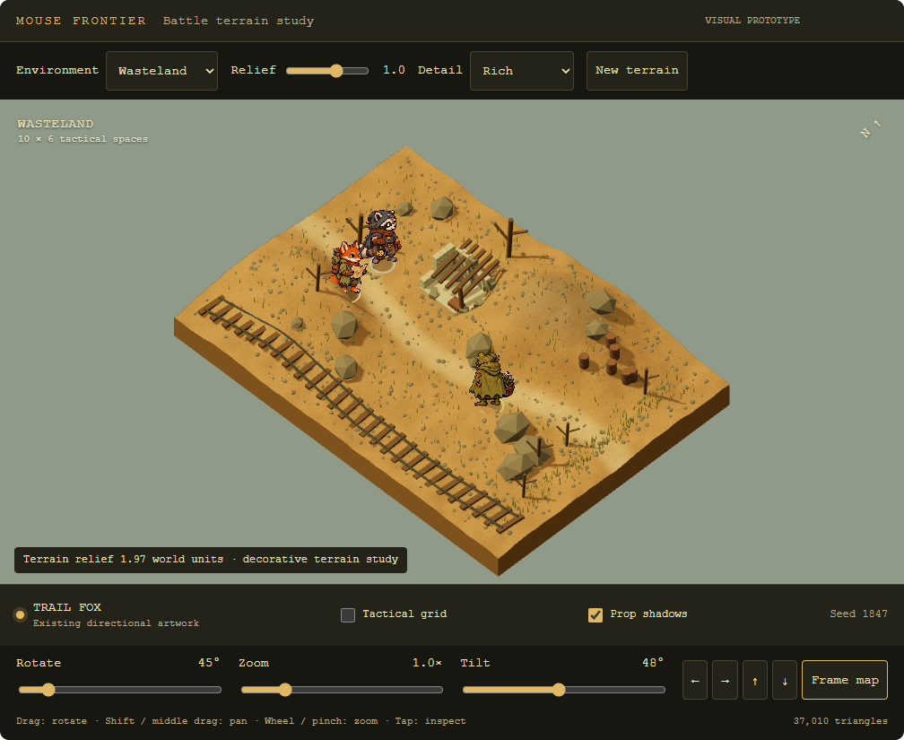
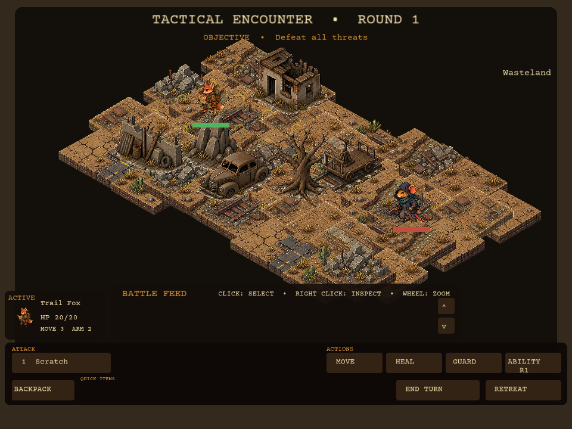
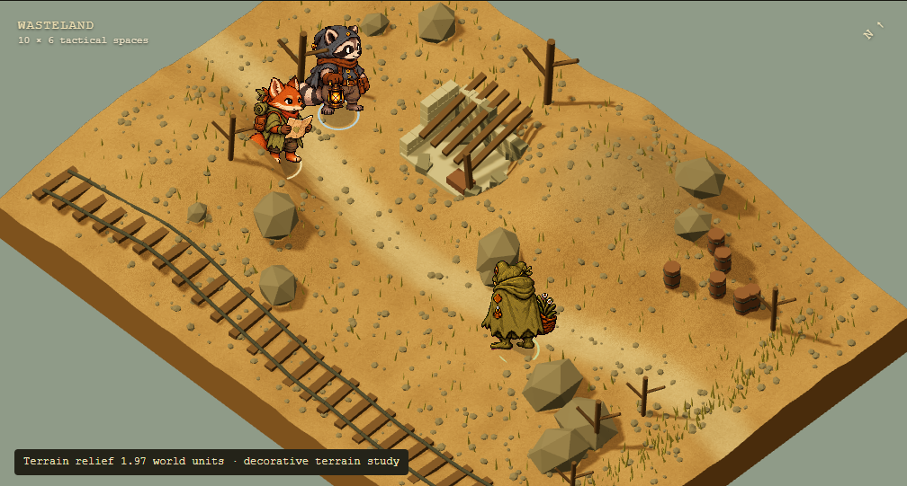
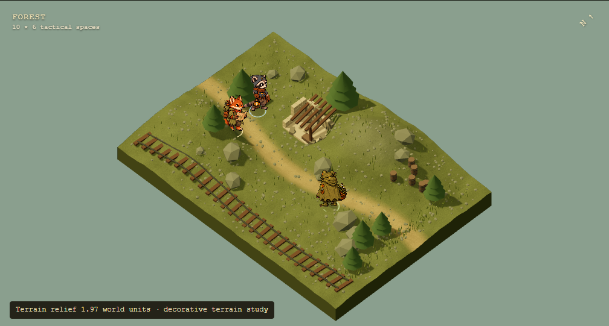

# Battle environment and camera feasibility

October 21, 2026

Mouse Frontier can keep its turn based combat and illustrated critters while gaining a rotating, three dimensional battlefield. The strongest approach is a **hybrid renderer: continuous 3D terrain and solid scenery, with the existing directional character sprites drawn on camera facing planes**. Procedural generation chooses the shape and arrangement of the environment; authored textures and reusable prop pieces supply its visual character.

Keep the present 10 by 6 tactical board for the first implementation. A larger map is unnecessary to make battles easier to see. Give the battlefield more of the window, use a camera that can frame the board or move closer to a unit, and remove the fixed isometric projection from the rendering layer.

The accompanying [interactive terrain study](battle-terrain-lab.html) demonstrates this approach independently of the game. Open it in a browser with an internet connection for its pinned Three.js dependency. It supports rotation through 360 degrees, zoom, pan, terrain inspection, four environments, variable relief, two detail densities, shadows, and deterministic regeneration. Its hills and props are visual examples; it does not implement combat, movement legality, cover, or height based line of sight.



## What the current system already does

The map is already procedural in a limited sense. `Battle.begin` selects terrain types and variants for 60 spaces. `Grid.generateObstacles` arranges five, six, or seven obstacles according to difficulty. The resulting tiles, variants, obstacles, and units are retained in the tactical battle checkpoint.

The limitation is their representation. `Grid.boardToScreen` projects every space onto a single flat diamond layout using fixed X and Y steps. Terrain and obstacle sprites contain an already painted viewpoint. Rotating those images in the screen plane would spin the entire picture; it would not reveal the other side of a rock, wall, or hill.

| Current element | Consequence for the proposed camera |
| --- | --- |
| 10 columns indexed 0 to 9 and 6 rows indexed 1 to 6 | The same logical spaces can remain under a new renderer. |
| Fixed projection at origin 450,92 with steps 48,25 | Replace this screen mapping with a camera projection. |
| Terrain drawn from six-cell atlases at scale 0.30 | Those images are useful style references, but their baked perspective is unsuitable as ordinary 3D ground textures. |
| Obstacles drawn in one pass, then units sorted by q+r | Arbitrary viewing angles require depth testing and coherent geometry. |
| Existing camera scales and translates a 2D surface | Zoom and pan exist today. Orbit, tilt, and terrain picking require a different camera model. |
| Equal-cost breadth-first movement and planar sight checks | These can remain for an initially flat playable board. Meaningful elevation requires shared rule changes. |
| Several critters have authored directional idle and walk views | Existing art can demonstrate rotation now. Full roster and combat-action coverage still need an audit. |

Sources in this checkout: [battle grid](../../../game/battle_grid.lua), [battle UI](../../../game/battle_ui.lua), [battle setup](../../../game/battle_controller.lua), [camera](../../../game/camera.lua), [viewport](../../../game/viewport.lua), [asset loading](../../../game/assets.lua), and [character motion](../../../game/character_motion.lua).

## Use more of the screen

The present battle viewport is clipped to 910 by 396 logical pixels on desktop and 910 by 334 on mobile. Feed, character information, actions, and surrounding margins take the remaining area. The shared stage is 960 by 720, and its general viewport transform preserves that 4:3 aspect ratio. A 1560 by 720 window therefore leaves substantial width outside the stage.



This reference uses the production BattleUI, current terrain and obstacle atlases, a fixed sample encounter, and simplified button drawing and background. It illustrates the default geometry, not a screenshot from a campaign save or a customized UI preset.

The following are **layout targets**, calculated before safe-area and larger-text adjustments. They describe available world-view area, not measured rendering speed or an automatic increase in sprite detail.

| Window or stage | Current battle viewport | Proposed viewport | Share available to the world |
| --- | ---: | ---: | ---: |
| Desktop 960 by 720 | 910 by 396 | 960 by 568 | About 52% to 79% |
| Wide desktop 1560 by 720 | 910 by 396 at the default stage scale | 1560 by 568 | About 32% to 79% |
| Mobile logical stage 960 by 720 | 910 by 334 | 960 by 528 | About 44% to 73% |

The desktop target reserves a 56-pixel header and a 96-pixel action dock. Mobile reserves a 56-pixel header and a 136-pixel dock; actual touch layout must adapt to the device and text size. At 1560 by 720, the proposed viewport has roughly 2.46 times the current available world area. Camera framing must deliberately use that space to enlarge relevant units; viewport area alone does not enlarge them.

Use a short objective and turn indicator at the top, a compact selected-unit summary beside actions at the bottom, and one recent combat result with expandable history. Keep critical actions visible and text at the player's chosen size. Let the map continue behind optional inspection panels. A temporary close view should expose the original sprite detail, with an easy return to the whole board.

The interactive study includes extra generation and camera controls for evaluation. Those development controls are not the proposed permanent battle HUD.

## Compare the rendering approaches

| Approach | Rotation and hills | Art and engineering implications | Assessment |
| --- | --- | --- | --- |
| Enlarge the existing sprite board | Better readability immediately; retains the fixed viewpoint | Smallest change; retains all current scenery | Useful first improvement, but insufficient for the requested camera |
| Paint several angles for every terrain tile and obstacle | Discrete angle changes; many height transitions and seams to author | Asset combinations grow with angle, terrain edge, and elevation | Poor fit for continuous rotation |
| 3D terrain and props with directional critter sprites | Continuous orbit, pan, zoom, and terrain elevation | New environment renderer and reusable prop kit; preserves character artwork and combat model | Recommended |
| Full 3D environment and characters | Broad camera freedom and unified lighting | Character modeling, rigging, animation, and substantial art replacement | Larger project than this battle upgrade requires |

Procedural generation and 3D rendering solve different problems. A hand-built mesh can rotate, and a procedural tile map can remain flat. Here, generation provides variety and terrain structure; geometry provides the camera freedom.

LÖVE supports meshes with custom three-component vertex positions, vertex shaders, and depth testing. Those primitives make a native implementation feasible, but the project would need camera matrices, terrain picking, lighting, and appropriate sprite depth handling. This is an engineering assessment, not a completed native renderer. See the official [mesh API](https://www.love2d.org/wiki/love.graphics.newMesh) and [LÖVE 11.0 graphics additions](https://www.love2d.org/wiki/11.0). An engine migration is unnecessary to evaluate this route and would expand the task into platform, input, networking, asset, and save integration.

## What level of detail is possible

There is no need for the result to look like an untextured block model. The production direction can combine a deliberately simple mesh with dense, carefully matched surface detail.

| Detail layer | Examples for Mouse Frontier | How it contributes |
| --- | --- | --- |
| Terrain shape | Rolling hills, shallow gullies, embankments, cut slopes, broad ramps | Changes silhouette, elevation, and sightlines |
| Ground materials | Cracked dirt, gravel, worn road, leaf litter, scree, moss | Supplies small detail visible when zoomed in |
| Material transitions | Dust against walls, stones exposed on slopes, grass at path edges | Makes the environment continuous instead of a collection of separate plates |
| Solid scenery | Ruined wall sections, vehicles, rock clusters, rail carts, trunks, barricades | Provides readable cover shapes from every angle |
| Small decoration | Pebbles, grass clumps, scrap, broken boards, rail fasteners | Creates local variation without changing combat rules |
| Lighting | Broad sunlight, contact shadows, restrained prop shadows, ambient color | Connects sprites and scenery visually and reveals relief |
| Atmosphere | Distant haze, sparse dust, limited foliage motion | Adds depth while preserving tactical readability |

The study demonstrates the first, fourth, and fifth layers with generated geometry, simple surface noise, and lighting. It uses existing Trail Fox, Watch Raccoon, and Botanist Frog idle art in eight directions. Ground texture and prop surfaces are deliberately basic. The current painted tiles contain richer hand-directed surface information than this first mesh kit; matching that richness needs authored materials and prop textures.



The preferred art target is textured, illustrated scenery with consistent pixel density. Match its palette, edge treatment, and scale to the existing critters. Use nearest filtering for character art and reviewed pixel textures, and keep interface text crisp independently of the scene resolution. Zoom reveals available source detail; it cannot invent detail absent from the artwork. Small moving pixels, excessively sharp shadows, and incompatible texture scales need visual review during camera movement.

A heightfield assigns one terrain height to each horizontal position. It is well suited to hills, slopes, gullies, and terraces. Overhangs, caves, or a bridge with a walkable route underneath require additional meshes and, if traversable, multiple navigation layers. Procedural terrain alone does not supply those systems.

## Generate battlefields with structure

Use seeded generation constrained by encounter design. A different arrangement of random clutter is less useful than a battlefield with a clear route, readable cover, and several tactical choices.

1. Choose a biome and an encounter pattern, such as a rail cutting, ruined crossing, wooded clearing, or rocky pass. Patterns define entry zones, broad routes, and the intended cover distribution.
2. Reserve spawn spaces and primary movement corridors before placing hills or large props.
3. Build a coarse elevation layout, then form a continuous mesh with gentler transitions along routes and explicit ramps between playable levels.
4. Place solid prop pieces according to their footprints, cover categories, and allowed terrain slopes.
5. Validate connectivity, spawn safety, useful firing positions, and access to opponents. Reject unsuitable layouts using a bounded retry process with a known valid fallback.
6. Add decoration using a separate random stream. Changing grass density must not move a blocker or change combat results.

The four route biomes can share the renderer while varying their material palette, terrain profiles, vegetation, and prop families. The study changes palette and some prop treatments across all four; a production generator should also give them distinct encounter patterns. Its present ruin, railway, and actor positions are authored anchors, while hill variation and scattered detail are seeded. It is a mixed procedural demonstration, not a generator for fully validated tactical encounters.



## Keep appearance and combat rules in agreement

Preserve q and r as the identity of a tactical space. Give a space an authoritative elevation and give each neighbor connection a traversal rule. Rendering samples the same terrain surface that movement, unit anchoring, picking, and projectile presentation use.

The current breadth-first search is appropriate for equal-cost movement. If uphill movement costs more, use a weighted search such as Dijkstra's algorithm; if a slope is impassable, remove that connection. A unit's world position follows the permitted route and its height, rather than interpolating through an intervening cliff.

Height-aware sight needs a segment from the attacker's firing height to a point on the target. Check terrain and relevant obstacle volumes along that segment. A hill that visibly obscures a target must have the corresponding rule consequence. Keep aim bonuses, range changes, and uphill penalties as separate design decisions; they do not follow automatically from adding height.

Depth testing handles which geometry appears in front. It does not decide whether an attack is legal. Walls and terrain should obscure units coherently, with a restrained silhouette or cutaway when the selected unit is hidden. The study uses depth testing but has no selected-unit occlusion aid, so scenery can hide a critter while orbiting.

Character direction should be selected from its world heading relative to the camera azimuth. The sprite itself faces the camera and remains anchored at the feet. The study demonstrates eight idle views, yielding a view change every 45 degrees. Rotation of the camera remains continuous. Attack, hit, death, weapon attachment, and every enemy family need their own coverage checks before treating the whole combat roster as rotation ready. Existing baked sprite lighting will also need to be balanced against world lighting.

The prototype uses simple contact discs for characters and shadow maps for solid props. Its camera-facing character planes do not cast articulated character shadows. The general distinction between camera-facing sprites and solid geometry is also documented in the official [Three.js sprite reference](https://threejs.org/docs/pages/Sprite.html). The study's [orthographic camera](https://threejs.org/docs/pages/OrthographicCamera.html) keeps scale independent of distance, which suits board readability.

## Integrate with saves and co-op

The current tactical checkpoint validates the tile arrays, variants, obstacle profiles, units, and board bounds. A production terrain format needs corresponding save validation and migration work. Relevant files are [tactical battle state](../../../game/tactical_battle_state.lua), [save schema](../../../game/save_schema.lua), and the [network state manifest](../../../game/net/state_manifest.lua).

Store the generator version and seed with a compact canonical representation of gameplay geometry: quantized heights, traversal links, and obstacle identities and footprints. The host supplies authoritative battlefield data to co-op guests. Keep camera angle, pan, zoom, and cosmetic density local to each device.

A seed alone is insufficient protection against later generator changes. Existing active battles should retain their canonical geometry when the generator changes. Quantized gameplay values and a specified random generator also avoid platform-dependent changes to legal moves. Do not transmit rendered meshes or thousands of decorative pebbles in battle state; rebuild those locally from the agreed data and cosmetic seed.

## Performance and rollout

Generate terrain once per battle and retain its meshes. Batch repeated decoration, share textures and materials, and limit transparent layers. Start with contact shadows on mobile; add inexpensive prop shadows only where measured device performance permits them. The same gameplay geometry must run on both platforms even when cosmetic density differs.

An initial native experiment could budget roughly 30,000 to 80,000 visible triangles, a small shared texture set, and one bounded shadow map on desktop. These are starting constraints to profile, not established device limits. Measure CPU and GPU frame time, generation latency, memory, and frame pacing on the actual Android target. Browser results do not predict LÖVE performance.

| Stage | Concrete result | Completion criterion |
| --- | --- | --- |
| Expand the viewport | Responsive battle layout and smaller permanent chrome | Core actions and accessible text remain readable; the map uses the window width |
| Prove the native renderer | One flat playable encounter, solid versions of its cover, hills outside the playable board, sprite billboards, orbit, zoom, and pan | Existing combat outcomes remain consistent; all spaces can be picked at several angles and zoom levels |
| Add playable elevation | Shared heights, ramps, weighted movement where needed, terrain-aware sight, and persistent authoritative geometry | Highlights, legal actions, AI, visual occlusion, saves, and co-op agree |
| Expand the environment kit | Authored surfaces and props for all four biomes, constrained generator, cosmetic quality settings | Repeated seeds reproduce valid battles; art and performance pass desktop and physical-device review |

For the first native encounter, keep elevation outside the playable board so the existing flat combat rules remain visually truthful. Introduce hills inside the board together with the rule and persistence changes they require. This lets the camera and art direction be evaluated before changing battle balance.

## Prototype validation and limits

The [validation record](validation.json) contains 14 browser acceptance checks with no JavaScript errors. They cover identical pixels after regenerating the same seed and settings, camera-relative sprite views, rotation, slider and wheel zoom, button and drag pan, transformed terrain picking, variable relief, all four environments, new seeds, layouts at 360 and 320 pixels, and an emulated two-pointer gesture. Desktop, reverse, close, forest, and narrow-layout images were captured; overview, close, forest, and narrow views were visually inspected.

The production BattleUI reference was rendered with installed LÖVE using an in-memory fixture. No campaign saves were opened, migrated, backed up, or wiped. No game runtime, source artwork, dialogue, or combat rules were changed by this study. The browser lab remembers its own viewing choices only through the conversation visualization host when available.

The next useful experiment is the single native LÖVE encounter described above. It will settle renderer integration, actual sprite readability, arbitrary-angle input accuracy, and device cost before committing to a full environment overhaul.

## Reproduce the study

Source and checks are in [tools/battle-environment-study](../../../tools/battle-environment-study). From the project root:

```powershell
python tools/battle-environment-study/build_preview.py
$env:MOUSE_FRONTIER_PROJECT_ROOT=(Get-Location).Path
& 'C:\Program Files\LOVE\lovec.exe' tools/battle-environment-study/capture-current
node tools/battle-environment-study/check_preview.cjs
```

The build step requires Pillow. Browser checks require the Playwright package and installed Chrome; set `NODE_PATH` to the package location when using the bundled runtime, or use a local installation. `MF_TERRAIN_CHROME` can select a different Chrome executable and `MF_TERRAIN_PREVIEW_URL` can select a served preview. The generated preview contains its character images and loads only the pinned Three.js library from jsDelivr.
